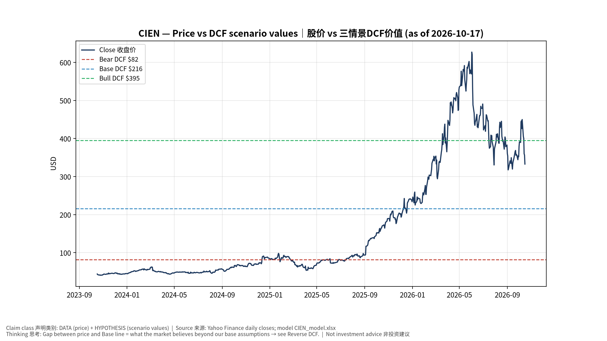
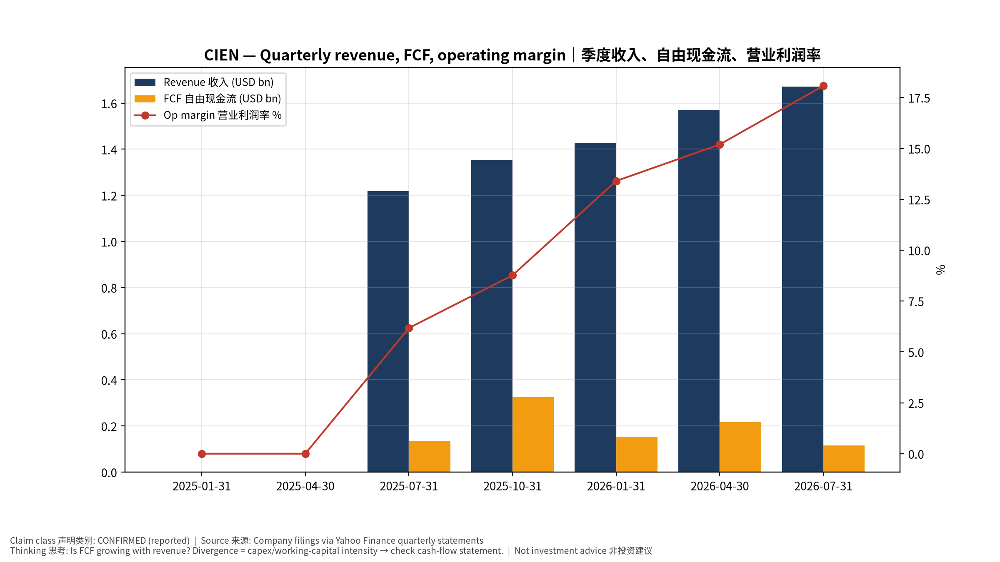
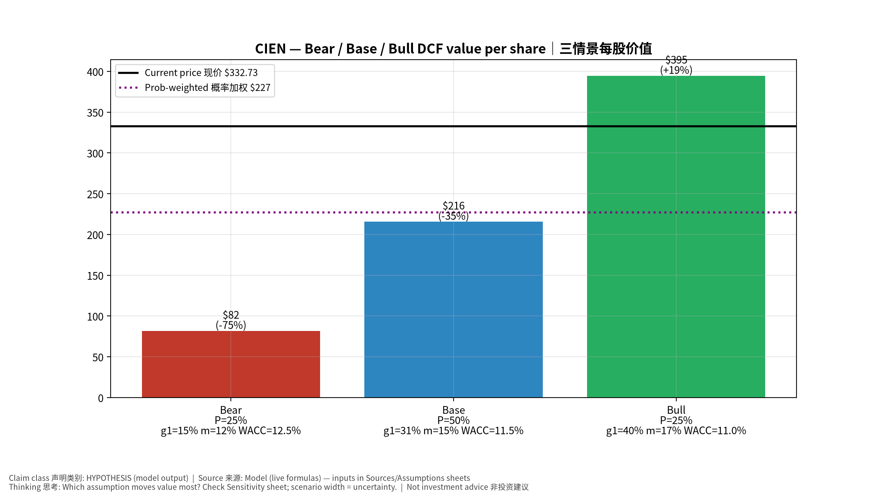
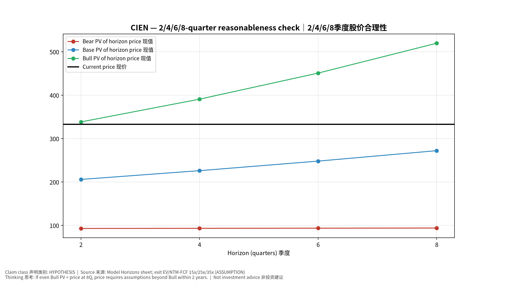
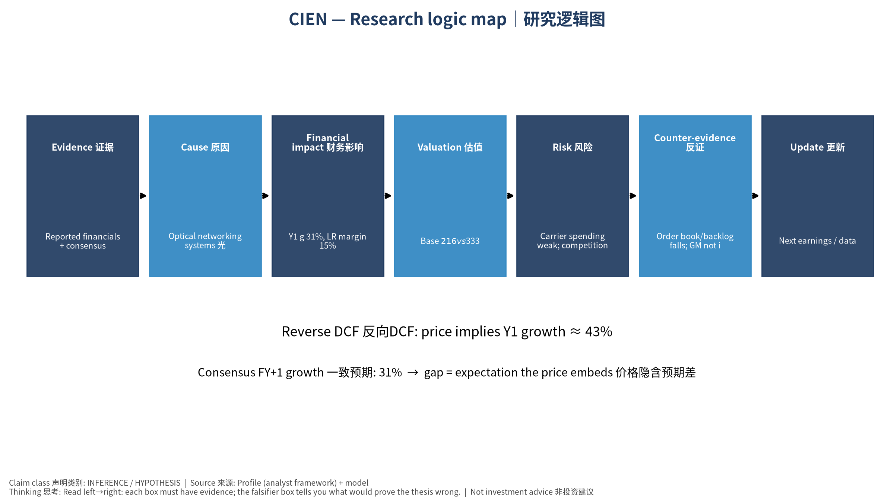

# CIEN Ciena Corporation — 个股深度研究 (专业中文版) v20261017-0755
> 数据截至 2026-10-17 07:55 SGT｜价格 $332.73｜市值 47.2 bn USD｜财报货币 USD｜非投资建议。事实=CONFIRMED/DATA；推断=INFERENCE；假设=ASSUMPTION/HYPOTHESIS。

## 1. 投资论点 Investment Thesis (HYPOTHESIS)
AI训练集群跨园区互连(scale-across)推动Ciena 800G/1.6T相干光需求；从运营商周期股转向云厂成长股。

- **多头驱动**: Hyperscaler >50% of revenue; pluggables and in-DC opportunities｜云厂收入占比超半；可插拔与机房内机会
- **空头驱动**: Carrier spending weak; competition from Nokia/Infinera｜运营商开支疲弱；诺基亚竞争
- **证伪条件 Falsifiers**: Order book/backlog falls; GM not improving｜订单/积压下降；毛利不改善

## 2. 产品、客户与收入模式
- 主题 Theme: Optical networking systems 光网络系统
- 业务分部 Segments: Networking platforms 网络平台；Platform software & services 软件服务；Blue Planet
- 公司描述 (DATA, Yahoo/公司申报): Ciena Corporation, a network technology company, provides hardware, software, and services for various network operators in the Americas, Europe, the Middle East, Africa, the Asia Pacific, Japan, and India. It operates through Networking Platforms, Platform Software and Services, Blue Planet Automation Software and Services, and Global Services segments. The Networking Platforms segment consists optical networking, routing, and switching products and services. This segment products include the 6500 Packet-Optical Platform, Waveserver modular interconnect system, the 6500 Reconfigurable Line System, and coherent pluggable transceivers; and the 3000 family of service delivery platforms and the 5000 family of service aggregation, as well as the 8100 Coherent Routing platforms and virtualization software. The Platform Software and Services segment offers navigator network control suite; and 
- 主要客户: Telecom carriers, hyperscalers (DCI), cable operators｜运营商、云厂(数据中心互连)、有线电视

## 3. 行业、竞争、监管与供应链 (ANALYST FRAMEWORK)
- 供应商/上游: In-house WaveLogic DSP (TSMC), lasers, components｜自研WaveLogic DSP、激光器
- 竞争者 (含业外): Nokia (Infinera), Cisco (Acacia), Huawei, Coherent pluggables｜诺基亚、思科、华为、Coherent
- 瓶颈/监管: Component supply, hyperscaler DCI cycles｜器件供应、云厂DCI周期
- 关键KPI: Revenue, cloud mix, GM%, backlog｜收入、云占比、毛利率、积压
- 零部件现货/合约价: 本版未接入付费价格源(TrendForce/DRAMeXchange等)——标注 **UNAVAILABLE**，在KPI监控中以定性方式跟踪。

## 4. 历史财务与现金流 (CONFIRMED, 季度, USD)
| 季度 | 收入 | 毛利 | 营业利润 | 净利润 | FCF | 营业利润率 |
|---|---|---|---|---|---|---|
| 2026-07-31 | 1.7 bn USD | 0.8 bn USD | 0.3 bn USD | 0.3 bn USD | 0.1 bn USD | 18.1% |
| 2026-04-30 | 1.6 bn USD | 0.7 bn USD | 0.2 bn USD | 0.2 bn USD | 0.2 bn USD | 15.2% |
| 2026-01-31 | 1.4 bn USD | 0.6 bn USD | 0.2 bn USD | 0.2 bn USD | 0.2 bn USD | 13.4% |
| 2025-10-31 | 1.4 bn USD | 0.6 bn USD | 0.1 bn USD | 19.5 mn USD | 0.3 bn USD | 8.8% |
| 2025-07-31 | 1.2 bn USD | 0.5 bn USD | 75.3 mn USD | 50.3 mn USD | 0.1 bn USD | 6.2% |
| 2025-04-30 | N/A | N/A | N/A | N/A | N/A | N/A |
| 2025-01-31 | N/A | N/A | N/A | N/A | N/A | N/A |

资产负债: 现金 2.6 bn USD；总负债 3.3 bn USD；净现金 -0.7 bn USD。TTM FCF 0.8 bn USD（FCF率 13.5%）。

## 5. 最新财报: 实际 vs 一致预期 vs 指引
| 季度 | EPS实际 | EPS一致预期 | 超预期% |
|---|---|---|---|
| 2025-10-31 | 0.91 | 0.76964 | 0.1824 |
| 2026-01-31 | 1.35 | 1.16833 | 0.1555 |
| 2026-04-30 | 1.64 | 1.45989 | 0.1234 |
| 2026-07-31 | 2.11 | 1.72756 | 0.2214 |

- 管理层指引 Guidance: 自动数据源不含指引——**UNAVAILABLE（待从公司IR新闻稿录入）**。
- 下次财报日 (Yahoo, TENTATIVE 直至公司确认): **2026-09-03**；本季EPS一致预期 1.61699（5位分析师）；收入一致预期 1.8 bn USD。

## 6. 未来2/4/6/8季度驱动与价格合理性
| 期限 | 情景 | 期限价格现值 | 相对现价 |
|---|---|---|---|
| 2Q | Bear | $92.98 | -72.1% |
| 2Q | Base | $205.93 | -38.1% |
| 2Q | Bull | $338.43 | 1.7% |
| 4Q | Bear | $93.33 | -72.0% |
| 4Q | Base | $226.11 | -32.0% |
| 4Q | Bull | $390.85 | 17.5% |
| 6Q | Bear | $93.65 | -71.9% |
| 6Q | Base | $248.15 | -25.4% |
| 6Q | Bull | $450.92 | 35.5% |
| 8Q | Bear | $93.95 | -71.8% |
| 8Q | Base | $272.21 | -18.2% |
| 8Q | Bull | $519.75 | 56.2% |

现价隐含的 EV/NTM-FCF (Base 路径): | 期限 | 隐含倍数 |
|---|---|
| 2Q | 38.0x |
| 4Q | 32.8x |
| 6Q | 28.4x |
| 8Q | 24.6x |

解读: 如果8季度后Base情景所需倍数仍远高于25x，说明价格依赖更远期的增长。

## 7. 三情景 Bear / Base / Bull (HYPOTHESIS)
| 情景 | Y1增速 | 长期FCF率 | WACC | 永续g | 概率 | 每股价值 | 相对现价 |
|---|---|---|---|---|---|---|---|
| Bear | 15.5% | 12.0% | 12.5% | 2.5% | 25.0% | $81.90 | -75.4% |
| Base | 30.9% | 15.0% | 11.5% | 3.0% | 50.0% | $215.76 | -35.2% |
| Bull | 40.2% | 17.2% | 11.0% | 3.5% | 25.0% | $394.67 | 18.6% |

概率加权价值 **$227.02**（相对现价 -31.8%）。

## 8. 估值: DCF / Reverse DCF / ROIC-WACC / 同业 / 敏感度
- DCF Base: EV 31.3 bn USD；终值占比 54.4%。
- **Reverse DCF 反向DCF**: 在Base利润率与WACC下，现价隐含Y1收入增速 ≈ **42.9%**；一致预期FY+1增速 30.9%。
- WACC (CAPM) = rf 5.1% + β 1.29 × ERP 5.0% = 11.5%。
- SOTP segments 分部: Networking platforms 网络平台; Platform software & services 软件服务; Blue Planet. **Status: framework only** — segment revenues are INPUT REQUIRED from the latest 10-K/10-Q segment note (not auto-fed, left blank to avoid fabrication)｜分部收入需按最新财报手动录入，未自动填充以避免编造。
- 同业比较 Comps (DATA):
| Ticker | 市值 | EV/Sales | Fwd P/E | 收入增速 | 毛利率 | FCF收益率 |
|---|---|---|---|---|---|---|
| CIEN | 47.2 bn USD | 7.9x | 28.0x | 37.0% | 44.1% | 1.7% |
| COHR | 45.9 bn USD | 6.7x | 16.6x | 33.7% | 37.5% | -1.4% |
| LITE | 74.7 bn USD | 24.2x | 22.9x | 109.3% | 44.2% | 0.3% |
| NOK | 51.2 bn USD | 2.4x | 18.9x | 8.4% | 45.5% | 2.3% |
| CSCO | 423.4 bn USD | 6.9x | 19.1x | 17.6% | 64.5% | 2.6% |

- 敏感度: 见Excel `Sensitivity` 表 (WACC × 永续增长率)。

## 9. 风险、反方论证与证伪
- 反方观点 Counter-thesis: Carrier spending weak; competition from Nokia/Infinera｜运营商开支疲弱；诺基亚竞争
- 证伪指标: Order book/backlog falls; GM not improving｜订单/积压下降；毛利不改善
- 模型风险: 长期利润率与WACC为假设；终值占比高时估值对假设极敏感。

## 10. Source Ledger 来源账本
| Item | Value | Source/time |
|---|---|---|
| Price 股价 | 332.7 | Yahoo Finance quote, fetched 2026-10-17T07:55 SGT |
| Market cap 市值 | 4.718e+10 | Yahoo info.marketCap 2026-10-17T07:55 |
| Cash 现金 | 2.63e+09 | Yahoo info.totalCash (latest filing) 2026-10-17T07:55 |
| Debt 负债 | 3.286e+09 | Yahoo info.totalDebt (latest filing) 2026-10-17T07:55 |
| Revenue TTM 收入 | 6.021e+09 | Yahoo info.totalRevenue (TTM, USD) 2026-10-17T07:55 |
| FCF TTM 自由现金流 | 8.144e+08 | Sum of last 4 quarterly FCF (q_cash); quarters ['2026-07-31', '2026-04-30', '2026-01-31', '2025-10-31'] (USD) |
| Beta | 1.289 | Yahoo info.beta (5Y monthly) |
| Risk-free 10Y 无风险利率 | 0.051 | FRED DGS10 2026-10-15 |
| FX USD per USD | 1 | n/a (USD) |
| Consensus rev growth FY0 | 0.3468 | Yahoo revenue_estimate 0y |
| Consensus rev growth FY+1 | 0.3093 | Yahoo revenue_estimate +1y |

## 11. Assumption Register 假设登记表
| Assumption | Value | Rationale |
|---|---|---|
| ERP 股权风险溢价 | 0.05 | ASSUMPTION: 5.0% house mature-market ERP |
| Beta clamp | [0.8,1.6] → 1.29 | ASSUMPTION: limit extreme betas |
| Tax rate (ROIC) | 0.18 | ASSUMPTION: blended cash tax 18% |
| Year-1 growth (Base) | 0.3093 | Consensus FY+1 revenue growth (Yahoo revenue_estimate '+1y'); capped at 100% |
| Growth fade | linear Y1→terminal by Y10 | ASSUMPTION |
| Starting FCF margin | 0.1353 | DATA: FCF TTM / Revenue TTM, floored -50% |
| Long-run FCF margin (Base) | 0.15 | ASSUMPTION (analyst framework, reached by Y5; see profile) |
| Bear/Bull Y1 growth multiplier | 0.5x / 1.3x | ASSUMPTION |
| Bear/Bull margin multiplier | 0.8x / 1.15x | ASSUMPTION |
| WACC adj Bear/Bull | +1.0pp / -0.5pp | ASSUMPTION |
| Terminal g Bear/Base/Bull | 2.5% / 3.0% / 3.5% | ASSUMPTION |
| Scenario probabilities | 25% / 50% / 25% | ASSUMPTION |
| Horizon exit EV/NTM-FCF Bear/Base/Bull | 15x / 25x / 35x | ASSUMPTION |
| Per-share conversion | value × fx ÷ market cap × price | METHOD: avoids ADR/share-class mismatch |

## 12. Model Provenance 模型溯源
- Model file: `CIEN_model_v20261017-0755.xlsx` (live formulas; sheets Inputs→Scenarios→DCF→ReverseDCF→Sensitivity→Horizons→SOTP→Comps→ROIC_WACC→History→Sources→Assumptions)
- Engine: `production/pipeline/model.py` (Python mirror; values in this report = Python mirror, verified against LibreOffice recalculation of the xlsx)
- Data snapshot: `data/snapshots/20261017-0755` (immutable) | Fetched 2026-10-17 07:55 SGT | Generated 2026-10-17 07:57 SGT
- Version: v20261017-0755. Prior versions are never overwritten (see company history page).

## 13. 版本与事件时间轴
- v20261017-0755: 首版生产系统报告 (27家同步)。下一事件: 财报 2026-09-03 (TENTATIVE)。

## 图片报告 Image Report

*股价vs三情景价值 Price vs scenario values*

*季度财务 Quarterly financials*

*三情景 Scenarios*

*2/4/6/8季度检验 Horizon check*

*研究逻辑图 Logic map*

---

# CIEN Ciena Corporation — Equity Deep Dive (Professional English) v20261017-0755
> Data as of 2026-10-17 07:55 SGT | Price $332.73 | Mkt cap 47.2 bn USD | Reporting currency USD | Not investment advice.

## 1. Investment thesis (HYPOTHESIS)
AI scale-across interconnect between campuses drives demand for Ciena's 800G/1.6T coherent optics, shifting it from a carrier-cycle stock toward a cloud-growth stock.

- **Bull drivers**: Hyperscaler >50% of revenue; pluggables and in-DC opportunities｜云厂收入占比超半；可插拔与机房内机会
- **Bear drivers**: Carrier spending weak; competition from Nokia/Infinera｜运营商开支疲弱；诺基亚竞争
- **Falsifiers**: Order book/backlog falls; GM not improving｜订单/积压下降；毛利不改善

## 2. Products, customers, revenue model
- Theme: Optical networking systems 光网络系统 | Segments: Networking platforms 网络平台; Platform software & services 软件服务; Blue Planet
- Business description (DATA): Ciena Corporation, a network technology company, provides hardware, software, and services for various network operators in the Americas, Europe, the Middle East, Africa, the Asia Pacific, Japan, and India. It operates through Networking Platforms, Platform Software and Services, Blue Planet Automation Software and Services, and Global Services segments. The Networking Platforms segment consists optical networking, routing, and switching products and services. This segment products include the 6500 Packet-Optical Platform, Waveserver modular interconnect system, the 6500 Reconfigurable Line System, and coherent pluggable transceivers; and the 3000 family of service delivery platforms and the 5000 family of service aggregation, as well as the 8100 Coherent Routing platforms and virtualization software. The Platform Software and Services segment offers navigator network control suite; and 
- Customers: Telecom carriers, hyperscalers (DCI), cable operators｜运营商、云厂(数据中心互连)、有线电视

## 3. Industry, competition, regulation, supply chain (ANALYST FRAMEWORK)
- Suppliers: In-house WaveLogic DSP (TSMC), lasers, components｜自研WaveLogic DSP、激光器
- Competitors: Nokia (Infinera), Cisco (Acacia), Huawei, Coherent pluggables｜诺基亚、思科、华为、Coherent
- Bottlenecks/regulation: Component supply, hyperscaler DCI cycles｜器件供应、云厂DCI周期
- KPIs: Revenue, cloud mix, GM%, backlog｜收入、云占比、毛利率、积压
- Component spot/contract prices: paid feeds not connected — **UNAVAILABLE**, tracked qualitatively.

## 4. Historical financials & cash flow (CONFIRMED, quarterly, USD)
| Quarter | Revenue | Gross profit | Op income | Net income | FCF | Op margin |
|---|---|---|---|---|---|---|
| 2026-07-31 | 1.7 bn USD | 0.8 bn USD | 0.3 bn USD | 0.3 bn USD | 0.1 bn USD | 18.1% |
| 2026-04-30 | 1.6 bn USD | 0.7 bn USD | 0.2 bn USD | 0.2 bn USD | 0.2 bn USD | 15.2% |
| 2026-01-31 | 1.4 bn USD | 0.6 bn USD | 0.2 bn USD | 0.2 bn USD | 0.2 bn USD | 13.4% |
| 2025-10-31 | 1.4 bn USD | 0.6 bn USD | 0.1 bn USD | 19.5 mn USD | 0.3 bn USD | 8.8% |
| 2025-07-31 | 1.2 bn USD | 0.5 bn USD | 75.3 mn USD | 50.3 mn USD | 0.1 bn USD | 6.2% |
| 2025-04-30 | N/A | N/A | N/A | N/A | N/A | N/A |
| 2025-01-31 | N/A | N/A | N/A | N/A | N/A | N/A |

Cash 2.6 bn USD; debt 3.3 bn USD; TTM FCF 0.8 bn USD (FCF margin 13.5%).

## 5. Latest earnings: actual vs consensus vs guidance
| Quarter | EPS actual | EPS consensus | Surprise |
|---|---|---|---|
| 2025-10-31 | 0.91 | 0.76964 | 0.1824 |
| 2026-01-31 | 1.35 | 1.16833 | 0.1555 |
| 2026-04-30 | 1.64 | 1.45989 | 0.1234 |
| 2026-07-31 | 2.11 | 1.72756 | 0.2214 |

- Management guidance: not in automated feed — **UNAVAILABLE (to be entered from IR release)**.
- Next earnings (Yahoo; TENTATIVE until company-confirmed): **2026-09-03**; current-quarter EPS consensus 1.61699 (5 analysts); revenue consensus 1.8 bn USD.

## 6. 2/4/6/8-quarter drivers & price reasonableness
| Horizon | Scenario | PV of horizon price | vs current |
|---|---|---|---|
| 2Q | Bear | $92.98 | -72.1% |
| 2Q | Base | $205.93 | -38.1% |
| 2Q | Bull | $338.43 | 1.7% |
| 4Q | Bear | $93.33 | -72.0% |
| 4Q | Base | $226.11 | -32.0% |
| 4Q | Bull | $390.85 | 17.5% |
| 6Q | Bear | $93.65 | -71.9% |
| 6Q | Base | $248.15 | -25.4% |
| 6Q | Bull | $450.92 | 35.5% |
| 8Q | Bear | $93.95 | -71.8% |
| 8Q | Base | $272.21 | -18.2% |
| 8Q | Bull | $519.75 | 56.2% |

Current-price implied EV/NTM-FCF on Base path: | Horizon | Implied multiple |
|---|---|
| 2Q | 38.0x |
| 4Q | 32.8x |
| 6Q | 28.4x |
| 8Q | 24.6x |

## 7. Bear / Base / Bull (HYPOTHESIS)
| Scenario | Y1 growth | LR FCF margin | WACC | Terminal g | Prob. | Value/share | vs price |
|---|---|---|---|---|---|---|---|
| Bear | 15.5% | 12.0% | 12.5% | 2.5% | 25.0% | $81.90 | -75.4% |
| Base | 30.9% | 15.0% | 11.5% | 3.0% | 50.0% | $215.76 | -35.2% |
| Bull | 40.2% | 17.2% | 11.0% | 3.5% | 25.0% | $394.67 | 18.6% |

Probability-weighted value **$227.02** (-31.8% vs price).

## 8. Valuation: DCF / Reverse DCF / ROIC-WACC / comps / sensitivity
- Base DCF EV 31.3 bn USD; terminal share 54.4%.
- **Reverse DCF**: at Base margin/WACC the price implies Y1 revenue growth ≈ **42.9%** vs consensus FY+1 30.9%.
- WACC (CAPM) = rf 5.1% + β 1.29 × ERP 5.0% = 11.5%.
- SOTP segments: Networking platforms 网络平台; Platform software & services 软件服务; Blue Planet — framework only; segment revenue inputs pending from filings.
- Comps (DATA): see table in Chinese section / Excel `Comps`.
- Sensitivity: Excel `Sensitivity` (WACC × terminal g).

## 9. Risks, counterarguments, falsifiers
Carrier spending weak; competition from Nokia/Infinera｜运营商开支疲弱；诺基亚竞争 | Falsifiers: Order book/backlog falls; GM not improving｜订单/积压下降；毛利不改善

## 10–12. Source Ledger / Assumption Register / Model Provenance
See tables above (shared, bilingual). - Model file: `CIEN_model_v20261017-0755.xlsx` (live formulas; sheets Inputs→Scenarios→DCF→ReverseDCF→Sensitivity→Horizons→SOTP→Comps→ROIC_WACC→History→Sources→Assumptions)
- Engine: `production/pipeline/model.py` (Python mirror; values in this report = Python mirror, verified against LibreOffice recalculation of the xlsx)
- Data snapshot: `data/snapshots/20261017-0755` (immutable) | Fetched 2026-10-17 07:55 SGT | Generated 2026-10-17 07:57 SGT
- Version: v20261017-0755. Prior versions are never overwritten (see company history page).
