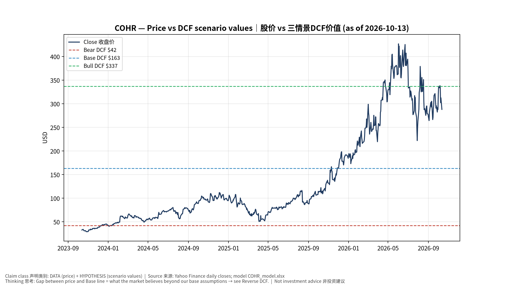
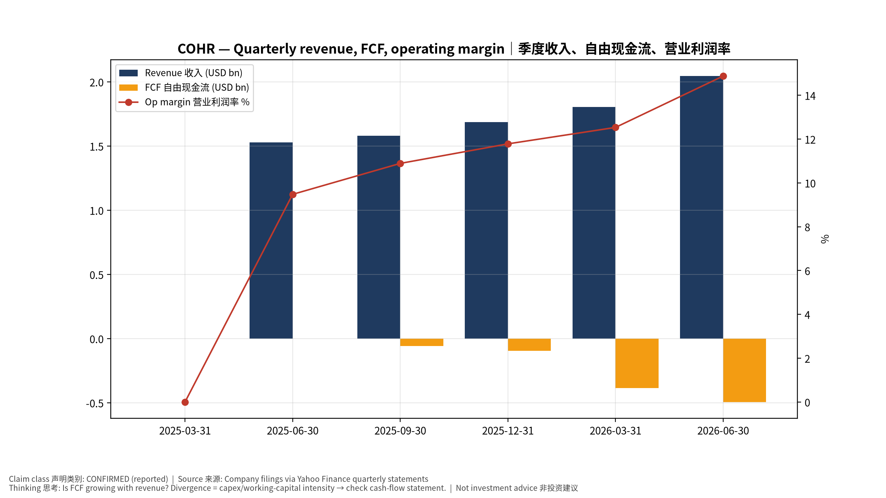
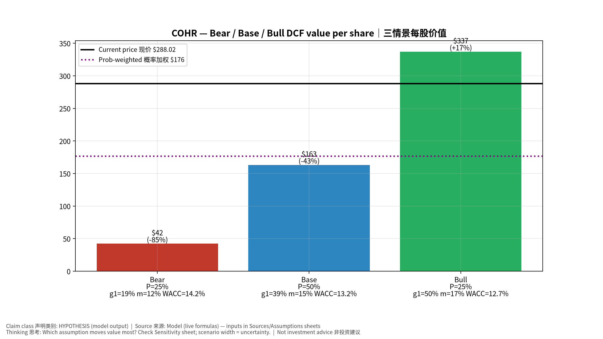
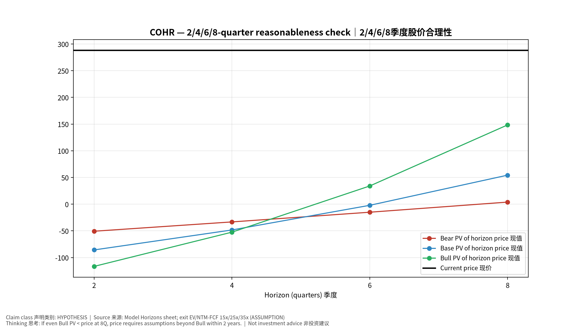
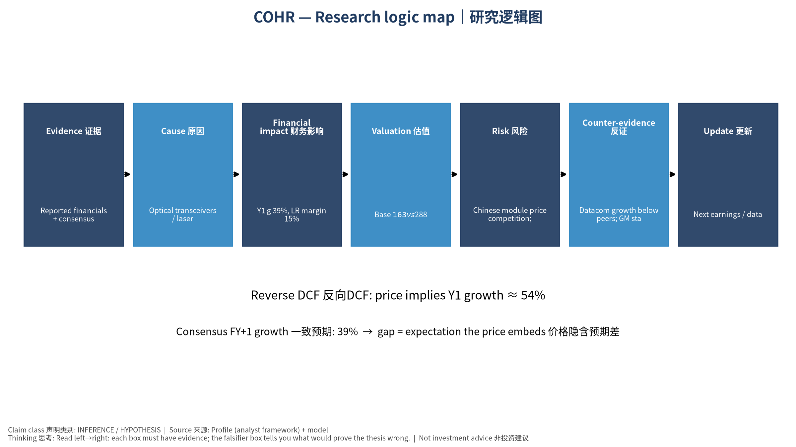

# COHR Coherent Corp. — 个股深度研究 (专业中文版) v20261013-1622
> 数据截至 2026-10-13 16:22 SGT｜价格 $288.02｜市值 56.7 bn USD｜财报货币 USD｜非投资建议。事实=CONFIRMED/DATA；推断=INFERENCE；假设=ASSUMPTION/HYPOTHESIS。

## 1. 投资论点 Investment Thesis (HYPOTHESIS)
Coherent是垂直整合的光模块+激光器厂，受益于800G/1.6T与CPO；重整资产(剥离非核心)与提升毛利是重估关键。注意：最新FCF为负(数据期间)。

- **多头驱动**: 1.6T share gains; InP capacity doubles; GM >40%｜1.6T份额提升；InP产能倍增；毛利率>40%
- **空头驱动**: Chinese module price competition; industrial weakness; debt｜中国模块价格战；工业疲弱；负债
- **证伪条件 Falsifiers**: Datacom growth below peers; GM stalls｜数通增速落后同业；毛利停滞

## 2. 产品、客户与收入模式
- 主题 Theme: Optical transceivers / lasers / materials 光模块/激光/材料
- 业务分部 Segments: Datacom transceivers 数通光模块；Telecom 电信；Industrial lasers & materials (SiC) 工业激光与材料
- 公司描述 (DATA, Yahoo/公司申报): Coherent Corp. develops, manufactures, and markets lasers, transceivers, other optical and optoelectronic devices, modules, and systems worldwide. Its products include critical components consisting of detectors, passive optics, thermal solutions, and PICS; silicon photonics and other advanced optical technologies; and coherent transmission components, transport products, optical amplifiers, passive optical components, optical line systems, and multi-rail platform. The company's Datacenter and Communications segment offers transceivers, co-packaged optics, and optical circuit switches, as well as other systems, such as subsystems, modules, and semiconductor devices for datacenter and communications applications; and VCSELS, EELS, pump lasers, and other components, optics, and ICs for datacenter and communication applications. Its Industrial segment offers excimer lasers, solid-state lase
- 主要客户: NVDA, hyperscalers, telecom OEMs, industrial users｜NVDA、云厂、电信设备商、工业客户

## 3. 行业、竞争、监管与供应链 (ANALYST FRAMEWORK)
- 供应商/上游: InP/GaAs epi (in-house), DSPs (MRVL/AVGO)｜自有磷化铟/砷化镓外延、DSP(MRVL/AVGO)
- 竞争者 (含业外): Innolight, Eoptolink, Lumentum, Fabrinet-built modules｜中际旭创、新易盛、Lumentum
- 瓶颈/监管: 6-inch InP capacity, DSP supply, 1.6T ramp｜6寸InP产能、DSP供应、1.6T爬坡
- 关键KPI: Datacom revenue, GM%, InP capacity, net debt｜数通收入、毛利率、InP产能、净负债
- 零部件现货/合约价: 本版未接入付费价格源(TrendForce/DRAMeXchange等)——标注 **UNAVAILABLE**，在KPI监控中以定性方式跟踪。

## 4. 历史财务与现金流 (CONFIRMED, 季度, USD)
| 季度 | 收入 | 毛利 | 营业利润 | 净利润 | FCF | 营业利润率 |
|---|---|---|---|---|---|---|
| 2026-06-30 | 2.0 bn USD | 0.8 bn USD | 0.3 bn USD | 0.2 bn USD | -0.5 bn USD | 14.9% |
| 2026-03-31 | 1.8 bn USD | 0.7 bn USD | 0.2 bn USD | 0.2 bn USD | -0.4 bn USD | 12.5% |
| 2025-12-31 | 1.7 bn USD | 0.6 bn USD | 0.2 bn USD | 0.1 bn USD | -95.7 mn USD | 11.8% |
| 2025-09-30 | 1.6 bn USD | 0.6 bn USD | 0.2 bn USD | 0.2 bn USD | -58.0 mn USD | 10.9% |
| 2025-06-30 | 1.5 bn USD | 0.5 bn USD | 0.1 bn USD | -95.6 mn USD | -1.1 mn USD | 9.5% |
| 2025-03-31 | N/A | N/A | N/A | N/A | N/A | N/A |

资产负债: 现金 2.0 bn USD；总负债 3.6 bn USD；净现金 -1.6 bn USD。TTM FCF -1.0 bn USD（FCF率 -14.5%）。

## 5. 最新财报: 实际 vs 一致预期 vs 指引
| 季度 | EPS实际 | EPS一致预期 | 超预期% |
|---|---|---|---|
| 2025-09-30 | 1.16 | 1.04249 | 0.11270001 |
| 2025-12-31 | 1.29 | 1.20766 | 0.0682 |
| 2026-03-31 | 1.41 | 1.39433 | 0.0112 |
| 2026-06-30 | 1.74 | 1.61709 | 0.076 |

- 管理层指引 Guidance: 自动数据源不含指引——**UNAVAILABLE（待从公司IR新闻稿录入）**。
- 下次财报日 (Yahoo, TENTATIVE 直至公司确认): **2026-11-05**；本季EPS一致预期 1.96331（20位分析师）；收入一致预期 2.3 bn USD。

## 6. 未来2/4/6/8季度驱动与价格合理性
| 期限 | 情景 | 期限价格现值 | 相对现价 |
|---|---|---|---|
| 2Q | Bear | $-50.69 | -117.6% |
| 2Q | Base | $-85.74 | -129.8% |
| 2Q | Bull | $-116.58 | -140.5% |
| 4Q | Bear | $-33.26 | -111.5% |
| 4Q | Base | $-48.35 | -116.8% |
| 4Q | Bull | $-52.46 | -118.2% |
| 6Q | Bear | $-15.08 | -105.2% |
| 6Q | Base | $-2.14 | -100.7% |
| 6Q | Bull | $34.08 | -88.2% |
| 8Q | Bear | $3.89 | -98.6% |
| 8Q | Base | $54.35 | -81.1% |
| 8Q | Bull | $148.46 | -48.5% |

现价隐含的 EV/NTM-FCF (Base 路径): | 期限 | 隐含倍数 |
|---|---|
| 2Q | n/m (neg FCF) |
| 4Q | n/m (neg FCF) |
| 6Q | 1381.1x |
| 8Q | 95.3x |

解读: 如果8季度后Base情景所需倍数仍远高于25x，说明价格依赖更远期的增长。

## 7. 三情景 Bear / Base / Bull (HYPOTHESIS)
| 情景 | Y1增速 | 长期FCF率 | WACC | 永续g | 概率 | 每股价值 | 相对现价 |
|---|---|---|---|---|---|---|---|
| Bear | 19.4% | 12.0% | 14.2% | 2.5% | 25.0% | $42.29 | -85.3% |
| Base | 38.8% | 15.0% | 13.2% | 3.0% | 50.0% | $163.25 | -43.3% |
| Bull | 50.5% | 17.2% | 12.7% | 3.5% | 25.0% | $337.11 | 17.0% |

概率加权价值 **$176.47**（相对现价 -38.7%）。

## 8. 估值: DCF / Reverse DCF / ROIC-WACC / 同业 / 敏感度
- DCF Base: EV 33.7 bn USD；终值占比 58.9%。
- **Reverse DCF 反向DCF**: 在Base利润率与WACC下，现价隐含Y1收入增速 ≈ **53.8%**；一致预期FY+1增速 38.8%。
- WACC (CAPM) = rf 5.2% + β 1.60 × ERP 5.0% = 13.2%。
- SOTP segments 分部: Datacom transceivers 数通光模块; Telecom 电信; Industrial lasers & materials (SiC) 工业激光与材料. **Status: framework only** — segment revenues are INPUT REQUIRED from the latest 10-K/10-Q segment note (not auto-fed, left blank to avoid fabrication)｜分部收入需按最新财报手动录入，未自动填充以避免编造。
- 同业比较 Comps (DATA):
| Ticker | 市值 | EV/Sales | Fwd P/E | 收入增速 | 毛利率 | FCF收益率 |
|---|---|---|---|---|---|---|
| COHR | 56.7 bn USD | 8.2x | 20.5x | 33.7% | 37.5% | -1.8% |
| LITE | 90.2 bn USD | 29.3x | 28.0x | 109.3% | 44.2% | 0.2% |
| CIEN | 57.4 bn USD | 9.6x | 34.2x | 37.0% | 44.1% | 1.1% |
| FN | 16.4 bn USD | 3.3x | 20.9x | 44.6% | 12.0% | -0.4% |
| AAOI | 8.5 bn USD | 14.0x | 21.9x | 86.4% | 28.9% | -10.4% |

- 敏感度: 见Excel `Sensitivity` 表 (WACC × 永续增长率)。

## 9. 风险、反方论证与证伪
- 反方观点 Counter-thesis: Chinese module price competition; industrial weakness; debt｜中国模块价格战；工业疲弱；负债
- 证伪指标: Datacom growth below peers; GM stalls｜数通增速落后同业；毛利停滞
- 模型风险: 长期利润率与WACC为假设；终值占比高时估值对假设极敏感。

## 10. Source Ledger 来源账本
| Item | Value | Source/time |
|---|---|---|
| Price 股价 | 288 | Yahoo Finance quote, fetched 2026-10-13T16:22 SGT |
| Market cap 市值 | 5.672e+10 | Yahoo info.marketCap 2026-10-13T16:22 |
| Cash 现金 | 1.99e+09 | Yahoo info.totalCash (latest filing) 2026-10-13T16:22 |
| Debt 负债 | 3.553e+09 | Yahoo info.totalDebt (latest filing) 2026-10-13T16:22 |
| Revenue TTM 收入 | 7.118e+09 | Yahoo info.totalRevenue (TTM, USD) 2026-10-13T16:22 |
| FCF TTM 自由现金流 | -1.031e+09 | Sum of last 4 quarterly FCF (q_cash); quarters ['2026-06-30', '2026-03-31', '2025-12-31', '2025-09-30'] (USD) |
| Beta | 2.113 | Yahoo info.beta (5Y monthly) |
| Risk-free 10Y 无风险利率 | 0.0522 | FRED DGS10 2026-10-08 |
| FX USD per USD | 1 | n/a (USD) |
| Consensus rev growth FY0 | 0.4933 | Yahoo revenue_estimate 0y |
| Consensus rev growth FY+1 | 0.3884 | Yahoo revenue_estimate +1y |

## 11. Assumption Register 假设登记表
| Assumption | Value | Rationale |
|---|---|---|
| ERP 股权风险溢价 | 0.05 | ASSUMPTION: 5.0% house mature-market ERP |
| Beta clamp | [0.8,1.6] → 1.60 | ASSUMPTION: limit extreme betas |
| Tax rate (ROIC) | 0.18 | ASSUMPTION: blended cash tax 18% |
| Year-1 growth (Base) | 0.3884 | Consensus FY+1 revenue growth (Yahoo revenue_estimate '+1y'); capped at 100% |
| Growth fade | linear Y1→terminal by Y10 | ASSUMPTION |
| Starting FCF margin | -0.1448 | DATA: FCF TTM / Revenue TTM, floored -50% |
| Long-run FCF margin (Base) | 0.15 | ASSUMPTION (analyst framework, reached by Y5; see profile) |
| Bear/Bull Y1 growth multiplier | 0.5x / 1.3x | ASSUMPTION |
| Bear/Bull margin multiplier | 0.8x / 1.15x | ASSUMPTION |
| WACC adj Bear/Bull | +1.0pp / -0.5pp | ASSUMPTION |
| Terminal g Bear/Base/Bull | 2.5% / 3.0% / 3.5% | ASSUMPTION |
| Scenario probabilities | 25% / 50% / 25% | ASSUMPTION |
| Horizon exit EV/NTM-FCF Bear/Base/Bull | 15x / 25x / 35x | ASSUMPTION |
| Per-share conversion | value × fx ÷ market cap × price | METHOD: avoids ADR/share-class mismatch |

## 12. Model Provenance 模型溯源
- Model file: `COHR_model_v20261013-1622.xlsx` (live formulas; sheets Inputs→Scenarios→DCF→ReverseDCF→Sensitivity→Horizons→SOTP→Comps→ROIC_WACC→History→Sources→Assumptions)
- Engine: `production/pipeline/model.py` (Python mirror; values in this report = Python mirror, verified against LibreOffice recalculation of the xlsx)
- Data snapshot: `data/snapshots/20261013-1622` (immutable) | Fetched 2026-10-13 16:22 SGT | Generated 2026-10-13 16:23 SGT
- Version: v20261013-1622. Prior versions are never overwritten (see company history page).

## 13. 版本与事件时间轴
- v20261013-1622: 首版生产系统报告 (27家同步)。下一事件: 财报 2026-11-05 (TENTATIVE)。

## 图片报告 Image Report

*股价vs三情景价值 Price vs scenario values*

*季度财务 Quarterly financials*

*三情景 Scenarios*

*2/4/6/8季度检验 Horizon check*

*研究逻辑图 Logic map*

---

# COHR Coherent Corp. — Equity Deep Dive (Professional English) v20261013-1622
> Data as of 2026-10-13 16:22 SGT | Price $288.02 | Mkt cap 56.7 bn USD | Reporting currency USD | Not investment advice.

## 1. Investment thesis (HYPOTHESIS)
Coherent is a vertically integrated transceiver + laser maker benefiting from 800G/1.6T and CPO; portfolio pruning and gross-margin expansion are the rerating keys. Note: latest FCF is negative (data period).

- **Bull drivers**: 1.6T share gains; InP capacity doubles; GM >40%｜1.6T份额提升；InP产能倍增；毛利率>40%
- **Bear drivers**: Chinese module price competition; industrial weakness; debt｜中国模块价格战；工业疲弱；负债
- **Falsifiers**: Datacom growth below peers; GM stalls｜数通增速落后同业；毛利停滞

## 2. Products, customers, revenue model
- Theme: Optical transceivers / lasers / materials 光模块/激光/材料 | Segments: Datacom transceivers 数通光模块; Telecom 电信; Industrial lasers & materials (SiC) 工业激光与材料
- Business description (DATA): Coherent Corp. develops, manufactures, and markets lasers, transceivers, other optical and optoelectronic devices, modules, and systems worldwide. Its products include critical components consisting of detectors, passive optics, thermal solutions, and PICS; silicon photonics and other advanced optical technologies; and coherent transmission components, transport products, optical amplifiers, passive optical components, optical line systems, and multi-rail platform. The company's Datacenter and Communications segment offers transceivers, co-packaged optics, and optical circuit switches, as well as other systems, such as subsystems, modules, and semiconductor devices for datacenter and communications applications; and VCSELS, EELS, pump lasers, and other components, optics, and ICs for datacenter and communication applications. Its Industrial segment offers excimer lasers, solid-state lase
- Customers: NVDA, hyperscalers, telecom OEMs, industrial users｜NVDA、云厂、电信设备商、工业客户

## 3. Industry, competition, regulation, supply chain (ANALYST FRAMEWORK)
- Suppliers: InP/GaAs epi (in-house), DSPs (MRVL/AVGO)｜自有磷化铟/砷化镓外延、DSP(MRVL/AVGO)
- Competitors: Innolight, Eoptolink, Lumentum, Fabrinet-built modules｜中际旭创、新易盛、Lumentum
- Bottlenecks/regulation: 6-inch InP capacity, DSP supply, 1.6T ramp｜6寸InP产能、DSP供应、1.6T爬坡
- KPIs: Datacom revenue, GM%, InP capacity, net debt｜数通收入、毛利率、InP产能、净负债
- Component spot/contract prices: paid feeds not connected — **UNAVAILABLE**, tracked qualitatively.

## 4. Historical financials & cash flow (CONFIRMED, quarterly, USD)
| Quarter | Revenue | Gross profit | Op income | Net income | FCF | Op margin |
|---|---|---|---|---|---|---|
| 2026-06-30 | 2.0 bn USD | 0.8 bn USD | 0.3 bn USD | 0.2 bn USD | -0.5 bn USD | 14.9% |
| 2026-03-31 | 1.8 bn USD | 0.7 bn USD | 0.2 bn USD | 0.2 bn USD | -0.4 bn USD | 12.5% |
| 2025-12-31 | 1.7 bn USD | 0.6 bn USD | 0.2 bn USD | 0.1 bn USD | -95.7 mn USD | 11.8% |
| 2025-09-30 | 1.6 bn USD | 0.6 bn USD | 0.2 bn USD | 0.2 bn USD | -58.0 mn USD | 10.9% |
| 2025-06-30 | 1.5 bn USD | 0.5 bn USD | 0.1 bn USD | -95.6 mn USD | -1.1 mn USD | 9.5% |
| 2025-03-31 | N/A | N/A | N/A | N/A | N/A | N/A |

Cash 2.0 bn USD; debt 3.6 bn USD; TTM FCF -1.0 bn USD (FCF margin -14.5%).

## 5. Latest earnings: actual vs consensus vs guidance
| Quarter | EPS actual | EPS consensus | Surprise |
|---|---|---|---|
| 2025-09-30 | 1.16 | 1.04249 | 0.11270001 |
| 2025-12-31 | 1.29 | 1.20766 | 0.0682 |
| 2026-03-31 | 1.41 | 1.39433 | 0.0112 |
| 2026-06-30 | 1.74 | 1.61709 | 0.076 |

- Management guidance: not in automated feed — **UNAVAILABLE (to be entered from IR release)**.
- Next earnings (Yahoo; TENTATIVE until company-confirmed): **2026-11-05**; current-quarter EPS consensus 1.96331 (20 analysts); revenue consensus 2.3 bn USD.

## 6. 2/4/6/8-quarter drivers & price reasonableness
| Horizon | Scenario | PV of horizon price | vs current |
|---|---|---|---|
| 2Q | Bear | $-50.69 | -117.6% |
| 2Q | Base | $-85.74 | -129.8% |
| 2Q | Bull | $-116.58 | -140.5% |
| 4Q | Bear | $-33.26 | -111.5% |
| 4Q | Base | $-48.35 | -116.8% |
| 4Q | Bull | $-52.46 | -118.2% |
| 6Q | Bear | $-15.08 | -105.2% |
| 6Q | Base | $-2.14 | -100.7% |
| 6Q | Bull | $34.08 | -88.2% |
| 8Q | Bear | $3.89 | -98.6% |
| 8Q | Base | $54.35 | -81.1% |
| 8Q | Bull | $148.46 | -48.5% |

Current-price implied EV/NTM-FCF on Base path: | Horizon | Implied multiple |
|---|---|
| 2Q | n/m (neg FCF) |
| 4Q | n/m (neg FCF) |
| 6Q | 1381.1x |
| 8Q | 95.3x |

## 7. Bear / Base / Bull (HYPOTHESIS)
| Scenario | Y1 growth | LR FCF margin | WACC | Terminal g | Prob. | Value/share | vs price |
|---|---|---|---|---|---|---|---|
| Bear | 19.4% | 12.0% | 14.2% | 2.5% | 25.0% | $42.29 | -85.3% |
| Base | 38.8% | 15.0% | 13.2% | 3.0% | 50.0% | $163.25 | -43.3% |
| Bull | 50.5% | 17.2% | 12.7% | 3.5% | 25.0% | $337.11 | 17.0% |

Probability-weighted value **$176.47** (-38.7% vs price).

## 8. Valuation: DCF / Reverse DCF / ROIC-WACC / comps / sensitivity
- Base DCF EV 33.7 bn USD; terminal share 58.9%.
- **Reverse DCF**: at Base margin/WACC the price implies Y1 revenue growth ≈ **53.8%** vs consensus FY+1 38.8%.
- WACC (CAPM) = rf 5.2% + β 1.60 × ERP 5.0% = 13.2%.
- SOTP segments: Datacom transceivers 数通光模块; Telecom 电信; Industrial lasers & materials (SiC) 工业激光与材料 — framework only; segment revenue inputs pending from filings.
- Comps (DATA): see table in Chinese section / Excel `Comps`.
- Sensitivity: Excel `Sensitivity` (WACC × terminal g).

## 9. Risks, counterarguments, falsifiers
Chinese module price competition; industrial weakness; debt｜中国模块价格战；工业疲弱；负债 | Falsifiers: Datacom growth below peers; GM stalls｜数通增速落后同业；毛利停滞

## 10–12. Source Ledger / Assumption Register / Model Provenance
See tables above (shared, bilingual). - Model file: `COHR_model_v20261013-1622.xlsx` (live formulas; sheets Inputs→Scenarios→DCF→ReverseDCF→Sensitivity→Horizons→SOTP→Comps→ROIC_WACC→History→Sources→Assumptions)
- Engine: `production/pipeline/model.py` (Python mirror; values in this report = Python mirror, verified against LibreOffice recalculation of the xlsx)
- Data snapshot: `data/snapshots/20261013-1622` (immutable) | Fetched 2026-10-13 16:22 SGT | Generated 2026-10-13 16:23 SGT
- Version: v20261013-1622. Prior versions are never overwritten (see company history page).
