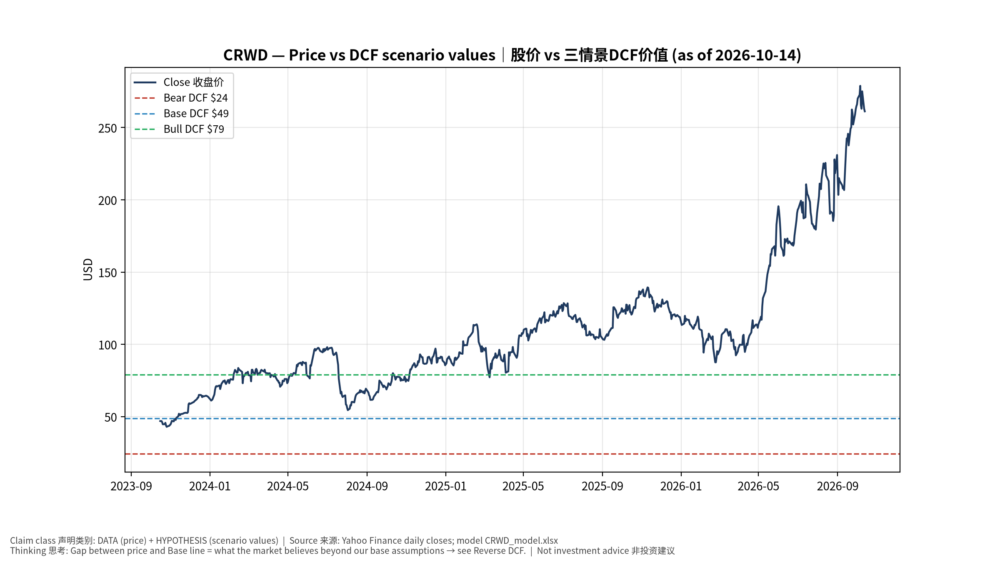
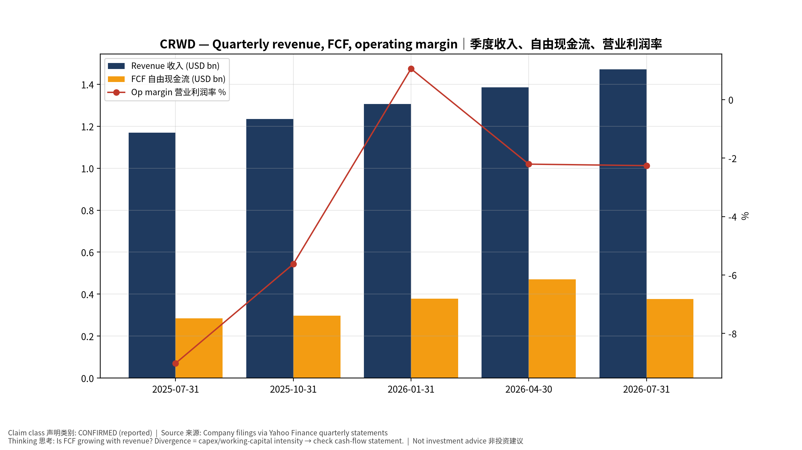
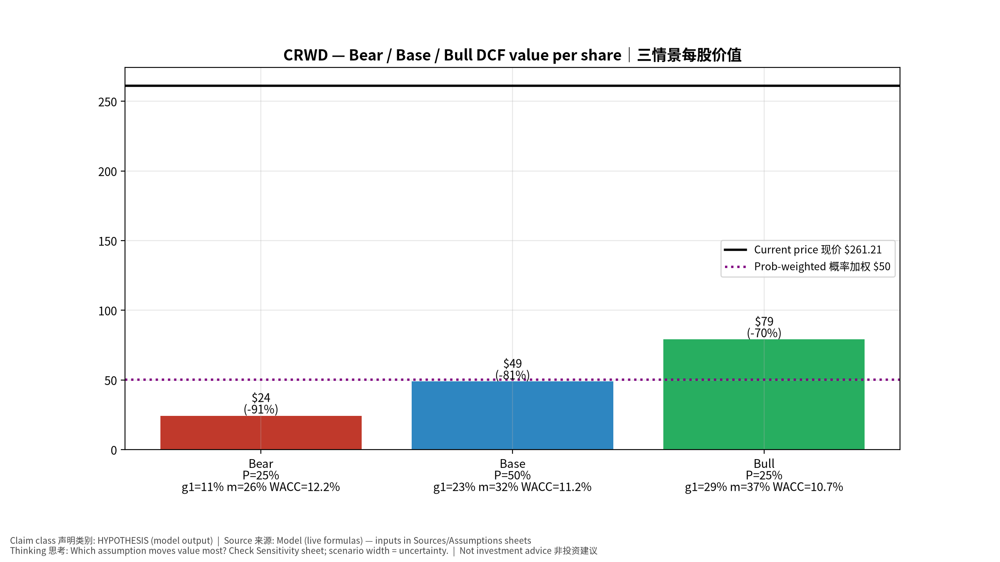
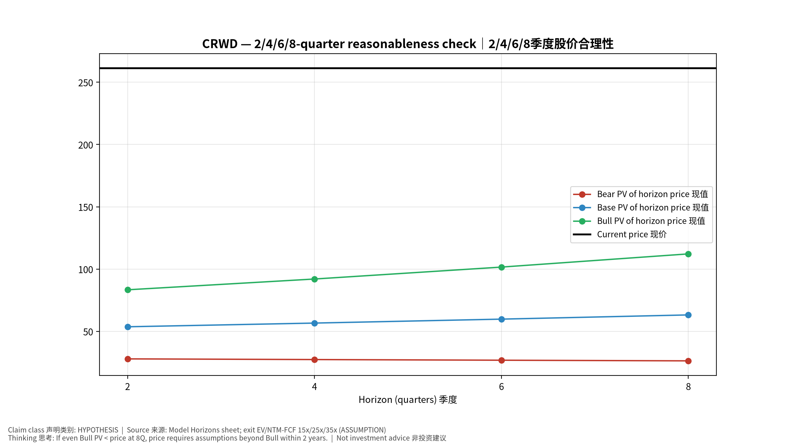
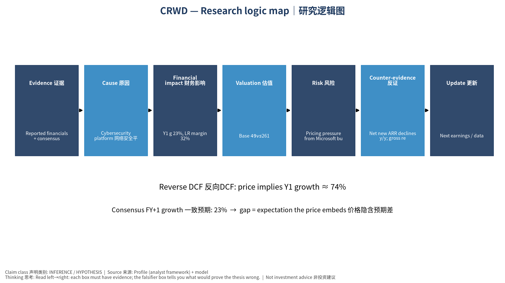

# CRWD CrowdStrike Holdings, Inc. — 个股深度研究 (专业中文版) v20261014-0758
> 数据截至 2026-10-14 07:58 SGT｜价格 $261.21｜市值 267.5 bn USD｜财报货币 USD｜非投资建议。事实=CONFIRMED/DATA；推断=INFERENCE；假设=ASSUMPTION/HYPOTHESIS。

## 1. 投资论点 Investment Thesis (HYPOTHESIS)
CrowdStrike是安全平台整合者，Falcon Flex推动多模块采用；AI Agent带来新的身份/数据安全需求。

- **多头驱动**: Net new ARR reaccelerates; Flex converts; FCF margin >30%｜净新增ARR再加速；Flex转化；FCF利润率>30%
- **空头驱动**: Pricing pressure from Microsoft bundling; outage-type reputational events｜微软捆绑压价；宕机类声誉事件
- **证伪条件 Falsifiers**: Net new ARR declines y/y; gross retention slips｜净新增ARR同比下降；毛留存下滑

## 2. 产品、客户与收入模式
- 主题 Theme: Cybersecurity platform 网络安全平台
- 业务分部 Segments: Subscription 订阅；Professional services 专业服务
- 公司描述 (DATA, Yahoo/公司申报): CrowdStrike Holdings, Inc. provides cybersecurity solutions in the United States and internationally. Its unified platform provides cloud-delivered protection of endpoints, cloud workloads, identity, and data through a software as a service (SaaS) subscription-based model. The company offers corporate endpoint and cloud workload security, managed security, security and vulnerability management, IT operations management, identity protection, threat intelligence, data protection, SaaS security posture management, and AI powered workflow automation, and securing generative AI workload services, as well as security orchestration, automation, and response; and security information and event management, and log management services. It primarily sells subscriptions to its Falcon platform and cloud modules. The company has a strategic alliance with Cognizant Technology Solutions Corporation to h
- 主要客户: Enterprises, governments, SMB via MSSPs｜企业、政府、中小企业

## 3. 行业、竞争、监管与供应链 (ANALYST FRAMEWORK)
- 供应商/上游: Cloud infrastructure (AWS, GCP)｜云基础设施
- 竞争者 (含业外): Microsoft Defender, Palo Alto, SentinelOne, Zscaler｜微软、Palo Alto、SentinelOne、Zscaler
- 瓶颈/监管: Platform consolidation (Falcon Flex), AI-agent security TAM｜平台整合、AI Agent安全市场
- 关键KPI: ARR, net new ARR, NRR/GRR, FCF margin｜ARR、净新增ARR、留存率、FCF利润率
- 零部件现货/合约价: 本版未接入付费价格源(TrendForce/DRAMeXchange等)——标注 **UNAVAILABLE**，在KPI监控中以定性方式跟踪。

## 4. 历史财务与现金流 (CONFIRMED, 季度, USD)
| 季度 | 收入 | 毛利 | 营业利润 | 净利润 | FCF | 营业利润率 |
|---|---|---|---|---|---|---|
| 2026-07-31 | 1.5 bn USD | 1.1 bn USD | -33.2 mn USD | 5.3 mn USD | 0.4 bn USD | -2.3% |
| 2026-04-30 | 1.4 bn USD | 1.0 bn USD | -30.6 mn USD | 27.8 mn USD | 0.5 bn USD | -2.2% |
| 2026-01-31 | 1.3 bn USD | 1.0 bn USD | 13.8 mn USD | 59.4 mn USD | 0.4 bn USD | 1.1% |
| 2025-10-31 | 1.2 bn USD | 0.9 bn USD | -69.4 mn USD | -34.0 mn USD | 0.3 bn USD | -5.6% |
| 2025-07-31 | 1.2 bn USD | 0.9 bn USD | -0.1 bn USD | -70.2 mn USD | 0.3 bn USD | -9.0% |

资产负债: 现金 5.0 bn USD；总负债 0.8 bn USD；净现金 4.2 bn USD。TTM FCF 1.5 bn USD（FCF率 28.2%）。

## 5. 最新财报: 实际 vs 一致预期 vs 指引
| 季度 | EPS实际 | EPS一致预期 | 超预期% |
|---|---|---|---|
| 2025-10-31 | 0.24 | 0.23533 | 0.0198 |
| 2026-01-31 | 0.28 | 0.2757 | 0.0156 |
| 2026-04-30 | 0.275 | 0.26686 | 0.0305 |
| 2026-07-31 | 0.31 | 0.29141 | 0.0638 |

- 管理层指引 Guidance: 自动数据源不含指引——**UNAVAILABLE（待从公司IR新闻稿录入）**。
- 下次财报日 (Yahoo, TENTATIVE 直至公司确认): **2026-12-02**；本季EPS一致预期 0.31101（45位分析师）；收入一致预期 1.5 bn USD。

## 6. 未来2/4/6/8季度驱动与价格合理性
| 期限 | 情景 | 期限价格现值 | 相对现价 |
|---|---|---|---|
| 2Q | Bear | $27.91 | -89.3% |
| 2Q | Base | $53.68 | -79.4% |
| 2Q | Bull | $83.37 | -68.1% |
| 4Q | Bear | $27.37 | -89.5% |
| 4Q | Base | $56.65 | -78.3% |
| 4Q | Bull | $92.03 | -64.8% |
| 6Q | Bear | $26.84 | -89.7% |
| 6Q | Base | $59.82 | -77.1% |
| 6Q | Bull | $101.60 | -61.1% |
| 8Q | Bear | $26.32 | -89.9% |
| 8Q | Base | $63.20 | -75.8% |
| 8Q | Bull | $112.19 | -57.0% |

现价隐含的 EV/NTM-FCF (Base 路径): | 期限 | 隐含倍数 |
|---|---|
| 2Q | 122.4x |
| 4Q | 109.1x |
| 6Q | 97.3x |
| 8Q | 86.8x |

解读: 如果8季度后Base情景所需倍数仍远高于25x，说明价格依赖更远期的增长。

## 7. 三情景 Bear / Base / Bull (HYPOTHESIS)
| 情景 | Y1增速 | 长期FCF率 | WACC | 永续g | 概率 | 每股价值 | 相对现价 |
|---|---|---|---|---|---|---|---|
| Bear | 11.3% | 25.6% | 12.2% | 2.5% | 25.0% | $24.34 | -90.7% |
| Base | 22.6% | 32.0% | 11.2% | 3.0% | 50.0% | $48.87 | -81.3% |
| Bull | 29.4% | 36.8% | 10.7% | 3.5% | 25.0% | $79.07 | -69.7% |

概率加权价值 **$50.29**（相对现价 -80.7%）。

## 8. 估值: DCF / Reverse DCF / ROIC-WACC / 同业 / 敏感度
- DCF Base: EV 45.8 bn USD；终值占比 53.5%。
- **Reverse DCF 反向DCF**: 在Base利润率与WACC下，现价隐含Y1收入增速 ≈ **73.6%**；一致预期FY+1增速 22.6%。
- WACC (CAPM) = rf 5.2% + β 1.20 × ERP 5.0% = 11.2%。
- SOTP segments 分部: Subscription 订阅; Professional services 专业服务. **Status: framework only** — segment revenues are INPUT REQUIRED from the latest 10-K/10-Q segment note (not auto-fed, left blank to avoid fabrication)｜分部收入需按最新财报手动录入，未自动填充以避免编造。
- 同业比较 Comps (DATA):
| Ticker | 市值 | EV/Sales | Fwd P/E | 收入增速 | 毛利率 | FCF收益率 |
|---|---|---|---|---|---|---|
| CRWD | 267.5 bn USD | 48.8x | 162.7x | 25.8% | 75.2% | 0.6% |
| PANW | 324.8 bn USD | 28.2x | 81.4x | 34.5% | 70.4% | 1.3% |
| ZS | 37.3 bn USD | 10.6x | 40.7x | 24.9% | 76.9% | 2.9% |
| S | 8.4 bn USD | 7.0x | 52.1x | 20.6% | 72.5% | 3.6% |
| PLTR | 501.4 bn USD | 80.0x | 88.7x | 92.8% | 84.8% | 0.4% |

- 敏感度: 见Excel `Sensitivity` 表 (WACC × 永续增长率)。

## 9. 风险、反方论证与证伪
- 反方观点 Counter-thesis: Pricing pressure from Microsoft bundling; outage-type reputational events｜微软捆绑压价；宕机类声誉事件
- 证伪指标: Net new ARR declines y/y; gross retention slips｜净新增ARR同比下降；毛留存下滑
- 模型风险: 长期利润率与WACC为假设；终值占比高时估值对假设极敏感。

## 10. Source Ledger 来源账本
| Item | Value | Source/time |
|---|---|---|
| Price 股价 | 261.2 | Yahoo Finance quote, fetched 2026-10-14T07:58 SGT |
| Market cap 市值 | 2.675e+11 | Yahoo info.marketCap 2026-10-14T07:58 |
| Cash 现金 | 5.014e+09 | Yahoo info.totalCash (latest filing) 2026-10-14T07:58 |
| Debt 负债 | 8.202e+08 | Yahoo info.totalDebt (latest filing) 2026-10-14T07:58 |
| Revenue TTM 收入 | 5.396e+09 | Yahoo info.totalRevenue (TTM, USD) 2026-10-14T07:58 |
| FCF TTM 自由现金流 | 1.523e+09 | Sum of last 4 quarterly FCF (q_cash); quarters ['2026-07-31', '2026-04-30', '2026-01-31', '2025-10-31'] (USD) |
| Beta | 1.197 | Yahoo info.beta (5Y monthly) |
| Risk-free 10Y 无风险利率 | 0.0524 | FRED DGS10 2026-10-09 |
| FX USD per USD | 1 | n/a (USD) |
| Consensus rev growth FY0 | 0.2482 | Yahoo revenue_estimate 0y |
| Consensus rev growth FY+1 | 0.2264 | Yahoo revenue_estimate +1y |

## 11. Assumption Register 假设登记表
| Assumption | Value | Rationale |
|---|---|---|
| ERP 股权风险溢价 | 0.05 | ASSUMPTION: 5.0% house mature-market ERP |
| Beta clamp | [0.8,1.6] → 1.20 | ASSUMPTION: limit extreme betas |
| Tax rate (ROIC) | 0.18 | ASSUMPTION: blended cash tax 18% |
| Year-1 growth (Base) | 0.2264 | Consensus FY+1 revenue growth (Yahoo revenue_estimate '+1y'); capped at 100% |
| Growth fade | linear Y1→terminal by Y10 | ASSUMPTION |
| Starting FCF margin | 0.2822 | DATA: FCF TTM / Revenue TTM, floored -50% |
| Long-run FCF margin (Base) | 0.32 | ASSUMPTION (analyst framework, reached by Y5; see profile) |
| Bear/Bull Y1 growth multiplier | 0.5x / 1.3x | ASSUMPTION |
| Bear/Bull margin multiplier | 0.8x / 1.15x | ASSUMPTION |
| WACC adj Bear/Bull | +1.0pp / -0.5pp | ASSUMPTION |
| Terminal g Bear/Base/Bull | 2.5% / 3.0% / 3.5% | ASSUMPTION |
| Scenario probabilities | 25% / 50% / 25% | ASSUMPTION |
| Horizon exit EV/NTM-FCF Bear/Base/Bull | 15x / 25x / 35x | ASSUMPTION |
| Per-share conversion | value × fx ÷ market cap × price | METHOD: avoids ADR/share-class mismatch |

## 12. Model Provenance 模型溯源
- Model file: `CRWD_model_v20261014-0758.xlsx` (live formulas; sheets Inputs→Scenarios→DCF→ReverseDCF→Sensitivity→Horizons→SOTP→Comps→ROIC_WACC→History→Sources→Assumptions)
- Engine: `production/pipeline/model.py` (Python mirror; values in this report = Python mirror, verified against LibreOffice recalculation of the xlsx)
- Data snapshot: `data/snapshots/20261014-0758` (immutable) | Fetched 2026-10-14 07:58 SGT | Generated 2026-10-14 07:59 SGT
- Version: v20261014-0758. Prior versions are never overwritten (see company history page).

## 13. 版本与事件时间轴
- v20261014-0758: 首版生产系统报告 (27家同步)。下一事件: 财报 2026-12-02 (TENTATIVE)。

## 图片报告 Image Report

*股价vs三情景价值 Price vs scenario values*

*季度财务 Quarterly financials*

*三情景 Scenarios*

*2/4/6/8季度检验 Horizon check*

*研究逻辑图 Logic map*

---

# CRWD CrowdStrike Holdings, Inc. — Equity Deep Dive (Professional English) v20261014-0758
> Data as of 2026-10-14 07:58 SGT | Price $261.21 | Mkt cap 267.5 bn USD | Reporting currency USD | Not investment advice.

## 1. Investment thesis (HYPOTHESIS)
CrowdStrike is a security-platform consolidator; Falcon Flex drives multi-module adoption, and AI agents create new identity/data-security demand.

- **Bull drivers**: Net new ARR reaccelerates; Flex converts; FCF margin >30%｜净新增ARR再加速；Flex转化；FCF利润率>30%
- **Bear drivers**: Pricing pressure from Microsoft bundling; outage-type reputational events｜微软捆绑压价；宕机类声誉事件
- **Falsifiers**: Net new ARR declines y/y; gross retention slips｜净新增ARR同比下降；毛留存下滑

## 2. Products, customers, revenue model
- Theme: Cybersecurity platform 网络安全平台 | Segments: Subscription 订阅; Professional services 专业服务
- Business description (DATA): CrowdStrike Holdings, Inc. provides cybersecurity solutions in the United States and internationally. Its unified platform provides cloud-delivered protection of endpoints, cloud workloads, identity, and data through a software as a service (SaaS) subscription-based model. The company offers corporate endpoint and cloud workload security, managed security, security and vulnerability management, IT operations management, identity protection, threat intelligence, data protection, SaaS security posture management, and AI powered workflow automation, and securing generative AI workload services, as well as security orchestration, automation, and response; and security information and event management, and log management services. It primarily sells subscriptions to its Falcon platform and cloud modules. The company has a strategic alliance with Cognizant Technology Solutions Corporation to h
- Customers: Enterprises, governments, SMB via MSSPs｜企业、政府、中小企业

## 3. Industry, competition, regulation, supply chain (ANALYST FRAMEWORK)
- Suppliers: Cloud infrastructure (AWS, GCP)｜云基础设施
- Competitors: Microsoft Defender, Palo Alto, SentinelOne, Zscaler｜微软、Palo Alto、SentinelOne、Zscaler
- Bottlenecks/regulation: Platform consolidation (Falcon Flex), AI-agent security TAM｜平台整合、AI Agent安全市场
- KPIs: ARR, net new ARR, NRR/GRR, FCF margin｜ARR、净新增ARR、留存率、FCF利润率
- Component spot/contract prices: paid feeds not connected — **UNAVAILABLE**, tracked qualitatively.

## 4. Historical financials & cash flow (CONFIRMED, quarterly, USD)
| Quarter | Revenue | Gross profit | Op income | Net income | FCF | Op margin |
|---|---|---|---|---|---|---|
| 2026-07-31 | 1.5 bn USD | 1.1 bn USD | -33.2 mn USD | 5.3 mn USD | 0.4 bn USD | -2.3% |
| 2026-04-30 | 1.4 bn USD | 1.0 bn USD | -30.6 mn USD | 27.8 mn USD | 0.5 bn USD | -2.2% |
| 2026-01-31 | 1.3 bn USD | 1.0 bn USD | 13.8 mn USD | 59.4 mn USD | 0.4 bn USD | 1.1% |
| 2025-10-31 | 1.2 bn USD | 0.9 bn USD | -69.4 mn USD | -34.0 mn USD | 0.3 bn USD | -5.6% |
| 2025-07-31 | 1.2 bn USD | 0.9 bn USD | -0.1 bn USD | -70.2 mn USD | 0.3 bn USD | -9.0% |

Cash 5.0 bn USD; debt 0.8 bn USD; TTM FCF 1.5 bn USD (FCF margin 28.2%).

## 5. Latest earnings: actual vs consensus vs guidance
| Quarter | EPS actual | EPS consensus | Surprise |
|---|---|---|---|
| 2025-10-31 | 0.24 | 0.23533 | 0.0198 |
| 2026-01-31 | 0.28 | 0.2757 | 0.0156 |
| 2026-04-30 | 0.275 | 0.26686 | 0.0305 |
| 2026-07-31 | 0.31 | 0.29141 | 0.0638 |

- Management guidance: not in automated feed — **UNAVAILABLE (to be entered from IR release)**.
- Next earnings (Yahoo; TENTATIVE until company-confirmed): **2026-12-02**; current-quarter EPS consensus 0.31101 (45 analysts); revenue consensus 1.5 bn USD.

## 6. 2/4/6/8-quarter drivers & price reasonableness
| Horizon | Scenario | PV of horizon price | vs current |
|---|---|---|---|
| 2Q | Bear | $27.91 | -89.3% |
| 2Q | Base | $53.68 | -79.4% |
| 2Q | Bull | $83.37 | -68.1% |
| 4Q | Bear | $27.37 | -89.5% |
| 4Q | Base | $56.65 | -78.3% |
| 4Q | Bull | $92.03 | -64.8% |
| 6Q | Bear | $26.84 | -89.7% |
| 6Q | Base | $59.82 | -77.1% |
| 6Q | Bull | $101.60 | -61.1% |
| 8Q | Bear | $26.32 | -89.9% |
| 8Q | Base | $63.20 | -75.8% |
| 8Q | Bull | $112.19 | -57.0% |

Current-price implied EV/NTM-FCF on Base path: | Horizon | Implied multiple |
|---|---|
| 2Q | 122.4x |
| 4Q | 109.1x |
| 6Q | 97.3x |
| 8Q | 86.8x |

## 7. Bear / Base / Bull (HYPOTHESIS)
| Scenario | Y1 growth | LR FCF margin | WACC | Terminal g | Prob. | Value/share | vs price |
|---|---|---|---|---|---|---|---|
| Bear | 11.3% | 25.6% | 12.2% | 2.5% | 25.0% | $24.34 | -90.7% |
| Base | 22.6% | 32.0% | 11.2% | 3.0% | 50.0% | $48.87 | -81.3% |
| Bull | 29.4% | 36.8% | 10.7% | 3.5% | 25.0% | $79.07 | -69.7% |

Probability-weighted value **$50.29** (-80.7% vs price).

## 8. Valuation: DCF / Reverse DCF / ROIC-WACC / comps / sensitivity
- Base DCF EV 45.8 bn USD; terminal share 53.5%.
- **Reverse DCF**: at Base margin/WACC the price implies Y1 revenue growth ≈ **73.6%** vs consensus FY+1 22.6%.
- WACC (CAPM) = rf 5.2% + β 1.20 × ERP 5.0% = 11.2%.
- SOTP segments: Subscription 订阅; Professional services 专业服务 — framework only; segment revenue inputs pending from filings.
- Comps (DATA): see table in Chinese section / Excel `Comps`.
- Sensitivity: Excel `Sensitivity` (WACC × terminal g).

## 9. Risks, counterarguments, falsifiers
Pricing pressure from Microsoft bundling; outage-type reputational events｜微软捆绑压价；宕机类声誉事件 | Falsifiers: Net new ARR declines y/y; gross retention slips｜净新增ARR同比下降；毛留存下滑

## 10–12. Source Ledger / Assumption Register / Model Provenance
See tables above (shared, bilingual). - Model file: `CRWD_model_v20261014-0758.xlsx` (live formulas; sheets Inputs→Scenarios→DCF→ReverseDCF→Sensitivity→Horizons→SOTP→Comps→ROIC_WACC→History→Sources→Assumptions)
- Engine: `production/pipeline/model.py` (Python mirror; values in this report = Python mirror, verified against LibreOffice recalculation of the xlsx)
- Data snapshot: `data/snapshots/20261014-0758` (immutable) | Fetched 2026-10-14 07:58 SGT | Generated 2026-10-14 07:59 SGT
- Version: v20261014-0758. Prior versions are never overwritten (see company history page).
