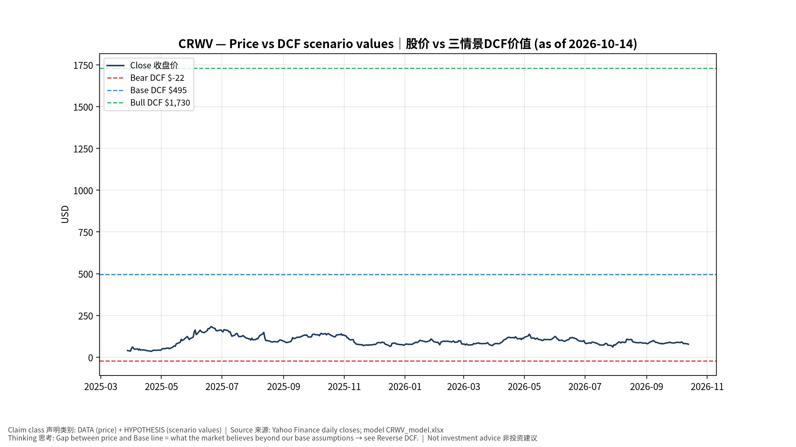
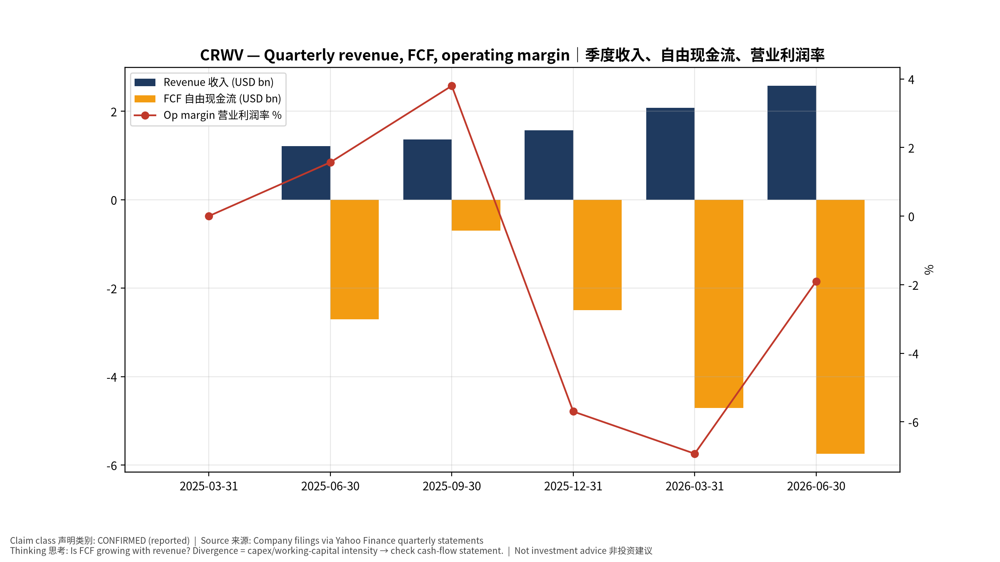
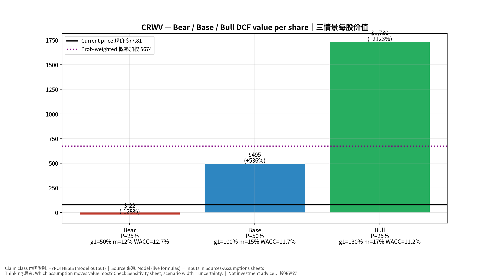
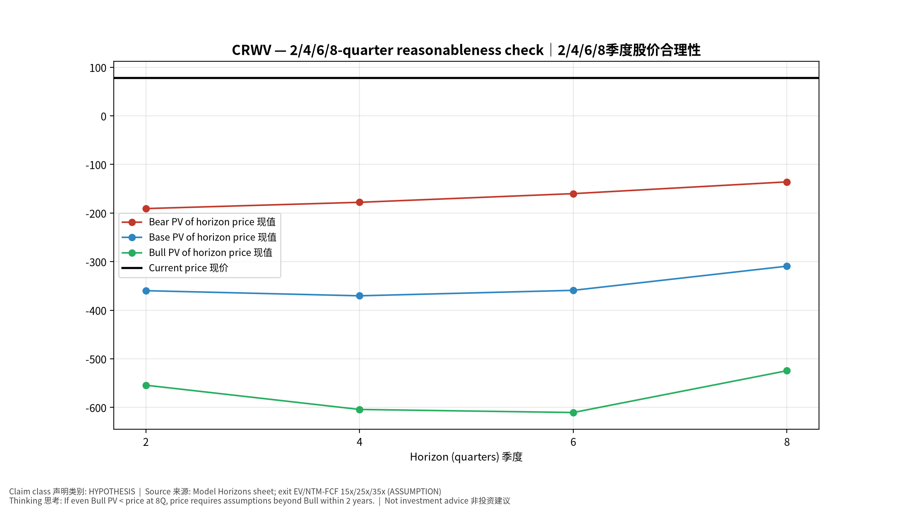
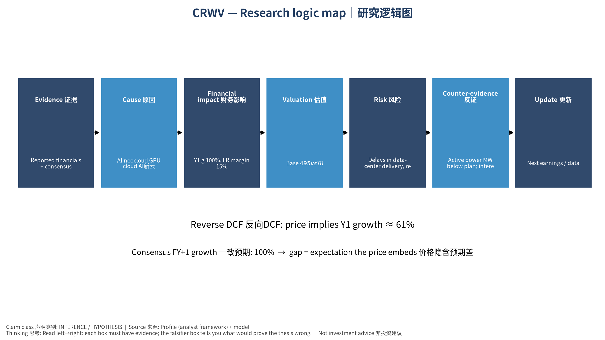

# CRWV CoreWeave, Inc. — 个股深度研究 (专业中文版) v20261014-0758
> 数据截至 2026-10-14 07:58 SGT｜价格 $77.81｜市值 42.9 bn USD｜财报货币 USD｜非投资建议。事实=CONFIRMED/DATA；推断=INFERENCE；假设=ASSUMPTION/HYPOTHESIS。

## 1. 投资论点 Investment Thesis (HYPOTHESIS)
CoreWeave以高杠杆换取AI算力租赁的高速增长；核心是积压订单(backlog)转化率、融资成本与GPU经济寿命。FCF深度为负属于商业模式特征。

- **多头驱动**: Backlog converts on time; financing spreads tighten; contract diversification｜积压订单按期转化；融资利差收窄；客户分散
- **空头驱动**: Delays in data-center delivery, refinancing stress, GPU price deflation｜交付延期、再融资压力、GPU租赁价格通缩
- **证伪条件 Falsifiers**: Active power MW below plan; interest expense outruns EBITDA growth; H100/B200 rental prices fall sharply｜在运营电力低于计划；利息增速超EBITDA；GPU租价暴跌

## 2. 产品、客户与收入模式
- 主题 Theme: AI neocloud GPU cloud AI新云
- 业务分部 Segments: GPU cloud services GPU云服务
- 公司描述 (DATA, Yahoo/公司申报): CoreWeave, Inc. operates as a cloud infrastructure technology company in the United States. The company offers CoreWeave Cloud platform that comprises proprietary software and cloud services that deliver the automation and efficiency needed to manage complex artificial intelligence (AI) infrastructure at scale. It also offers data and storage solutions, such as Local Object Transport Accelerator; infrastructure control solutions, including CoreWeave Kubernetes service; mission control services, including node, rack, and fleet lifecycle management; model and agent development tools comprising Weights & Biases, an AI developer platform; and runtime acceleration. In addition, the company offers graphics processing unit compute, CPU compute, networking services, managed services, and virtual and bare metal servers. Its services also include visual effects rendering, machine learning, pixel s
- 主要客户: Microsoft, OpenAI, Meta, Google, AI labs｜微软、OpenAI、Meta、谷歌、AI实验室

## 3. 行业、竞争、监管与供应链 (ANALYST FRAMEWORK)
- 供应商/上游: NVDA (GPUs), Dell/SMCI (servers), data-center landlords (Core Scientific, Galaxy), lenders｜NVDA、服务器厂、数据中心房东、贷款方
- 竞争者 (含业外): Hyperscalers, Nebius, Lambda, Oracle OCI｜云厂、Nebius、Lambda、甲骨文
- 瓶颈/监管: Powered shell availability, debt financing cost, GPU depreciation life｜带电机房、债务融资成本、GPU折旧年限
- 关键KPI: Backlog/RPO, active MW, contracted MW, interest expense, capex｜积压订单、在运营MW、签约MW、利息费用、Capex
- 零部件现货/合约价: 本版未接入付费价格源(TrendForce/DRAMeXchange等)——标注 **UNAVAILABLE**，在KPI监控中以定性方式跟踪。

## 4. 历史财务与现金流 (CONFIRMED, 季度, USD)
| 季度 | 收入 | 毛利 | 营业利润 | 净利润 | FCF | 营业利润率 |
|---|---|---|---|---|---|---|
| 2026-06-30 | 2.6 bn USD | 1.7 bn USD | -49.0 mn USD | -0.6 bn USD | -5.7 bn USD | -1.9% |
| 2026-03-31 | 2.1 bn USD | 1.4 bn USD | -0.1 bn USD | -0.7 bn USD | -4.7 bn USD | -6.9% |
| 2025-12-31 | 1.6 bn USD | 1.1 bn USD | -89.6 mn USD | -0.5 bn USD | -2.5 bn USD | -5.7% |
| 2025-09-30 | 1.4 bn USD | 1.0 bn USD | 51.9 mn USD | -0.1 bn USD | -0.7 bn USD | 3.8% |
| 2025-06-30 | 1.2 bn USD | 0.9 bn USD | 19.0 mn USD | -0.3 bn USD | -2.7 bn USD | 1.6% |
| 2025-03-31 | N/A | N/A | N/A | N/A | N/A | N/A |

资产负债: 现金 5.5 bn USD；总负债 51.6 bn USD；净现金 -46.1 bn USD。TTM FCF -13.7 bn USD（FCF率 -50.0%）。

## 5. 最新财报: 实际 vs 一致预期 vs 指引
| 季度 | EPS实际 | EPS一致预期 | 超预期% |
|---|---|---|---|
| 2025-09-30 | -0.22 | -0.48219 | 0.5437 |
| 2025-12-31 | -0.89 | -0.68481 | -0.2996 |
| 2026-03-31 | -1.4 | -1.2042 | -0.1626 |
| 2026-06-30 | -1.14 | -1.46997 | 0.2245 |

- 管理层指引 Guidance: 自动数据源不含指引——**UNAVAILABLE（待从公司IR新闻稿录入）**。
- 下次财报日 (Yahoo, TENTATIVE 直至公司确认): **2026-11-12**；本季EPS一致预期 -1.52697（18位分析师）；收入一致预期 3.5 bn USD。

## 6. 未来2/4/6/8季度驱动与价格合理性
| 期限 | 情景 | 期限价格现值 | 相对现价 |
|---|---|---|---|
| 2Q | Bear | $-190.82 | -345.2% |
| 2Q | Base | $-359.80 | -562.4% |
| 2Q | Bull | $-554.30 | -812.4% |
| 4Q | Bear | $-177.91 | -328.7% |
| 4Q | Base | $-370.34 | -576.0% |
| 4Q | Bull | $-604.20 | -876.5% |
| 6Q | Bear | $-160.07 | -305.7% |
| 6Q | Base | $-359.07 | -561.5% |
| 6Q | Bull | $-610.52 | -884.6% |
| 8Q | Bear | $-135.88 | -274.6% |
| 8Q | Base | $-309.38 | -497.6% |
| 8Q | Bull | $-524.52 | -774.1% |

现价隐含的 EV/NTM-FCF (Base 路径): | 期限 | 隐含倍数 |
|---|---|
| 2Q | n/m (neg FCF) |
| 4Q | n/m (neg FCF) |
| 6Q | n/m (neg FCF) |
| 8Q | n/m (neg FCF) |

解读: 如果8季度后Base情景所需倍数仍远高于25x，说明价格依赖更远期的增长。

## 7. 三情景 Bear / Base / Bull (HYPOTHESIS)
| 情景 | Y1增速 | 长期FCF率 | WACC | 永续g | 概率 | 每股价值 | 相对现价 |
|---|---|---|---|---|---|---|---|
| Bear | 50.0% | 12.0% | 12.7% | 2.5% | 25.0% | $-21.67 | -127.8% |
| Base | 100.0% | 15.0% | 11.7% | 3.0% | 50.0% | $494.84 | 536.0% |
| Bull | 130.0% | 17.2% | 11.2% | 3.5% | 25.0% | $1,729.53 | 2122.8% |

概率加权价值 **$674.39**（相对现价 766.7%）。

## 8. 估值: DCF / Reverse DCF / ROIC-WACC / 同业 / 敏感度
- DCF Base: EV 319.0 bn USD；终值占比 71.1%。
- **Reverse DCF 反向DCF**: 在Base利润率与WACC下，现价隐含Y1收入增速 ≈ **61.3%**；一致预期FY+1增速 100.0%。
- WACC (CAPM) = rf 5.2% + β 1.30 × ERP 5.0% = 11.7%。
- SOTP segments 分部: GPU cloud services GPU云服务. **Status: framework only** — segment revenues are INPUT REQUIRED from the latest 10-K/10-Q segment note (not auto-fed, left blank to avoid fabrication)｜分部收入需按最新财报手动录入，未自动填充以避免编造。
- 同业比较 Comps (DATA):
| Ticker | 市值 | EV/Sales | Fwd P/E | 收入增速 | 毛利率 | FCF收益率 |
|---|---|---|---|---|---|---|
| CRWV | 42.9 bn USD | 11.7x | -42.4x | 112.5% | 67.4% | -31.8% |
| NBIS | 56.2 bn USD | 43.4x | -58.1x | 454.0% | 74.3% | -17.1% |
| ORCL | 434.1 bn USD | 7.9x | 13.0x | 29.6% | 64.0% | -10.6% |
| NVDA | 5,518.1 bn USD | 18.1x | 14.4x | 105.9% | 74.7% | 0.8% |

- 敏感度: 见Excel `Sensitivity` 表 (WACC × 永续增长率)。

## 9. 风险、反方论证与证伪
- 反方观点 Counter-thesis: Delays in data-center delivery, refinancing stress, GPU price deflation｜交付延期、再融资压力、GPU租赁价格通缩
- 证伪指标: Active power MW below plan; interest expense outruns EBITDA growth; H100/B200 rental prices fall sharply｜在运营电力低于计划；利息增速超EBITDA；GPU租价暴跌
- 模型风险: 长期利润率与WACC为假设；终值占比高时估值对假设极敏感。

## 10. Source Ledger 来源账本
| Item | Value | Source/time |
|---|---|---|
| Price 股价 | 77.81 | Yahoo Finance quote, fetched 2026-10-14T07:58 SGT |
| Market cap 市值 | 4.292e+10 | Yahoo info.marketCap 2026-10-14T07:58 |
| Cash 现金 | 5.539e+09 | Yahoo info.totalCash (latest filing) 2026-10-14T07:58 |
| Debt 负债 | 5.161e+10 | Yahoo info.totalDebt (latest filing) 2026-10-14T07:58 |
| Revenue TTM 收入 | 7.59e+09 | Yahoo info.totalRevenue (TTM, USD) 2026-10-14T07:58 |
| FCF TTM 自由现金流 | -1.366e+10 | Sum of last 4 quarterly FCF (q_cash); quarters ['2026-06-30', '2026-03-31', '2025-12-31', '2025-09-30'] (USD) |
| Beta | 1.3 | ASSUMPTION (no beta history; recent IPO) = 1.3 |
| Risk-free 10Y 无风险利率 | 0.0524 | FRED DGS10 2026-10-09 |
| FX USD per USD | 1 | n/a (USD) |
| Consensus rev growth FY0 | 1.508 | Yahoo revenue_estimate 0y |
| Consensus rev growth FY+1 | 1.043 | Yahoo revenue_estimate +1y |

## 11. Assumption Register 假设登记表
| Assumption | Value | Rationale |
|---|---|---|
| ERP 股权风险溢价 | 0.05 | ASSUMPTION: 5.0% house mature-market ERP |
| Beta clamp | [0.8,1.6] → 1.30 | ASSUMPTION: limit extreme betas |
| Tax rate (ROIC) | 0.18 | ASSUMPTION: blended cash tax 18% |
| Year-1 growth (Base) | 1 | Consensus FY+1 revenue growth (Yahoo revenue_estimate '+1y'); capped at 100% |
| Growth fade | linear Y1→terminal by Y10 | ASSUMPTION |
| Starting FCF margin | -0.5 | DATA: FCF TTM / Revenue TTM, floored -50% |
| Long-run FCF margin (Base) | 0.15 | ASSUMPTION (analyst framework, reached by Y5; see profile) |
| Bear/Bull Y1 growth multiplier | 0.5x / 1.3x | ASSUMPTION |
| Bear/Bull margin multiplier | 0.8x / 1.15x | ASSUMPTION |
| WACC adj Bear/Bull | +1.0pp / -0.5pp | ASSUMPTION |
| Terminal g Bear/Base/Bull | 2.5% / 3.0% / 3.5% | ASSUMPTION |
| Scenario probabilities | 25% / 50% / 25% | ASSUMPTION |
| Horizon exit EV/NTM-FCF Bear/Base/Bull | 15x / 25x / 35x | ASSUMPTION |
| Per-share conversion | value × fx ÷ market cap × price | METHOD: avoids ADR/share-class mismatch |

## 12. Model Provenance 模型溯源
- Model file: `CRWV_model_v20261014-0758.xlsx` (live formulas; sheets Inputs→Scenarios→DCF→ReverseDCF→Sensitivity→Horizons→SOTP→Comps→ROIC_WACC→History→Sources→Assumptions)
- Engine: `production/pipeline/model.py` (Python mirror; values in this report = Python mirror, verified against LibreOffice recalculation of the xlsx)
- Data snapshot: `data/snapshots/20261014-0758` (immutable) | Fetched 2026-10-14 07:58 SGT | Generated 2026-10-14 07:59 SGT
- Version: v20261014-0758. Prior versions are never overwritten (see company history page).

## 13. 版本与事件时间轴
- v20261014-0758: 首版生产系统报告 (27家同步)。下一事件: 财报 2026-11-12 (TENTATIVE)。

## 图片报告 Image Report

*股价vs三情景价值 Price vs scenario values*

*季度财务 Quarterly financials*

*三情景 Scenarios*

*2/4/6/8季度检验 Horizon check*

*研究逻辑图 Logic map*

---

# CRWV CoreWeave, Inc. — Equity Deep Dive (Professional English) v20261014-0758
> Data as of 2026-10-14 07:58 SGT | Price $77.81 | Mkt cap 42.9 bn USD | Reporting currency USD | Not investment advice.

## 1. Investment thesis (HYPOTHESIS)
CoreWeave trades high leverage for fast AI-compute rental growth; the crux is backlog conversion, financing cost and GPU economic life. Deeply negative FCF is a feature of the model.

- **Bull drivers**: Backlog converts on time; financing spreads tighten; contract diversification｜积压订单按期转化；融资利差收窄；客户分散
- **Bear drivers**: Delays in data-center delivery, refinancing stress, GPU price deflation｜交付延期、再融资压力、GPU租赁价格通缩
- **Falsifiers**: Active power MW below plan; interest expense outruns EBITDA growth; H100/B200 rental prices fall sharply｜在运营电力低于计划；利息增速超EBITDA；GPU租价暴跌

## 2. Products, customers, revenue model
- Theme: AI neocloud GPU cloud AI新云 | Segments: GPU cloud services GPU云服务
- Business description (DATA): CoreWeave, Inc. operates as a cloud infrastructure technology company in the United States. The company offers CoreWeave Cloud platform that comprises proprietary software and cloud services that deliver the automation and efficiency needed to manage complex artificial intelligence (AI) infrastructure at scale. It also offers data and storage solutions, such as Local Object Transport Accelerator; infrastructure control solutions, including CoreWeave Kubernetes service; mission control services, including node, rack, and fleet lifecycle management; model and agent development tools comprising Weights & Biases, an AI developer platform; and runtime acceleration. In addition, the company offers graphics processing unit compute, CPU compute, networking services, managed services, and virtual and bare metal servers. Its services also include visual effects rendering, machine learning, pixel s
- Customers: Microsoft, OpenAI, Meta, Google, AI labs｜微软、OpenAI、Meta、谷歌、AI实验室

## 3. Industry, competition, regulation, supply chain (ANALYST FRAMEWORK)
- Suppliers: NVDA (GPUs), Dell/SMCI (servers), data-center landlords (Core Scientific, Galaxy), lenders｜NVDA、服务器厂、数据中心房东、贷款方
- Competitors: Hyperscalers, Nebius, Lambda, Oracle OCI｜云厂、Nebius、Lambda、甲骨文
- Bottlenecks/regulation: Powered shell availability, debt financing cost, GPU depreciation life｜带电机房、债务融资成本、GPU折旧年限
- KPIs: Backlog/RPO, active MW, contracted MW, interest expense, capex｜积压订单、在运营MW、签约MW、利息费用、Capex
- Component spot/contract prices: paid feeds not connected — **UNAVAILABLE**, tracked qualitatively.

## 4. Historical financials & cash flow (CONFIRMED, quarterly, USD)
| Quarter | Revenue | Gross profit | Op income | Net income | FCF | Op margin |
|---|---|---|---|---|---|---|
| 2026-06-30 | 2.6 bn USD | 1.7 bn USD | -49.0 mn USD | -0.6 bn USD | -5.7 bn USD | -1.9% |
| 2026-03-31 | 2.1 bn USD | 1.4 bn USD | -0.1 bn USD | -0.7 bn USD | -4.7 bn USD | -6.9% |
| 2025-12-31 | 1.6 bn USD | 1.1 bn USD | -89.6 mn USD | -0.5 bn USD | -2.5 bn USD | -5.7% |
| 2025-09-30 | 1.4 bn USD | 1.0 bn USD | 51.9 mn USD | -0.1 bn USD | -0.7 bn USD | 3.8% |
| 2025-06-30 | 1.2 bn USD | 0.9 bn USD | 19.0 mn USD | -0.3 bn USD | -2.7 bn USD | 1.6% |
| 2025-03-31 | N/A | N/A | N/A | N/A | N/A | N/A |

Cash 5.5 bn USD; debt 51.6 bn USD; TTM FCF -13.7 bn USD (FCF margin -50.0%).

## 5. Latest earnings: actual vs consensus vs guidance
| Quarter | EPS actual | EPS consensus | Surprise |
|---|---|---|---|
| 2025-09-30 | -0.22 | -0.48219 | 0.5437 |
| 2025-12-31 | -0.89 | -0.68481 | -0.2996 |
| 2026-03-31 | -1.4 | -1.2042 | -0.1626 |
| 2026-06-30 | -1.14 | -1.46997 | 0.2245 |

- Management guidance: not in automated feed — **UNAVAILABLE (to be entered from IR release)**.
- Next earnings (Yahoo; TENTATIVE until company-confirmed): **2026-11-12**; current-quarter EPS consensus -1.52697 (18 analysts); revenue consensus 3.5 bn USD.

## 6. 2/4/6/8-quarter drivers & price reasonableness
| Horizon | Scenario | PV of horizon price | vs current |
|---|---|---|---|
| 2Q | Bear | $-190.82 | -345.2% |
| 2Q | Base | $-359.80 | -562.4% |
| 2Q | Bull | $-554.30 | -812.4% |
| 4Q | Bear | $-177.91 | -328.7% |
| 4Q | Base | $-370.34 | -576.0% |
| 4Q | Bull | $-604.20 | -876.5% |
| 6Q | Bear | $-160.07 | -305.7% |
| 6Q | Base | $-359.07 | -561.5% |
| 6Q | Bull | $-610.52 | -884.6% |
| 8Q | Bear | $-135.88 | -274.6% |
| 8Q | Base | $-309.38 | -497.6% |
| 8Q | Bull | $-524.52 | -774.1% |

Current-price implied EV/NTM-FCF on Base path: | Horizon | Implied multiple |
|---|---|
| 2Q | n/m (neg FCF) |
| 4Q | n/m (neg FCF) |
| 6Q | n/m (neg FCF) |
| 8Q | n/m (neg FCF) |

## 7. Bear / Base / Bull (HYPOTHESIS)
| Scenario | Y1 growth | LR FCF margin | WACC | Terminal g | Prob. | Value/share | vs price |
|---|---|---|---|---|---|---|---|
| Bear | 50.0% | 12.0% | 12.7% | 2.5% | 25.0% | $-21.67 | -127.8% |
| Base | 100.0% | 15.0% | 11.7% | 3.0% | 50.0% | $494.84 | 536.0% |
| Bull | 130.0% | 17.2% | 11.2% | 3.5% | 25.0% | $1,729.53 | 2122.8% |

Probability-weighted value **$674.39** (766.7% vs price).

## 8. Valuation: DCF / Reverse DCF / ROIC-WACC / comps / sensitivity
- Base DCF EV 319.0 bn USD; terminal share 71.1%.
- **Reverse DCF**: at Base margin/WACC the price implies Y1 revenue growth ≈ **61.3%** vs consensus FY+1 100.0%.
- WACC (CAPM) = rf 5.2% + β 1.30 × ERP 5.0% = 11.7%.
- SOTP segments: GPU cloud services GPU云服务 — framework only; segment revenue inputs pending from filings.
- Comps (DATA): see table in Chinese section / Excel `Comps`.
- Sensitivity: Excel `Sensitivity` (WACC × terminal g).

## 9. Risks, counterarguments, falsifiers
Delays in data-center delivery, refinancing stress, GPU price deflation｜交付延期、再融资压力、GPU租赁价格通缩 | Falsifiers: Active power MW below plan; interest expense outruns EBITDA growth; H100/B200 rental prices fall sharply｜在运营电力低于计划；利息增速超EBITDA；GPU租价暴跌

## 10–12. Source Ledger / Assumption Register / Model Provenance
See tables above (shared, bilingual). - Model file: `CRWV_model_v20261014-0758.xlsx` (live formulas; sheets Inputs→Scenarios→DCF→ReverseDCF→Sensitivity→Horizons→SOTP→Comps→ROIC_WACC→History→Sources→Assumptions)
- Engine: `production/pipeline/model.py` (Python mirror; values in this report = Python mirror, verified against LibreOffice recalculation of the xlsx)
- Data snapshot: `data/snapshots/20261014-0758` (immutable) | Fetched 2026-10-14 07:58 SGT | Generated 2026-10-14 07:59 SGT
- Version: v20261014-0758. Prior versions are never overwritten (see company history page).
