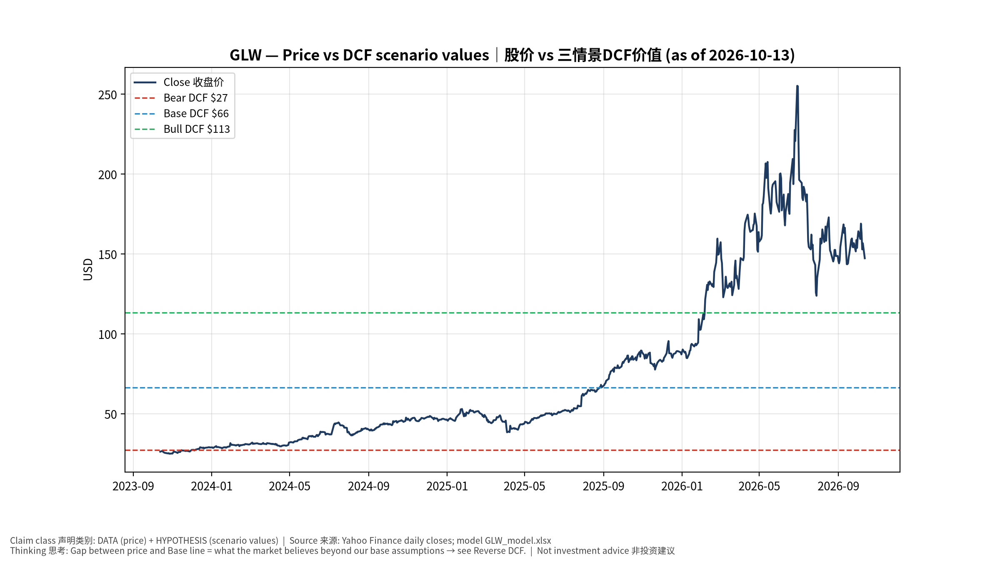
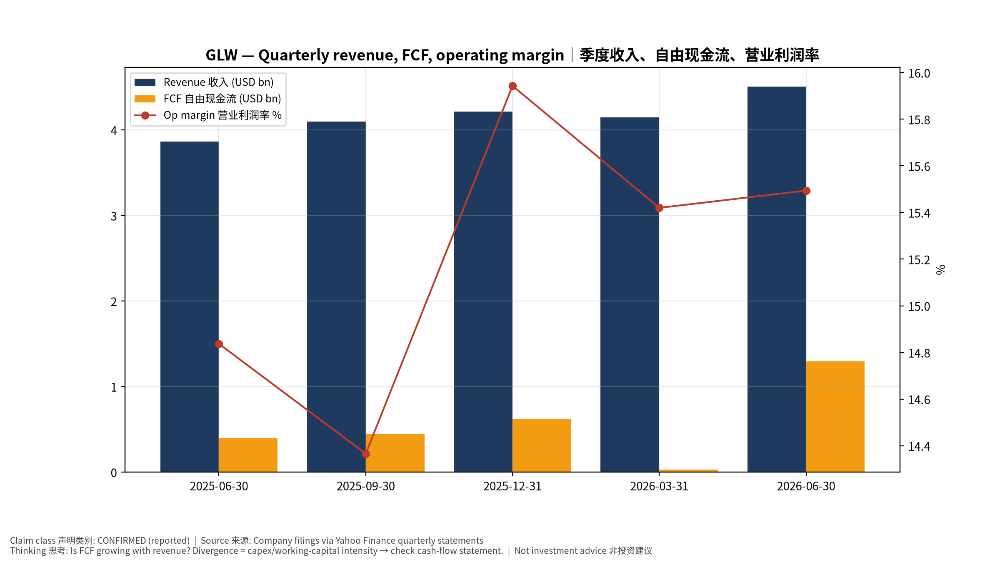
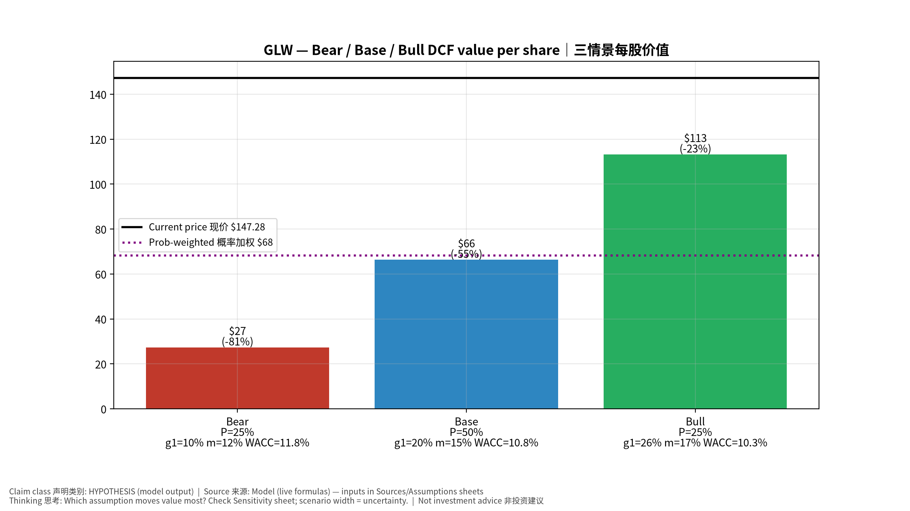
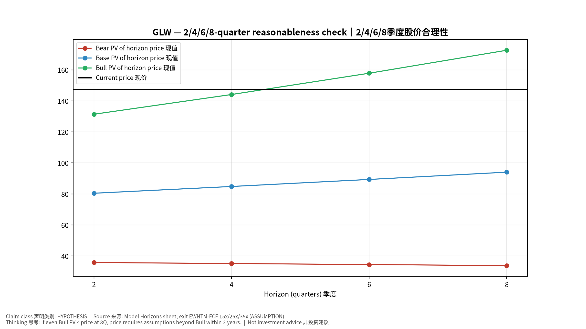
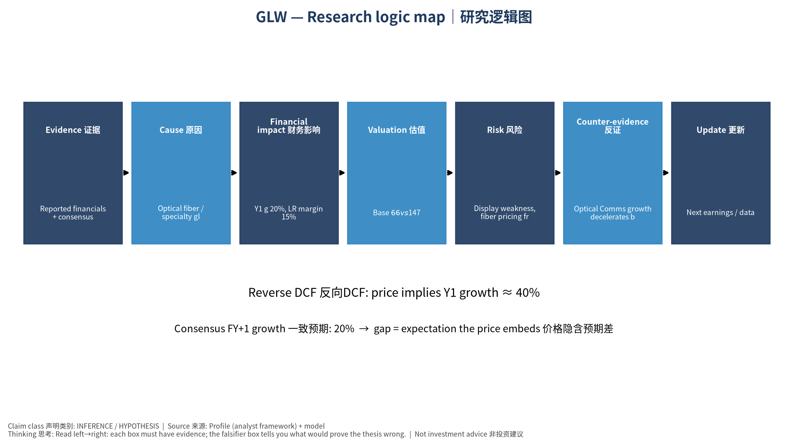

# GLW Corning Incorporated — 个股深度研究 (专业中文版) v20261013-1622
> 数据截至 2026-10-13 16:22 SGT｜价格 $147.28｜市值 126.9 bn USD｜财报货币 USD｜非投资建议。事实=CONFIRMED/DATA；推断=INFERENCE；假设=ASSUMPTION/HYPOTHESIS。

## 1. 投资论点 Investment Thesis (HYPOTHESIS)
AI数据中心内部与之间的光纤密度大幅提升，使康宁光通信成为AI基建的'铜→光'受益者；Springboard计划强调利润率提升。

- **多头驱动**: Hyperscaler fiber contracts scale; CPO raises fiber-attach; solar/specialty recover｜云厂光纤合约放量；CPO提升光纤连接量；光伏/特材复苏
- **空头驱动**: Display weakness, fiber pricing from Chinese competition, capex digestion｜显示疲弱、中国光纤价格竞争、Capex消化
- **证伪条件 Falsifiers**: Optical Comms growth decelerates below enterprise market; Springboard margin targets missed｜光通信增速回落；Springboard利润率目标落空

## 2. 产品、客户与收入模式
- 主题 Theme: Optical fiber / specialty glass 光纤/特种玻璃
- 业务分部 Segments: Optical Communications 光通信；Display 显示；Specialty Materials 特种材料(Gorilla)；Environmental/Life Sci/Solar 其他
- 公司描述 (DATA, Yahoo/公司申报): Corning Incorporated operates in optical communications, display, specialty materials, automotive, and life sciences businesses in the United States, Canada, Mexico, Japan, Taiwan, China, South Korea, Germany, and internationally. The company provides optical fibers and cables; and hardware and equipment products, such as cable assemblies, fiber optic hardware and connectors, optical components and couplers, closures, network interface devices, and other accessories for the telecommunications industry, businesses, governments, and individuals. It also offers glass substrates for flat panel displays, including liquid crystal displays and organic light-emitting diodes that are used in televisions, notebook computers, desktop monitors, tablets, and handheld devices. In addition, it manufactures products that offer material formulations for glass, glass ceramics, crystals, precision metrolog
- 主要客户: Hyperscalers & carriers (fiber/connectivity), Samsung/LG/BOE (display), Apple (cover glass)｜云厂与电信商、面板厂、苹果

## 3. 行业、竞争、监管与供应链 (ANALYST FRAMEWORK)
- 供应商/上游: Raw materials (silica, germanium), energy; in-house glass tech｜原材料(硅、锗)、能源；自有玻璃工艺
- 竞争者 (含业外): Prysmian, Fujikura, Sumitomo, YOFC (fiber); AGC, NEG (glass)｜普睿司曼、藤仓、住友、长飞；旭硝子、日本电气硝子
- 瓶颈/监管: High-density fiber/cable capacity for AI data centers; preform capacity｜AI数据中心高密度光纤/光缆产能、预制棒产能
- 关键KPI: Optical Comms sales, core op margin, enterprise network growth｜光通信销售、核心营业利润率、企业网络增速
- 零部件现货/合约价: 本版未接入付费价格源(TrendForce/DRAMeXchange等)——标注 **UNAVAILABLE**，在KPI监控中以定性方式跟踪。

## 4. 历史财务与现金流 (CONFIRMED, 季度, USD)
| 季度 | 收入 | 毛利 | 营业利润 | 净利润 | FCF | 营业利润率 |
|---|---|---|---|---|---|---|
| 2026-06-30 | 4.5 bn USD | 1.6 bn USD | 0.7 bn USD | 0.6 bn USD | 1.3 bn USD | 15.5% |
| 2026-03-31 | 4.1 bn USD | 1.5 bn USD | 0.6 bn USD | 0.4 bn USD | 30.0 mn USD | 15.4% |
| 2025-12-31 | 4.2 bn USD | 1.5 bn USD | 0.7 bn USD | 0.5 bn USD | 0.6 bn USD | 15.9% |
| 2025-09-30 | 4.1 bn USD | 1.5 bn USD | 0.6 bn USD | 0.4 bn USD | 0.5 bn USD | 14.4% |
| 2025-06-30 | 3.9 bn USD | 1.4 bn USD | 0.6 bn USD | 0.5 bn USD | 0.4 bn USD | 14.8% |

资产负债: 现金 2.5 bn USD；总负债 9.4 bn USD；净现金 -6.9 bn USD。TTM FCF 2.4 bn USD（FCF率 14.1%）。

## 5. 最新财报: 实际 vs 一致预期 vs 指引
| 季度 | EPS实际 | EPS一致预期 | 超预期% |
|---|---|---|---|
| 2025-09-30 | 0.67 | 0.66471 | 0.008 |
| 2025-12-31 | 0.72 | 0.70535 | 0.0208 |
| 2026-03-31 | 0.7 | 0.6916 | 0.0121 |
| 2026-06-30 | 0.78 | 0.75378 | 0.0348 |

- 管理层指引 Guidance: 自动数据源不含指引——**UNAVAILABLE（待从公司IR新闻稿录入）**。
- 下次财报日 (Yahoo, TENTATIVE 直至公司确认): **2026-10-27**；本季EPS一致预期 0.87717（13位分析师）；收入一致预期 5.0 bn USD。

## 6. 未来2/4/6/8季度驱动与价格合理性
| 期限 | 情景 | 期限价格现值 | 相对现价 |
|---|---|---|---|
| 2Q | Bear | $35.80 | -75.7% |
| 2Q | Base | $80.44 | -45.4% |
| 2Q | Bull | $131.37 | -10.8% |
| 4Q | Bear | $35.14 | -76.1% |
| 4Q | Base | $84.81 | -42.4% |
| 4Q | Bull | $144.08 | -2.2% |
| 6Q | Bear | $34.48 | -76.6% |
| 6Q | Base | $89.34 | -39.3% |
| 6Q | Bull | $157.81 | 7.1% |
| 8Q | Bear | $33.81 | -77.0% |
| 8Q | Base | $94.03 | -36.2% |
| 8Q | Bull | $172.62 | 17.2% |

现价隐含的 EV/NTM-FCF (Base 路径): | 期限 | 隐含倍数 |
|---|---|
| 2Q | 41.9x |
| 4Q | 38.1x |
| 6Q | 34.6x |
| 8Q | 31.4x |

解读: 如果8季度后Base情景所需倍数仍远高于25x，说明价格依赖更远期的增长。

## 7. 三情景 Bear / Base / Bull (HYPOTHESIS)
| 情景 | Y1增速 | 长期FCF率 | WACC | 永续g | 概率 | 每股价值 | 相对现价 |
|---|---|---|---|---|---|---|---|
| Bear | 9.8% | 12.0% | 11.8% | 2.5% | 25.0% | $27.32 | -81.5% |
| Base | 19.6% | 15.0% | 10.8% | 3.0% | 50.0% | $66.29 | -55.0% |
| Bull | 25.5% | 17.2% | 10.3% | 3.5% | 25.0% | $113.18 | -23.2% |

概率加权价值 **$68.27**（相对现价 -53.6%）。

## 8. 估值: DCF / Reverse DCF / ROIC-WACC / 同业 / 敏感度
- DCF Base: EV 64.0 bn USD；终值占比 54.0%。
- **Reverse DCF 反向DCF**: 在Base利润率与WACC下，现价隐含Y1收入增速 ≈ **39.7%**；一致预期FY+1增速 19.6%。
- WACC (CAPM) = rf 5.2% + β 1.12 × ERP 5.0% = 10.8%。
- SOTP segments 分部: Optical Communications 光通信; Display 显示; Specialty Materials 特种材料(Gorilla); Environmental/Life Sci/Solar 其他. **Status: framework only** — segment revenues are INPUT REQUIRED from the latest 10-K/10-Q segment note (not auto-fed, left blank to avoid fabrication)｜分部收入需按最新财报手动录入，未自动填充以避免编造。
- 同业比较 Comps (DATA):
| Ticker | 市值 | EV/Sales | Fwd P/E | 收入增速 | 毛利率 | FCF收益率 |
|---|---|---|---|---|---|---|
| GLW | 126.9 bn USD | 7.9x | 33.7x | 16.6% | 36.4% | 1.9% |
| COHR | 56.7 bn USD | 8.2x | 20.5x | 33.7% | 37.5% | -1.1% |
| LITE | 90.2 bn USD | 29.3x | 28.0x | 109.3% | 44.2% | 0.2% |
| CIEN | 57.4 bn USD | 9.6x | 34.2x | 37.0% | 44.1% | 1.1% |
| APH | 212.5 bn USD | 7.8x | 25.9x | 55.0% | 39.0% | 1.8% |

- 敏感度: 见Excel `Sensitivity` 表 (WACC × 永续增长率)。

## 9. 风险、反方论证与证伪
- 反方观点 Counter-thesis: Display weakness, fiber pricing from Chinese competition, capex digestion｜显示疲弱、中国光纤价格竞争、Capex消化
- 证伪指标: Optical Comms growth decelerates below enterprise market; Springboard margin targets missed｜光通信增速回落；Springboard利润率目标落空
- 模型风险: 长期利润率与WACC为假设；终值占比高时估值对假设极敏感。

## 10. Source Ledger 来源账本
| Item | Value | Source/time |
|---|---|---|
| Price 股价 | 147.3 | Yahoo Finance quote, fetched 2026-10-13T16:22 SGT |
| Market cap 市值 | 1.269e+11 | Yahoo info.marketCap 2026-10-13T16:22 |
| Cash 现金 | 2.504e+09 | Yahoo info.totalCash (latest filing) 2026-10-13T16:22 |
| Debt 负债 | 9.379e+09 | Yahoo info.totalDebt (latest filing) 2026-10-13T16:22 |
| Revenue TTM 收入 | 1.696e+10 | Yahoo info.totalRevenue (TTM, USD) 2026-10-13T16:22 |
| FCF TTM 自由现金流 | 2.395e+09 | Sum of last 4 quarterly FCF (q_cash); quarters ['2026-06-30', '2026-03-31', '2025-12-31', '2025-09-30'] (USD) |
| Beta | 1.123 | Yahoo info.beta (5Y monthly) |
| Risk-free 10Y 无风险利率 | 0.0522 | FRED DGS10 2026-10-08 |
| FX USD per USD | 1 | n/a (USD) |
| Consensus rev growth FY0 | 0.1767 | Yahoo revenue_estimate 0y |
| Consensus rev growth FY+1 | 0.1964 | Yahoo revenue_estimate +1y |

## 11. Assumption Register 假设登记表
| Assumption | Value | Rationale |
|---|---|---|
| ERP 股权风险溢价 | 0.05 | ASSUMPTION: 5.0% house mature-market ERP |
| Beta clamp | [0.8,1.6] → 1.12 | ASSUMPTION: limit extreme betas |
| Tax rate (ROIC) | 0.18 | ASSUMPTION: blended cash tax 18% |
| Year-1 growth (Base) | 0.1964 | Consensus FY+1 revenue growth (Yahoo revenue_estimate '+1y'); capped at 100% |
| Growth fade | linear Y1→terminal by Y10 | ASSUMPTION |
| Starting FCF margin | 0.1412 | DATA: FCF TTM / Revenue TTM, floored -50% |
| Long-run FCF margin (Base) | 0.15 | ASSUMPTION (analyst framework, reached by Y5; see profile) |
| Bear/Bull Y1 growth multiplier | 0.5x / 1.3x | ASSUMPTION |
| Bear/Bull margin multiplier | 0.8x / 1.15x | ASSUMPTION |
| WACC adj Bear/Bull | +1.0pp / -0.5pp | ASSUMPTION |
| Terminal g Bear/Base/Bull | 2.5% / 3.0% / 3.5% | ASSUMPTION |
| Scenario probabilities | 25% / 50% / 25% | ASSUMPTION |
| Horizon exit EV/NTM-FCF Bear/Base/Bull | 15x / 25x / 35x | ASSUMPTION |
| Per-share conversion | value × fx ÷ market cap × price | METHOD: avoids ADR/share-class mismatch |

## 12. Model Provenance 模型溯源
- Model file: `GLW_model_v20261013-1622.xlsx` (live formulas; sheets Inputs→Scenarios→DCF→ReverseDCF→Sensitivity→Horizons→SOTP→Comps→ROIC_WACC→History→Sources→Assumptions)
- Engine: `production/pipeline/model.py` (Python mirror; values in this report = Python mirror, verified against LibreOffice recalculation of the xlsx)
- Data snapshot: `data/snapshots/20261013-1622` (immutable) | Fetched 2026-10-13 16:22 SGT | Generated 2026-10-13 16:23 SGT
- Version: v20261013-1622. Prior versions are never overwritten (see company history page).

## 13. 版本与事件时间轴
- v20261013-1622: 首版生产系统报告 (27家同步)。下一事件: 财报 2026-10-27 (TENTATIVE)。

## 图片报告 Image Report

*股价vs三情景价值 Price vs scenario values*

*季度财务 Quarterly financials*

*三情景 Scenarios*

*2/4/6/8季度检验 Horizon check*

*研究逻辑图 Logic map*

---

# GLW Corning Incorporated — Equity Deep Dive (Professional English) v20261013-1622
> Data as of 2026-10-13 16:22 SGT | Price $147.28 | Mkt cap 126.9 bn USD | Reporting currency USD | Not investment advice.

## 1. Investment thesis (HYPOTHESIS)
AI clusters massively raise fiber density inside and between data centers, making Corning Optical a 'copper-to-optics' beneficiary; its Springboard plan targets margin expansion.

- **Bull drivers**: Hyperscaler fiber contracts scale; CPO raises fiber-attach; solar/specialty recover｜云厂光纤合约放量；CPO提升光纤连接量；光伏/特材复苏
- **Bear drivers**: Display weakness, fiber pricing from Chinese competition, capex digestion｜显示疲弱、中国光纤价格竞争、Capex消化
- **Falsifiers**: Optical Comms growth decelerates below enterprise market; Springboard margin targets missed｜光通信增速回落；Springboard利润率目标落空

## 2. Products, customers, revenue model
- Theme: Optical fiber / specialty glass 光纤/特种玻璃 | Segments: Optical Communications 光通信; Display 显示; Specialty Materials 特种材料(Gorilla); Environmental/Life Sci/Solar 其他
- Business description (DATA): Corning Incorporated operates in optical communications, display, specialty materials, automotive, and life sciences businesses in the United States, Canada, Mexico, Japan, Taiwan, China, South Korea, Germany, and internationally. The company provides optical fibers and cables; and hardware and equipment products, such as cable assemblies, fiber optic hardware and connectors, optical components and couplers, closures, network interface devices, and other accessories for the telecommunications industry, businesses, governments, and individuals. It also offers glass substrates for flat panel displays, including liquid crystal displays and organic light-emitting diodes that are used in televisions, notebook computers, desktop monitors, tablets, and handheld devices. In addition, it manufactures products that offer material formulations for glass, glass ceramics, crystals, precision metrolog
- Customers: Hyperscalers & carriers (fiber/connectivity), Samsung/LG/BOE (display), Apple (cover glass)｜云厂与电信商、面板厂、苹果

## 3. Industry, competition, regulation, supply chain (ANALYST FRAMEWORK)
- Suppliers: Raw materials (silica, germanium), energy; in-house glass tech｜原材料(硅、锗)、能源；自有玻璃工艺
- Competitors: Prysmian, Fujikura, Sumitomo, YOFC (fiber); AGC, NEG (glass)｜普睿司曼、藤仓、住友、长飞；旭硝子、日本电气硝子
- Bottlenecks/regulation: High-density fiber/cable capacity for AI data centers; preform capacity｜AI数据中心高密度光纤/光缆产能、预制棒产能
- KPIs: Optical Comms sales, core op margin, enterprise network growth｜光通信销售、核心营业利润率、企业网络增速
- Component spot/contract prices: paid feeds not connected — **UNAVAILABLE**, tracked qualitatively.

## 4. Historical financials & cash flow (CONFIRMED, quarterly, USD)
| Quarter | Revenue | Gross profit | Op income | Net income | FCF | Op margin |
|---|---|---|---|---|---|---|
| 2026-06-30 | 4.5 bn USD | 1.6 bn USD | 0.7 bn USD | 0.6 bn USD | 1.3 bn USD | 15.5% |
| 2026-03-31 | 4.1 bn USD | 1.5 bn USD | 0.6 bn USD | 0.4 bn USD | 30.0 mn USD | 15.4% |
| 2025-12-31 | 4.2 bn USD | 1.5 bn USD | 0.7 bn USD | 0.5 bn USD | 0.6 bn USD | 15.9% |
| 2025-09-30 | 4.1 bn USD | 1.5 bn USD | 0.6 bn USD | 0.4 bn USD | 0.5 bn USD | 14.4% |
| 2025-06-30 | 3.9 bn USD | 1.4 bn USD | 0.6 bn USD | 0.5 bn USD | 0.4 bn USD | 14.8% |

Cash 2.5 bn USD; debt 9.4 bn USD; TTM FCF 2.4 bn USD (FCF margin 14.1%).

## 5. Latest earnings: actual vs consensus vs guidance
| Quarter | EPS actual | EPS consensus | Surprise |
|---|---|---|---|
| 2025-09-30 | 0.67 | 0.66471 | 0.008 |
| 2025-12-31 | 0.72 | 0.70535 | 0.0208 |
| 2026-03-31 | 0.7 | 0.6916 | 0.0121 |
| 2026-06-30 | 0.78 | 0.75378 | 0.0348 |

- Management guidance: not in automated feed — **UNAVAILABLE (to be entered from IR release)**.
- Next earnings (Yahoo; TENTATIVE until company-confirmed): **2026-10-27**; current-quarter EPS consensus 0.87717 (13 analysts); revenue consensus 5.0 bn USD.

## 6. 2/4/6/8-quarter drivers & price reasonableness
| Horizon | Scenario | PV of horizon price | vs current |
|---|---|---|---|
| 2Q | Bear | $35.80 | -75.7% |
| 2Q | Base | $80.44 | -45.4% |
| 2Q | Bull | $131.37 | -10.8% |
| 4Q | Bear | $35.14 | -76.1% |
| 4Q | Base | $84.81 | -42.4% |
| 4Q | Bull | $144.08 | -2.2% |
| 6Q | Bear | $34.48 | -76.6% |
| 6Q | Base | $89.34 | -39.3% |
| 6Q | Bull | $157.81 | 7.1% |
| 8Q | Bear | $33.81 | -77.0% |
| 8Q | Base | $94.03 | -36.2% |
| 8Q | Bull | $172.62 | 17.2% |

Current-price implied EV/NTM-FCF on Base path: | Horizon | Implied multiple |
|---|---|
| 2Q | 41.9x |
| 4Q | 38.1x |
| 6Q | 34.6x |
| 8Q | 31.4x |

## 7. Bear / Base / Bull (HYPOTHESIS)
| Scenario | Y1 growth | LR FCF margin | WACC | Terminal g | Prob. | Value/share | vs price |
|---|---|---|---|---|---|---|---|
| Bear | 9.8% | 12.0% | 11.8% | 2.5% | 25.0% | $27.32 | -81.5% |
| Base | 19.6% | 15.0% | 10.8% | 3.0% | 50.0% | $66.29 | -55.0% |
| Bull | 25.5% | 17.2% | 10.3% | 3.5% | 25.0% | $113.18 | -23.2% |

Probability-weighted value **$68.27** (-53.6% vs price).

## 8. Valuation: DCF / Reverse DCF / ROIC-WACC / comps / sensitivity
- Base DCF EV 64.0 bn USD; terminal share 54.0%.
- **Reverse DCF**: at Base margin/WACC the price implies Y1 revenue growth ≈ **39.7%** vs consensus FY+1 19.6%.
- WACC (CAPM) = rf 5.2% + β 1.12 × ERP 5.0% = 10.8%.
- SOTP segments: Optical Communications 光通信; Display 显示; Specialty Materials 特种材料(Gorilla); Environmental/Life Sci/Solar 其他 — framework only; segment revenue inputs pending from filings.
- Comps (DATA): see table in Chinese section / Excel `Comps`.
- Sensitivity: Excel `Sensitivity` (WACC × terminal g).

## 9. Risks, counterarguments, falsifiers
Display weakness, fiber pricing from Chinese competition, capex digestion｜显示疲弱、中国光纤价格竞争、Capex消化 | Falsifiers: Optical Comms growth decelerates below enterprise market; Springboard margin targets missed｜光通信增速回落；Springboard利润率目标落空

## 10–12. Source Ledger / Assumption Register / Model Provenance
See tables above (shared, bilingual). - Model file: `GLW_model_v20261013-1622.xlsx` (live formulas; sheets Inputs→Scenarios→DCF→ReverseDCF→Sensitivity→Horizons→SOTP→Comps→ROIC_WACC→History→Sources→Assumptions)
- Engine: `production/pipeline/model.py` (Python mirror; values in this report = Python mirror, verified against LibreOffice recalculation of the xlsx)
- Data snapshot: `data/snapshots/20261013-1622` (immutable) | Fetched 2026-10-13 16:22 SGT | Generated 2026-10-13 16:23 SGT
- Version: v20261013-1622. Prior versions are never overwritten (see company history page).
