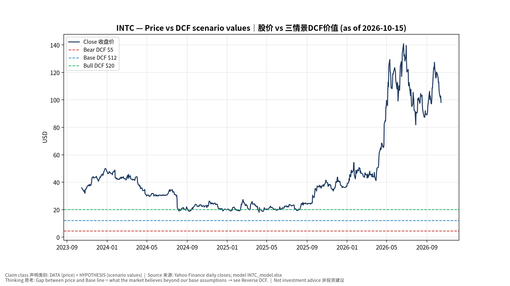
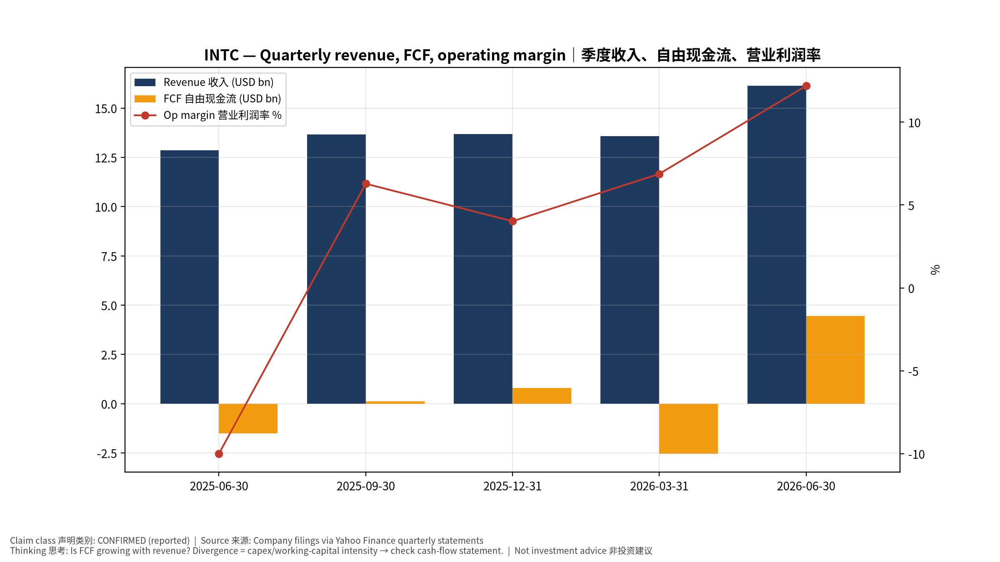
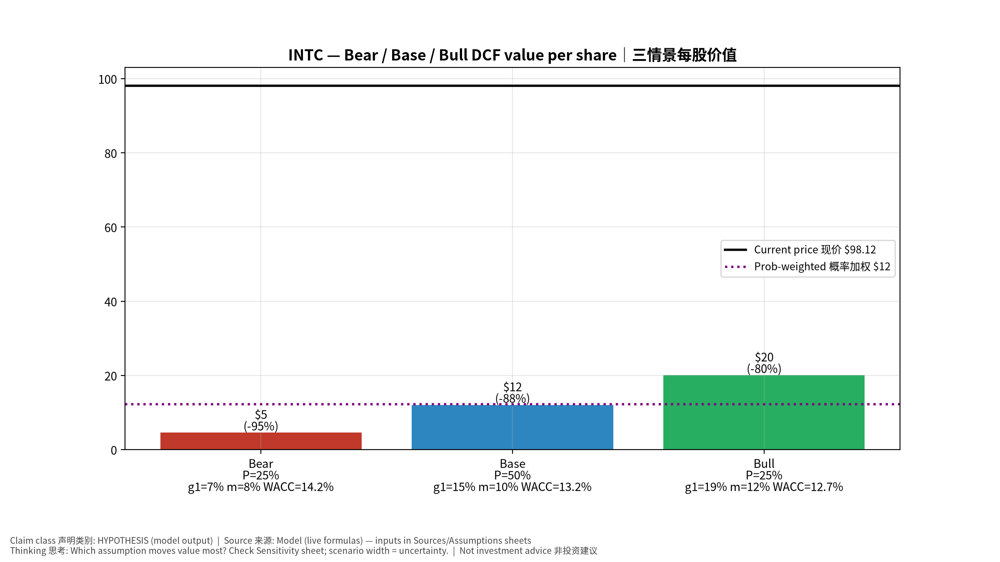
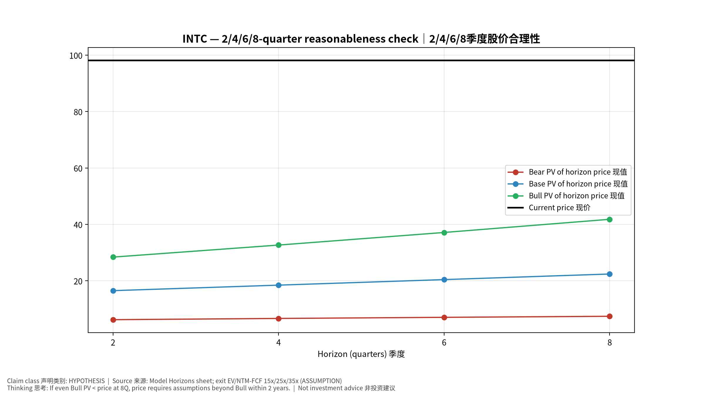
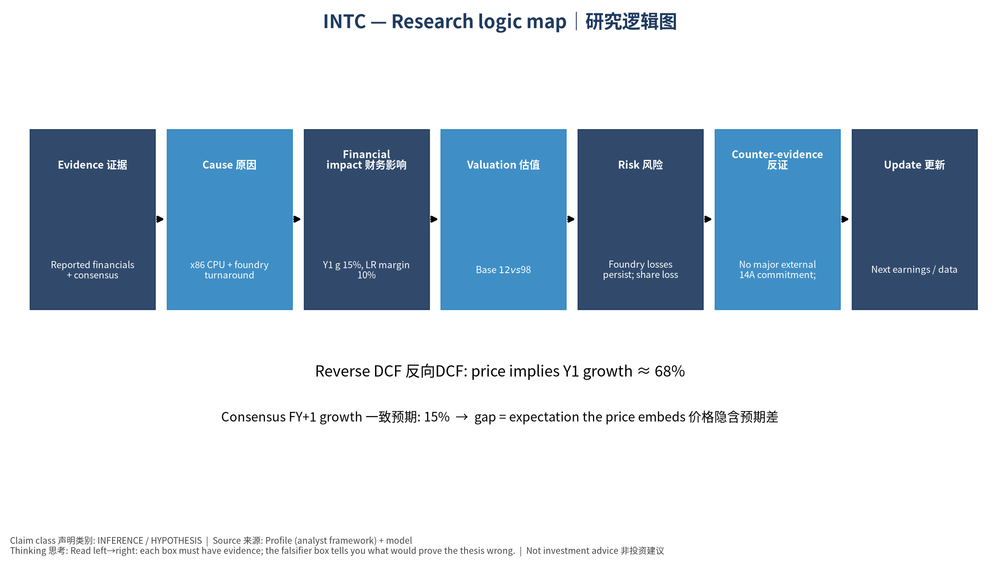

# INTC Intel Corporation — 个股深度研究 (专业中文版) v20261015-0757
> 数据截至 2026-10-15 07:57 SGT｜价格 $98.12｜市值 518.7 bn USD｜财报货币 USD｜非投资建议。事实=CONFIRMED/DATA；推断=INFERENCE；假设=ASSUMPTION/HYPOTHESIS。

## 1. 投资论点 Investment Thesis (HYPOTHESIS)
英特尔是政府+NVDA+软银入股支撑的转型故事；价值取决于代工能否获得外部大客户与CPU份额止血，属于高不确定性的期权型标的。

- **多头驱动**: 14A external anchor customer; server CPU demand from agentic AI; margin recovery｜14A外部大客户；Agent AI拉动服务器CPU；毛利修复
- **空头驱动**: Foundry losses persist; share loss to AMD/ARM; dilution｜代工持续亏损；份额流失；股权稀释
- **证伪条件 Falsifiers**: No major external 14A commitment; foundry operating loss not narrowing; GM <40%｜无14A外部承诺；代工亏损不收窄；毛利率<40%

## 2. 产品、客户与收入模式
- 主题 Theme: x86 CPU + foundry turnaround x86+代工转型
- 业务分部 Segments: Client computing 客户端；Data center & AI 数据中心；Intel Foundry 代工；Altera/Mobileye/other 其他
- 公司描述 (DATA, Yahoo/公司申报): Intel Corporation designs, develops, manufactures, markets, sells, and services computing and related end products and services in the United States, Ireland, Israel, and internationally. It operates through three segments: CCG, DCAI, and Intel Foundry. The company offers client computing group products, including client and commercial CPUs, discrete client GPUs, edge computing, and connectivity products; data center and AI products, such as server CPUs, discrete GPUs, and networking products; and semiconductors comprising wafer fabrication, substrates, and other related products and services. It also provides driving assistance and self-driving solutions; and develops and manufactures multi-beam mask writing tools. The company sells its products through sales organizations, distributors, resellers, retailers, and OEM partners. It serves original equipment manufacturers, original design 
- 主要客户: PC OEMs, cloud/enterprise servers, US government (CHIPS), foundry prospects (NVDA investment, others)｜PC厂、服务器、美国政府、潜在代工客户

## 3. 行业、竞争、监管与供应链 (ANALYST FRAMEWORK)
- 供应商/上游: ASML (High-NA EUV), equipment, TSMC (outsourced tiles)｜ASML、设备商、台积电(外包)
- 竞争者 (含业外): AMD, ARM-based CPUs, TSMC/Samsung in foundry｜AMD、ARM CPU、台积电/三星
- 瓶颈/监管: 18A/14A yield & external customers, capex funding, execution｜18A/14A良率与外部客户、资本开支资金、执行力
- 关键KPI: GM%, foundry op loss, 18A yield commentary, DCAI revenue, capex｜毛利率、代工亏损、18A良率、DCAI收入、Capex
- 零部件现货/合约价: 本版未接入付费价格源(TrendForce/DRAMeXchange等)——标注 **UNAVAILABLE**，在KPI监控中以定性方式跟踪。

## 4. 历史财务与现金流 (CONFIRMED, 季度, USD)
| 季度 | 收入 | 毛利 | 营业利润 | 净利润 | FCF | 营业利润率 |
|---|---|---|---|---|---|---|
| 2026-06-30 | 16.1 bn USD | 6.5 bn USD | 2.0 bn USD | -11.0 bn USD | 4.5 bn USD | 12.2% |
| 2026-03-31 | 13.6 bn USD | 5.3 bn USD | 0.9 bn USD | -3.7 bn USD | -2.5 bn USD | 6.9% |
| 2025-12-31 | 13.7 bn USD | 4.9 bn USD | 0.6 bn USD | -0.6 bn USD | 0.8 bn USD | 4.0% |
| 2025-09-30 | 13.7 bn USD | 5.2 bn USD | 0.9 bn USD | 4.1 bn USD | 0.1 bn USD | 6.3% |
| 2025-06-30 | 12.9 bn USD | 3.5 bn USD | -1.3 bn USD | -2.9 bn USD | -1.5 bn USD | -10.0% |

资产负债: 现金 29.7 bn USD；总负债 50.5 bn USD；净现金 -20.8 bn USD。TTM FCF 2.8 bn USD（FCF率 5.0%）。

## 5. 最新财报: 实际 vs 一致预期 vs 指引
| 季度 | EPS实际 | EPS一致预期 | 超预期% |
|---|---|---|---|
| 2025-09-30 | 0.23 | 0.00705 | 31.6241 |
| 2025-12-31 | 0.15 | 0.08264 | 0.8151 |
| 2026-03-31 | 0.29 | 0.01313 | 21.0868 |
| 2026-06-30 | 0.42 | 0.21584 | 0.94589996 |

- 管理层指引 Guidance: 自动数据源不含指引——**UNAVAILABLE（待从公司IR新闻稿录入）**。
- 下次财报日 (Yahoo, TENTATIVE 直至公司确认): **2026-10-30**；本季EPS一致预期 0.39202（36位分析师）；收入一致预期 16.4 bn USD。

## 6. 未来2/4/6/8季度驱动与价格合理性
| 期限 | 情景 | 期限价格现值 | 相对现价 |
|---|---|---|---|
| 2Q | Bear | $6.22 | -93.7% |
| 2Q | Base | $16.51 | -83.2% |
| 2Q | Bull | $28.41 | -71.0% |
| 4Q | Bear | $6.66 | -93.2% |
| 4Q | Base | $18.47 | -81.2% |
| 4Q | Bull | $32.68 | -66.7% |
| 6Q | Bear | $7.06 | -92.8% |
| 6Q | Base | $20.44 | -79.2% |
| 6Q | Bull | $37.14 | -62.1% |
| 8Q | Bear | $7.42 | -92.4% |
| 8Q | Base | $22.41 | -77.2% |
| 8Q | Bull | $41.81 | -57.4% |

现价隐含的 EV/NTM-FCF (Base 路径): | 期限 | 隐含倍数 |
|---|---|
| 2Q | 118.6x |
| 4Q | 102.7x |
| 6Q | 89.4x |
| 8Q | 78.1x |

解读: 如果8季度后Base情景所需倍数仍远高于25x，说明价格依赖更远期的增长。

## 7. 三情景 Bear / Base / Bull (HYPOTHESIS)
| 情景 | Y1增速 | 长期FCF率 | WACC | 永续g | 概率 | 每股价值 | 相对现价 |
|---|---|---|---|---|---|---|---|
| Bear | 7.4% | 8.0% | 14.2% | 2.5% | 25.0% | $4.57 | -95.3% |
| Base | 14.9% | 10.0% | 13.2% | 3.0% | 50.0% | $12.04 | -87.7% |
| Bull | 19.4% | 11.5% | 12.7% | 3.5% | 25.0% | $20.07 | -79.5% |

概率加权价值 **$12.18**（相对现价 -87.6%）。

## 8. 估值: DCF / Reverse DCF / ROIC-WACC / 同业 / 敏感度
- DCF Base: EV 84.5 bn USD；终值占比 46.1%。
- **Reverse DCF 反向DCF**: 在Base利润率与WACC下，现价隐含Y1收入增速 ≈ **67.9%**；一致预期FY+1增速 14.9%。
- WACC (CAPM) = rf 5.2% + β 1.60 × ERP 5.0% = 13.2%。
- SOTP segments 分部: Client computing 客户端; Data center & AI 数据中心; Intel Foundry 代工; Altera/Mobileye/other 其他. **Status: framework only** — segment revenues are INPUT REQUIRED from the latest 10-K/10-Q segment note (not auto-fed, left blank to avoid fabrication)｜分部收入需按最新财报手动录入，未自动填充以避免编造。
- 同业比较 Comps (DATA):
| Ticker | 市值 | EV/Sales | Fwd P/E | 收入增速 | 毛利率 | FCF收益率 |
|---|---|---|---|---|---|---|
| INTC | 518.7 bn USD | 9.3x | 46.9x | 25.4% | 38.9% | 0.5% |
| AMD | 931.8 bn USD | 22.3x | 36.3x | 50.1% | 55.7% | 0.9% |
| TSM | 2,230.2 bn USD | 3.5x | 19.3x | 36.0% | 64.2% | 32.8% |
| ARM | 254.2 bn USD | 48.6x | 77.7x | 22.4% | 97.5% | 0.5% |
| NVDA | 5,343.7 bn USD | 17.5x | 13.9x | 105.9% | 74.7% | 0.8% |

- 敏感度: 见Excel `Sensitivity` 表 (WACC × 永续增长率)。

## 9. 风险、反方论证与证伪
- 反方观点 Counter-thesis: Foundry losses persist; share loss to AMD/ARM; dilution｜代工持续亏损；份额流失；股权稀释
- 证伪指标: No major external 14A commitment; foundry operating loss not narrowing; GM <40%｜无14A外部承诺；代工亏损不收窄；毛利率<40%
- 模型风险: 长期利润率与WACC为假设；终值占比高时估值对假设极敏感。

## 10. Source Ledger 来源账本
| Item | Value | Source/time |
|---|---|---|
| Price 股价 | 98.12 | Yahoo Finance quote, fetched 2026-10-15T07:57 SGT |
| Market cap 市值 | 5.187e+11 | Yahoo info.marketCap 2026-10-15T07:57 |
| Cash 现金 | 2.973e+10 | Yahoo info.totalCash (latest filing) 2026-10-15T07:57 |
| Debt 负债 | 5.054e+10 | Yahoo info.totalDebt (latest filing) 2026-10-15T07:57 |
| Revenue TTM 收入 | 5.703e+10 | Yahoo info.totalRevenue (TTM, USD) 2026-10-15T07:57 |
| FCF TTM 自由现金流 | 2.831e+09 | Sum of last 4 quarterly FCF (q_cash); quarters ['2026-06-30', '2026-03-31', '2025-12-31', '2025-09-30'] (USD) |
| Beta | 2.23 | Yahoo info.beta (5Y monthly) |
| Risk-free 10Y 无风险利率 | 0.0521 | FRED DGS10 2026-10-13 |
| FX USD per USD | 1 | n/a (USD) |
| Consensus rev growth FY0 | 0.1944 | Yahoo revenue_estimate 0y |
| Consensus rev growth FY+1 | 0.1489 | Yahoo revenue_estimate +1y |

## 11. Assumption Register 假设登记表
| Assumption | Value | Rationale |
|---|---|---|
| ERP 股权风险溢价 | 0.05 | ASSUMPTION: 5.0% house mature-market ERP |
| Beta clamp | [0.8,1.6] → 1.60 | ASSUMPTION: limit extreme betas |
| Tax rate (ROIC) | 0.18 | ASSUMPTION: blended cash tax 18% |
| Year-1 growth (Base) | 0.1489 | Consensus FY+1 revenue growth (Yahoo revenue_estimate '+1y'); capped at 100% |
| Growth fade | linear Y1→terminal by Y10 | ASSUMPTION |
| Starting FCF margin | 0.04964 | DATA: FCF TTM / Revenue TTM, floored -50% |
| Long-run FCF margin (Base) | 0.1 | ASSUMPTION (analyst framework, reached by Y5; see profile) |
| Bear/Bull Y1 growth multiplier | 0.5x / 1.3x | ASSUMPTION |
| Bear/Bull margin multiplier | 0.8x / 1.15x | ASSUMPTION |
| WACC adj Bear/Bull | +1.0pp / -0.5pp | ASSUMPTION |
| Terminal g Bear/Base/Bull | 2.5% / 3.0% / 3.5% | ASSUMPTION |
| Scenario probabilities | 25% / 50% / 25% | ASSUMPTION |
| Horizon exit EV/NTM-FCF Bear/Base/Bull | 15x / 25x / 35x | ASSUMPTION |
| Per-share conversion | value × fx ÷ market cap × price | METHOD: avoids ADR/share-class mismatch |

## 12. Model Provenance 模型溯源
- Model file: `INTC_model_v20261015-0757.xlsx` (live formulas; sheets Inputs→Scenarios→DCF→ReverseDCF→Sensitivity→Horizons→SOTP→Comps→ROIC_WACC→History→Sources→Assumptions)
- Engine: `production/pipeline/model.py` (Python mirror; values in this report = Python mirror, verified against LibreOffice recalculation of the xlsx)
- Data snapshot: `data/snapshots/20261015-0757` (immutable) | Fetched 2026-10-15 07:57 SGT | Generated 2026-10-15 07:58 SGT
- Version: v20261015-0757. Prior versions are never overwritten (see company history page).

## 13. 版本与事件时间轴
- v20261015-0757: 首版生产系统报告 (27家同步)。下一事件: 财报 2026-10-30 (TENTATIVE)。

## 图片报告 Image Report

*股价vs三情景价值 Price vs scenario values*

*季度财务 Quarterly financials*

*三情景 Scenarios*

*2/4/6/8季度检验 Horizon check*

*研究逻辑图 Logic map*

---

# INTC Intel Corporation — Equity Deep Dive (Professional English) v20261015-0757
> Data as of 2026-10-15 07:57 SGT | Price $98.12 | Mkt cap 518.7 bn USD | Reporting currency USD | Not investment advice.

## 1. Investment thesis (HYPOTHESIS)
Intel is a turnaround backed by US-government, NVDA and SoftBank stakes; value hinges on landing external foundry customers and stabilizing CPU share—a high-uncertainty option-like name.

- **Bull drivers**: 14A external anchor customer; server CPU demand from agentic AI; margin recovery｜14A外部大客户；Agent AI拉动服务器CPU；毛利修复
- **Bear drivers**: Foundry losses persist; share loss to AMD/ARM; dilution｜代工持续亏损；份额流失；股权稀释
- **Falsifiers**: No major external 14A commitment; foundry operating loss not narrowing; GM <40%｜无14A外部承诺；代工亏损不收窄；毛利率<40%

## 2. Products, customers, revenue model
- Theme: x86 CPU + foundry turnaround x86+代工转型 | Segments: Client computing 客户端; Data center & AI 数据中心; Intel Foundry 代工; Altera/Mobileye/other 其他
- Business description (DATA): Intel Corporation designs, develops, manufactures, markets, sells, and services computing and related end products and services in the United States, Ireland, Israel, and internationally. It operates through three segments: CCG, DCAI, and Intel Foundry. The company offers client computing group products, including client and commercial CPUs, discrete client GPUs, edge computing, and connectivity products; data center and AI products, such as server CPUs, discrete GPUs, and networking products; and semiconductors comprising wafer fabrication, substrates, and other related products and services. It also provides driving assistance and self-driving solutions; and develops and manufactures multi-beam mask writing tools. The company sells its products through sales organizations, distributors, resellers, retailers, and OEM partners. It serves original equipment manufacturers, original design 
- Customers: PC OEMs, cloud/enterprise servers, US government (CHIPS), foundry prospects (NVDA investment, others)｜PC厂、服务器、美国政府、潜在代工客户

## 3. Industry, competition, regulation, supply chain (ANALYST FRAMEWORK)
- Suppliers: ASML (High-NA EUV), equipment, TSMC (outsourced tiles)｜ASML、设备商、台积电(外包)
- Competitors: AMD, ARM-based CPUs, TSMC/Samsung in foundry｜AMD、ARM CPU、台积电/三星
- Bottlenecks/regulation: 18A/14A yield & external customers, capex funding, execution｜18A/14A良率与外部客户、资本开支资金、执行力
- KPIs: GM%, foundry op loss, 18A yield commentary, DCAI revenue, capex｜毛利率、代工亏损、18A良率、DCAI收入、Capex
- Component spot/contract prices: paid feeds not connected — **UNAVAILABLE**, tracked qualitatively.

## 4. Historical financials & cash flow (CONFIRMED, quarterly, USD)
| Quarter | Revenue | Gross profit | Op income | Net income | FCF | Op margin |
|---|---|---|---|---|---|---|
| 2026-06-30 | 16.1 bn USD | 6.5 bn USD | 2.0 bn USD | -11.0 bn USD | 4.5 bn USD | 12.2% |
| 2026-03-31 | 13.6 bn USD | 5.3 bn USD | 0.9 bn USD | -3.7 bn USD | -2.5 bn USD | 6.9% |
| 2025-12-31 | 13.7 bn USD | 4.9 bn USD | 0.6 bn USD | -0.6 bn USD | 0.8 bn USD | 4.0% |
| 2025-09-30 | 13.7 bn USD | 5.2 bn USD | 0.9 bn USD | 4.1 bn USD | 0.1 bn USD | 6.3% |
| 2025-06-30 | 12.9 bn USD | 3.5 bn USD | -1.3 bn USD | -2.9 bn USD | -1.5 bn USD | -10.0% |

Cash 29.7 bn USD; debt 50.5 bn USD; TTM FCF 2.8 bn USD (FCF margin 5.0%).

## 5. Latest earnings: actual vs consensus vs guidance
| Quarter | EPS actual | EPS consensus | Surprise |
|---|---|---|---|
| 2025-09-30 | 0.23 | 0.00705 | 31.6241 |
| 2025-12-31 | 0.15 | 0.08264 | 0.8151 |
| 2026-03-31 | 0.29 | 0.01313 | 21.0868 |
| 2026-06-30 | 0.42 | 0.21584 | 0.94589996 |

- Management guidance: not in automated feed — **UNAVAILABLE (to be entered from IR release)**.
- Next earnings (Yahoo; TENTATIVE until company-confirmed): **2026-10-30**; current-quarter EPS consensus 0.39202 (36 analysts); revenue consensus 16.4 bn USD.

## 6. 2/4/6/8-quarter drivers & price reasonableness
| Horizon | Scenario | PV of horizon price | vs current |
|---|---|---|---|
| 2Q | Bear | $6.22 | -93.7% |
| 2Q | Base | $16.51 | -83.2% |
| 2Q | Bull | $28.41 | -71.0% |
| 4Q | Bear | $6.66 | -93.2% |
| 4Q | Base | $18.47 | -81.2% |
| 4Q | Bull | $32.68 | -66.7% |
| 6Q | Bear | $7.06 | -92.8% |
| 6Q | Base | $20.44 | -79.2% |
| 6Q | Bull | $37.14 | -62.1% |
| 8Q | Bear | $7.42 | -92.4% |
| 8Q | Base | $22.41 | -77.2% |
| 8Q | Bull | $41.81 | -57.4% |

Current-price implied EV/NTM-FCF on Base path: | Horizon | Implied multiple |
|---|---|
| 2Q | 118.6x |
| 4Q | 102.7x |
| 6Q | 89.4x |
| 8Q | 78.1x |

## 7. Bear / Base / Bull (HYPOTHESIS)
| Scenario | Y1 growth | LR FCF margin | WACC | Terminal g | Prob. | Value/share | vs price |
|---|---|---|---|---|---|---|---|
| Bear | 7.4% | 8.0% | 14.2% | 2.5% | 25.0% | $4.57 | -95.3% |
| Base | 14.9% | 10.0% | 13.2% | 3.0% | 50.0% | $12.04 | -87.7% |
| Bull | 19.4% | 11.5% | 12.7% | 3.5% | 25.0% | $20.07 | -79.5% |

Probability-weighted value **$12.18** (-87.6% vs price).

## 8. Valuation: DCF / Reverse DCF / ROIC-WACC / comps / sensitivity
- Base DCF EV 84.5 bn USD; terminal share 46.1%.
- **Reverse DCF**: at Base margin/WACC the price implies Y1 revenue growth ≈ **67.9%** vs consensus FY+1 14.9%.
- WACC (CAPM) = rf 5.2% + β 1.60 × ERP 5.0% = 13.2%.
- SOTP segments: Client computing 客户端; Data center & AI 数据中心; Intel Foundry 代工; Altera/Mobileye/other 其他 — framework only; segment revenue inputs pending from filings.
- Comps (DATA): see table in Chinese section / Excel `Comps`.
- Sensitivity: Excel `Sensitivity` (WACC × terminal g).

## 9. Risks, counterarguments, falsifiers
Foundry losses persist; share loss to AMD/ARM; dilution｜代工持续亏损；份额流失；股权稀释 | Falsifiers: No major external 14A commitment; foundry operating loss not narrowing; GM <40%｜无14A外部承诺；代工亏损不收窄；毛利率<40%

## 10–12. Source Ledger / Assumption Register / Model Provenance
See tables above (shared, bilingual). - Model file: `INTC_model_v20261015-0757.xlsx` (live formulas; sheets Inputs→Scenarios→DCF→ReverseDCF→Sensitivity→Horizons→SOTP→Comps→ROIC_WACC→History→Sources→Assumptions)
- Engine: `production/pipeline/model.py` (Python mirror; values in this report = Python mirror, verified against LibreOffice recalculation of the xlsx)
- Data snapshot: `data/snapshots/20261015-0757` (immutable) | Fetched 2026-10-15 07:57 SGT | Generated 2026-10-15 07:58 SGT
- Version: v20261015-0757. Prior versions are never overwritten (see company history page).
