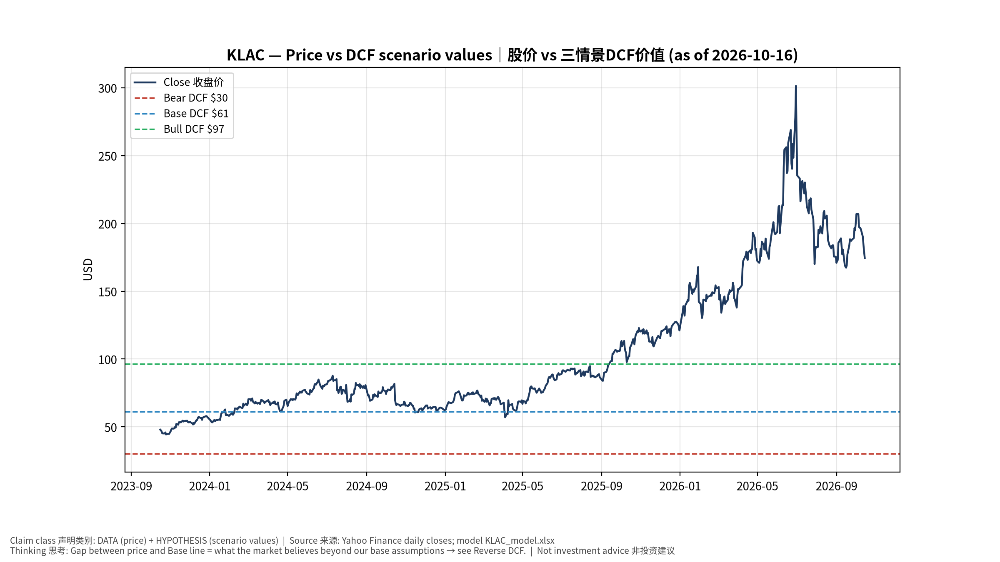
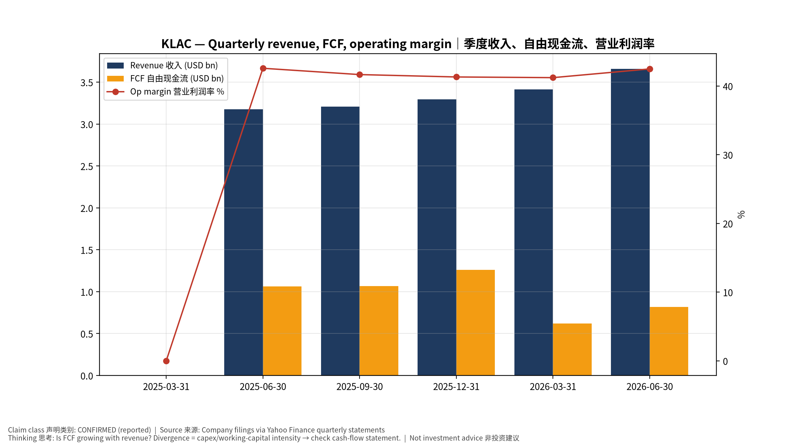
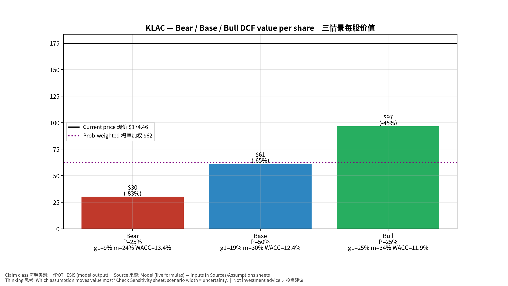
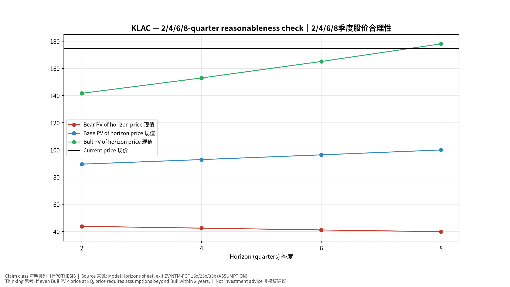
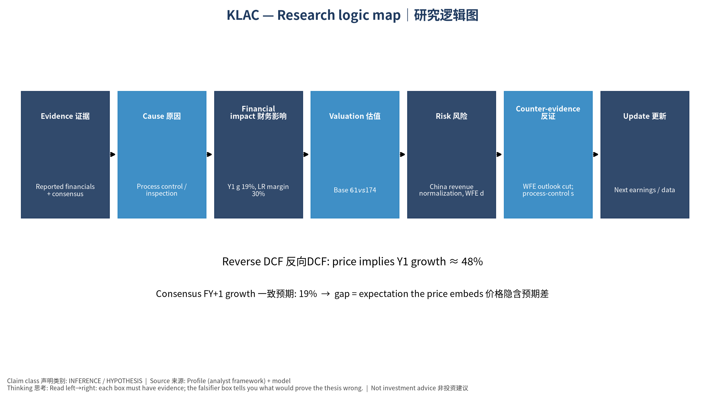

# KLAC KLA Corporation — 个股深度研究 (专业中文版) v20261016-0756
> 数据截至 2026-10-16 07:56 SGT｜价格 $174.46｜市值 227.7 bn USD｜财报货币 USD｜非投资建议。事实=CONFIRMED/DATA；推断=INFERENCE；假设=ASSUMPTION/HYPOTHESIS。

## 1. 投资论点 Investment Thesis (HYPOTHESIS)
KLA在检测量测几乎寡占，先进制程/HBM/先进封装复杂度提升使检测强度上升；高ROIC、强回购。

- **多头驱动**: WFE grows with N2/A16 and HBM; packaging inspection grows｜WFE随N2与HBM增长；封装检测成长
- **空头驱动**: China revenue normalization, WFE digestion｜中国收入回落、WFE消化
- **证伪条件 Falsifiers**: WFE outlook cut; process-control share loss｜WFE展望下修；份额流失

## 2. 产品、客户与收入模式
- 主题 Theme: Process control / inspection 量测检测
- 业务分部 Segments: Semiconductor process control 半导体过程控制；Specialty semi process 特种工艺；PCB & component inspection PCB检测
- 公司描述 (DATA, Yahoo/公司申报): KLA Corporation, together with its subsidiaries, provides process control and process-enabling solutions for manufacturing wafers, reticles/masks, chemicals/materials, integrated circuits (ICs), packaged ICs, and printed circuit boards. It operates through three segments: Semiconductor Process Control; Specialty Semiconductor Process; and PCB and Component Inspection. The company offers inspection and review tools to identify, locate, characterize, review, and analyze defects on various surfaces of patterned and unpatterned wafers; chemical process control equipment; wired and wireless sensor wafers and reticles; wafer defect inspection, review, and metrology systems; reticle inspection and metrology systems; wafer inspection and metrology systems; semiconductor software solutions; KLA Pro systems; and specialty semiconductor manufacturing, benchtop metrology, surface characterization, m
- 主要客户: TSMC, Samsung, Intel, SK hynix, Micron, Chinese fabs｜台积电、三星、英特尔、海力士、美光、中国晶圆厂

## 3. 行业、竞争、监管与供应链 (ANALYST FRAMEWORK)
- 供应商/上游: Optics, lasers, precision components｜光学、激光、精密部件
- 竞争者 (含业外): AMAT (e-beam), Hitachi High-Tech, Lasertec, Onto, Nova｜应材、日立高新、Lasertec、Onto、Nova
- 瓶颈/监管: China export controls, leading-edge capex cycle｜对华出口管制、先进制程Capex周期
- 关键KPI: Revenue, GM%, China mix, backlog, buybacks｜收入、毛利率、中国占比、积压、回购
- 零部件现货/合约价: 本版未接入付费价格源(TrendForce/DRAMeXchange等)——标注 **UNAVAILABLE**，在KPI监控中以定性方式跟踪。

## 4. 历史财务与现金流 (CONFIRMED, 季度, USD)
| 季度 | 收入 | 毛利 | 营业利润 | 净利润 | FCF | 营业利润率 |
|---|---|---|---|---|---|---|
| 2026-06-30 | 3.7 bn USD | 2.2 bn USD | 1.6 bn USD | 1.4 bn USD | 0.8 bn USD | 42.5% |
| 2026-03-31 | 3.4 bn USD | 2.1 bn USD | 1.4 bn USD | 1.2 bn USD | 0.6 bn USD | 41.2% |
| 2025-12-31 | 3.3 bn USD | 2.0 bn USD | 1.4 bn USD | 1.1 bn USD | 1.3 bn USD | 41.3% |
| 2025-09-30 | 3.2 bn USD | 2.0 bn USD | 1.3 bn USD | 1.1 bn USD | 1.1 bn USD | 41.7% |
| 2025-06-30 | 3.2 bn USD | 2.0 bn USD | 1.4 bn USD | 1.2 bn USD | 1.1 bn USD | 42.6% |
| 2025-03-31 | N/A | N/A | N/A | N/A | N/A | N/A |

资产负债: 现金 4.9 bn USD；总负债 6.2 bn USD；净现金 -1.2 bn USD。TTM FCF 3.8 bn USD（FCF率 27.7%）。

## 5. 最新财报: 实际 vs 一致预期 vs 指引
| 季度 | EPS实际 | EPS一致预期 | 超预期% |
|---|---|---|---|
| 2025-09-30 | 0.881 | 0.86172 | 0.0224 |
| 2025-12-31 | 0.885 | 0.87978 | 0.0058999998 |
| 2026-03-31 | 0.94 | 0.91703 | 0.025 |
| 2026-06-30 | 1.05 | 0.99866 | 0.0514 |

- 管理层指引 Guidance: 自动数据源不含指引——**UNAVAILABLE（待从公司IR新闻稿录入）**。
- 下次财报日 (Yahoo, TENTATIVE 直至公司确认): **2026-10-29**；本季EPS一致预期 1.17822（22位分析师）；收入一致预期 4.0 bn USD。

## 6. 未来2/4/6/8季度驱动与价格合理性
| 期限 | 情景 | 期限价格现值 | 相对现价 |
|---|---|---|---|
| 2Q | Bear | $43.78 | -74.9% |
| 2Q | Base | $89.52 | -48.7% |
| 2Q | Bull | $141.62 | -18.8% |
| 4Q | Bear | $42.43 | -75.7% |
| 4Q | Base | $92.88 | -46.8% |
| 4Q | Bull | $152.94 | -12.3% |
| 6Q | Bear | $41.11 | -76.4% |
| 6Q | Base | $96.36 | -44.8% |
| 6Q | Bull | $165.06 | -5.4% |
| 8Q | Bear | $39.82 | -77.2% |
| 8Q | Base | $99.96 | -42.7% |
| 8Q | Bull | $178.04 | 2.1% |

现价隐含的 EV/NTM-FCF (Base 路径): | 期限 | 隐含倍数 |
|---|---|
| 2Q | 45.7x |
| 4Q | 41.6x |
| 6Q | 37.9x |
| 8Q | 34.5x |

解读: 如果8季度后Base情景所需倍数仍远高于25x，说明价格依赖更远期的增长。

## 7. 三情景 Bear / Base / Bull (HYPOTHESIS)
| 情景 | Y1增速 | 长期FCF率 | WACC | 永续g | 概率 | 每股价值 | 相对现价 |
|---|---|---|---|---|---|---|---|
| Bear | 9.5% | 24.0% | 13.4% | 2.5% | 25.0% | $30.24 | -82.7% |
| Base | 18.9% | 30.0% | 12.4% | 3.0% | 50.0% | $61.20 | -64.9% |
| Bull | 24.6% | 34.5% | 11.9% | 3.5% | 25.0% | $96.51 | -44.7% |

概率加权价值 **$62.29**（相对现价 -64.3%）。

## 8. 估值: DCF / Reverse DCF / ROIC-WACC / 同业 / 敏感度
- DCF Base: EV 81.1 bn USD；终值占比 47.6%。
- **Reverse DCF 反向DCF**: 在Base利润率与WACC下，现价隐含Y1收入增速 ≈ **48.1%**；一致预期FY+1增速 18.9%。
- WACC (CAPM) = rf 5.2% + β 1.45 × ERP 5.0% = 12.4%。
- SOTP segments 分部: Semiconductor process control 半导体过程控制; Specialty semi process 特种工艺; PCB & component inspection PCB检测. **Status: framework only** — segment revenues are INPUT REQUIRED from the latest 10-K/10-Q segment note (not auto-fed, left blank to avoid fabrication)｜分部收入需按最新财报手动录入，未自动填充以避免编造。
- 同业比较 Comps (DATA):
| Ticker | 市值 | EV/Sales | Fwd P/E | 收入增速 | 毛利率 | FCF收益率 |
|---|---|---|---|---|---|---|
| KLAC | 227.7 bn USD | 16.9x | 25.9x | 15.2% | 61.3% | 1.7% |
| AMAT | 341.3 bn USD | 11.0x | 23.3x | 24.8% | 49.4% | 0.9% |
| LRCX | 347.2 bn USD | 14.9x | 23.6x | 30.0% | 50.5% | 0.9% |
| ASML | 636.6 bn USD | 996.5x | 26.7x | 21.3% | 52.7% | 1.3% |
| 8035.T | 4,705.4 bn USD | 8.8x | 8.1x | 33.3% | 45.6% | 6.3% |

- 敏感度: 见Excel `Sensitivity` 表 (WACC × 永续增长率)。

## 9. 风险、反方论证与证伪
- 反方观点 Counter-thesis: China revenue normalization, WFE digestion｜中国收入回落、WFE消化
- 证伪指标: WFE outlook cut; process-control share loss｜WFE展望下修；份额流失
- 模型风险: 长期利润率与WACC为假设；终值占比高时估值对假设极敏感。

## 10. Source Ledger 来源账本
| Item | Value | Source/time |
|---|---|---|
| Price 股价 | 174.5 | Yahoo Finance quote, fetched 2026-10-16T07:56 SGT |
| Market cap 市值 | 2.277e+11 | Yahoo info.marketCap 2026-10-16T07:56 |
| Cash 现金 | 4.902e+09 | Yahoo info.totalCash (latest filing) 2026-10-16T07:56 |
| Debt 负债 | 6.152e+09 | Yahoo info.totalDebt (latest filing) 2026-10-16T07:56 |
| Revenue TTM 收入 | 1.358e+10 | Yahoo info.totalRevenue (TTM, USD) 2026-10-16T07:56 |
| FCF TTM 自由现金流 | 3.767e+09 | Sum of last 4 quarterly FCF (q_cash); quarters ['2026-06-30', '2026-03-31', '2025-12-31', '2025-09-30'] (USD) |
| Beta | 1.447 | Yahoo info.beta (5Y monthly) |
| Risk-free 10Y 无风险利率 | 0.0519 | FRED DGS10 2026-10-14 |
| FX USD per USD | 1 | n/a (USD) |
| Consensus rev growth FY0 | 0.336 | Yahoo revenue_estimate 0y |
| Consensus rev growth FY+1 | 0.1892 | Yahoo revenue_estimate +1y |

## 11. Assumption Register 假设登记表
| Assumption | Value | Rationale |
|---|---|---|
| ERP 股权风险溢价 | 0.05 | ASSUMPTION: 5.0% house mature-market ERP |
| Beta clamp | [0.8,1.6] → 1.45 | ASSUMPTION: limit extreme betas |
| Tax rate (ROIC) | 0.18 | ASSUMPTION: blended cash tax 18% |
| Year-1 growth (Base) | 0.1892 | Consensus FY+1 revenue growth (Yahoo revenue_estimate '+1y'); capped at 100% |
| Growth fade | linear Y1→terminal by Y10 | ASSUMPTION |
| Starting FCF margin | 0.2774 | DATA: FCF TTM / Revenue TTM, floored -50% |
| Long-run FCF margin (Base) | 0.3 | ASSUMPTION (analyst framework, reached by Y5; see profile) |
| Bear/Bull Y1 growth multiplier | 0.5x / 1.3x | ASSUMPTION |
| Bear/Bull margin multiplier | 0.8x / 1.15x | ASSUMPTION |
| WACC adj Bear/Bull | +1.0pp / -0.5pp | ASSUMPTION |
| Terminal g Bear/Base/Bull | 2.5% / 3.0% / 3.5% | ASSUMPTION |
| Scenario probabilities | 25% / 50% / 25% | ASSUMPTION |
| Horizon exit EV/NTM-FCF Bear/Base/Bull | 15x / 25x / 35x | ASSUMPTION |
| Per-share conversion | value × fx ÷ market cap × price | METHOD: avoids ADR/share-class mismatch |

## 12. Model Provenance 模型溯源
- Model file: `KLAC_model_v20261016-0756.xlsx` (live formulas; sheets Inputs→Scenarios→DCF→ReverseDCF→Sensitivity→Horizons→SOTP→Comps→ROIC_WACC→History→Sources→Assumptions)
- Engine: `production/pipeline/model.py` (Python mirror; values in this report = Python mirror, verified against LibreOffice recalculation of the xlsx)
- Data snapshot: `data/snapshots/20261016-0756` (immutable) | Fetched 2026-10-16 07:56 SGT | Generated 2026-10-16 07:57 SGT
- Version: v20261016-0756. Prior versions are never overwritten (see company history page).

## 13. 版本与事件时间轴
- v20261016-0756: 首版生产系统报告 (27家同步)。下一事件: 财报 2026-10-29 (TENTATIVE)。

## 图片报告 Image Report

*股价vs三情景价值 Price vs scenario values*

*季度财务 Quarterly financials*

*三情景 Scenarios*

*2/4/6/8季度检验 Horizon check*

*研究逻辑图 Logic map*

---

# KLAC KLA Corporation — Equity Deep Dive (Professional English) v20261016-0756
> Data as of 2026-10-16 07:56 SGT | Price $174.46 | Mkt cap 227.7 bn USD | Reporting currency USD | Not investment advice.

## 1. Investment thesis (HYPOTHESIS)
KLA is a near-oligopoly in inspection/metrology; rising complexity at leading-edge, HBM and advanced packaging increases process-control intensity. High ROIC, strong buybacks.

- **Bull drivers**: WFE grows with N2/A16 and HBM; packaging inspection grows｜WFE随N2与HBM增长；封装检测成长
- **Bear drivers**: China revenue normalization, WFE digestion｜中国收入回落、WFE消化
- **Falsifiers**: WFE outlook cut; process-control share loss｜WFE展望下修；份额流失

## 2. Products, customers, revenue model
- Theme: Process control / inspection 量测检测 | Segments: Semiconductor process control 半导体过程控制; Specialty semi process 特种工艺; PCB & component inspection PCB检测
- Business description (DATA): KLA Corporation, together with its subsidiaries, provides process control and process-enabling solutions for manufacturing wafers, reticles/masks, chemicals/materials, integrated circuits (ICs), packaged ICs, and printed circuit boards. It operates through three segments: Semiconductor Process Control; Specialty Semiconductor Process; and PCB and Component Inspection. The company offers inspection and review tools to identify, locate, characterize, review, and analyze defects on various surfaces of patterned and unpatterned wafers; chemical process control equipment; wired and wireless sensor wafers and reticles; wafer defect inspection, review, and metrology systems; reticle inspection and metrology systems; wafer inspection and metrology systems; semiconductor software solutions; KLA Pro systems; and specialty semiconductor manufacturing, benchtop metrology, surface characterization, m
- Customers: TSMC, Samsung, Intel, SK hynix, Micron, Chinese fabs｜台积电、三星、英特尔、海力士、美光、中国晶圆厂

## 3. Industry, competition, regulation, supply chain (ANALYST FRAMEWORK)
- Suppliers: Optics, lasers, precision components｜光学、激光、精密部件
- Competitors: AMAT (e-beam), Hitachi High-Tech, Lasertec, Onto, Nova｜应材、日立高新、Lasertec、Onto、Nova
- Bottlenecks/regulation: China export controls, leading-edge capex cycle｜对华出口管制、先进制程Capex周期
- KPIs: Revenue, GM%, China mix, backlog, buybacks｜收入、毛利率、中国占比、积压、回购
- Component spot/contract prices: paid feeds not connected — **UNAVAILABLE**, tracked qualitatively.

## 4. Historical financials & cash flow (CONFIRMED, quarterly, USD)
| Quarter | Revenue | Gross profit | Op income | Net income | FCF | Op margin |
|---|---|---|---|---|---|---|
| 2026-06-30 | 3.7 bn USD | 2.2 bn USD | 1.6 bn USD | 1.4 bn USD | 0.8 bn USD | 42.5% |
| 2026-03-31 | 3.4 bn USD | 2.1 bn USD | 1.4 bn USD | 1.2 bn USD | 0.6 bn USD | 41.2% |
| 2025-12-31 | 3.3 bn USD | 2.0 bn USD | 1.4 bn USD | 1.1 bn USD | 1.3 bn USD | 41.3% |
| 2025-09-30 | 3.2 bn USD | 2.0 bn USD | 1.3 bn USD | 1.1 bn USD | 1.1 bn USD | 41.7% |
| 2025-06-30 | 3.2 bn USD | 2.0 bn USD | 1.4 bn USD | 1.2 bn USD | 1.1 bn USD | 42.6% |
| 2025-03-31 | N/A | N/A | N/A | N/A | N/A | N/A |

Cash 4.9 bn USD; debt 6.2 bn USD; TTM FCF 3.8 bn USD (FCF margin 27.7%).

## 5. Latest earnings: actual vs consensus vs guidance
| Quarter | EPS actual | EPS consensus | Surprise |
|---|---|---|---|
| 2025-09-30 | 0.881 | 0.86172 | 0.0224 |
| 2025-12-31 | 0.885 | 0.87978 | 0.0058999998 |
| 2026-03-31 | 0.94 | 0.91703 | 0.025 |
| 2026-06-30 | 1.05 | 0.99866 | 0.0514 |

- Management guidance: not in automated feed — **UNAVAILABLE (to be entered from IR release)**.
- Next earnings (Yahoo; TENTATIVE until company-confirmed): **2026-10-29**; current-quarter EPS consensus 1.17822 (22 analysts); revenue consensus 4.0 bn USD.

## 6. 2/4/6/8-quarter drivers & price reasonableness
| Horizon | Scenario | PV of horizon price | vs current |
|---|---|---|---|
| 2Q | Bear | $43.78 | -74.9% |
| 2Q | Base | $89.52 | -48.7% |
| 2Q | Bull | $141.62 | -18.8% |
| 4Q | Bear | $42.43 | -75.7% |
| 4Q | Base | $92.88 | -46.8% |
| 4Q | Bull | $152.94 | -12.3% |
| 6Q | Bear | $41.11 | -76.4% |
| 6Q | Base | $96.36 | -44.8% |
| 6Q | Bull | $165.06 | -5.4% |
| 8Q | Bear | $39.82 | -77.2% |
| 8Q | Base | $99.96 | -42.7% |
| 8Q | Bull | $178.04 | 2.1% |

Current-price implied EV/NTM-FCF on Base path: | Horizon | Implied multiple |
|---|---|
| 2Q | 45.7x |
| 4Q | 41.6x |
| 6Q | 37.9x |
| 8Q | 34.5x |

## 7. Bear / Base / Bull (HYPOTHESIS)
| Scenario | Y1 growth | LR FCF margin | WACC | Terminal g | Prob. | Value/share | vs price |
|---|---|---|---|---|---|---|---|
| Bear | 9.5% | 24.0% | 13.4% | 2.5% | 25.0% | $30.24 | -82.7% |
| Base | 18.9% | 30.0% | 12.4% | 3.0% | 50.0% | $61.20 | -64.9% |
| Bull | 24.6% | 34.5% | 11.9% | 3.5% | 25.0% | $96.51 | -44.7% |

Probability-weighted value **$62.29** (-64.3% vs price).

## 8. Valuation: DCF / Reverse DCF / ROIC-WACC / comps / sensitivity
- Base DCF EV 81.1 bn USD; terminal share 47.6%.
- **Reverse DCF**: at Base margin/WACC the price implies Y1 revenue growth ≈ **48.1%** vs consensus FY+1 18.9%.
- WACC (CAPM) = rf 5.2% + β 1.45 × ERP 5.0% = 12.4%.
- SOTP segments: Semiconductor process control 半导体过程控制; Specialty semi process 特种工艺; PCB & component inspection PCB检测 — framework only; segment revenue inputs pending from filings.
- Comps (DATA): see table in Chinese section / Excel `Comps`.
- Sensitivity: Excel `Sensitivity` (WACC × terminal g).

## 9. Risks, counterarguments, falsifiers
China revenue normalization, WFE digestion｜中国收入回落、WFE消化 | Falsifiers: WFE outlook cut; process-control share loss｜WFE展望下修；份额流失

## 10–12. Source Ledger / Assumption Register / Model Provenance
See tables above (shared, bilingual). - Model file: `KLAC_model_v20261016-0756.xlsx` (live formulas; sheets Inputs→Scenarios→DCF→ReverseDCF→Sensitivity→Horizons→SOTP→Comps→ROIC_WACC→History→Sources→Assumptions)
- Engine: `production/pipeline/model.py` (Python mirror; values in this report = Python mirror, verified against LibreOffice recalculation of the xlsx)
- Data snapshot: `data/snapshots/20261016-0756` (immutable) | Fetched 2026-10-16 07:56 SGT | Generated 2026-10-16 07:57 SGT
- Version: v20261016-0756. Prior versions are never overwritten (see company history page).
