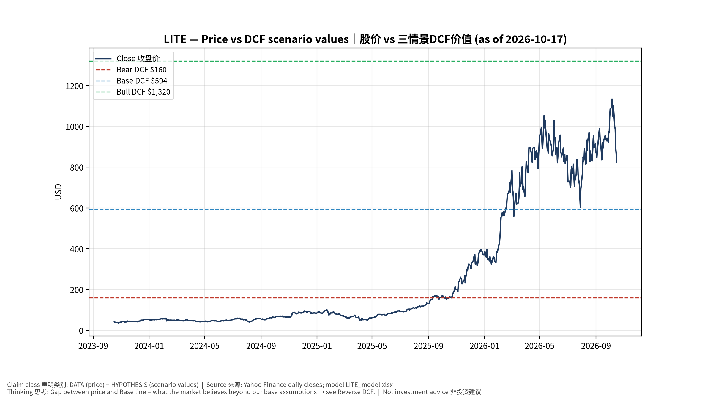
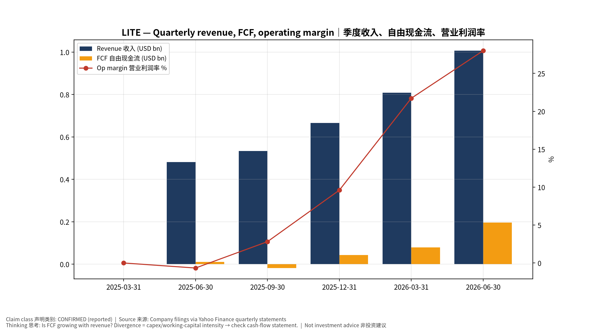
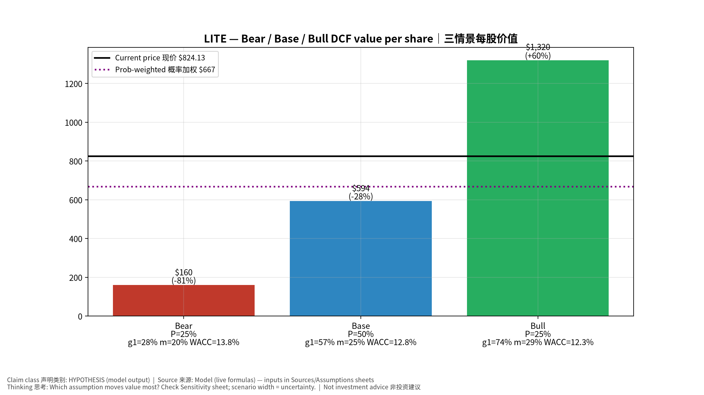
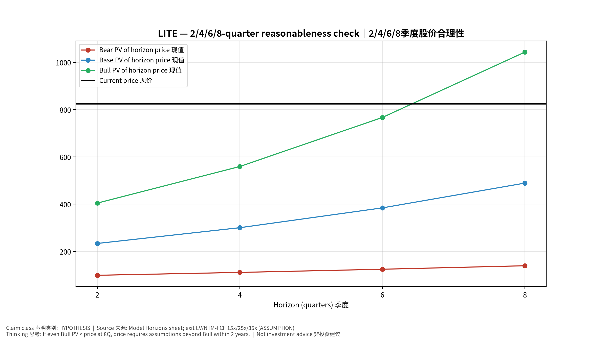
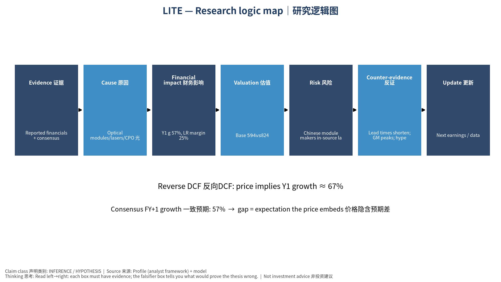

# LITE Lumentum Holdings Inc. — 个股深度研究 (专业中文版) v20261017-0755
> 数据截至 2026-10-17 07:55 SGT｜价格 $824.13｜市值 74.7 bn USD｜财报货币 USD｜非投资建议。事实=CONFIRMED/DATA；推断=INFERENCE；假设=ASSUMPTION/HYPOTHESIS。

## 1. 投资论点 Investment Thesis (HYPOTHESIS)
Lumentum是AI光互连上游'激光器瓶颈'受益者(EML、CPO用CW光源、OCS光交换)；股价已反映极高增长，对产能扩张与价格非常敏感。

- **多头驱动**: EML shortage persists; CPO ramps 2027; OCS adopted beyond Google｜EML短缺持续；CPO 2027放量；OCS扩散
- **空头驱动**: Chinese module makers in-source lasers; price normalization｜中国模块厂自研激光器；价格正常化
- **证伪条件 Falsifiers**: Lead times shorten; GM peaks; hyperscaler OCS orders slip｜交期缩短；毛利见顶；OCS订单延后

## 2. 产品、客户与收入模式
- 主题 Theme: Optical modules/lasers/CPO 光模块/激光器/CPO
- 业务分部 Segments: Components (EML, CW lasers) 器件；Systems (transceivers, OCS) 系统
- 公司描述 (DATA, Yahoo/公司申报): Lumentum Holdings Inc. manufactures and sells optical and photonic products in the Americas, the Asia-Pacific, Europe, the Middle East, and Africa. It offers component products, including semiconductor laser chips, laser sub-assemblies, line subsystems, and wavelength management systems. The company also offers system products, such as optical modules, optical circuit switches, and industrial lasers, including short-pulse solid-state lasers and kilowatt-class fiber lasers. Its products and solutions are used in cloud, artificial intelligence and machine learning (AI/ML), telecommunications, consumer, and industrial end-market applications. The company was incorporated in 2015 and is headquartered in San Jose, California.
- 主要客户: Hyperscalers (Google OCS), NVDA (CPO lasers), module makers｜云厂(谷歌OCS)、NVDA(CPO光源)、模块厂

## 3. 行业、竞争、监管与供应链 (ANALYST FRAMEWORK)
- 供应商/上游: InP substrates, epi (in-house + LandMark), TOSA parts｜磷化铟衬底、外延(自产+联亚)
- 竞争者 (含业外): Coherent, Innolight, Eoptolink, Broadcom (EML), Sumitomo, Mitsubishi｜Coherent、中际旭创、新易盛、博通、日系
- 瓶颈/监管: EML/InP laser capacity, CPO adoption timing｜EML/InP激光器产能、CPO导入时点
- 关键KPI: Revenue growth, GM%, EML capacity, CPO design wins｜收入增速、毛利率、EML产能、CPO订单
- 零部件现货/合约价: 本版未接入付费价格源(TrendForce/DRAMeXchange等)——标注 **UNAVAILABLE**，在KPI监控中以定性方式跟踪。

## 4. 历史财务与现金流 (CONFIRMED, 季度, USD)
| 季度 | 收入 | 毛利 | 营业利润 | 净利润 | FCF | 营业利润率 |
|---|---|---|---|---|---|---|
| 2026-06-30 | 1.0 bn USD | 0.5 bn USD | 0.3 bn USD | -7.2 bn USD | 0.2 bn USD | 28.0% |
| 2026-03-31 | 0.8 bn USD | 0.4 bn USD | 0.2 bn USD | 0.1 bn USD | 79.1 mn USD | 21.7% |
| 2025-12-31 | 0.7 bn USD | 0.2 bn USD | 63.9 mn USD | 78.2 mn USD | 43.1 mn USD | 9.6% |
| 2025-09-30 | 0.5 bn USD | 0.2 bn USD | 15.0 mn USD | 4.2 mn USD | -18.3 mn USD | 2.8% |
| 2025-06-30 | 0.5 bn USD | 0.2 bn USD | -3.2 mn USD | 0.2 bn USD | 10.1 mn USD | -0.7% |
| 2025-03-31 | N/A | N/A | N/A | N/A | N/A | N/A |

资产负债: 现金 2.7 bn USD；总负债 1.7 bn USD；净现金 1.1 bn USD。TTM FCF 0.3 bn USD（FCF率 10.0%）。

## 5. 最新财报: 实际 vs 一致预期 vs 指引
| 季度 | EPS实际 | EPS一致预期 | 超预期% |
|---|---|---|---|
| 2025-09-30 | 1.1 | 1.02764 | 0.0704 |
| 2025-12-31 | 1.67 | 1.40853 | 0.1856 |
| 2026-03-31 | 2.37 | 2.26526 | 0.0462 |
| 2026-06-30 | 3.23 | 2.96892 | 0.0879 |

- 管理层指引 Guidance: 自动数据源不含指引——**UNAVAILABLE（待从公司IR新闻稿录入）**。
- 下次财报日 (Yahoo, TENTATIVE 直至公司确认): **2026-11-06**；本季EPS一致预期 4.20967（22位分析师）；收入一致预期 1.3 bn USD。

## 6. 未来2/4/6/8季度驱动与价格合理性
| 期限 | 情景 | 期限价格现值 | 相对现价 |
|---|---|---|---|
| 2Q | Bear | $99.42 | -87.9% |
| 2Q | Base | $233.97 | -71.6% |
| 2Q | Bull | $404.67 | -50.9% |
| 4Q | Bear | $111.54 | -86.5% |
| 4Q | Base | $300.72 | -63.5% |
| 4Q | Bull | $559.52 | -32.1% |
| 6Q | Bear | $124.96 | -84.8% |
| 6Q | Base | $384.52 | -53.3% |
| 6Q | Bull | $766.98 | -6.9% |
| 8Q | Bear | $139.78 | -83.0% |
| 8Q | Base | $489.33 | -40.6% |
| 8Q | Bull | $1,043.47 | 26.6% |

现价隐含的 EV/NTM-FCF (Base 路径): | 期限 | 隐含倍数 |
|---|---|
| 2Q | 85.8x |
| 4Q | 62.0x |
| 6Q | 45.3x |
| 8Q | 33.3x |

解读: 如果8季度后Base情景所需倍数仍远高于25x，说明价格依赖更远期的增长。

## 7. 三情景 Bear / Base / Bull (HYPOTHESIS)
| 情景 | Y1增速 | 长期FCF率 | WACC | 永续g | 概率 | 每股价值 | 相对现价 |
|---|---|---|---|---|---|---|---|
| Bear | 28.5% | 20.0% | 13.8% | 2.5% | 25.0% | $159.87 | -80.6% |
| Base | 57.0% | 25.0% | 12.8% | 3.0% | 50.0% | $593.77 | -28.0% |
| Bull | 74.0% | 28.7% | 12.3% | 3.5% | 25.0% | $1,319.77 | 60.1% |

概率加权价值 **$666.79**（相对现价 -19.1%）。

## 8. 估值: DCF / Reverse DCF / ROIC-WACC / 同业 / 敏感度
- DCF Base: EV 52.7 bn USD；终值占比 56.9%。
- **Reverse DCF 反向DCF**: 在Base利润率与WACC下，现价隐含Y1收入增速 ≈ **67.2%**；一致预期FY+1增速 57.0%。
- WACC (CAPM) = rf 5.1% + β 1.54 × ERP 5.0% = 12.8%。
- SOTP segments 分部: Components (EML, CW lasers) 器件; Systems (transceivers, OCS) 系统. **Status: framework only** — segment revenues are INPUT REQUIRED from the latest 10-K/10-Q segment note (not auto-fed, left blank to avoid fabrication)｜分部收入需按最新财报手动录入，未自动填充以避免编造。
- 同业比较 Comps (DATA):
| Ticker | 市值 | EV/Sales | Fwd P/E | 收入增速 | 毛利率 | FCF收益率 |
|---|---|---|---|---|---|---|
| LITE | 74.7 bn USD | 24.2x | 22.9x | 109.3% | 44.2% | 0.4% |
| COHR | 45.9 bn USD | 6.7x | 16.6x | 33.7% | 37.5% | -1.4% |
| CIEN | 47.2 bn USD | 7.9x | 28.0x | 37.0% | 44.1% | 1.3% |
| AAOI | 6.4 bn USD | 10.4x | 16.4x | 86.4% | 28.9% | -13.8% |
| GLW | 113.7 bn USD | 7.1x | 30.2x | 16.6% | 36.4% | 0.6% |

- 敏感度: 见Excel `Sensitivity` 表 (WACC × 永续增长率)。

## 9. 风险、反方论证与证伪
- 反方观点 Counter-thesis: Chinese module makers in-source lasers; price normalization｜中国模块厂自研激光器；价格正常化
- 证伪指标: Lead times shorten; GM peaks; hyperscaler OCS orders slip｜交期缩短；毛利见顶；OCS订单延后
- 模型风险: 长期利润率与WACC为假设；终值占比高时估值对假设极敏感。

## 10. Source Ledger 来源账本
| Item | Value | Source/time |
|---|---|---|
| Price 股价 | 824.1 | Yahoo Finance quote, fetched 2026-10-17T07:55 SGT |
| Market cap 市值 | 7.465e+10 | Yahoo info.marketCap 2026-10-17T07:55 |
| Cash 现金 | 2.738e+09 | Yahoo info.totalCash (latest filing) 2026-10-17T07:55 |
| Debt 负债 | 1.671e+09 | Yahoo info.totalDebt (latest filing) 2026-10-17T07:55 |
| Revenue TTM 收入 | 3.014e+09 | Yahoo info.totalRevenue (TTM, USD) 2026-10-17T07:55 |
| FCF TTM 自由现金流 | 3.001e+08 | Sum of last 4 quarterly FCF (q_cash); quarters ['2026-06-30', '2026-03-31', '2025-12-31', '2025-09-30'] (USD) |
| Beta | 1.536 | Yahoo info.beta (5Y monthly) |
| Risk-free 10Y 无风险利率 | 0.051 | FRED DGS10 2026-10-15 |
| FX USD per USD | 1 | n/a (USD) |
| Consensus rev growth FY0 | 1.103 | Yahoo revenue_estimate 0y |
| Consensus rev growth FY+1 | 0.5696 | Yahoo revenue_estimate +1y |

## 11. Assumption Register 假设登记表
| Assumption | Value | Rationale |
|---|---|---|
| ERP 股权风险溢价 | 0.05 | ASSUMPTION: 5.0% house mature-market ERP |
| Beta clamp | [0.8,1.6] → 1.54 | ASSUMPTION: limit extreme betas |
| Tax rate (ROIC) | 0.18 | ASSUMPTION: blended cash tax 18% |
| Year-1 growth (Base) | 0.5696 | Consensus FY+1 revenue growth (Yahoo revenue_estimate '+1y'); capped at 100% |
| Growth fade | linear Y1→terminal by Y10 | ASSUMPTION |
| Starting FCF margin | 0.09957 | DATA: FCF TTM / Revenue TTM, floored -50% |
| Long-run FCF margin (Base) | 0.25 | ASSUMPTION (analyst framework, reached by Y5; see profile) |
| Bear/Bull Y1 growth multiplier | 0.5x / 1.3x | ASSUMPTION |
| Bear/Bull margin multiplier | 0.8x / 1.15x | ASSUMPTION |
| WACC adj Bear/Bull | +1.0pp / -0.5pp | ASSUMPTION |
| Terminal g Bear/Base/Bull | 2.5% / 3.0% / 3.5% | ASSUMPTION |
| Scenario probabilities | 25% / 50% / 25% | ASSUMPTION |
| Horizon exit EV/NTM-FCF Bear/Base/Bull | 15x / 25x / 35x | ASSUMPTION |
| Per-share conversion | value × fx ÷ market cap × price | METHOD: avoids ADR/share-class mismatch |

## 12. Model Provenance 模型溯源
- Model file: `LITE_model_v20261017-0755.xlsx` (live formulas; sheets Inputs→Scenarios→DCF→ReverseDCF→Sensitivity→Horizons→SOTP→Comps→ROIC_WACC→History→Sources→Assumptions)
- Engine: `production/pipeline/model.py` (Python mirror; values in this report = Python mirror, verified against LibreOffice recalculation of the xlsx)
- Data snapshot: `data/snapshots/20261017-0755` (immutable) | Fetched 2026-10-17 07:55 SGT | Generated 2026-10-17 07:56 SGT
- Version: v20261017-0755. Prior versions are never overwritten (see company history page).

## 13. 版本与事件时间轴
- v20261017-0755: 首版生产系统报告 (27家同步)。下一事件: 财报 2026-11-06 (TENTATIVE)。

## 图片报告 Image Report

*股价vs三情景价值 Price vs scenario values*

*季度财务 Quarterly financials*

*三情景 Scenarios*

*2/4/6/8季度检验 Horizon check*

*研究逻辑图 Logic map*

---

# LITE Lumentum Holdings Inc. — Equity Deep Dive (Professional English) v20261017-0755
> Data as of 2026-10-17 07:55 SGT | Price $824.13 | Mkt cap 74.7 bn USD | Reporting currency USD | Not investment advice.

## 1. Investment thesis (HYPOTHESIS)
Lumentum benefits from the upstream 'laser bottleneck' in AI optics (EMLs, CW sources for CPO, OCS switching); the stock already prices very high growth and is sensitive to capacity additions and pricing.

- **Bull drivers**: EML shortage persists; CPO ramps 2027; OCS adopted beyond Google｜EML短缺持续；CPO 2027放量；OCS扩散
- **Bear drivers**: Chinese module makers in-source lasers; price normalization｜中国模块厂自研激光器；价格正常化
- **Falsifiers**: Lead times shorten; GM peaks; hyperscaler OCS orders slip｜交期缩短；毛利见顶；OCS订单延后

## 2. Products, customers, revenue model
- Theme: Optical modules/lasers/CPO 光模块/激光器/CPO | Segments: Components (EML, CW lasers) 器件; Systems (transceivers, OCS) 系统
- Business description (DATA): Lumentum Holdings Inc. manufactures and sells optical and photonic products in the Americas, the Asia-Pacific, Europe, the Middle East, and Africa. It offers component products, including semiconductor laser chips, laser sub-assemblies, line subsystems, and wavelength management systems. The company also offers system products, such as optical modules, optical circuit switches, and industrial lasers, including short-pulse solid-state lasers and kilowatt-class fiber lasers. Its products and solutions are used in cloud, artificial intelligence and machine learning (AI/ML), telecommunications, consumer, and industrial end-market applications. The company was incorporated in 2015 and is headquartered in San Jose, California.
- Customers: Hyperscalers (Google OCS), NVDA (CPO lasers), module makers｜云厂(谷歌OCS)、NVDA(CPO光源)、模块厂

## 3. Industry, competition, regulation, supply chain (ANALYST FRAMEWORK)
- Suppliers: InP substrates, epi (in-house + LandMark), TOSA parts｜磷化铟衬底、外延(自产+联亚)
- Competitors: Coherent, Innolight, Eoptolink, Broadcom (EML), Sumitomo, Mitsubishi｜Coherent、中际旭创、新易盛、博通、日系
- Bottlenecks/regulation: EML/InP laser capacity, CPO adoption timing｜EML/InP激光器产能、CPO导入时点
- KPIs: Revenue growth, GM%, EML capacity, CPO design wins｜收入增速、毛利率、EML产能、CPO订单
- Component spot/contract prices: paid feeds not connected — **UNAVAILABLE**, tracked qualitatively.

## 4. Historical financials & cash flow (CONFIRMED, quarterly, USD)
| Quarter | Revenue | Gross profit | Op income | Net income | FCF | Op margin |
|---|---|---|---|---|---|---|
| 2026-06-30 | 1.0 bn USD | 0.5 bn USD | 0.3 bn USD | -7.2 bn USD | 0.2 bn USD | 28.0% |
| 2026-03-31 | 0.8 bn USD | 0.4 bn USD | 0.2 bn USD | 0.1 bn USD | 79.1 mn USD | 21.7% |
| 2025-12-31 | 0.7 bn USD | 0.2 bn USD | 63.9 mn USD | 78.2 mn USD | 43.1 mn USD | 9.6% |
| 2025-09-30 | 0.5 bn USD | 0.2 bn USD | 15.0 mn USD | 4.2 mn USD | -18.3 mn USD | 2.8% |
| 2025-06-30 | 0.5 bn USD | 0.2 bn USD | -3.2 mn USD | 0.2 bn USD | 10.1 mn USD | -0.7% |
| 2025-03-31 | N/A | N/A | N/A | N/A | N/A | N/A |

Cash 2.7 bn USD; debt 1.7 bn USD; TTM FCF 0.3 bn USD (FCF margin 10.0%).

## 5. Latest earnings: actual vs consensus vs guidance
| Quarter | EPS actual | EPS consensus | Surprise |
|---|---|---|---|
| 2025-09-30 | 1.1 | 1.02764 | 0.0704 |
| 2025-12-31 | 1.67 | 1.40853 | 0.1856 |
| 2026-03-31 | 2.37 | 2.26526 | 0.0462 |
| 2026-06-30 | 3.23 | 2.96892 | 0.0879 |

- Management guidance: not in automated feed — **UNAVAILABLE (to be entered from IR release)**.
- Next earnings (Yahoo; TENTATIVE until company-confirmed): **2026-11-06**; current-quarter EPS consensus 4.20967 (22 analysts); revenue consensus 1.3 bn USD.

## 6. 2/4/6/8-quarter drivers & price reasonableness
| Horizon | Scenario | PV of horizon price | vs current |
|---|---|---|---|
| 2Q | Bear | $99.42 | -87.9% |
| 2Q | Base | $233.97 | -71.6% |
| 2Q | Bull | $404.67 | -50.9% |
| 4Q | Bear | $111.54 | -86.5% |
| 4Q | Base | $300.72 | -63.5% |
| 4Q | Bull | $559.52 | -32.1% |
| 6Q | Bear | $124.96 | -84.8% |
| 6Q | Base | $384.52 | -53.3% |
| 6Q | Bull | $766.98 | -6.9% |
| 8Q | Bear | $139.78 | -83.0% |
| 8Q | Base | $489.33 | -40.6% |
| 8Q | Bull | $1,043.47 | 26.6% |

Current-price implied EV/NTM-FCF on Base path: | Horizon | Implied multiple |
|---|---|
| 2Q | 85.8x |
| 4Q | 62.0x |
| 6Q | 45.3x |
| 8Q | 33.3x |

## 7. Bear / Base / Bull (HYPOTHESIS)
| Scenario | Y1 growth | LR FCF margin | WACC | Terminal g | Prob. | Value/share | vs price |
|---|---|---|---|---|---|---|---|
| Bear | 28.5% | 20.0% | 13.8% | 2.5% | 25.0% | $159.87 | -80.6% |
| Base | 57.0% | 25.0% | 12.8% | 3.0% | 50.0% | $593.77 | -28.0% |
| Bull | 74.0% | 28.7% | 12.3% | 3.5% | 25.0% | $1,319.77 | 60.1% |

Probability-weighted value **$666.79** (-19.1% vs price).

## 8. Valuation: DCF / Reverse DCF / ROIC-WACC / comps / sensitivity
- Base DCF EV 52.7 bn USD; terminal share 56.9%.
- **Reverse DCF**: at Base margin/WACC the price implies Y1 revenue growth ≈ **67.2%** vs consensus FY+1 57.0%.
- WACC (CAPM) = rf 5.1% + β 1.54 × ERP 5.0% = 12.8%.
- SOTP segments: Components (EML, CW lasers) 器件; Systems (transceivers, OCS) 系统 — framework only; segment revenue inputs pending from filings.
- Comps (DATA): see table in Chinese section / Excel `Comps`.
- Sensitivity: Excel `Sensitivity` (WACC × terminal g).

## 9. Risks, counterarguments, falsifiers
Chinese module makers in-source lasers; price normalization｜中国模块厂自研激光器；价格正常化 | Falsifiers: Lead times shorten; GM peaks; hyperscaler OCS orders slip｜交期缩短；毛利见顶；OCS订单延后

## 10–12. Source Ledger / Assumption Register / Model Provenance
See tables above (shared, bilingual). - Model file: `LITE_model_v20261017-0755.xlsx` (live formulas; sheets Inputs→Scenarios→DCF→ReverseDCF→Sensitivity→Horizons→SOTP→Comps→ROIC_WACC→History→Sources→Assumptions)
- Engine: `production/pipeline/model.py` (Python mirror; values in this report = Python mirror, verified against LibreOffice recalculation of the xlsx)
- Data snapshot: `data/snapshots/20261017-0755` (immutable) | Fetched 2026-10-17 07:55 SGT | Generated 2026-10-17 07:56 SGT
- Version: v20261017-0755. Prior versions are never overwritten (see company history page).
