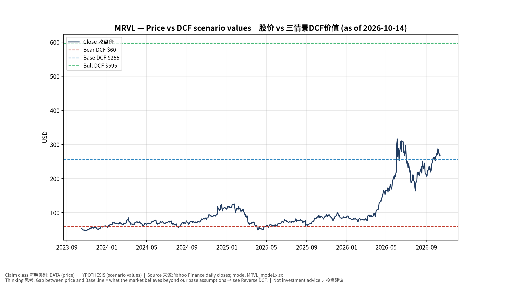
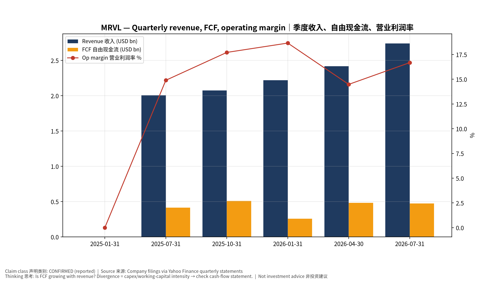
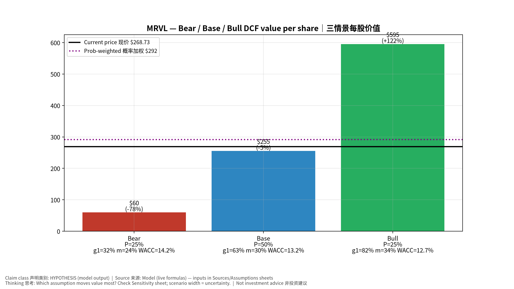
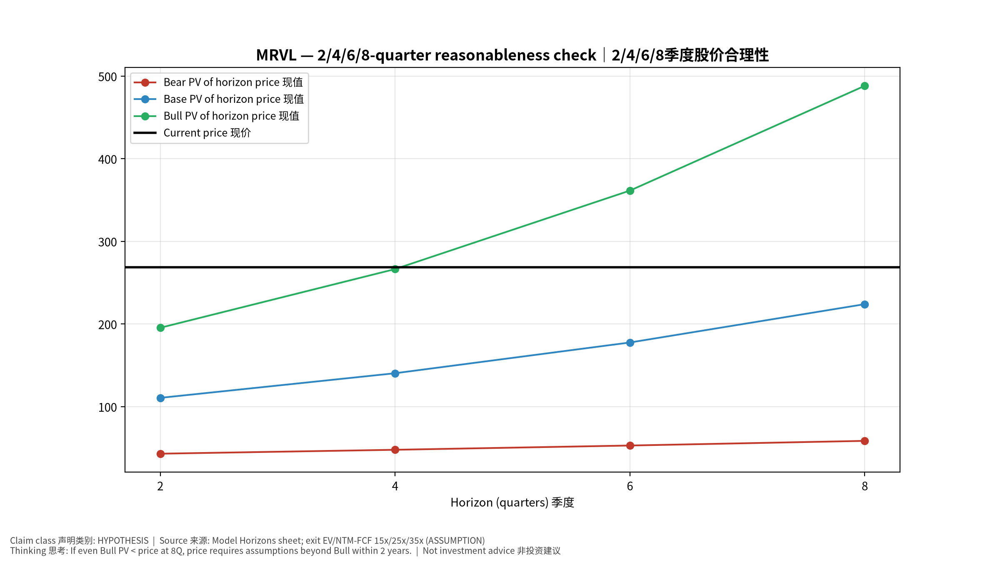
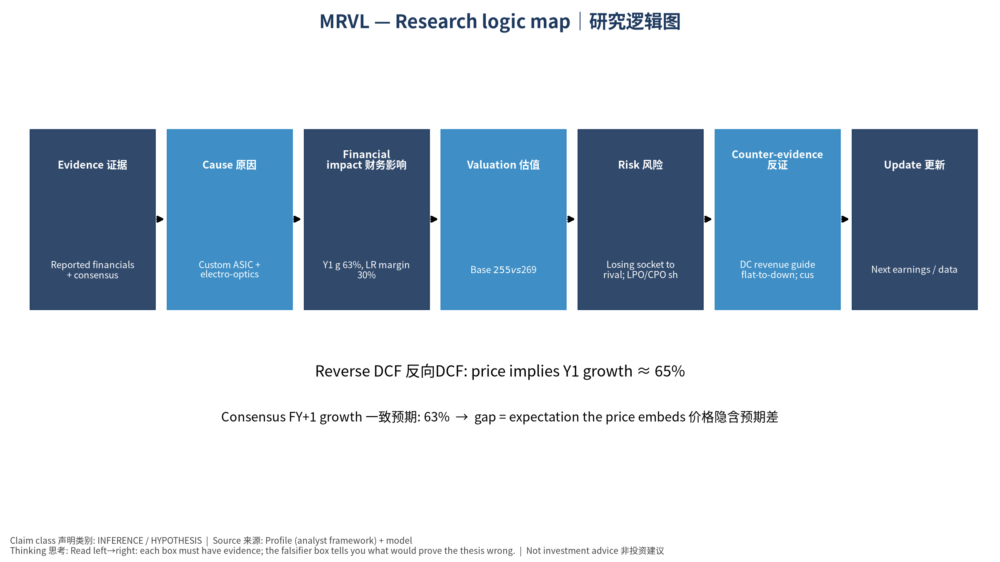

# MRVL Marvell Technology, Inc. — 个股深度研究 (专业中文版) v20261014-0758
> 数据截至 2026-10-14 07:58 SGT｜价格 $268.73｜市值 241.5 bn USD｜财报货币 USD｜非投资建议。事实=CONFIRMED/DATA；推断=INFERENCE；假设=ASSUMPTION/HYPOTHESIS。

## 1. 投资论点 Investment Thesis (HYPOTHESIS)
Marvell受益于AI光互连(PAM4 DSP)与定制XPU；争议点在定制项目的代际延续性及光DSP是否被CPO侵蚀。

- **多头驱动**: Next-gen Trainium/Maia sockets retained; 1.6T DSP ramp｜下一代Trainium/Maia留住；1.6T DSP放量
- **空头驱动**: Losing socket to rival; LPO/CPO shrinks DSP TAM｜失去关键项目；LPO/CPO压缩DSP市场
- **证伪条件 Falsifiers**: DC revenue guide flat-to-down; customer disclosures of competitor sockets｜DC收入指引持平或下降；客户披露换供应商

## 2. 产品、客户与收入模式
- 主题 Theme: Custom ASIC + electro-optics 定制ASIC+光电DSP
- 业务分部 Segments: Data center (custom+optical DSP) 数据中心；Enterprise/Carrier 企业/运营商；Consumer/Auto/Industrial 其他
- 公司描述 (DATA, Yahoo/公司申报): Marvell Technology, Inc., together with its subsidiaries, provides data infrastructure semiconductor solutions and spanning the data center core to network edge in the United States, Argentina, China, India, Israel, Japan, Singapore, South Korea, Taiwan, Vietnam, and internationally. The company develops and scales system-on-a-chip architectures, integrating analog, mixed-signal, and digital signal processing functionality. It offers a portfolio of ethernet solutions, including spanning controllers, network adapters, physical transceivers, and switches; single or multiple core processors; and custom application specific integrated circuits, interconnects, fibre channel adapters, and processors. The company also provides interconnect products, including pulse amplitude modulation, coherent and coherent-lite digital signal processors (DSPs), laser drivers, trans-impedance amplifiers, silic
- 主要客户: AWS (Trainium), Microsoft (Maia), Google, hyperscaler optical module makers｜AWS、微软、谷歌、光模块厂

## 3. 行业、竞争、监管与供应链 (ANALYST FRAMEWORK)
- 供应商/上游: TSMC, substrate/packaging vendors｜台积电、载板/封装
- 竞争者 (含业外): Broadcom, Alchip, MediaTek, Credo (AECs), Inphi-legacy rivals｜博通、世芯、联发科、Credo
- 瓶颈/监管: Custom program wins/losses, PAM4 DSP vs LPO/CPO substitution｜定制项目得失、DSP被LPO/CPO替代
- 关键KPI: DC revenue, custom revenue, optical DSP revenue, GM%｜DC收入、定制收入、光DSP收入、毛利率
- 零部件现货/合约价: 本版未接入付费价格源(TrendForce/DRAMeXchange等)——标注 **UNAVAILABLE**，在KPI监控中以定性方式跟踪。

## 4. 历史财务与现金流 (CONFIRMED, 季度, USD)
| 季度 | 收入 | 毛利 | 营业利润 | 净利润 | FCF | 营业利润率 |
|---|---|---|---|---|---|---|
| 2026-07-31 | 2.7 bn USD | 1.5 bn USD | 0.5 bn USD | 0.3 bn USD | 0.5 bn USD | 16.7% |
| 2026-04-30 | 2.4 bn USD | 1.3 bn USD | 0.4 bn USD | 34.5 mn USD | 0.5 bn USD | 14.5% |
| 2026-01-31 | 2.2 bn USD | 1.1 bn USD | 0.4 bn USD | 0.4 bn USD | 0.3 bn USD | 18.7% |
| 2025-10-31 | 2.1 bn USD | 1.1 bn USD | 0.4 bn USD | 1.9 bn USD | 0.5 bn USD | 17.7% |
| 2025-07-31 | 2.0 bn USD | 1.0 bn USD | 0.3 bn USD | 0.2 bn USD | 0.4 bn USD | 14.9% |
| 2025-01-31 | N/A | N/A | N/A | N/A | N/A | N/A |

资产负债: 现金 3.9 bn USD；总负债 5.3 bn USD；净现金 -1.4 bn USD。TTM FCF 1.7 bn USD（FCF率 18.2%）。

## 5. 最新财报: 实际 vs 一致预期 vs 指引
| 季度 | EPS实际 | EPS一致预期 | 超预期% |
|---|---|---|---|
| 2025-10-31 | 0.76 | 0.73778 | 0.0301 |
| 2026-01-31 | 0.8 | 0.79165 | 0.0105 |
| 2026-04-30 | 0.8 | 0.79495 | 0.0064 |
| 2026-07-31 | 0.94 | 0.93077 | 0.0099 |

- 管理层指引 Guidance: 自动数据源不含指引——**UNAVAILABLE（待从公司IR新闻稿录入）**。
- 下次财报日 (Yahoo, TENTATIVE 直至公司确认): **2026-12-02**；本季EPS一致预期 1.10124（34位分析师）；收入一致预期 3.2 bn USD。

## 6. 未来2/4/6/8季度驱动与价格合理性
| 期限 | 情景 | 期限价格现值 | 相对现价 |
|---|---|---|---|
| 2Q | Bear | $43.05 | -84.0% |
| 2Q | Base | $110.61 | -58.8% |
| 2Q | Bull | $195.43 | -27.3% |
| 4Q | Bear | $47.77 | -82.2% |
| 4Q | Base | $140.41 | -47.7% |
| 4Q | Bull | $266.45 | -0.8% |
| 6Q | Bear | $52.93 | -80.3% |
| 6Q | Base | $177.62 | -33.9% |
| 6Q | Bull | $361.45 | 34.5% |
| 8Q | Bear | $58.56 | -78.2% |
| 8Q | Base | $224.00 | -16.6% |
| 8Q | Bull | $488.22 | 81.7% |

现价隐含的 EV/NTM-FCF (Base 路径): | 期限 | 隐含倍数 |
|---|---|
| 2Q | 56.7x |
| 4Q | 42.1x |
| 6Q | 31.3x |
| 8Q | 23.4x |

解读: 如果8季度后Base情景所需倍数仍远高于25x，说明价格依赖更远期的增长。

## 7. 三情景 Bear / Base / Bull (HYPOTHESIS)
| 情景 | Y1增速 | 长期FCF率 | WACC | 永续g | 概率 | 每股价值 | 相对现价 |
|---|---|---|---|---|---|---|---|
| Bear | 31.6% | 24.0% | 14.2% | 2.5% | 25.0% | $59.93 | -77.7% |
| Base | 63.1% | 30.0% | 13.2% | 3.0% | 50.0% | $255.42 | -5.0% |
| Bull | 82.1% | 34.5% | 12.7% | 3.5% | 25.0% | $595.43 | 121.6% |

概率加权价值 **$291.55**（相对现价 8.5%）。

## 8. 估值: DCF / Reverse DCF / ROIC-WACC / 同业 / 敏感度
- DCF Base: EV 230.9 bn USD；终值占比 55.8%。
- **Reverse DCF 反向DCF**: 在Base利润率与WACC下，现价隐含Y1收入增速 ≈ **64.7%**；一致预期FY+1增速 63.1%。
- WACC (CAPM) = rf 5.2% + β 1.60 × ERP 5.0% = 13.2%。
- SOTP segments 分部: Data center (custom+optical DSP) 数据中心; Enterprise/Carrier 企业/运营商; Consumer/Auto/Industrial 其他. **Status: framework only** — segment revenues are INPUT REQUIRED from the latest 10-K/10-Q segment note (not auto-fed, left blank to avoid fabrication)｜分部收入需按最新财报手动录入，未自动填充以避免编造。
- 同业比较 Comps (DATA):
| Ticker | 市值 | EV/Sales | Fwd P/E | 收入增速 | 毛利率 | FCF收益率 |
|---|---|---|---|---|---|---|
| MRVL | 241.5 bn USD | 25.1x | 36.9x | 36.5% | 52.2% | 0.7% |
| AVGO | 1,705.7 bn USD | 19.5x | 18.4x | 85.5% | 75.5% | 1.8% |
| CRDO | 37.3 bn USD | 23.0x | 20.5x | 114.7% | 67.1% | 0.7% |
| ALAB | 56.5 bn USD | 46.0x | 50.9x | 104.5% | 75.1% | 0.2% |
| AMD | 988.5 bn USD | 23.7x | 38.5x | 50.1% | 55.7% | 0.9% |

- 敏感度: 见Excel `Sensitivity` 表 (WACC × 永续增长率)。

## 9. 风险、反方论证与证伪
- 反方观点 Counter-thesis: Losing socket to rival; LPO/CPO shrinks DSP TAM｜失去关键项目；LPO/CPO压缩DSP市场
- 证伪指标: DC revenue guide flat-to-down; customer disclosures of competitor sockets｜DC收入指引持平或下降；客户披露换供应商
- 模型风险: 长期利润率与WACC为假设；终值占比高时估值对假设极敏感。

## 10. Source Ledger 来源账本
| Item | Value | Source/time |
|---|---|---|
| Price 股价 | 268.7 | Yahoo Finance quote, fetched 2026-10-14T07:58 SGT |
| Market cap 市值 | 2.415e+11 | Yahoo info.marketCap 2026-10-14T07:58 |
| Cash 现金 | 3.933e+09 | Yahoo info.totalCash (latest filing) 2026-10-14T07:58 |
| Debt 负债 | 5.286e+09 | Yahoo info.totalDebt (latest filing) 2026-10-14T07:58 |
| Revenue TTM 收入 | 9.45e+09 | Yahoo info.totalRevenue (TTM, USD) 2026-10-14T07:58 |
| FCF TTM 自由现金流 | 1.723e+09 | Sum of last 4 quarterly FCF (q_cash); quarters ['2026-07-31', '2026-04-30', '2026-01-31', '2025-10-31'] (USD) |
| Beta | 2.26 | Yahoo info.beta (5Y monthly) |
| Risk-free 10Y 无风险利率 | 0.0524 | FRED DGS10 2026-10-09 |
| FX USD per USD | 1 | n/a (USD) |
| Consensus rev growth FY0 | 0.4728 | Yahoo revenue_estimate 0y |
| Consensus rev growth FY+1 | 0.6315 | Yahoo revenue_estimate +1y |

## 11. Assumption Register 假设登记表
| Assumption | Value | Rationale |
|---|---|---|
| ERP 股权风险溢价 | 0.05 | ASSUMPTION: 5.0% house mature-market ERP |
| Beta clamp | [0.8,1.6] → 1.60 | ASSUMPTION: limit extreme betas |
| Tax rate (ROIC) | 0.18 | ASSUMPTION: blended cash tax 18% |
| Year-1 growth (Base) | 0.6315 | Consensus FY+1 revenue growth (Yahoo revenue_estimate '+1y'); capped at 100% |
| Growth fade | linear Y1→terminal by Y10 | ASSUMPTION |
| Starting FCF margin | 0.1823 | DATA: FCF TTM / Revenue TTM, floored -50% |
| Long-run FCF margin (Base) | 0.3 | ASSUMPTION (analyst framework, reached by Y5; see profile) |
| Bear/Bull Y1 growth multiplier | 0.5x / 1.3x | ASSUMPTION |
| Bear/Bull margin multiplier | 0.8x / 1.15x | ASSUMPTION |
| WACC adj Bear/Bull | +1.0pp / -0.5pp | ASSUMPTION |
| Terminal g Bear/Base/Bull | 2.5% / 3.0% / 3.5% | ASSUMPTION |
| Scenario probabilities | 25% / 50% / 25% | ASSUMPTION |
| Horizon exit EV/NTM-FCF Bear/Base/Bull | 15x / 25x / 35x | ASSUMPTION |
| Per-share conversion | value × fx ÷ market cap × price | METHOD: avoids ADR/share-class mismatch |

## 12. Model Provenance 模型溯源
- Model file: `MRVL_model_v20261014-0758.xlsx` (live formulas; sheets Inputs→Scenarios→DCF→ReverseDCF→Sensitivity→Horizons→SOTP→Comps→ROIC_WACC→History→Sources→Assumptions)
- Engine: `production/pipeline/model.py` (Python mirror; values in this report = Python mirror, verified against LibreOffice recalculation of the xlsx)
- Data snapshot: `data/snapshots/20261014-0758` (immutable) | Fetched 2026-10-14 07:58 SGT | Generated 2026-10-14 07:59 SGT
- Version: v20261014-0758. Prior versions are never overwritten (see company history page).

## 13. 版本与事件时间轴
- v20261014-0758: 首版生产系统报告 (27家同步)。下一事件: 财报 2026-12-02 (TENTATIVE)。

## 图片报告 Image Report

*股价vs三情景价值 Price vs scenario values*

*季度财务 Quarterly financials*

*三情景 Scenarios*

*2/4/6/8季度检验 Horizon check*

*研究逻辑图 Logic map*

---

# MRVL Marvell Technology, Inc. — Equity Deep Dive (Professional English) v20261014-0758
> Data as of 2026-10-14 07:58 SGT | Price $268.73 | Mkt cap 241.5 bn USD | Reporting currency USD | Not investment advice.

## 1. Investment thesis (HYPOTHESIS)
Marvell benefits from AI optical interconnect (PAM4 DSPs) and custom XPUs; the debate is generational continuity of custom programs and whether CPO erodes DSP demand.

- **Bull drivers**: Next-gen Trainium/Maia sockets retained; 1.6T DSP ramp｜下一代Trainium/Maia留住；1.6T DSP放量
- **Bear drivers**: Losing socket to rival; LPO/CPO shrinks DSP TAM｜失去关键项目；LPO/CPO压缩DSP市场
- **Falsifiers**: DC revenue guide flat-to-down; customer disclosures of competitor sockets｜DC收入指引持平或下降；客户披露换供应商

## 2. Products, customers, revenue model
- Theme: Custom ASIC + electro-optics 定制ASIC+光电DSP | Segments: Data center (custom+optical DSP) 数据中心; Enterprise/Carrier 企业/运营商; Consumer/Auto/Industrial 其他
- Business description (DATA): Marvell Technology, Inc., together with its subsidiaries, provides data infrastructure semiconductor solutions and spanning the data center core to network edge in the United States, Argentina, China, India, Israel, Japan, Singapore, South Korea, Taiwan, Vietnam, and internationally. The company develops and scales system-on-a-chip architectures, integrating analog, mixed-signal, and digital signal processing functionality. It offers a portfolio of ethernet solutions, including spanning controllers, network adapters, physical transceivers, and switches; single or multiple core processors; and custom application specific integrated circuits, interconnects, fibre channel adapters, and processors. The company also provides interconnect products, including pulse amplitude modulation, coherent and coherent-lite digital signal processors (DSPs), laser drivers, trans-impedance amplifiers, silic
- Customers: AWS (Trainium), Microsoft (Maia), Google, hyperscaler optical module makers｜AWS、微软、谷歌、光模块厂

## 3. Industry, competition, regulation, supply chain (ANALYST FRAMEWORK)
- Suppliers: TSMC, substrate/packaging vendors｜台积电、载板/封装
- Competitors: Broadcom, Alchip, MediaTek, Credo (AECs), Inphi-legacy rivals｜博通、世芯、联发科、Credo
- Bottlenecks/regulation: Custom program wins/losses, PAM4 DSP vs LPO/CPO substitution｜定制项目得失、DSP被LPO/CPO替代
- KPIs: DC revenue, custom revenue, optical DSP revenue, GM%｜DC收入、定制收入、光DSP收入、毛利率
- Component spot/contract prices: paid feeds not connected — **UNAVAILABLE**, tracked qualitatively.

## 4. Historical financials & cash flow (CONFIRMED, quarterly, USD)
| Quarter | Revenue | Gross profit | Op income | Net income | FCF | Op margin |
|---|---|---|---|---|---|---|
| 2026-07-31 | 2.7 bn USD | 1.5 bn USD | 0.5 bn USD | 0.3 bn USD | 0.5 bn USD | 16.7% |
| 2026-04-30 | 2.4 bn USD | 1.3 bn USD | 0.4 bn USD | 34.5 mn USD | 0.5 bn USD | 14.5% |
| 2026-01-31 | 2.2 bn USD | 1.1 bn USD | 0.4 bn USD | 0.4 bn USD | 0.3 bn USD | 18.7% |
| 2025-10-31 | 2.1 bn USD | 1.1 bn USD | 0.4 bn USD | 1.9 bn USD | 0.5 bn USD | 17.7% |
| 2025-07-31 | 2.0 bn USD | 1.0 bn USD | 0.3 bn USD | 0.2 bn USD | 0.4 bn USD | 14.9% |
| 2025-01-31 | N/A | N/A | N/A | N/A | N/A | N/A |

Cash 3.9 bn USD; debt 5.3 bn USD; TTM FCF 1.7 bn USD (FCF margin 18.2%).

## 5. Latest earnings: actual vs consensus vs guidance
| Quarter | EPS actual | EPS consensus | Surprise |
|---|---|---|---|
| 2025-10-31 | 0.76 | 0.73778 | 0.0301 |
| 2026-01-31 | 0.8 | 0.79165 | 0.0105 |
| 2026-04-30 | 0.8 | 0.79495 | 0.0064 |
| 2026-07-31 | 0.94 | 0.93077 | 0.0099 |

- Management guidance: not in automated feed — **UNAVAILABLE (to be entered from IR release)**.
- Next earnings (Yahoo; TENTATIVE until company-confirmed): **2026-12-02**; current-quarter EPS consensus 1.10124 (34 analysts); revenue consensus 3.2 bn USD.

## 6. 2/4/6/8-quarter drivers & price reasonableness
| Horizon | Scenario | PV of horizon price | vs current |
|---|---|---|---|
| 2Q | Bear | $43.05 | -84.0% |
| 2Q | Base | $110.61 | -58.8% |
| 2Q | Bull | $195.43 | -27.3% |
| 4Q | Bear | $47.77 | -82.2% |
| 4Q | Base | $140.41 | -47.7% |
| 4Q | Bull | $266.45 | -0.8% |
| 6Q | Bear | $52.93 | -80.3% |
| 6Q | Base | $177.62 | -33.9% |
| 6Q | Bull | $361.45 | 34.5% |
| 8Q | Bear | $58.56 | -78.2% |
| 8Q | Base | $224.00 | -16.6% |
| 8Q | Bull | $488.22 | 81.7% |

Current-price implied EV/NTM-FCF on Base path: | Horizon | Implied multiple |
|---|---|
| 2Q | 56.7x |
| 4Q | 42.1x |
| 6Q | 31.3x |
| 8Q | 23.4x |

## 7. Bear / Base / Bull (HYPOTHESIS)
| Scenario | Y1 growth | LR FCF margin | WACC | Terminal g | Prob. | Value/share | vs price |
|---|---|---|---|---|---|---|---|
| Bear | 31.6% | 24.0% | 14.2% | 2.5% | 25.0% | $59.93 | -77.7% |
| Base | 63.1% | 30.0% | 13.2% | 3.0% | 50.0% | $255.42 | -5.0% |
| Bull | 82.1% | 34.5% | 12.7% | 3.5% | 25.0% | $595.43 | 121.6% |

Probability-weighted value **$291.55** (8.5% vs price).

## 8. Valuation: DCF / Reverse DCF / ROIC-WACC / comps / sensitivity
- Base DCF EV 230.9 bn USD; terminal share 55.8%.
- **Reverse DCF**: at Base margin/WACC the price implies Y1 revenue growth ≈ **64.7%** vs consensus FY+1 63.1%.
- WACC (CAPM) = rf 5.2% + β 1.60 × ERP 5.0% = 13.2%.
- SOTP segments: Data center (custom+optical DSP) 数据中心; Enterprise/Carrier 企业/运营商; Consumer/Auto/Industrial 其他 — framework only; segment revenue inputs pending from filings.
- Comps (DATA): see table in Chinese section / Excel `Comps`.
- Sensitivity: Excel `Sensitivity` (WACC × terminal g).

## 9. Risks, counterarguments, falsifiers
Losing socket to rival; LPO/CPO shrinks DSP TAM｜失去关键项目；LPO/CPO压缩DSP市场 | Falsifiers: DC revenue guide flat-to-down; customer disclosures of competitor sockets｜DC收入指引持平或下降；客户披露换供应商

## 10–12. Source Ledger / Assumption Register / Model Provenance
See tables above (shared, bilingual). - Model file: `MRVL_model_v20261014-0758.xlsx` (live formulas; sheets Inputs→Scenarios→DCF→ReverseDCF→Sensitivity→Horizons→SOTP→Comps→ROIC_WACC→History→Sources→Assumptions)
- Engine: `production/pipeline/model.py` (Python mirror; values in this report = Python mirror, verified against LibreOffice recalculation of the xlsx)
- Data snapshot: `data/snapshots/20261014-0758` (immutable) | Fetched 2026-10-14 07:58 SGT | Generated 2026-10-14 07:59 SGT
- Version: v20261014-0758. Prior versions are never overwritten (see company history page).
