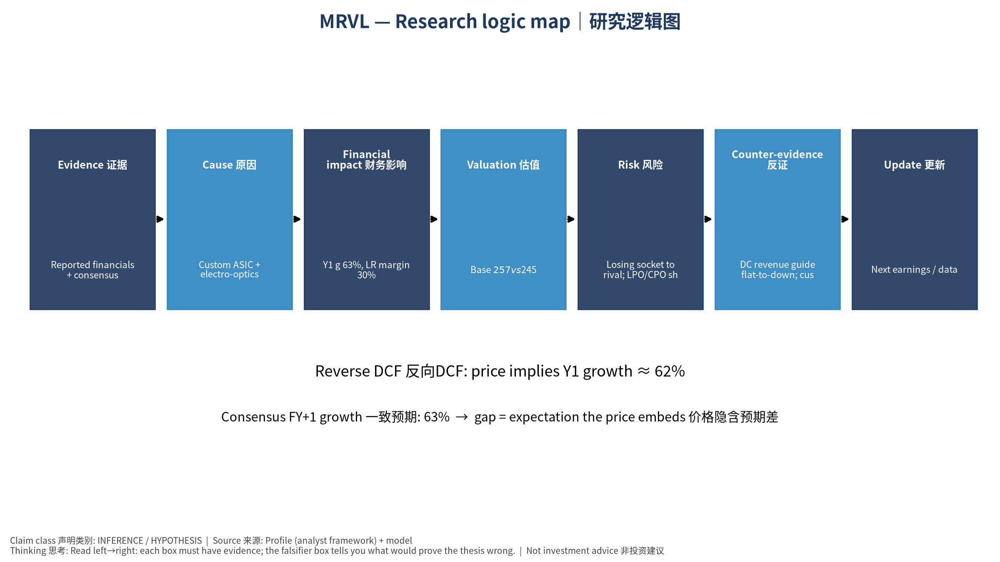

# MRVL 初学者教学版 (中文) v20261015-0757
## ① 一句话
Marvell Technology, Inc. 是一家 Custom ASIC + electro-optics 定制ASIC+光电DSP 公司。现在股价 $245.28。我们的Base模型认为每股价值约 $257（4.7%）。

## ② 发生了什么
最近一季财报EPS实际 vs 预期: ['2026-07-31', '0.94', '0.93077', '0.0099']（实际、预期、超预期%）。下次财报约 2026-12-02。

## ③ 术语 Glossary
- DCF (Discounted Cash Flow｜现金流折现): 把未来每年能拿到的现金，按"时间成本"折回今天加总。
- FCF (Free Cash Flow｜自由现金流) = 经营现金流 − 资本开支。
- WACC (Weighted Average Cost of Capital｜加权平均资本成本): 投资人要求的年回报率，用作折现率。
- Reverse DCF (反向DCF): 反过来问"现价要求公司增长多快"。
- Consensus (一致预期): 分析师预测的平均值。
- Falsifier (证伪指标): 一旦出现就说明论点错了的信号。

## ④ 生活比喻
买这家公司股票≈买一棵果树。DCF就是估算果树未来每年结多少果(FCF)，再考虑"明年的一斤果不如今天的一斤果值钱"(WACC折现)。

## ⑤ 因果箭头
Custom ASIC + electro-optics 定制ASIC+光电DSP 需求 → 收入增长 (g) → 自由现金流 (FCF = 收入 × FCF率) → 折现 (÷(1+WACC)^t) → 每股价值 → 与股价比较 → 预期差

## ⑥ 数字例题（符号定义）
设 R₀ = 过去12个月收入 = 9.5 bn USD；g₁ = 第一年增速 = 63.2%；m = 长期FCF率 = 30.0%；W = WACC = 13.2%。
第一年收入 R₁ = R₀ × (1+g₁) = 15.4 bn USD。
若第5年FCF率达到 m，则第1年FCF ≈ R₁ × m₁（m₁ 由当前 18.2% 向 30.0% 线性过渡）= 3.2 bn USD；
折现到今天: FCF₁ ÷ (1+W)¹ = 2.8 bn USD。十年加总 + 终值 = EV 232.2 bn USD。

## ⑦ 事实 / 预测 / 市场预期
- 事实: 过去财务数据(第4节)、现价。
- 预测(我们的假设): 长期FCF率 30.0%、三情景。
- 市场预期: 一致预期增速 63.2%；价格隐含增速 61.8%。

## ⑧ 三情景
Bear $60 / Base $257 / Bull $599；概率加权 $293。

## ⑨ 反方观点与失效条件
反方: Losing socket to rival; LPO/CPO shrinks DSP TAM｜失去关键项目；LPO/CPO压缩DSP市场
失效条件: DC revenue guide flat-to-down; customer disclosures of competitor sockets｜DC收入指引持平或下降；客户披露换供应商

## 自我检验题
1. 如果WACC上升1个百分点，价值会升还是降？为什么？（提示：分母变大）
2. 反向DCF隐含增速高于一致预期意味着什么？

---

# MRVL Beginner Teaching Edition (English) v20261015-0757
## ① In one line
Marvell Technology, Inc. is a Custom ASIC + electro-optics 定制ASIC+光电DSP company. Price $245.28; our Base model value ≈ $257 (4.7%).
## ② What happened
Last quarter EPS actual vs consensus: ['2026-07-31', '0.94', '0.93077', '0.0099']. Next earnings ≈ 2026-12-02 (TENTATIVE).
## ③ Glossary
DCF (Discounted Cash Flow｜现金流折现); FCF (Free Cash Flow｜自由现金流) = operating cash flow − capex; WACC (Weighted Average Cost of Capital｜加权平均资本成本) = the yearly return investors demand; Reverse DCF (反向DCF) = what growth the price requires; Consensus (一致预期); Falsifier (证伪指标).
## ④ Analogy
Owning the stock ≈ owning a fruit tree: DCF estimates future fruit (FCF) and discounts it because fruit next year is worth less than fruit today.
## ⑤ Causal arrows
Demand → revenue growth (g) → FCF (= revenue × FCF margin) → discounting ÷(1+WACC)^t → value/share → compare with price → expectation gap
## ⑥ Worked example (symbols)
R₀ = TTM revenue = 9.5 bn USD; g₁ = 63.2%; m = long-run FCF margin = 30.0%; W = 13.2%.
R₁ = R₀×(1+g₁) = 15.4 bn USD; FCF₁ = 3.2 bn USD; PV = FCF₁/(1+W) = 2.8 bn USD; 10 years + terminal → EV 232.2 bn USD.
## ⑦ Fact vs forecast vs market expectation
Facts: reported financials, price. Forecast: our margin/scenario assumptions. Market: consensus growth 63.2%; price-implied growth 61.8%.
## ⑧ Three scenarios
Bear $60 / Base $257 / Bull $599; weighted $293.
## ⑨ Counterview & failure conditions
Losing socket to rival; LPO/CPO shrinks DSP TAM｜失去关键项目；LPO/CPO压缩DSP市场 — Falsifiers: DC revenue guide flat-to-down; customer disclosures of competitor sockets｜DC收入指引持平或下降；客户披露换供应商
## Self-check
1. WACC +1pp → value up or down? 2. What does price-implied growth > consensus mean?

