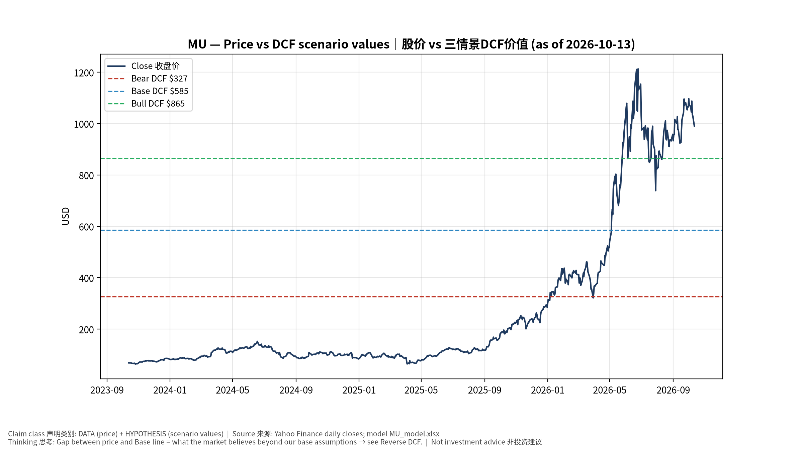
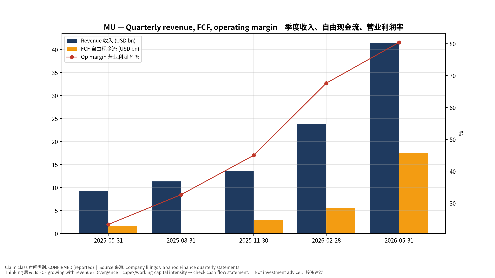
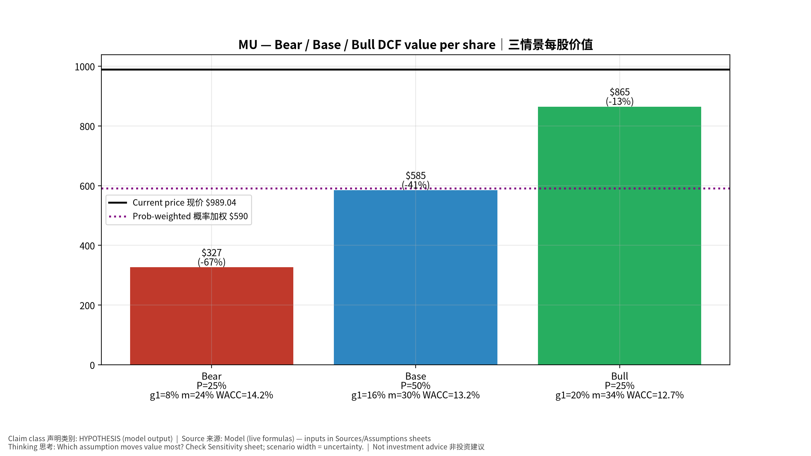
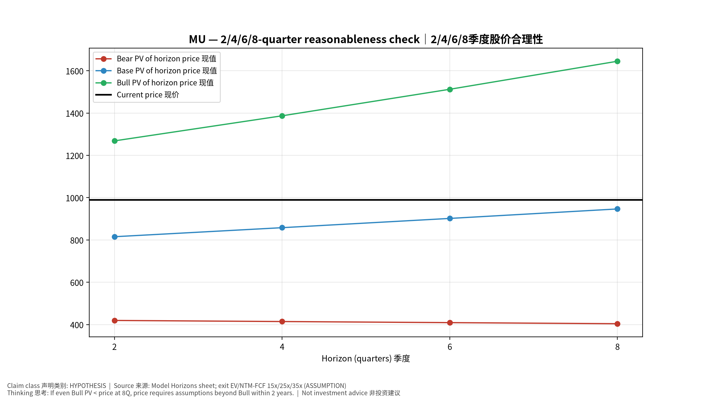
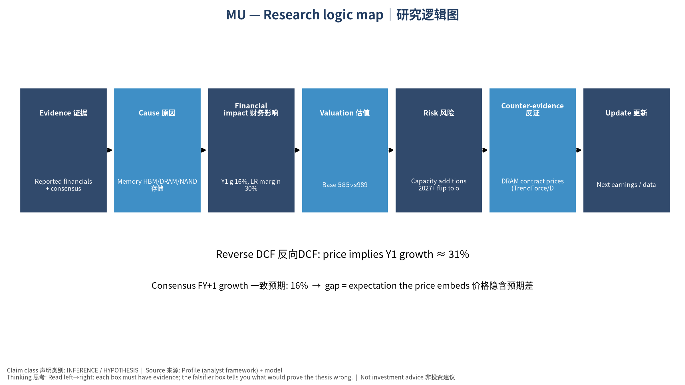

# MU Micron Technology, Inc. — 个股深度研究 (专业中文版) v20261013-1622
> 数据截至 2026-10-13 16:22 SGT｜价格 $989.04｜市值 1,119.0 bn USD｜财报货币 USD｜非投资建议。事实=CONFIRMED/DATA；推断=INFERENCE；假设=ASSUMPTION/HYPOTHESIS。

## 1. 投资论点 Investment Thesis (HYPOTHESIS)
AI把存储从周期品部分转为结构性成长：HBM吃掉晶圆产能，挤压通用DRAM供给，推高合约价；但存储仍具强周期性，需监控供给纪律与价格拐点。

- **多头驱动**: HBM4 share gains at NVDA, DRAM contract prices keep rising, eSSD boom｜HBM4在NVDA份额提升、DRAM合约价续涨、企业SSD爆发
- **空头驱动**: Capacity additions 2027+ flip to oversupply; HBM price cuts; China CXMT expansion｜2027后扩产导致过剩、HBM降价、长鑫扩张
- **证伪条件 Falsifiers**: DRAM contract prices (TrendForce/DRAMeXchange) turn negative q/q; inventory days rising; HBM qualification setbacks｜DRAM合约价环比转负；库存天数上升；HBM认证受挫

## 2. 产品、客户与收入模式
- 主题 Theme: Memory HBM/DRAM/NAND 存储
- 业务分部 Segments: DRAM incl. HBM DRAM含HBM；NAND/SSD；Other 其他
- 公司描述 (DATA, Yahoo/公司申报): Micron Technology, Inc. engages in the provision of semiconductor memory and storage products in the United States, Taiwan, Mainland China, other Asia Pacific countries, Japan, Europe, and internationally. It operates through Cloud Memory Business Unit, Core Data Center Business Unit, Mobile and Client Business Unit, and Automotive and Embedded Business Unit segments. The company provides dynamic random access memory (DRAM) products, including High-Bandwidth Memory, doublie data rate, low-power DRAM, and graphics DRAM products; NAND products comprising solid state drives, managed NAND, and multi-chip packages; and NOR products. The company sells its products under the Micron brand name and private labels through its own direct sales force, sales or representative offices, as well as through distributors, retailers, and independent sales representatives. Micron Technology, Inc. was founde
- 主要客户: NVDA/AMD (HBM), hyperscalers (DDR5/eSSD), PC/phone OEMs｜NVDA/AMD(HBM)、云厂(DDR5/企业SSD)、PC/手机厂

## 3. 行业、竞争、监管与供应链 (ANALYST FRAMEWORK)
- 供应商/上游: ASML/AMAT/LRCX/TEL/KLAC equipment; wafers; TSMC (HBM4 base die)｜设备商、硅片、台积电(HBM4基底die)
- 竞争者 (含业外): SK hynix, Samsung, CXMT (China), Kioxia/SanDisk/YMTC in NAND｜SK海力士、三星、长鑫、铠侠/闪迪/长江存储
- 瓶颈/监管: HBM capacity (wafer trade ratio ~3x DDR5), cleanroom space, TSV/packaging yield｜HBM产能(晶圆消耗约DDR5的3倍)、洁净室、TSV良率
- 关键KPI: DRAM/NAND ASP, bit shipments, HBM revenue, GM%, inventory days, capex｜DRAM/NAND均价、位元出货、HBM收入、毛利率、库存天数、Capex
- 零部件现货/合约价: 本版未接入付费价格源(TrendForce/DRAMeXchange等)——标注 **UNAVAILABLE**，在KPI监控中以定性方式跟踪。

## 4. 历史财务与现金流 (CONFIRMED, 季度, USD)
| 季度 | 收入 | 毛利 | 营业利润 | 净利润 | FCF | 营业利润率 |
|---|---|---|---|---|---|---|
| 2026-05-31 | 41.5 bn USD | 35.1 bn USD | 33.3 bn USD | 28.2 bn USD | 17.6 bn USD | 80.4% |
| 2026-02-28 | 23.9 bn USD | 17.8 bn USD | 16.1 bn USD | 13.8 bn USD | 5.5 bn USD | 67.6% |
| 2025-11-30 | 13.6 bn USD | 7.6 bn USD | 6.1 bn USD | 5.2 bn USD | 3.0 bn USD | 45.0% |
| 2025-08-31 | 11.3 bn USD | 5.1 bn USD | 3.7 bn USD | 3.2 bn USD | 72.0 mn USD | 32.6% |
| 2025-05-31 | 9.3 bn USD | 3.5 bn USD | 2.2 bn USD | 1.9 bn USD | 1.7 bn USD | 23.3% |

资产负债: 现金 43.4 bn USD；总负债 5.2 bn USD；净现金 38.3 bn USD。TTM FCF 26.2 bn USD（FCF率 19.7%）。

## 5. 最新财报: 实际 vs 一致预期 vs 指引
| 季度 | EPS实际 | EPS一致预期 | 超预期% |
|---|---|---|---|
| 2025-11-30 | 4.78 | 3.96409 | 0.2058 |
| 2026-02-28 | 12.2 | 9.15866 | 0.3321 |
| 2026-05-31 | 25.11 | 20.68603 | 0.2139 |
| 2026-08-31 | 33.42 | 31.81801 | 0.050300002 |

- 管理层指引 Guidance: 自动数据源不含指引——**UNAVAILABLE（待从公司IR新闻稿录入）**。
- 下次财报日 (Yahoo, TENTATIVE 直至公司确认): **2026-12-24**；本季EPS一致预期 38.21061（30位分析师）；收入一致预期 61.7 bn USD。

## 6. 未来2/4/6/8季度驱动与价格合理性
| 期限 | 情景 | 期限价格现值 | 相对现价 |
|---|---|---|---|
| 2Q | Bear | $419.50 | -57.6% |
| 2Q | Base | $815.33 | -17.6% |
| 2Q | Bull | $1,268.43 | 28.2% |
| 4Q | Bear | $414.34 | -58.1% |
| 4Q | Base | $858.09 | -13.2% |
| 4Q | Bull | $1,387.02 | 40.2% |
| 6Q | Bear | $409.18 | -58.6% |
| 6Q | Base | $901.85 | -8.8% |
| 6Q | Bull | $1,512.43 | 52.9% |
| 8Q | Bear | $404.03 | -59.1% |
| 8Q | Base | $946.62 | -4.3% |
| 8Q | Bull | $1,644.98 | 66.3% |

现价隐含的 EV/NTM-FCF (Base 路径): | 期限 | 隐含倍数 |
|---|---|
| 2Q | 28.6x |
| 4Q | 25.5x |
| 6Q | 22.7x |
| 8Q | 20.2x |

解读: 如果8季度后Base情景所需倍数仍远高于25x，说明价格依赖更远期的增长。

## 7. 三情景 Bear / Base / Bull (HYPOTHESIS)
| 情景 | Y1增速 | 长期FCF率 | WACC | 永续g | 概率 | 每股价值 | 相对现价 |
|---|---|---|---|---|---|---|---|
| Bear | 7.9% | 24.0% | 14.2% | 2.5% | 25.0% | $326.58 | -67.0% |
| Base | 15.7% | 30.0% | 13.2% | 3.0% | 50.0% | $584.92 | -40.9% |
| Bull | 20.4% | 34.5% | 12.7% | 3.5% | 25.0% | $864.80 | -12.6% |

概率加权价值 **$590.31**（相对现价 -40.3%）。

## 8. 估值: DCF / Reverse DCF / ROIC-WACC / 同业 / 敏感度
- DCF Base: EV 623.5 bn USD；终值占比 45.4%。
- **Reverse DCF 反向DCF**: 在Base利润率与WACC下，现价隐含Y1收入增速 ≈ **30.6%**；一致预期FY+1增速 15.7%。
- WACC (CAPM) = rf 5.2% + β 1.60 × ERP 5.0% = 13.2%。
- SOTP segments 分部: DRAM incl. HBM DRAM含HBM; NAND/SSD; Other 其他. **Status: framework only** — segment revenues are INPUT REQUIRED from the latest 10-K/10-Q segment note (not auto-fed, left blank to avoid fabrication)｜分部收入需按最新财报手动录入，未自动填充以避免编造。
- 同业比较 Comps (DATA):
| Ticker | 市值 | EV/Sales | Fwd P/E | 收入增速 | 毛利率 | FCF收益率 |
|---|---|---|---|---|---|---|
| MU | 1,119.0 bn USD | 8.1x | 4.8x | 379.3% | 80.7% | 2.3% |
| 000660.KS | 1,026,082.0 bn USD | 5.7x | 3.1x | 256.8% | 76.3% | 5.4% |
| 005930.KS | 1,523,442.8 bn USD | 3.1x | 3.2x | 130.0% | 57.5% | 4.6% |
| WDC | 144.8 bn USD | 10.8x | 11.8x | 43.8% | 48.9% | 1.6% |
| SNDK | 215.0 bn USD | 10.5x | 5.6x | 371.6% | 71.5% | 3.6% |

- 敏感度: 见Excel `Sensitivity` 表 (WACC × 永续增长率)。

## 9. 风险、反方论证与证伪
- 反方观点 Counter-thesis: Capacity additions 2027+ flip to oversupply; HBM price cuts; China CXMT expansion｜2027后扩产导致过剩、HBM降价、长鑫扩张
- 证伪指标: DRAM contract prices (TrendForce/DRAMeXchange) turn negative q/q; inventory days rising; HBM qualification setbacks｜DRAM合约价环比转负；库存天数上升；HBM认证受挫
- 模型风险: 长期利润率与WACC为假设；终值占比高时估值对假设极敏感。

## 10. Source Ledger 来源账本
| Item | Value | Source/time |
|---|---|---|
| Price 股价 | 989 | Yahoo Finance quote, fetched 2026-10-13T16:22 SGT |
| Market cap 市值 | 1.119e+12 | Yahoo info.marketCap 2026-10-13T16:22 |
| Cash 现金 | 4.343e+10 | Yahoo info.totalCash (latest filing) 2026-10-13T16:22 |
| Debt 负债 | 5.179e+09 | Yahoo info.totalDebt (latest filing) 2026-10-13T16:22 |
| Revenue TTM 收入 | 1.332e+11 | Yahoo info.totalRevenue (TTM, USD) 2026-10-13T16:22 |
| FCF TTM 自由现金流 | 2.617e+10 | Sum of last 4 quarterly FCF (q_cash); quarters ['2026-05-31', '2026-02-28', '2025-11-30', '2025-08-31'] (USD) |
| Beta | 2.226 | Yahoo info.beta (5Y monthly) |
| Risk-free 10Y 无风险利率 | 0.0522 | FRED DGS10 2026-10-08 |
| FX USD per USD | 1 | n/a (USD) |
| Consensus rev growth FY0 | 1.065 | Yahoo revenue_estimate 0y |
| Consensus rev growth FY+1 | 0.1573 | Yahoo revenue_estimate +1y |

## 11. Assumption Register 假设登记表
| Assumption | Value | Rationale |
|---|---|---|
| ERP 股权风险溢价 | 0.05 | ASSUMPTION: 5.0% house mature-market ERP |
| Beta clamp | [0.8,1.6] → 1.60 | ASSUMPTION: limit extreme betas |
| Tax rate (ROIC) | 0.18 | ASSUMPTION: blended cash tax 18% |
| Year-1 growth (Base) | 0.1573 | Consensus FY+1 revenue growth (Yahoo revenue_estimate '+1y'); capped at 100% |
| Growth fade | linear Y1→terminal by Y10 | ASSUMPTION |
| Starting FCF margin | 0.1965 | DATA: FCF TTM / Revenue TTM, floored -50% |
| Long-run FCF margin (Base) | 0.3 | ASSUMPTION (analyst framework, reached by Y5; see profile) |
| Bear/Bull Y1 growth multiplier | 0.5x / 1.3x | ASSUMPTION |
| Bear/Bull margin multiplier | 0.8x / 1.15x | ASSUMPTION |
| WACC adj Bear/Bull | +1.0pp / -0.5pp | ASSUMPTION |
| Terminal g Bear/Base/Bull | 2.5% / 3.0% / 3.5% | ASSUMPTION |
| Scenario probabilities | 25% / 50% / 25% | ASSUMPTION |
| Horizon exit EV/NTM-FCF Bear/Base/Bull | 15x / 25x / 35x | ASSUMPTION |
| Per-share conversion | value × fx ÷ market cap × price | METHOD: avoids ADR/share-class mismatch |

## 12. Model Provenance 模型溯源
- Model file: `MU_model_v20261013-1622.xlsx` (live formulas; sheets Inputs→Scenarios→DCF→ReverseDCF→Sensitivity→Horizons→SOTP→Comps→ROIC_WACC→History→Sources→Assumptions)
- Engine: `production/pipeline/model.py` (Python mirror; values in this report = Python mirror, verified against LibreOffice recalculation of the xlsx)
- Data snapshot: `data/snapshots/20261013-1622` (immutable) | Fetched 2026-10-13 16:22 SGT | Generated 2026-10-13 16:23 SGT
- Version: v20261013-1622. Prior versions are never overwritten (see company history page).

## 13. 版本与事件时间轴
- v20261013-1622: 首版生产系统报告 (27家同步)。下一事件: 财报 2026-12-24 (TENTATIVE)。

## 图片报告 Image Report

*股价vs三情景价值 Price vs scenario values*

*季度财务 Quarterly financials*

*三情景 Scenarios*

*2/4/6/8季度检验 Horizon check*

*研究逻辑图 Logic map*

---

# MU Micron Technology, Inc. — Equity Deep Dive (Professional English) v20261013-1622
> Data as of 2026-10-13 16:22 SGT | Price $989.04 | Mkt cap 1,119.0 bn USD | Reporting currency USD | Not investment advice.

## 1. Investment thesis (HYPOTHESIS)
AI partially converts memory from a commodity cycle into structural growth: HBM consumes wafer capacity, tightening commodity DRAM and lifting contract prices. Memory remains cyclical, so supply discipline and price inflections must be monitored.

- **Bull drivers**: HBM4 share gains at NVDA, DRAM contract prices keep rising, eSSD boom｜HBM4在NVDA份额提升、DRAM合约价续涨、企业SSD爆发
- **Bear drivers**: Capacity additions 2027+ flip to oversupply; HBM price cuts; China CXMT expansion｜2027后扩产导致过剩、HBM降价、长鑫扩张
- **Falsifiers**: DRAM contract prices (TrendForce/DRAMeXchange) turn negative q/q; inventory days rising; HBM qualification setbacks｜DRAM合约价环比转负；库存天数上升；HBM认证受挫

## 2. Products, customers, revenue model
- Theme: Memory HBM/DRAM/NAND 存储 | Segments: DRAM incl. HBM DRAM含HBM; NAND/SSD; Other 其他
- Business description (DATA): Micron Technology, Inc. engages in the provision of semiconductor memory and storage products in the United States, Taiwan, Mainland China, other Asia Pacific countries, Japan, Europe, and internationally. It operates through Cloud Memory Business Unit, Core Data Center Business Unit, Mobile and Client Business Unit, and Automotive and Embedded Business Unit segments. The company provides dynamic random access memory (DRAM) products, including High-Bandwidth Memory, doublie data rate, low-power DRAM, and graphics DRAM products; NAND products comprising solid state drives, managed NAND, and multi-chip packages; and NOR products. The company sells its products under the Micron brand name and private labels through its own direct sales force, sales or representative offices, as well as through distributors, retailers, and independent sales representatives. Micron Technology, Inc. was founde
- Customers: NVDA/AMD (HBM), hyperscalers (DDR5/eSSD), PC/phone OEMs｜NVDA/AMD(HBM)、云厂(DDR5/企业SSD)、PC/手机厂

## 3. Industry, competition, regulation, supply chain (ANALYST FRAMEWORK)
- Suppliers: ASML/AMAT/LRCX/TEL/KLAC equipment; wafers; TSMC (HBM4 base die)｜设备商、硅片、台积电(HBM4基底die)
- Competitors: SK hynix, Samsung, CXMT (China), Kioxia/SanDisk/YMTC in NAND｜SK海力士、三星、长鑫、铠侠/闪迪/长江存储
- Bottlenecks/regulation: HBM capacity (wafer trade ratio ~3x DDR5), cleanroom space, TSV/packaging yield｜HBM产能(晶圆消耗约DDR5的3倍)、洁净室、TSV良率
- KPIs: DRAM/NAND ASP, bit shipments, HBM revenue, GM%, inventory days, capex｜DRAM/NAND均价、位元出货、HBM收入、毛利率、库存天数、Capex
- Component spot/contract prices: paid feeds not connected — **UNAVAILABLE**, tracked qualitatively.

## 4. Historical financials & cash flow (CONFIRMED, quarterly, USD)
| Quarter | Revenue | Gross profit | Op income | Net income | FCF | Op margin |
|---|---|---|---|---|---|---|
| 2026-05-31 | 41.5 bn USD | 35.1 bn USD | 33.3 bn USD | 28.2 bn USD | 17.6 bn USD | 80.4% |
| 2026-02-28 | 23.9 bn USD | 17.8 bn USD | 16.1 bn USD | 13.8 bn USD | 5.5 bn USD | 67.6% |
| 2025-11-30 | 13.6 bn USD | 7.6 bn USD | 6.1 bn USD | 5.2 bn USD | 3.0 bn USD | 45.0% |
| 2025-08-31 | 11.3 bn USD | 5.1 bn USD | 3.7 bn USD | 3.2 bn USD | 72.0 mn USD | 32.6% |
| 2025-05-31 | 9.3 bn USD | 3.5 bn USD | 2.2 bn USD | 1.9 bn USD | 1.7 bn USD | 23.3% |

Cash 43.4 bn USD; debt 5.2 bn USD; TTM FCF 26.2 bn USD (FCF margin 19.7%).

## 5. Latest earnings: actual vs consensus vs guidance
| Quarter | EPS actual | EPS consensus | Surprise |
|---|---|---|---|
| 2025-11-30 | 4.78 | 3.96409 | 0.2058 |
| 2026-02-28 | 12.2 | 9.15866 | 0.3321 |
| 2026-05-31 | 25.11 | 20.68603 | 0.2139 |
| 2026-08-31 | 33.42 | 31.81801 | 0.050300002 |

- Management guidance: not in automated feed — **UNAVAILABLE (to be entered from IR release)**.
- Next earnings (Yahoo; TENTATIVE until company-confirmed): **2026-12-24**; current-quarter EPS consensus 38.21061 (30 analysts); revenue consensus 61.7 bn USD.

## 6. 2/4/6/8-quarter drivers & price reasonableness
| Horizon | Scenario | PV of horizon price | vs current |
|---|---|---|---|
| 2Q | Bear | $419.50 | -57.6% |
| 2Q | Base | $815.33 | -17.6% |
| 2Q | Bull | $1,268.43 | 28.2% |
| 4Q | Bear | $414.34 | -58.1% |
| 4Q | Base | $858.09 | -13.2% |
| 4Q | Bull | $1,387.02 | 40.2% |
| 6Q | Bear | $409.18 | -58.6% |
| 6Q | Base | $901.85 | -8.8% |
| 6Q | Bull | $1,512.43 | 52.9% |
| 8Q | Bear | $404.03 | -59.1% |
| 8Q | Base | $946.62 | -4.3% |
| 8Q | Bull | $1,644.98 | 66.3% |

Current-price implied EV/NTM-FCF on Base path: | Horizon | Implied multiple |
|---|---|
| 2Q | 28.6x |
| 4Q | 25.5x |
| 6Q | 22.7x |
| 8Q | 20.2x |

## 7. Bear / Base / Bull (HYPOTHESIS)
| Scenario | Y1 growth | LR FCF margin | WACC | Terminal g | Prob. | Value/share | vs price |
|---|---|---|---|---|---|---|---|
| Bear | 7.9% | 24.0% | 14.2% | 2.5% | 25.0% | $326.58 | -67.0% |
| Base | 15.7% | 30.0% | 13.2% | 3.0% | 50.0% | $584.92 | -40.9% |
| Bull | 20.4% | 34.5% | 12.7% | 3.5% | 25.0% | $864.80 | -12.6% |

Probability-weighted value **$590.31** (-40.3% vs price).

## 8. Valuation: DCF / Reverse DCF / ROIC-WACC / comps / sensitivity
- Base DCF EV 623.5 bn USD; terminal share 45.4%.
- **Reverse DCF**: at Base margin/WACC the price implies Y1 revenue growth ≈ **30.6%** vs consensus FY+1 15.7%.
- WACC (CAPM) = rf 5.2% + β 1.60 × ERP 5.0% = 13.2%.
- SOTP segments: DRAM incl. HBM DRAM含HBM; NAND/SSD; Other 其他 — framework only; segment revenue inputs pending from filings.
- Comps (DATA): see table in Chinese section / Excel `Comps`.
- Sensitivity: Excel `Sensitivity` (WACC × terminal g).

## 9. Risks, counterarguments, falsifiers
Capacity additions 2027+ flip to oversupply; HBM price cuts; China CXMT expansion｜2027后扩产导致过剩、HBM降价、长鑫扩张 | Falsifiers: DRAM contract prices (TrendForce/DRAMeXchange) turn negative q/q; inventory days rising; HBM qualification setbacks｜DRAM合约价环比转负；库存天数上升；HBM认证受挫

## 10–12. Source Ledger / Assumption Register / Model Provenance
See tables above (shared, bilingual). - Model file: `MU_model_v20261013-1622.xlsx` (live formulas; sheets Inputs→Scenarios→DCF→ReverseDCF→Sensitivity→Horizons→SOTP→Comps→ROIC_WACC→History→Sources→Assumptions)
- Engine: `production/pipeline/model.py` (Python mirror; values in this report = Python mirror, verified against LibreOffice recalculation of the xlsx)
- Data snapshot: `data/snapshots/20261013-1622` (immutable) | Fetched 2026-10-13 16:22 SGT | Generated 2026-10-13 16:23 SGT
- Version: v20261013-1622. Prior versions are never overwritten (see company history page).
