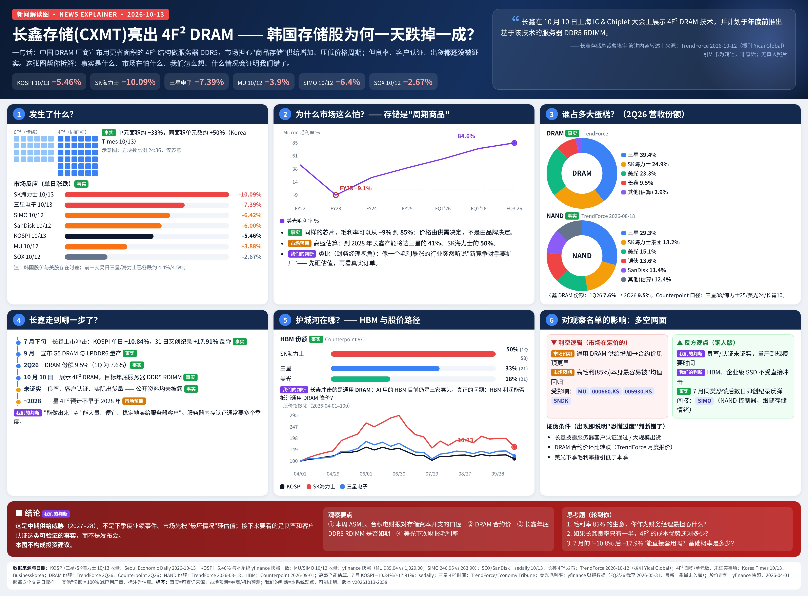
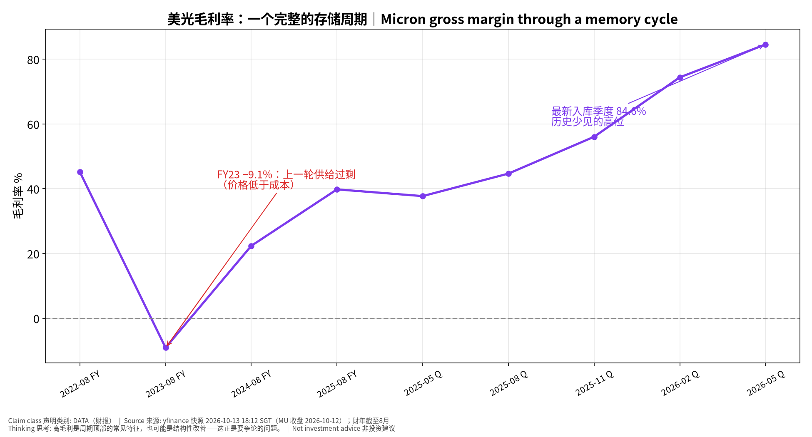
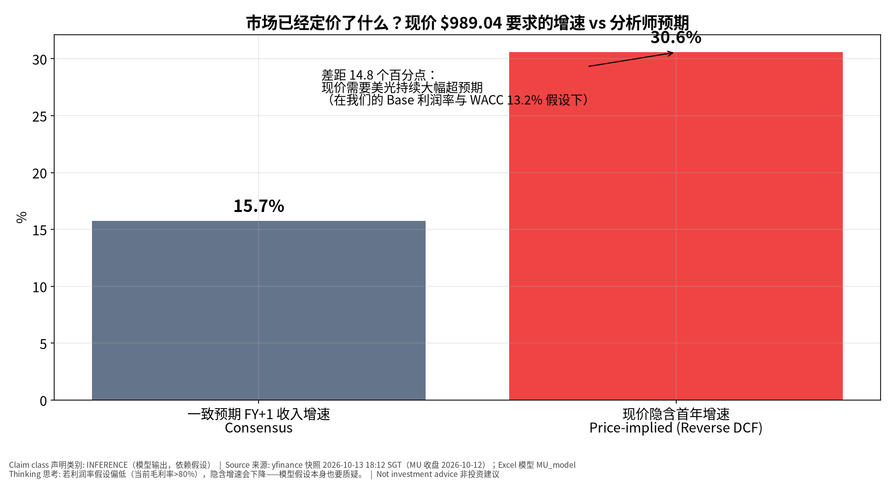
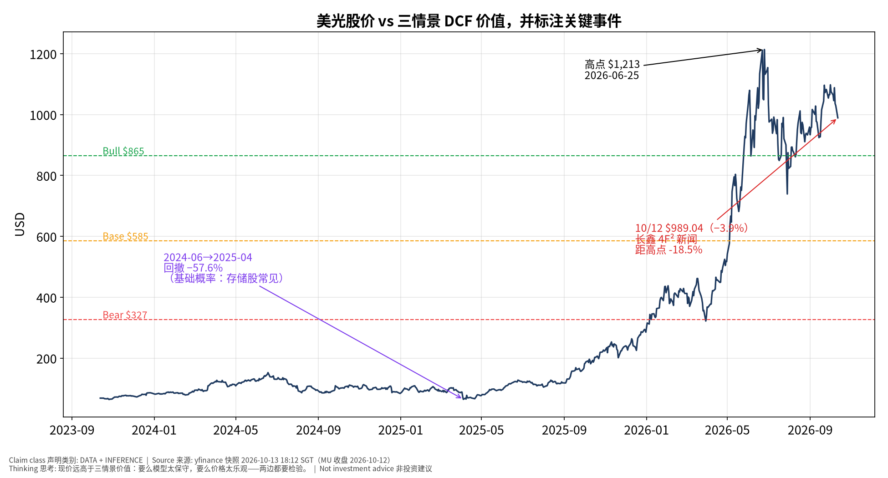

# MU 美光 — 思考过程版（Teaching v2.1 试点）v20261013-2057-think
> 数据：yfinance 快照 2026-10-13 18:12 SGT（MU 收盘 2026-10-12）｜模型与数字沿用 v20261013-1812（同一快照，未改动）｜**非投资建议**｜标签：事实 DATA / 市场预期 / 我们的判断 INFERENCE
> 关联新闻解读图：[长鑫 4F² DRAM 冲击（新闻解读图）](../../../../news.html)

**⏱ 30秒看懂**

1. **发生什么：**长鑫（CXMT）10/10 展示 4F² DRAM，美光 10/12 收跌 3.9% 至 $989.04，距 2026-06-25 高点 -18.5%。
2. **和我的股票有什么关系：**现价隐含首年收入增速约 30.6%，分析师一致预期 15.7%；我们的三情景价值 $327/$585/$865 都低于现价。
3. **该看什么/做什么：**盯：DRAM 合约价、12/24（TENTATIVE）财报的毛利率指引、长鑫服务器客户认证。

**🗺 阅读地图**

| 你有多少时间 | 读哪里 |
|---|---|
| 2 分钟 | 30秒卡 + 新闻解读图 |
| 10 分钟 | + 七步思考 + 反方裁判 |
| 30 分钟 | 全部 + Excel 模型 + 原 v1812 专业报告 |

层级说明：**L1 故事**（人人能懂）→ **L2 关键数字**（带解释）→ **L3 专业细节**（网页可折叠，默认收起）。

## 一、七步思考过程（把分析师脑子里的过程写出来）
1. **先问对问题：谁在乎、为什么在乎** —— 谁在乎长鑫？持有美光/海力士/三星的人。为什么？因为 DRAM 价格由全行业供给决定，长鑫多供一片，所有人的价格都受影响。
2. **市场已经定价了什么** —— 反向 DCF：现价 $989.04 需要首年增速 ≈ 30.6%，高于一致预期 15.7%。市场定价的是"超级周期继续"。
3. **搭因果链，每环配一个检验数据** —— 长鑫扩产 → 通用 DRAM 供给↑（检验：长鑫份额，2Q26 9.5%）→ 合约价↓（检验：TrendForce 月度合约价）→ 美光毛利率↓（检验：下季指引）→ EPS↓ → 股价。
4. **找每一环的断点** —— 断点①：4F² 良率/认证未证实，供给未必兑现；断点②：HBM 吃掉晶圆，通用 DRAM 未必过剩；断点③：价格已经大幅回撤，可能已部分定价。
5. **用工具箱逐一质疑** —— 见第二节。
6. **给对立观点最强版本，再用证据裁判** —— 见第三节。
7. **写下「如果我错了，会先看到什么」** —— 见第四节证伪清单。

## 二、质疑工具箱（每个工具都用真实数字）
### 第一性原理 First principles
- **是什么：**拆到最基本：价格 = 未来现金流 ÷ 折现。这件事改变的是现金流还是折现率？
- **为什么用：**避免被标题情绪带走。
- **用在本事件上：**长鑫新闻改变的是**现金流**（未来价格/毛利），不是折现率（WACC 13.2% 不变）。美光最新入库季度毛利率 84.6%，营收 $41.46B；问题是这种利润能持续几年。
- **✍ 轮到你：**如果毛利率回到 FY25 的 39.8%，你觉得每股价值会变多少？用 Excel 的利润率输入试一试。

### 二阶思维 Second-order
- **是什么：**然后呢？谁会因此改变行为？二阶、三阶效果是什么？
- **为什么用：**一阶看'竞争对手变多'，二阶看'别人怎么反应'。
- **用在本事件上：**二阶：三星/海力士可能加快 4F²（三星预计不早于 2028）或把更多产能转去 HBM；客户可能趁机压合约价、减少囤货——这会比长鑫本身更早体现在价格上。
- **✍ 轮到你：**列出一个'客户行为'变化，以及你会用什么数据看到它。

### 反向思考 Inversion
- **是什么：**什么会让我错？相反结论成立需要哪些条件同时为真？
- **为什么用：**先想怎么输。
- **用在本事件上：**看多美光会错，如果：合约价环比转负 + 库存天数上升 + 毛利率指引下降，三者同时出现。
- **✍ 轮到你：**反过来：看空会错的条件是什么？

### 市场已经定价了什么 Priced-in
- **是什么：**共识/价格隐含了什么？只有「实际−预期」推动价格。
- **为什么用：**只有'实际−预期'推动价格。
- **用在本事件上：**现价隐含 30.6% vs 一致预期 15.7%；过去 4 季 EPS 超预期：2025-11 +21% / 2026-02 +33% / 2026-05 +21% / 2026-08 +5%——超预期幅度在缩小（最近一季 +5%）。
- **✍ 轮到你：**超预期幅度缩小，意味着什么？

### 谁在对手盘 Counterparty
- **是什么：**如果我对，谁错？他们为什么会错？想不出来=可能已被定价。
- **为什么用：**想清楚你在和谁交易。
- **用在本事件上：**今天卖出的人在押'周期见顶'；买入的人在押'AI 让存储不再是周期品'。周期派的证据：FY23 毛利率 −9.1%。结构派的证据：HBM 份额 SKH50/三星33/美光18，寡头。
- **✍ 轮到你：**你更相信哪一方？他们为什么可能错？

### 基础概率 Base rates
- **是什么：**这类事情历史上多常发生？先用基础概率，再用本次信息调整。
- **为什么用：**先用历史再用本次信息调整。
- **用在本事件上：**本快照内美光 2024-06→2025-04 回撤 −57.6%；毛利率 FY22 45.2% → FY23 −9.1%。存储股大起大落是常态，不是例外。7 月长鑫上市时 KOSPI −10.84% 后次日 +17.91%——单日恐慌不等于趋势。
- **✍ 轮到你：**当前距高点 {dd:.1f}%，和历史回撤相比算大还是小？

### 假设清单与证伪 Assumptions & falsifiers
- **是什么：**逐条写出假设，并给每条一个推翻它的可观察信号。
- **为什么用：**把信念变成可检验的清单。
- **用在本事件上：**见第四节表格。
- **✍ 轮到你：**给每条假设加一个你会去看的网站/数据。

## 三、给空头最强版本，再用证据裁判
**我们的观点：**长鑫是中期（2027–28）供给威胁，不是下季度业绩事件；但美光现价已要求高于共识的增长，安全边际很薄。

**对立观点最强版本：**
1. 毛利率 >80% 本身就会吸引供给，历史上每次都均值回归（FY23 −9.1%）
2. 长鑫份额一年翻倍式提升（1Q 7.6% → 2Q 9.5%），高盛估算 2028 产能达三星 41%
3. 现价高于我们 Bull 价值 $865，任何坏消息都会被放大

| 证据 | 支持我们 | 支持对立 | 权重 |
|---|---|---|---|
| 长鑫 4F² 良率/认证未证实 | ✔ |  | 中 |
| 毛利率处于历史极端高位 |  | ✔ | 高 |
| HBM 寡头、份额稳定 | ✔ |  | 中 |
| EPS 超预期幅度从 +33% 降到 +5% |  | ✔ | 中 |
| 现价 > 三情景 DCF 价值 |  | ✔ | 高 |
| 7 月同类恐慌迅速反弹 | ✔ |  | 低 |

**裁判：**证据略偏空方：不是因为长鑫本身，而是因为**估值已经定价了乐观情景**。长鑫新闻只是让市场重新想起'周期'。（我们的判断，可能出错）

## 四、假设清单与证伪
| 假设 | 检验数据 | 推翻信号 |
|---|---|---|
| DRAM 合约价继续上涨 | TrendForce 月度合约价 | 环比转负 |
| 长鑫短期无法放量服务器 DDR5 | 客户认证公告/出货 | 年底前宣布主流云厂认证 |
| HBM 份额稳定 | Counterpoint 季度份额 | 美光份额 <15% |
| 毛利率维持高位 | 12/24 财报指引（TENTATIVE） | 指引环比下降 |

## 五、怎么看这些图

**📊 怎么看这张图**

- **坐标/颜色：**横轴=财年(FY)/财季(Q)，纵轴=毛利率%；紫线=美光
- **只记住一件事：**毛利率可以从 −9% 到 85%——这就是'周期品'
- **什么会改变结论：**若下季毛利率继续升，'结构性'论点加强

**📊 怎么看这张图**

- **坐标/颜色：**灰=分析师预期增速，红=现价隐含增速
- **只记住一件事：**红柱越高于灰柱，股价越依赖'超预期'
- **什么会改变结论：**我们的利润率假设若太保守，红柱会变矮——要检验模型本身

**📊 怎么看这张图**

- **坐标/颜色：**深蓝=收盘价；虚线=三情景 DCF 价值；标注=事件
- **只记住一件事：**价格长期在三情景上方→市场比我们的模型更乐观
- **什么会改变结论：**合约价、指引、长鑫认证——任何一个变化都会移动虚线或价格

## 六、推理自测（考推理，不考记忆）

**✅ 自我测验 Check your understanding**

Q1. 如果长鑫良率很差、但三星宣布提前到 2027 年做 4F²，对美光是利好还是利空？为什么？

**答案：**利空大于长鑫本身：三星规模大得多，二阶效应是行业整体供给更早增加。关键是看'谁的供给'而非'谁发新闻'。

Q2. 毛利率 84.6% 时，'公司超预期'和'股价上涨'为什么可能脱钩？

**答案：**因为现价已隐含 30.6% 增速，超预期需要超过'隐含预期'而非分析师预期；最近一季超预期仅 +5%。

Q3. 用基础概率：存储股单日因新闻跌 4%，接下来一个月继续跌的概率你怎么估？需要什么数据？

**答案：**不要凭感觉——需要历史上类似单日跌幅后 20 日收益的分布（本系统可从快照计算）。7 月案例是一次样本，不是概率。

## 七、事后推理复盘（12/24 财报后填写）
| 环节 | 成立/断开 | 证据 | 学到什么 |
|---|---|---|---|
| 长鑫扩产→通用 DRAM 供给 | ____ | ____ | ____ |
| 供给→合约价 | ____ | ____ | ____ |
| 合约价→美光毛利率 | ____ | ____ | ____ |
| 毛利率→EPS/指引 | ____ | ____ | ____ |
| EPS→股价 | ____ | ____ | ____ |

---
## English summary
MU thinking-first pilot. Price $989.04 (10/12 close, −3.9% on CXMT 4F² news; -18.5% from 2026-06-25 high). Reverse DCF: price implies ~30.6% Y1 growth vs consensus 15.7%. Scenario values Bear/Base/Bull $327/$585/$865. Base rates: GM went from 45.2% (FY22) to −9.1% (FY23) to 84.6% (latest stored quarter); 2024-06→2025-04 drawdown −57.6%. Our judgment: CXMT is a 2027–28 supply threat; the bigger risk is that valuation already prices the bull case. Falsifiers: DRAM contract prices turning negative q/q, GM guide down, CXMT server qualification. Not investment advice.
