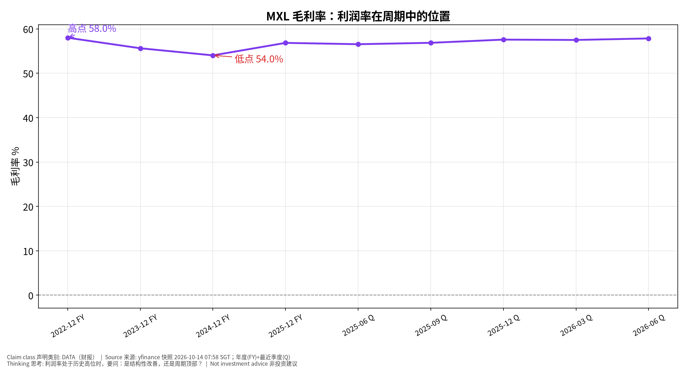
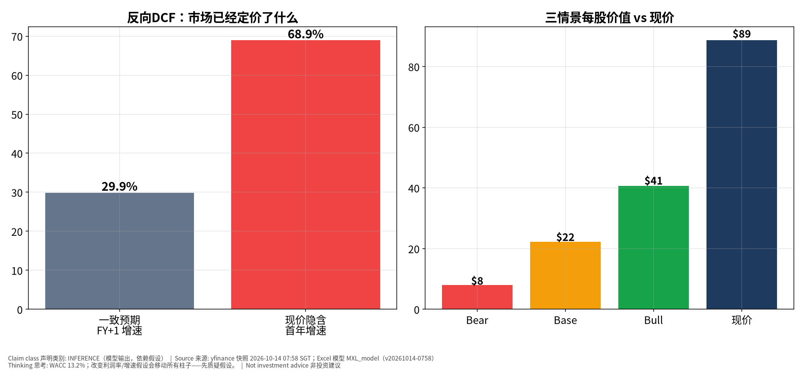
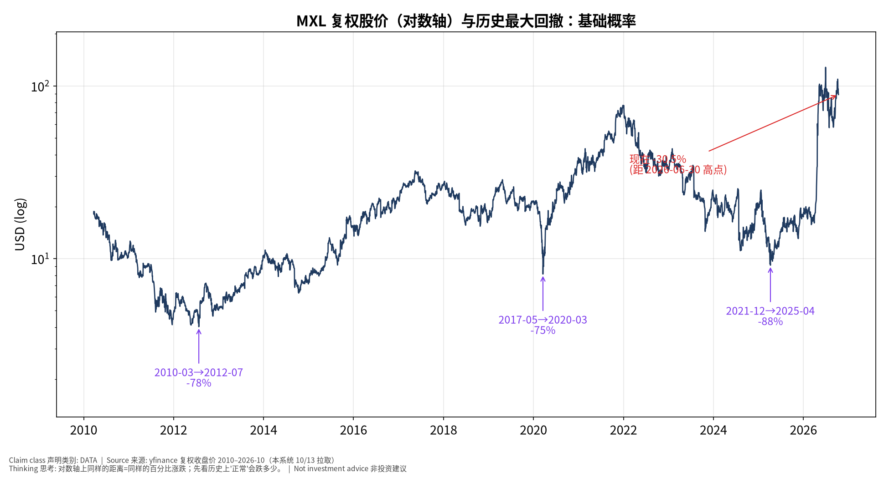

# MXL MaxLinear, Inc. — 思考过程版（Teaching v2.1）v20261014-0758-think
> 数据：yfinance 快照 2026-10-14 07:58 SGT｜模型与数字沿用 v20261014-0758（同一快照，未改动）｜**非投资建议**｜标签：事实 DATA / 市场预期 / 我们的判断 INFERENCE｜标准：MU 试点（用户已批准推广）

**⏱ 30秒看懂**

1. **发生什么：**MaxLinear, Inc. 现价 $88.64；距 2026-06-30 高点 -30.5%。主题：Broadband/connectivity/optical DSP 宽带/连接/光DSP。
2. **和我的股票有什么关系：**现价隐含首年增速约 68.9%，一致预期 29.9%；三情景价值 $8/$22/$41。
3. **该看什么/做什么：**下次财报 2026-10-23（TENTATIVE 直至公司确认）；盯：基础设施收入、毛利率、营业利润率、设计订单。

**🗺 阅读地图**

| 你有多少时间 | 读哪里 |
|---|---|
| 2 分钟 | 30秒卡 |
| 10 分钟 | + 七步思考 + 反方裁判 |
| 30 分钟 | 全部 + Excel 模型 + 原 v20261014-0758 专业报告 |

层级说明：**L1 故事**（人人能懂）→ **L2 关键数字**（带解释）→ **L3 专业细节**（网页可折叠，默认收起）。

## 一、七步思考过程
1. **先问对问题：谁在乎、为什么在乎** —— 主题是 Broadband/connectivity/optical DSP 宽带/连接/光DSP。持有者在乎的是：MaxLinear是小型复苏+期权标的：宽带周期复苏加上Keystone PAM4光DSP与Panther存储加速器打入AI数据中心的可能性；利润率与执行风险高。
2. **市场已经定价了什么** —— 反向 DCF：现价需要首年增速 ≈ 68.9%，一致预期 29.9%——市场定价比分析师更乐观。P/E 数据不可用或为负（亏损）。
3. **搭因果链，每环配一个检验数据** —— 驱动 → 收入（检验：季度收入同比 55.2%）→ 毛利率（最新 57.8%）→ FCF → 价值。
4. **找每一环的断点** —— 断点：Keystone DSP qualification at hyperscalers｜Keystone DSP在云厂认证
5. **用工具箱逐一质疑** —— 见第二节。
6. **给对立观点最强版本，再用证据裁判** —— 见第三节。
7. **写下「如果我错了，会先看到什么」** —— Infrastructure revenue flat; continued operating losses｜基础设施收入持平；持续经营亏损

## 二、质疑工具箱（真实数字）
### 第一性原理 First principles
- **是什么：**拆到最基本：价格 = 未来现金流 ÷ 折现。这件事改变的是现金流还是折现率？
- **为什么用：**避免被故事带走。
- **用在本事件上：**价值 = 未来现金流 ÷ 折现。MXL 的 WACC 13.2%；最新季度毛利率 57.8%；收入同比 55.2%。新闻多数改变的是现金流预期，而非折现率。
- **✍ 轮到你：**把 Excel 里 Base 情景的利润率下调 5 个百分点，每股价值变多少？

### 二阶思维 Second-order
- **是什么：**然后呢？谁会因此改变行为？二阶、三阶效果是什么？
- **为什么用：**一阶看自己，二阶看竞争者和客户。
- **用在本事件上：**竞争者：Broadcom, Marvell, Realtek, Credo｜博通、Marvell、瑞昱、Credo。客户：Cable/fiber gateway OEMs, data-center optical module makers, storage OEMs｜网关厂、光模块厂、存储厂。若 MXL 继续高增长，竞争者和客户会如何改变行为？
- **✍ 轮到你：**写下一个'别人会怎么反应'以及你会用什么数据看到。

### 反向思考 Inversion
- **是什么：**什么会让我错？相反结论成立需要哪些条件同时为真？
- **为什么用：**先想怎么输。
- **用在本事件上：**看多会错，如果：Design wins don't convert; legal overhang (Silicon Motion merger dispute)｜订单不转化；与慧荣并购纠纷诉讼
- **✍ 轮到你：**反过来，看空会错的条件是什么？

### 市场已经定价了什么 Priced-in
- **是什么：**共识/价格隐含了什么？只有「实际−预期」推动价格。
- **为什么用：**只有'实际−预期'推动价格。
- **用在本事件上：**隐含 68.9% vs 共识 29.9%；近几季 EPS 超预期：2025-09 +18% / 2025-12 +6% / 2026-03 +26% / 2026-06 +6%。
- **✍ 轮到你：**超预期幅度的趋势说明了什么？

### 谁在对手盘 Counterparty
- **是什么：**如果我对，谁错？他们为什么会错？想不出来=可能已被定价。
- **为什么用：**想清楚你在和谁交易。
- **用在本事件上：**买方押：Keystone volume ramp at a top module maker; broadband upcycle｜Keystone在头部模块厂放量；宽带复苏。卖方押：Design wins don't convert; legal overhang (Silicon Motion merger dispute)｜订单不转化；与慧荣并购纠纷诉讼。
- **✍ 轮到你：**你更相信哪一方？他们为什么可能错？

### 基础概率 Base rates
- **是什么：**这类事情历史上多常发生？先用基础概率，再用本次信息调整。
- **为什么用：**先用历史，再用本次信息调整。
- **用在本事件上：**2010 年以来最大的三次回撤：2021-12→2025-04 -88%；2010-03→2012-07 -78%；2017-05→2020-03 -75%；中位数 -78%。当前距高点 -30.5%。毛利率区间：54.0%–58.0%（本快照内）。
- **✍ 轮到你：**当前回撤和历史比算大还是小？这能说明'便宜'吗？

### 假设清单与证伪 Assumptions & falsifiers
- **是什么：**逐条写出假设，并给每条一个推翻它的可观察信号。
- **为什么用：**把信念变成可检验的清单。
- **用在本事件上：**见第四节。
- **✍ 轮到你：**给每条假设加一个你会去看的数据源。

## 三、给对立观点最强版本，再用证据裁判
**我们的观点：**MaxLinear是小型复苏+期权标的：宽带周期复苏加上Keystone PAM4光DSP与Panther存储加速器打入AI数据中心的可能性；利润率与执行风险高。（HYPOTHESIS）

**对立观点最强版本：**
1. Design wins don't convert; legal overhang (Silicon Motion merger dispute)｜订单不转化；与慧荣并购纠纷诉讼
2. 现价 $88.64 相对 Base 价值 $22 297.5%，安全边际取决于假设
3. 历史上该股曾出现 2021-12→2025-04 -88%；2010-03→2012-07 -78%；2017-05→2020-03 -75% 的回撤

| 证据 | 支持我们 | 支持对立 | 权重 |
|---|---|---|---|
| 现价 $88.64 vs Base 价值 $22 |  | ✔ | 高 |
| 现价隐含增速 68.9% vs 一致预期 29.9% |  | ✔ | 高 |
| 最近 5 季毛利率 56.5% → 57.8% | ✔ |  | 中 |
| EPS 超预期 +26% → +6% |  | ✔ | 中 |
| 最新季度收入同比 +55.2% | ✔ |  | 中 |
| 当前回撤 -30.5% vs 历史前三大回撤中位数 -78% |  | ✔ | 低 |

**裁判：**证据偏空方（加权 4 : 9）。这是对现有数据的机械称重，不是买卖结论；最该做的是盯住证伪清单。（我们的判断，可能出错）

## 四、假设清单与证伪
| 假设 | 检验数据 | 推翻信号 |
|---|---|---|
| 增长兑现市场隐含的 68.9% | 季度收入同比（现 55.2%） | 连续两季低于隐含增速的一半 |
| 毛利率维持 | 季报毛利率（现 57.8%） | 环比下降 >3 个百分点 |
| 论点核心驱动 | Infrastructure revenue, GM%, op margin, design wins｜基础设施收入、毛利率、营业利润率、设计订单 | Infrastructure revenue flat; continued operating losses｜基础设施收入持平；持续经营亏损 |
| 估值假设合理 | Excel WACC 13.2% | 利率/β 上升使 WACC +1pp |

## 五、怎么看这些图

**📊 怎么看这张图**

- **坐标/颜色：**横轴=财年(FY)/财季(Q)，纵轴=毛利率%
- **只记住一件事：**利润率在区间中的位置决定'均值回归'风险
- **什么会改变结论：**若下季继续创新高，结构性论点加强

**📊 怎么看这张图**

- **坐标/颜色：**左：灰=共识增速，红=现价隐含；右：三情景价值 vs 现价
- **只记住一件事：**红柱高于灰柱=价格依赖超预期；现价高于 Base=安全边际薄
- **什么会改变结论：**我们的假设若太保守，价值柱会升高——要检验模型本身

**📊 怎么看这张图**

- **坐标/颜色：**对数轴复权股价；紫色=历史最大回撤；红色=当前位置
- **只记住一件事：**大跌在该股历史上是常态还是例外
- **什么会改变结论：**若基本面恶化，历史回撤幅度是参考下限而非上限

## 七、推理自测（考推理，不考记忆）

**✅ 自我测验 Check your understanding**

Q1. 现价隐含 68.9%、共识 29.9%。如果公司下季'超预期'但只超共识不超隐含，股价可能怎样？为什么？

**答案：**可能下跌或横盘：价格反映的是隐含预期，超共识不等于超隐含。

Q2. 毛利率现在 57.8%，区间 54.0%–58.0%。用'第一性原理'说明利润率下降 5pp 主要影响价值公式的哪一项？

**答案：**影响分子（未来现金流），不影响分母（WACC）；对远期现金流占比高的公司影响更大。

Q3. 历史回撤中位数约 -78%，当前 -30.5%。为什么'已经跌了很多'不能单独作为买入理由？

**答案：**基础概率只告诉你跌幅常见范围；是否便宜取决于现金流预期是否也变了（价格↓但价值也↓）。

## 八、事后推理复盘（2026-10-23 财报后填写）
| 环节 | 成立/断开 | 证据 | 学到什么 |
|---|---|---|---|
| 核心驱动→收入 | ____ | ____ | ____ |
| 收入→利润率 | ____ | ____ | ____ |
| 利润率→EPS/指引 | ____ | ____ | ____ |
| EPS→股价 | ____ | ____ | ____ |
| 我的预期 vs 市场预期 | ____ | ____ | ____ |

---
## English summary
MXL thinking-first edition. Price $88.64; -30.5% from 2026-06-30 high. Reverse DCF: price implies ~68.9% Y1 growth vs consensus 29.9%. Scenario values $8/$22/$41; WACC 13.2%. Base rates: largest drawdowns since 2010: 2021-12→2025-04 -88%；2010-03→2012-07 -78%；2017-05→2020-03 -75%. Evidence weighting 4:9 (bull:bear). Falsifiers: Infrastructure revenue flat; continued operating losses｜基础设施收入持平；持续经营亏损. Not investment advice.
