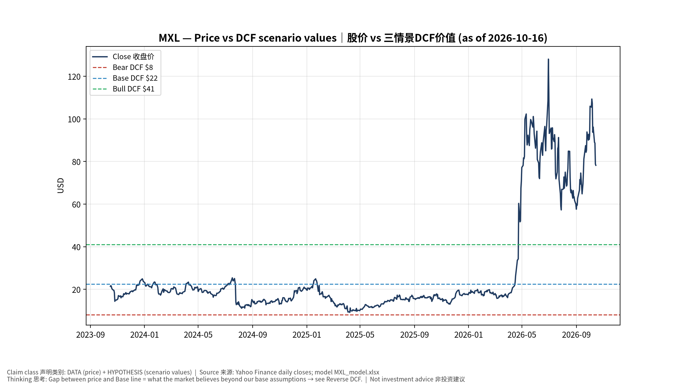
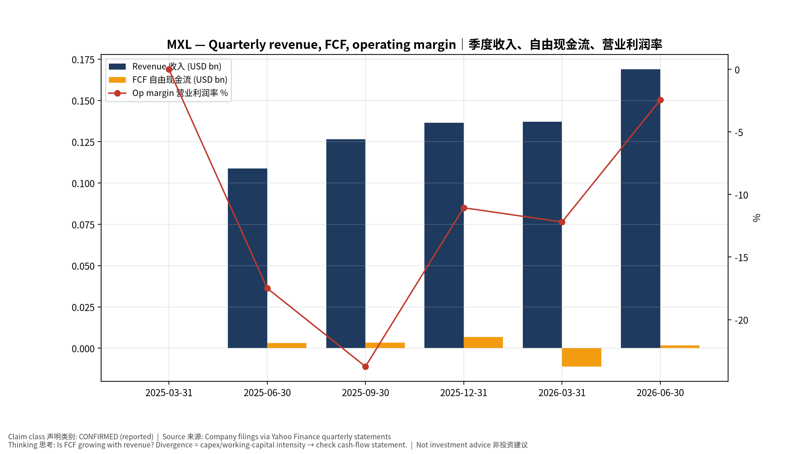
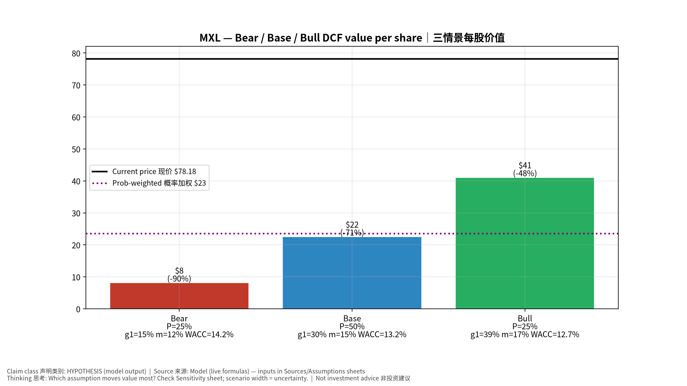
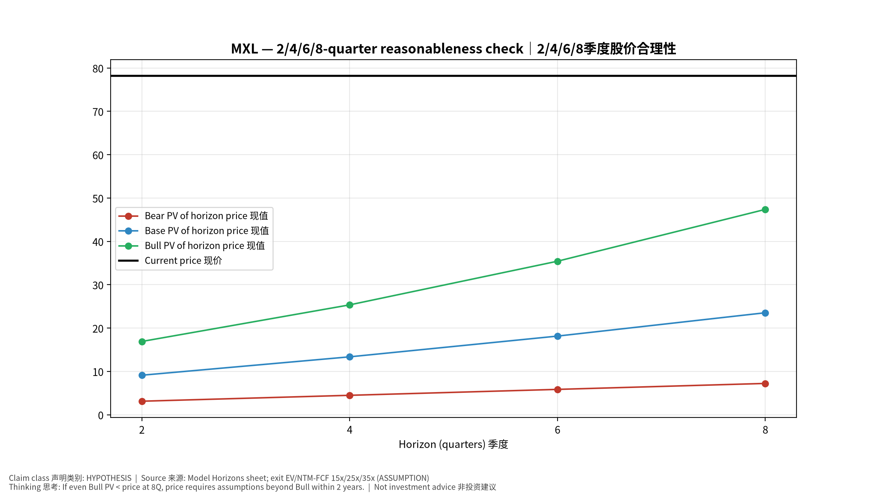
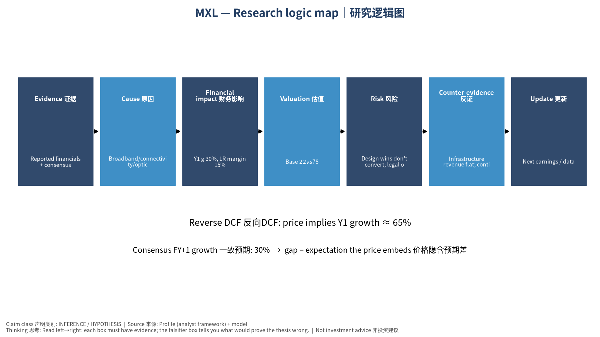

# MXL MaxLinear, Inc. — 个股深度研究 (专业中文版) v20261016-0756
> 数据截至 2026-10-16 07:56 SGT｜价格 $78.18｜市值 7.1 bn USD｜财报货币 USD｜非投资建议。事实=CONFIRMED/DATA；推断=INFERENCE；假设=ASSUMPTION/HYPOTHESIS。

## 1. 投资论点 Investment Thesis (HYPOTHESIS)
MaxLinear是小型复苏+期权标的：宽带周期复苏加上Keystone PAM4光DSP与Panther存储加速器打入AI数据中心的可能性；利润率与执行风险高。

- **多头驱动**: Keystone volume ramp at a top module maker; broadband upcycle｜Keystone在头部模块厂放量；宽带复苏
- **空头驱动**: Design wins don't convert; legal overhang (Silicon Motion merger dispute)｜订单不转化；与慧荣并购纠纷诉讼
- **证伪条件 Falsifiers**: Infrastructure revenue flat; continued operating losses｜基础设施收入持平；持续经营亏损

## 2. 产品、客户与收入模式
- 主题 Theme: Broadband/connectivity/optical DSP 宽带/连接/光DSP
- 业务分部 Segments: Broadband 宽带；Connectivity 连接；Infrastructure (Keystone PAM4 DSP, storage accel.) 基础设施
- 公司描述 (DATA, Yahoo/公司申报): MaxLinear, Inc. provides communications systems-on-chip solutions in the United States, Asia, Europe, and internationally. Its products integrate various portions of a high-speed communication system, including radio frequency, high-performance analog, mixed-signal, digital signal processing, security engines, data compression and networking layers, and power management. Its products are used in various electronic devices, such as radio transceivers and modems for 4G/5G base-station and backhaul infrastructure; optical transceivers; wi-fi and wireline routers for home networking; broadband modems compliant with data over cable service interface specifications, passive optical fiber standards, and digital subscriber line, as well as power management and interface products. It serves electronics distributors, module makers, original equipment manufacturers, and original design manufacturer
- 主要客户: Cable/fiber gateway OEMs, data-center optical module makers, storage OEMs｜网关厂、光模块厂、存储厂

## 3. 行业、竞争、监管与供应链 (ANALYST FRAMEWORK)
- 供应商/上游: TSMC/GlobalFoundries/UMC wafers｜晶圆代工
- 竞争者 (含业外): Broadcom, Marvell, Realtek, Credo｜博通、Marvell、瑞昱、Credo
- 瓶颈/监管: Keystone DSP qualification at hyperscalers｜Keystone DSP在云厂认证
- 关键KPI: Infrastructure revenue, GM%, op margin, design wins｜基础设施收入、毛利率、营业利润率、设计订单
- 零部件现货/合约价: 本版未接入付费价格源(TrendForce/DRAMeXchange等)——标注 **UNAVAILABLE**，在KPI监控中以定性方式跟踪。

## 4. 历史财务与现金流 (CONFIRMED, 季度, USD)
| 季度 | 收入 | 毛利 | 营业利润 | 净利润 | FCF | 营业利润率 |
|---|---|---|---|---|---|---|
| 2026-06-30 | 0.2 bn USD | 97.7 mn USD | -4.1 mn USD | 1.8 mn USD | 1.7 mn USD | -2.4% |
| 2026-03-31 | 0.1 bn USD | 78.9 mn USD | -16.7 mn USD | -45.1 mn USD | -11.1 mn USD | -12.2% |
| 2025-12-31 | 0.1 bn USD | 78.6 mn USD | -15.1 mn USD | -14.9 mn USD | 6.7 mn USD | -11.1% |
| 2025-09-30 | 0.1 bn USD | 71.9 mn USD | -30.0 mn USD | -45.5 mn USD | 3.4 mn USD | -23.7% |
| 2025-06-30 | 0.1 bn USD | 61.5 mn USD | -19.0 mn USD | -26.6 mn USD | 3.1 mn USD | -17.5% |
| 2025-03-31 | N/A | N/A | N/A | N/A | N/A | N/A |

资产负债: 现金 64.8 mn USD；总负债 0.1 bn USD；净现金 -83.4 mn USD。TTM FCF 0.7 mn USD（FCF率 0.1%）。

## 5. 最新财报: 实际 vs 一致预期 vs 指引
| 季度 | EPS实际 | EPS一致预期 | 超预期% |
|---|---|---|---|
| 2025-09-30 | 0.14 | 0.1191 | 0.17549999 |
| 2025-12-31 | 0.19 | 0.17875 | 0.0629 |
| 2026-03-31 | 0.22 | 0.17523 | 0.2555 |
| 2026-06-30 | 0.35 | 0.32952 | 0.0622 |

- 管理层指引 Guidance: 自动数据源不含指引——**UNAVAILABLE（待从公司IR新闻稿录入）**。
- 下次财报日 (Yahoo, TENTATIVE 直至公司确认): **2026-10-23**；本季EPS一致预期 0.55778（9位分析师）；收入一致预期 0.2 bn USD。

## 6. 未来2/4/6/8季度驱动与价格合理性
| 期限 | 情景 | 期限价格现值 | 相对现价 |
|---|---|---|---|
| 2Q | Bear | $3.13 | -96.0% |
| 2Q | Base | $9.13 | -88.3% |
| 2Q | Bull | $16.92 | -78.4% |
| 4Q | Bear | $4.50 | -94.2% |
| 4Q | Base | $13.37 | -82.9% |
| 4Q | Bull | $25.36 | -67.6% |
| 6Q | Bear | $5.86 | -92.5% |
| 6Q | Base | $18.16 | -76.8% |
| 6Q | Bull | $35.43 | -54.7% |
| 8Q | Bear | $7.24 | -90.7% |
| 8Q | Base | $23.54 | -69.9% |
| 8Q | Bull | $47.38 | -39.4% |

现价隐含的 EV/NTM-FCF (Base 路径): | 期限 | 隐含倍数 |
|---|---|
| 2Q | 186.0x |
| 4Q | 123.2x |
| 6Q | 86.8x |
| 8Q | 63.6x |

解读: 如果8季度后Base情景所需倍数仍远高于25x，说明价格依赖更远期的增长。

## 7. 三情景 Bear / Base / Bull (HYPOTHESIS)
| 情景 | Y1增速 | 长期FCF率 | WACC | 永续g | 概率 | 每股价值 | 相对现价 |
|---|---|---|---|---|---|---|---|
| Bear | 14.9% | 12.0% | 14.2% | 2.5% | 25.0% | $8.06 | -89.7% |
| Base | 29.9% | 15.0% | 13.2% | 3.0% | 50.0% | $22.44 | -71.3% |
| Bull | 38.8% | 17.2% | 12.7% | 3.5% | 25.0% | $40.99 | -47.6% |

概率加权价值 **$23.48**（相对现价 -70.0%）。

## 8. 估值: DCF / Reverse DCF / ROIC-WACC / 同业 / 敏感度
- DCF Base: EV 2.1 bn USD；终值占比 52.6%。
- **Reverse DCF 反向DCF**: 在Base利润率与WACC下，现价隐含Y1收入增速 ≈ **64.9%**；一致预期FY+1增速 29.9%。
- WACC (CAPM) = rf 5.2% + β 1.60 × ERP 5.0% = 13.2%。
- SOTP segments 分部: Broadband 宽带; Connectivity 连接; Infrastructure (Keystone PAM4 DSP, storage accel.) 基础设施. **Status: framework only** — segment revenues are INPUT REQUIRED from the latest 10-K/10-Q segment note (not auto-fed, left blank to avoid fabrication)｜分部收入需按最新财报手动录入，未自动填充以避免编造。
- 同业比较 Comps (DATA):
| Ticker | 市值 | EV/Sales | Fwd P/E | 收入增速 | 毛利率 | FCF收益率 |
|---|---|---|---|---|---|---|
| MXL | 7.1 bn USD | 12.6x | 29.9x | 55.2% | 57.5% | 0.0% |
| MRVL | 216.8 bn USD | 22.5x | 33.1x | 36.5% | 52.2% | 1.1% |
| CRDO | 33.5 bn USD | 20.6x | 18.4x | 114.7% | 67.1% | 0.7% |
| AVGO | 1,643.7 bn USD | 18.8x | 17.8x | 85.5% | 75.5% | 1.9% |
| SIMO | 7.4 bn USD | 5.6x | 13.8x | 127.0% | 48.9% | -2.7% |

- 敏感度: 见Excel `Sensitivity` 表 (WACC × 永续增长率)。

## 9. 风险、反方论证与证伪
- 反方观点 Counter-thesis: Design wins don't convert; legal overhang (Silicon Motion merger dispute)｜订单不转化；与慧荣并购纠纷诉讼
- 证伪指标: Infrastructure revenue flat; continued operating losses｜基础设施收入持平；持续经营亏损
- 模型风险: 长期利润率与WACC为假设；终值占比高时估值对假设极敏感。

## 10. Source Ledger 来源账本
| Item | Value | Source/time |
|---|---|---|
| Price 股价 | 78.18 | Yahoo Finance quote, fetched 2026-10-16T07:56 SGT |
| Market cap 市值 | 7.09e+09 | Yahoo info.marketCap 2026-10-16T07:56 |
| Cash 现金 | 6.481e+07 | Yahoo info.totalCash (latest filing) 2026-10-16T07:56 |
| Debt 负债 | 1.482e+08 | Yahoo info.totalDebt (latest filing) 2026-10-16T07:56 |
| Revenue TTM 收入 | 5.689e+08 | Yahoo info.totalRevenue (TTM, USD) 2026-10-16T07:56 |
| FCF TTM 自由现金流 | 6.53e+05 | Sum of last 4 quarterly FCF (q_cash); quarters ['2026-06-30', '2026-03-31', '2025-12-31', '2025-09-30'] (USD) |
| Beta | 3.94 | Yahoo info.beta (5Y monthly) |
| Risk-free 10Y 无风险利率 | 0.0519 | FRED DGS10 2026-10-14 |
| FX USD per USD | 1 | n/a (USD) |
| Consensus rev growth FY0 | 0.5782 | Yahoo revenue_estimate 0y |
| Consensus rev growth FY+1 | 0.2988 | Yahoo revenue_estimate +1y |

## 11. Assumption Register 假设登记表
| Assumption | Value | Rationale |
|---|---|---|
| ERP 股权风险溢价 | 0.05 | ASSUMPTION: 5.0% house mature-market ERP |
| Beta clamp | [0.8,1.6] → 1.60 | ASSUMPTION: limit extreme betas |
| Tax rate (ROIC) | 0.18 | ASSUMPTION: blended cash tax 18% |
| Year-1 growth (Base) | 0.2988 | Consensus FY+1 revenue growth (Yahoo revenue_estimate '+1y'); capped at 100% |
| Growth fade | linear Y1→terminal by Y10 | ASSUMPTION |
| Starting FCF margin | 0.001148 | DATA: FCF TTM / Revenue TTM, floored -50% |
| Long-run FCF margin (Base) | 0.15 | ASSUMPTION (analyst framework, reached by Y5; see profile) |
| Bear/Bull Y1 growth multiplier | 0.5x / 1.3x | ASSUMPTION |
| Bear/Bull margin multiplier | 0.8x / 1.15x | ASSUMPTION |
| WACC adj Bear/Bull | +1.0pp / -0.5pp | ASSUMPTION |
| Terminal g Bear/Base/Bull | 2.5% / 3.0% / 3.5% | ASSUMPTION |
| Scenario probabilities | 25% / 50% / 25% | ASSUMPTION |
| Horizon exit EV/NTM-FCF Bear/Base/Bull | 15x / 25x / 35x | ASSUMPTION |
| Per-share conversion | value × fx ÷ market cap × price | METHOD: avoids ADR/share-class mismatch |

## 12. Model Provenance 模型溯源
- Model file: `MXL_model_v20261016-0756.xlsx` (live formulas; sheets Inputs→Scenarios→DCF→ReverseDCF→Sensitivity→Horizons→SOTP→Comps→ROIC_WACC→History→Sources→Assumptions)
- Engine: `production/pipeline/model.py` (Python mirror; values in this report = Python mirror, verified against LibreOffice recalculation of the xlsx)
- Data snapshot: `data/snapshots/20261016-0756` (immutable) | Fetched 2026-10-16 07:56 SGT | Generated 2026-10-16 07:57 SGT
- Version: v20261016-0756. Prior versions are never overwritten (see company history page).

## 13. 版本与事件时间轴
- v20261016-0756: 首版生产系统报告 (27家同步)。下一事件: 财报 2026-10-23 (TENTATIVE)。

## 图片报告 Image Report

*股价vs三情景价值 Price vs scenario values*

*季度财务 Quarterly financials*

*三情景 Scenarios*

*2/4/6/8季度检验 Horizon check*

*研究逻辑图 Logic map*

---

# MXL MaxLinear, Inc. — Equity Deep Dive (Professional English) v20261016-0756
> Data as of 2026-10-16 07:56 SGT | Price $78.18 | Mkt cap 7.1 bn USD | Reporting currency USD | Not investment advice.

## 1. Investment thesis (HYPOTHESIS)
MaxLinear is a small-cap recovery + option story: broadband cycle recovery plus potential AI data-center entry via Keystone PAM4 DSP and Panther storage accelerators; margin and execution risks are high.

- **Bull drivers**: Keystone volume ramp at a top module maker; broadband upcycle｜Keystone在头部模块厂放量；宽带复苏
- **Bear drivers**: Design wins don't convert; legal overhang (Silicon Motion merger dispute)｜订单不转化；与慧荣并购纠纷诉讼
- **Falsifiers**: Infrastructure revenue flat; continued operating losses｜基础设施收入持平；持续经营亏损

## 2. Products, customers, revenue model
- Theme: Broadband/connectivity/optical DSP 宽带/连接/光DSP | Segments: Broadband 宽带; Connectivity 连接; Infrastructure (Keystone PAM4 DSP, storage accel.) 基础设施
- Business description (DATA): MaxLinear, Inc. provides communications systems-on-chip solutions in the United States, Asia, Europe, and internationally. Its products integrate various portions of a high-speed communication system, including radio frequency, high-performance analog, mixed-signal, digital signal processing, security engines, data compression and networking layers, and power management. Its products are used in various electronic devices, such as radio transceivers and modems for 4G/5G base-station and backhaul infrastructure; optical transceivers; wi-fi and wireline routers for home networking; broadband modems compliant with data over cable service interface specifications, passive optical fiber standards, and digital subscriber line, as well as power management and interface products. It serves electronics distributors, module makers, original equipment manufacturers, and original design manufacturer
- Customers: Cable/fiber gateway OEMs, data-center optical module makers, storage OEMs｜网关厂、光模块厂、存储厂

## 3. Industry, competition, regulation, supply chain (ANALYST FRAMEWORK)
- Suppliers: TSMC/GlobalFoundries/UMC wafers｜晶圆代工
- Competitors: Broadcom, Marvell, Realtek, Credo｜博通、Marvell、瑞昱、Credo
- Bottlenecks/regulation: Keystone DSP qualification at hyperscalers｜Keystone DSP在云厂认证
- KPIs: Infrastructure revenue, GM%, op margin, design wins｜基础设施收入、毛利率、营业利润率、设计订单
- Component spot/contract prices: paid feeds not connected — **UNAVAILABLE**, tracked qualitatively.

## 4. Historical financials & cash flow (CONFIRMED, quarterly, USD)
| Quarter | Revenue | Gross profit | Op income | Net income | FCF | Op margin |
|---|---|---|---|---|---|---|
| 2026-06-30 | 0.2 bn USD | 97.7 mn USD | -4.1 mn USD | 1.8 mn USD | 1.7 mn USD | -2.4% |
| 2026-03-31 | 0.1 bn USD | 78.9 mn USD | -16.7 mn USD | -45.1 mn USD | -11.1 mn USD | -12.2% |
| 2025-12-31 | 0.1 bn USD | 78.6 mn USD | -15.1 mn USD | -14.9 mn USD | 6.7 mn USD | -11.1% |
| 2025-09-30 | 0.1 bn USD | 71.9 mn USD | -30.0 mn USD | -45.5 mn USD | 3.4 mn USD | -23.7% |
| 2025-06-30 | 0.1 bn USD | 61.5 mn USD | -19.0 mn USD | -26.6 mn USD | 3.1 mn USD | -17.5% |
| 2025-03-31 | N/A | N/A | N/A | N/A | N/A | N/A |

Cash 64.8 mn USD; debt 0.1 bn USD; TTM FCF 0.7 mn USD (FCF margin 0.1%).

## 5. Latest earnings: actual vs consensus vs guidance
| Quarter | EPS actual | EPS consensus | Surprise |
|---|---|---|---|
| 2025-09-30 | 0.14 | 0.1191 | 0.17549999 |
| 2025-12-31 | 0.19 | 0.17875 | 0.0629 |
| 2026-03-31 | 0.22 | 0.17523 | 0.2555 |
| 2026-06-30 | 0.35 | 0.32952 | 0.0622 |

- Management guidance: not in automated feed — **UNAVAILABLE (to be entered from IR release)**.
- Next earnings (Yahoo; TENTATIVE until company-confirmed): **2026-10-23**; current-quarter EPS consensus 0.55778 (9 analysts); revenue consensus 0.2 bn USD.

## 6. 2/4/6/8-quarter drivers & price reasonableness
| Horizon | Scenario | PV of horizon price | vs current |
|---|---|---|---|
| 2Q | Bear | $3.13 | -96.0% |
| 2Q | Base | $9.13 | -88.3% |
| 2Q | Bull | $16.92 | -78.4% |
| 4Q | Bear | $4.50 | -94.2% |
| 4Q | Base | $13.37 | -82.9% |
| 4Q | Bull | $25.36 | -67.6% |
| 6Q | Bear | $5.86 | -92.5% |
| 6Q | Base | $18.16 | -76.8% |
| 6Q | Bull | $35.43 | -54.7% |
| 8Q | Bear | $7.24 | -90.7% |
| 8Q | Base | $23.54 | -69.9% |
| 8Q | Bull | $47.38 | -39.4% |

Current-price implied EV/NTM-FCF on Base path: | Horizon | Implied multiple |
|---|---|
| 2Q | 186.0x |
| 4Q | 123.2x |
| 6Q | 86.8x |
| 8Q | 63.6x |

## 7. Bear / Base / Bull (HYPOTHESIS)
| Scenario | Y1 growth | LR FCF margin | WACC | Terminal g | Prob. | Value/share | vs price |
|---|---|---|---|---|---|---|---|
| Bear | 14.9% | 12.0% | 14.2% | 2.5% | 25.0% | $8.06 | -89.7% |
| Base | 29.9% | 15.0% | 13.2% | 3.0% | 50.0% | $22.44 | -71.3% |
| Bull | 38.8% | 17.2% | 12.7% | 3.5% | 25.0% | $40.99 | -47.6% |

Probability-weighted value **$23.48** (-70.0% vs price).

## 8. Valuation: DCF / Reverse DCF / ROIC-WACC / comps / sensitivity
- Base DCF EV 2.1 bn USD; terminal share 52.6%.
- **Reverse DCF**: at Base margin/WACC the price implies Y1 revenue growth ≈ **64.9%** vs consensus FY+1 29.9%.
- WACC (CAPM) = rf 5.2% + β 1.60 × ERP 5.0% = 13.2%.
- SOTP segments: Broadband 宽带; Connectivity 连接; Infrastructure (Keystone PAM4 DSP, storage accel.) 基础设施 — framework only; segment revenue inputs pending from filings.
- Comps (DATA): see table in Chinese section / Excel `Comps`.
- Sensitivity: Excel `Sensitivity` (WACC × terminal g).

## 9. Risks, counterarguments, falsifiers
Design wins don't convert; legal overhang (Silicon Motion merger dispute)｜订单不转化；与慧荣并购纠纷诉讼 | Falsifiers: Infrastructure revenue flat; continued operating losses｜基础设施收入持平；持续经营亏损

## 10–12. Source Ledger / Assumption Register / Model Provenance
See tables above (shared, bilingual). - Model file: `MXL_model_v20261016-0756.xlsx` (live formulas; sheets Inputs→Scenarios→DCF→ReverseDCF→Sensitivity→Horizons→SOTP→Comps→ROIC_WACC→History→Sources→Assumptions)
- Engine: `production/pipeline/model.py` (Python mirror; values in this report = Python mirror, verified against LibreOffice recalculation of the xlsx)
- Data snapshot: `data/snapshots/20261016-0756` (immutable) | Fetched 2026-10-16 07:56 SGT | Generated 2026-10-16 07:57 SGT
- Version: v20261016-0756. Prior versions are never overwritten (see company history page).
