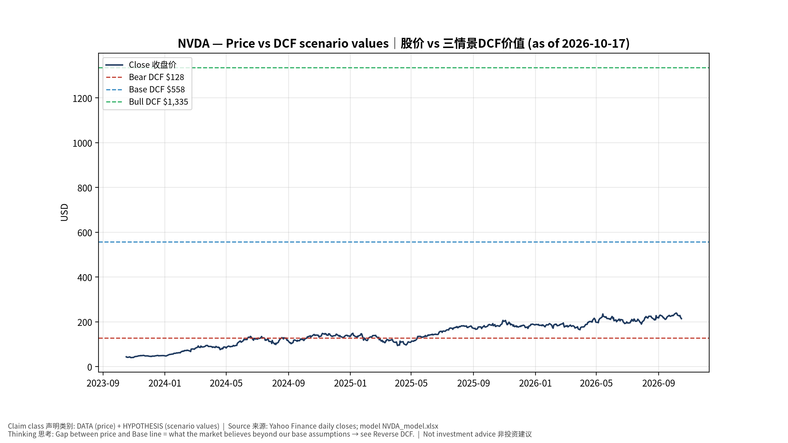
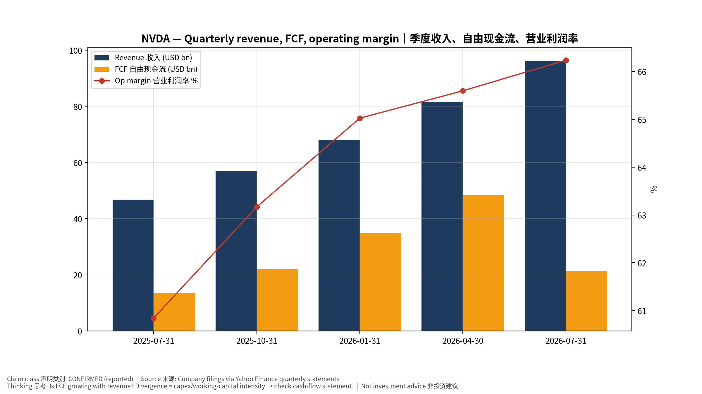
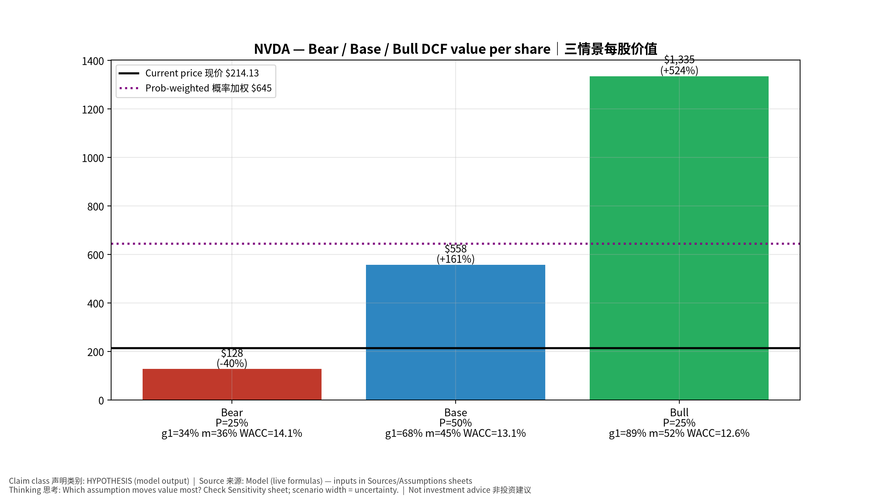
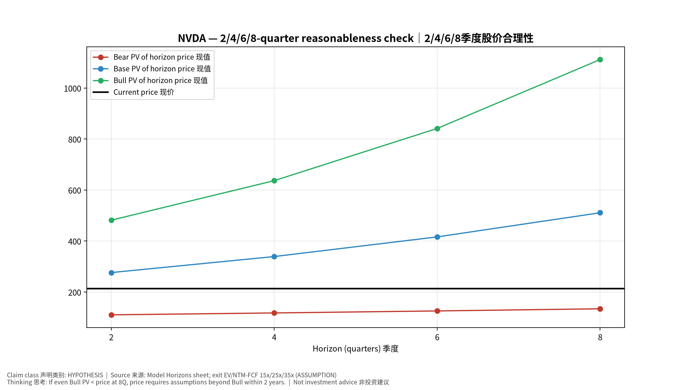
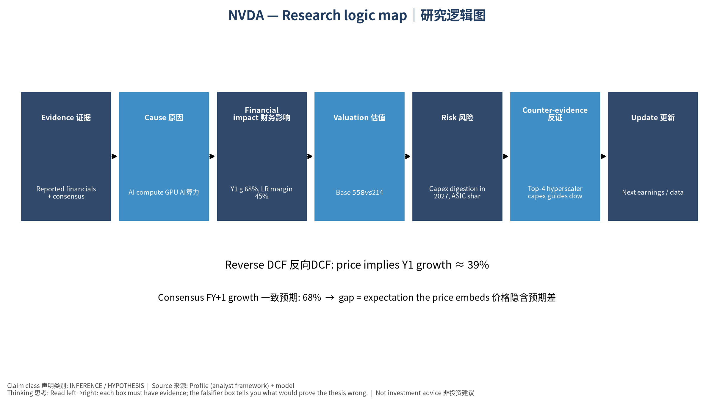

# NVDA NVIDIA Corporation — 个股深度研究 (专业中文版) v20261017-0755
> 数据截至 2026-10-17 07:55 SGT｜价格 $214.13｜市值 5,170.6 bn USD｜财报货币 USD｜非投资建议。事实=CONFIRMED/DATA；推断=INFERENCE；假设=ASSUMPTION/HYPOTHESIS。

## 1. 投资论点 Investment Thesis (HYPOTHESIS)
NVDA是AI资本开支的首要受益者，系统级(GPU+NVLink+网络+CUDA)护城河使其维持高毛利；核心争议在于云厂Capex持续性与ASIC替代速度。

- **多头驱动**: Rubin cycle on time, inference demand broadens to enterprise/sovereign, networking attach rises｜Rubin按期、推理需求扩散、网络附加率提升
- **空头驱动**: Capex digestion in 2027, ASIC share gains, gross-margin pressure from HBM costs｜2027年Capex消化、ASIC份额提升、HBM成本压毛利
- **证伪条件 Falsifiers**: Top-4 hyperscaler capex guides down; DC revenue q/q growth <5% two quarters; GM below mid-60s%｜四大云Capex下修；DC收入环比连续两季<5%；毛利率跌破60%中段

## 2. 产品、客户与收入模式
- 主题 Theme: AI compute GPU AI算力
- 业务分部 Segments: Data Center compute 数据中心计算；Data Center networking 网络；Gaming 游戏；ProViz/Auto/Other 专业可视化/汽车
- 公司描述 (DATA, Yahoo/公司申报): NVIDIA Corporation operates as a data center scale AI infrastructure company in the United States, Taiwan, China, Hong Kong, Europe, and internationally. It operates through Compute & Networking, and Graphics segments. The Compute & Networking segment provides data center accelerated computing and networking platforms and artificial intelligence solutions and software, and automotive platforms and autonomous and electric vehicle solutions, including software. The Graphics segment offers GeForce GPUs for gaming and PCs; Quadro/NVIDIA RTX GPUs for enterprise workstation graphics. The company's products are used in gaming, professional visualization, data center, and automotive markets. It sells its products to original equipment manufacturers, original device manufacturers, system integrators and distributors, independent software vendors, cloud service providers, add-in board manufacturer
- 主要客户: Hyperscalers (MSFT, META, GOOGL, AMZN, ORCL), neoclouds (CRWV), sovereigns, enterprises｜超大规模云厂、新云、主权AI、企业

## 3. 行业、竞争、监管与供应链 (ANALYST FRAMEWORK)
- 供应商/上游: TSMC (N4/N3, CoWoS), SK hynix/Micron/Samsung (HBM), ODMs (Foxconn, Quanta, Wistron), ABF/PCB｜台积电(制程+CoWoS)、HBM三巨头、ODM、ABF/PCB
- 竞争者 (含业外): AMD Instinct, custom ASICs (Broadcom/Marvell/Google TPU/Trainium), Intel, Chinese domestic GPUs｜AMD、定制ASIC(TPU/Trainium等)、英特尔、中国国产GPU
- 瓶颈/监管: CoWoS capacity, HBM supply, data-center power, export controls (China)｜CoWoS产能、HBM供应、数据中心电力、出口管制
- 关键KPI: DC revenue, GM%, networking revenue, hyperscaler capex, CoWoS allocation｜数据中心收入、毛利率、网络收入、云厂Capex、CoWoS分配
- 零部件现货/合约价: 本版未接入付费价格源(TrendForce/DRAMeXchange等)——标注 **UNAVAILABLE**，在KPI监控中以定性方式跟踪。

## 4. 历史财务与现金流 (CONFIRMED, 季度, USD)
| 季度 | 收入 | 毛利 | 营业利润 | 净利润 | FCF | 营业利润率 |
|---|---|---|---|---|---|---|
| 2026-07-31 | 96.2 bn USD | 72.1 bn USD | 63.7 bn USD | 59.7 bn USD | 21.4 bn USD | 66.2% |
| 2026-04-30 | 81.6 bn USD | 61.2 bn USD | 53.5 bn USD | 58.3 bn USD | 48.6 bn USD | 65.6% |
| 2026-01-31 | 68.1 bn USD | 51.1 bn USD | 44.3 bn USD | 43.0 bn USD | 34.9 bn USD | 65.0% |
| 2025-10-31 | 57.0 bn USD | 41.8 bn USD | 36.0 bn USD | 31.9 bn USD | 22.1 bn USD | 63.2% |
| 2025-07-31 | 46.7 bn USD | 33.9 bn USD | 28.4 bn USD | 26.4 bn USD | 13.5 bn USD | 60.8% |

资产负债: 现金 62.5 bn USD；总负债 38.9 bn USD；净现金 23.6 bn USD。TTM FCF 127.0 bn USD（FCF率 41.9%）。

## 5. 最新财报: 实际 vs 一致预期 vs 指引
| 季度 | EPS实际 | EPS一致预期 | 超预期% |
|---|---|---|---|
| 2025-10-31 | 1.3 | 1.25647 | 0.0346 |
| 2026-01-31 | 1.62 | 1.53812 | 0.053200003 |
| 2026-04-30 | 1.87 | 1.77191 | 0.0554 |
| 2026-07-31 | 2.22 | 2.09113 | 0.0616 |

- 管理层指引 Guidance: 自动数据源不含指引——**UNAVAILABLE（待从公司IR新闻稿录入）**。
- 下次财报日 (Yahoo, TENTATIVE 直至公司确认): **2026-11-18**；本季EPS一致预期 2.47325（44位分析师）；收入一致预期 109.0 bn USD。

## 6. 未来2/4/6/8季度驱动与价格合理性
| 期限 | 情景 | 期限价格现值 | 相对现价 |
|---|---|---|---|
| 2Q | Bear | $110.72 | -48.3% |
| 2Q | Base | $276.46 | 29.1% |
| 2Q | Bull | $481.85 | 125.0% |
| 4Q | Bear | $118.13 | -44.8% |
| 4Q | Base | $339.25 | 58.4% |
| 4Q | Bull | $636.91 | 197.4% |
| 6Q | Bear | $126.03 | -41.1% |
| 6Q | Base | $416.36 | 94.4% |
| 6Q | Bull | $841.62 | 293.0% |
| 8Q | Bear | $134.43 | -37.2% |
| 8Q | Base | $511.03 | 138.7% |
| 8Q | Bull | $1,111.76 | 419.2% |

现价隐含的 EV/NTM-FCF (Base 路径): | 期限 | 隐含倍数 |
|---|---|
| 2Q | 18.2x |
| 4Q | 13.9x |
| 6Q | 10.7x |
| 8Q | 8.2x |

解读: 如果8季度后Base情景所需倍数仍远高于25x，说明价格依赖更远期的增长。

## 7. 三情景 Bear / Base / Bull (HYPOTHESIS)
| 情景 | Y1增速 | 长期FCF率 | WACC | 永续g | 概率 | 每股价值 | 相对现价 |
|---|---|---|---|---|---|---|---|
| Bear | 34.1% | 36.0% | 14.1% | 2.5% | 25.0% | $127.66 | -40.4% |
| Base | 68.2% | 45.0% | 13.1% | 3.0% | 50.0% | $557.86 | 160.5% |
| Bull | 88.6% | 51.7% | 12.6% | 3.5% | 25.0% | $1,335.11 | 523.5% |

概率加权价值 **$644.62**（相对现价 201.0%）。

## 8. 估值: DCF / Reverse DCF / ROIC-WACC / 同业 / 敏感度
- DCF Base: EV 13,447.0 bn USD；终值占比 56.2%。
- **Reverse DCF 反向DCF**: 在Base利润率与WACC下，现价隐含Y1收入增速 ≈ **38.9%**；一致预期FY+1增速 68.2%。
- WACC (CAPM) = rf 5.1% + β 1.60 × ERP 5.0% = 13.1%。
- SOTP segments 分部: Data Center compute 数据中心计算; Data Center networking 网络; Gaming 游戏; ProViz/Auto/Other 专业可视化/汽车. **Status: framework only** — segment revenues are INPUT REQUIRED from the latest 10-K/10-Q segment note (not auto-fed, left blank to avoid fabrication)｜分部收入需按最新财报手动录入，未自动填充以避免编造。
- 同业比较 Comps (DATA):
| Ticker | 市值 | EV/Sales | Fwd P/E | 收入增速 | 毛利率 | FCF收益率 |
|---|---|---|---|---|---|---|
| NVDA | 5,170.6 bn USD | 17.0x | 13.5x | 105.9% | 74.7% | 2.5% |
| AMD | 863.2 bn USD | 20.7x | 33.6x | 50.1% | 55.7% | 1.0% |
| AVGO | 1,569.3 bn USD | 18.0x | 17.0x | 85.5% | 75.5% | 1.9% |
| MRVL | 204.8 bn USD | 21.3x | 31.2x | 36.5% | 52.2% | 1.2% |
| INTC | 475.0 bn USD | 8.6x | 42.7x | 25.4% | 38.9% | 1.0% |

- 敏感度: 见Excel `Sensitivity` 表 (WACC × 永续增长率)。

## 9. 风险、反方论证与证伪
- 反方观点 Counter-thesis: Capex digestion in 2027, ASIC share gains, gross-margin pressure from HBM costs｜2027年Capex消化、ASIC份额提升、HBM成本压毛利
- 证伪指标: Top-4 hyperscaler capex guides down; DC revenue q/q growth <5% two quarters; GM below mid-60s%｜四大云Capex下修；DC收入环比连续两季<5%；毛利率跌破60%中段
- 模型风险: 长期利润率与WACC为假设；终值占比高时估值对假设极敏感。

## 10. Source Ledger 来源账本
| Item | Value | Source/time |
|---|---|---|
| Price 股价 | 214.1 | Yahoo Finance quote, fetched 2026-10-17T07:55 SGT |
| Market cap 市值 | 5.171e+12 | Yahoo info.marketCap 2026-10-17T07:55 |
| Cash 现金 | 6.247e+10 | Yahoo info.totalCash (latest filing) 2026-10-17T07:55 |
| Debt 负债 | 3.886e+10 | Yahoo info.totalDebt (latest filing) 2026-10-17T07:55 |
| Revenue TTM 收入 | 3.03e+11 | Yahoo info.totalRevenue (TTM, USD) 2026-10-17T07:55 |
| FCF TTM 自由现金流 | 1.27e+11 | Sum of last 4 quarterly FCF (q_cash); quarters ['2026-07-31', '2026-04-30', '2026-01-31', '2025-10-31'] (USD) |
| Beta | 2.216 | Yahoo info.beta (5Y monthly) |
| Risk-free 10Y 无风险利率 | 0.051 | FRED DGS10 2026-10-15 |
| FX USD per USD | 1 | n/a (USD) |
| Consensus rev growth FY0 | 0.9064 | Yahoo revenue_estimate 0y |
| Consensus rev growth FY+1 | 0.6815 | Yahoo revenue_estimate +1y |

## 11. Assumption Register 假设登记表
| Assumption | Value | Rationale |
|---|---|---|
| ERP 股权风险溢价 | 0.05 | ASSUMPTION: 5.0% house mature-market ERP |
| Beta clamp | [0.8,1.6] → 1.60 | ASSUMPTION: limit extreme betas |
| Tax rate (ROIC) | 0.18 | ASSUMPTION: blended cash tax 18% |
| Year-1 growth (Base) | 0.6815 | Consensus FY+1 revenue growth (Yahoo revenue_estimate '+1y'); capped at 100% |
| Growth fade | linear Y1→terminal by Y10 | ASSUMPTION |
| Starting FCF margin | 0.4192 | DATA: FCF TTM / Revenue TTM, floored -50% |
| Long-run FCF margin (Base) | 0.45 | ASSUMPTION (analyst framework, reached by Y5; see profile) |
| Bear/Bull Y1 growth multiplier | 0.5x / 1.3x | ASSUMPTION |
| Bear/Bull margin multiplier | 0.8x / 1.15x | ASSUMPTION |
| WACC adj Bear/Bull | +1.0pp / -0.5pp | ASSUMPTION |
| Terminal g Bear/Base/Bull | 2.5% / 3.0% / 3.5% | ASSUMPTION |
| Scenario probabilities | 25% / 50% / 25% | ASSUMPTION |
| Horizon exit EV/NTM-FCF Bear/Base/Bull | 15x / 25x / 35x | ASSUMPTION |
| Per-share conversion | value × fx ÷ market cap × price | METHOD: avoids ADR/share-class mismatch |

## 12. Model Provenance 模型溯源
- Model file: `NVDA_model_v20261017-0755.xlsx` (live formulas; sheets Inputs→Scenarios→DCF→ReverseDCF→Sensitivity→Horizons→SOTP→Comps→ROIC_WACC→History→Sources→Assumptions)
- Engine: `production/pipeline/model.py` (Python mirror; values in this report = Python mirror, verified against LibreOffice recalculation of the xlsx)
- Data snapshot: `data/snapshots/20261017-0755` (immutable) | Fetched 2026-10-17 07:55 SGT | Generated 2026-10-17 07:56 SGT
- Version: v20261017-0755. Prior versions are never overwritten (see company history page).

## 13. 版本与事件时间轴
- v20261017-0755: 首版生产系统报告 (27家同步)。下一事件: 财报 2026-11-18 (TENTATIVE)。

## 图片报告 Image Report

*股价vs三情景价值 Price vs scenario values*

*季度财务 Quarterly financials*

*三情景 Scenarios*

*2/4/6/8季度检验 Horizon check*

*研究逻辑图 Logic map*

---

# NVDA NVIDIA Corporation — Equity Deep Dive (Professional English) v20261017-0755
> Data as of 2026-10-17 07:55 SGT | Price $214.13 | Mkt cap 5,170.6 bn USD | Reporting currency USD | Not investment advice.

## 1. Investment thesis (HYPOTHESIS)
NVDA is the primary beneficiary of AI capex; its system-level moat (GPU+NVLink+networking+CUDA) sustains high margins. The core debate is hyperscaler capex durability and the pace of ASIC substitution.

- **Bull drivers**: Rubin cycle on time, inference demand broadens to enterprise/sovereign, networking attach rises｜Rubin按期、推理需求扩散、网络附加率提升
- **Bear drivers**: Capex digestion in 2027, ASIC share gains, gross-margin pressure from HBM costs｜2027年Capex消化、ASIC份额提升、HBM成本压毛利
- **Falsifiers**: Top-4 hyperscaler capex guides down; DC revenue q/q growth <5% two quarters; GM below mid-60s%｜四大云Capex下修；DC收入环比连续两季<5%；毛利率跌破60%中段

## 2. Products, customers, revenue model
- Theme: AI compute GPU AI算力 | Segments: Data Center compute 数据中心计算; Data Center networking 网络; Gaming 游戏; ProViz/Auto/Other 专业可视化/汽车
- Business description (DATA): NVIDIA Corporation operates as a data center scale AI infrastructure company in the United States, Taiwan, China, Hong Kong, Europe, and internationally. It operates through Compute & Networking, and Graphics segments. The Compute & Networking segment provides data center accelerated computing and networking platforms and artificial intelligence solutions and software, and automotive platforms and autonomous and electric vehicle solutions, including software. The Graphics segment offers GeForce GPUs for gaming and PCs; Quadro/NVIDIA RTX GPUs for enterprise workstation graphics. The company's products are used in gaming, professional visualization, data center, and automotive markets. It sells its products to original equipment manufacturers, original device manufacturers, system integrators and distributors, independent software vendors, cloud service providers, add-in board manufacturer
- Customers: Hyperscalers (MSFT, META, GOOGL, AMZN, ORCL), neoclouds (CRWV), sovereigns, enterprises｜超大规模云厂、新云、主权AI、企业

## 3. Industry, competition, regulation, supply chain (ANALYST FRAMEWORK)
- Suppliers: TSMC (N4/N3, CoWoS), SK hynix/Micron/Samsung (HBM), ODMs (Foxconn, Quanta, Wistron), ABF/PCB｜台积电(制程+CoWoS)、HBM三巨头、ODM、ABF/PCB
- Competitors: AMD Instinct, custom ASICs (Broadcom/Marvell/Google TPU/Trainium), Intel, Chinese domestic GPUs｜AMD、定制ASIC(TPU/Trainium等)、英特尔、中国国产GPU
- Bottlenecks/regulation: CoWoS capacity, HBM supply, data-center power, export controls (China)｜CoWoS产能、HBM供应、数据中心电力、出口管制
- KPIs: DC revenue, GM%, networking revenue, hyperscaler capex, CoWoS allocation｜数据中心收入、毛利率、网络收入、云厂Capex、CoWoS分配
- Component spot/contract prices: paid feeds not connected — **UNAVAILABLE**, tracked qualitatively.

## 4. Historical financials & cash flow (CONFIRMED, quarterly, USD)
| Quarter | Revenue | Gross profit | Op income | Net income | FCF | Op margin |
|---|---|---|---|---|---|---|
| 2026-07-31 | 96.2 bn USD | 72.1 bn USD | 63.7 bn USD | 59.7 bn USD | 21.4 bn USD | 66.2% |
| 2026-04-30 | 81.6 bn USD | 61.2 bn USD | 53.5 bn USD | 58.3 bn USD | 48.6 bn USD | 65.6% |
| 2026-01-31 | 68.1 bn USD | 51.1 bn USD | 44.3 bn USD | 43.0 bn USD | 34.9 bn USD | 65.0% |
| 2025-10-31 | 57.0 bn USD | 41.8 bn USD | 36.0 bn USD | 31.9 bn USD | 22.1 bn USD | 63.2% |
| 2025-07-31 | 46.7 bn USD | 33.9 bn USD | 28.4 bn USD | 26.4 bn USD | 13.5 bn USD | 60.8% |

Cash 62.5 bn USD; debt 38.9 bn USD; TTM FCF 127.0 bn USD (FCF margin 41.9%).

## 5. Latest earnings: actual vs consensus vs guidance
| Quarter | EPS actual | EPS consensus | Surprise |
|---|---|---|---|
| 2025-10-31 | 1.3 | 1.25647 | 0.0346 |
| 2026-01-31 | 1.62 | 1.53812 | 0.053200003 |
| 2026-04-30 | 1.87 | 1.77191 | 0.0554 |
| 2026-07-31 | 2.22 | 2.09113 | 0.0616 |

- Management guidance: not in automated feed — **UNAVAILABLE (to be entered from IR release)**.
- Next earnings (Yahoo; TENTATIVE until company-confirmed): **2026-11-18**; current-quarter EPS consensus 2.47325 (44 analysts); revenue consensus 109.0 bn USD.

## 6. 2/4/6/8-quarter drivers & price reasonableness
| Horizon | Scenario | PV of horizon price | vs current |
|---|---|---|---|
| 2Q | Bear | $110.72 | -48.3% |
| 2Q | Base | $276.46 | 29.1% |
| 2Q | Bull | $481.85 | 125.0% |
| 4Q | Bear | $118.13 | -44.8% |
| 4Q | Base | $339.25 | 58.4% |
| 4Q | Bull | $636.91 | 197.4% |
| 6Q | Bear | $126.03 | -41.1% |
| 6Q | Base | $416.36 | 94.4% |
| 6Q | Bull | $841.62 | 293.0% |
| 8Q | Bear | $134.43 | -37.2% |
| 8Q | Base | $511.03 | 138.7% |
| 8Q | Bull | $1,111.76 | 419.2% |

Current-price implied EV/NTM-FCF on Base path: | Horizon | Implied multiple |
|---|---|
| 2Q | 18.2x |
| 4Q | 13.9x |
| 6Q | 10.7x |
| 8Q | 8.2x |

## 7. Bear / Base / Bull (HYPOTHESIS)
| Scenario | Y1 growth | LR FCF margin | WACC | Terminal g | Prob. | Value/share | vs price |
|---|---|---|---|---|---|---|---|
| Bear | 34.1% | 36.0% | 14.1% | 2.5% | 25.0% | $127.66 | -40.4% |
| Base | 68.2% | 45.0% | 13.1% | 3.0% | 50.0% | $557.86 | 160.5% |
| Bull | 88.6% | 51.7% | 12.6% | 3.5% | 25.0% | $1,335.11 | 523.5% |

Probability-weighted value **$644.62** (201.0% vs price).

## 8. Valuation: DCF / Reverse DCF / ROIC-WACC / comps / sensitivity
- Base DCF EV 13,447.0 bn USD; terminal share 56.2%.
- **Reverse DCF**: at Base margin/WACC the price implies Y1 revenue growth ≈ **38.9%** vs consensus FY+1 68.2%.
- WACC (CAPM) = rf 5.1% + β 1.60 × ERP 5.0% = 13.1%.
- SOTP segments: Data Center compute 数据中心计算; Data Center networking 网络; Gaming 游戏; ProViz/Auto/Other 专业可视化/汽车 — framework only; segment revenue inputs pending from filings.
- Comps (DATA): see table in Chinese section / Excel `Comps`.
- Sensitivity: Excel `Sensitivity` (WACC × terminal g).

## 9. Risks, counterarguments, falsifiers
Capex digestion in 2027, ASIC share gains, gross-margin pressure from HBM costs｜2027年Capex消化、ASIC份额提升、HBM成本压毛利 | Falsifiers: Top-4 hyperscaler capex guides down; DC revenue q/q growth <5% two quarters; GM below mid-60s%｜四大云Capex下修；DC收入环比连续两季<5%；毛利率跌破60%中段

## 10–12. Source Ledger / Assumption Register / Model Provenance
See tables above (shared, bilingual). - Model file: `NVDA_model_v20261017-0755.xlsx` (live formulas; sheets Inputs→Scenarios→DCF→ReverseDCF→Sensitivity→Horizons→SOTP→Comps→ROIC_WACC→History→Sources→Assumptions)
- Engine: `production/pipeline/model.py` (Python mirror; values in this report = Python mirror, verified against LibreOffice recalculation of the xlsx)
- Data snapshot: `data/snapshots/20261017-0755` (immutable) | Fetched 2026-10-17 07:55 SGT | Generated 2026-10-17 07:56 SGT
- Version: v20261017-0755. Prior versions are never overwritten (see company history page).
