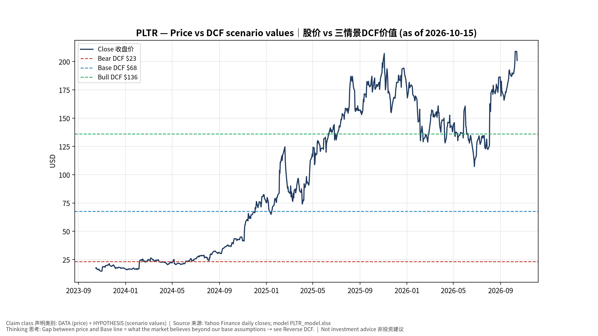
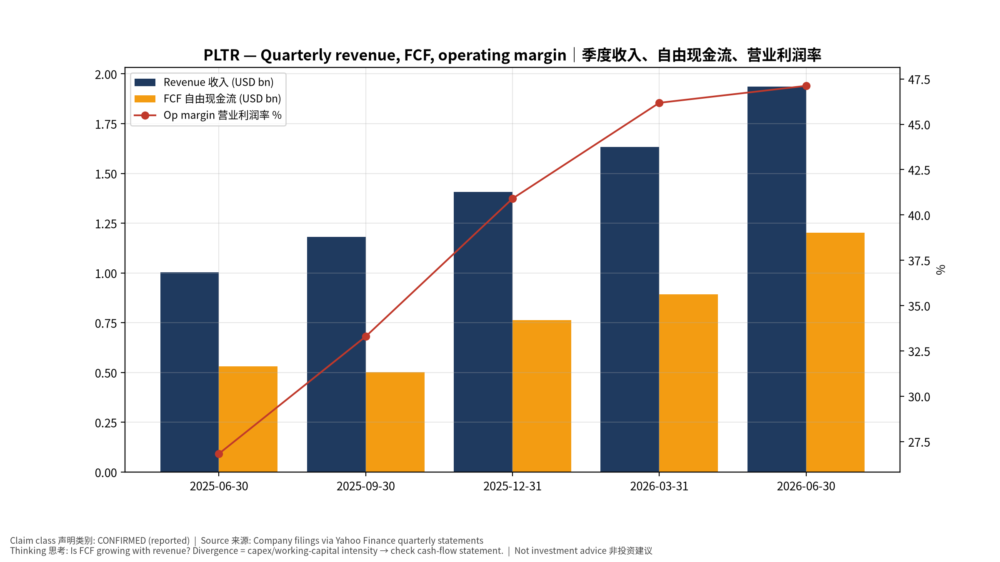
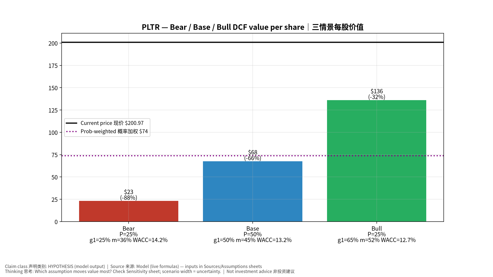
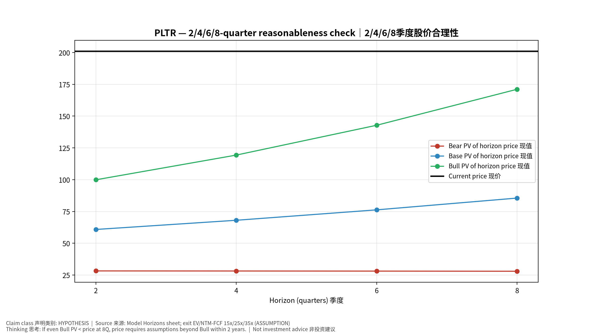
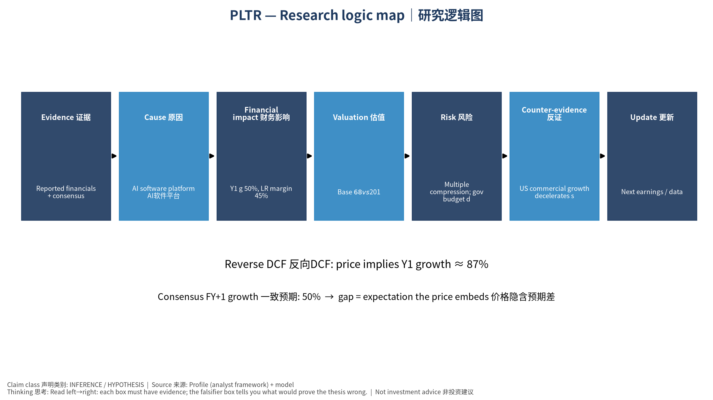

# PLTR Palantir Technologies Inc. — 个股深度研究 (专业中文版) v20261015-0757
> 数据截至 2026-10-15 07:57 SGT｜价格 $200.97｜市值 482.9 bn USD｜财报货币 USD｜非投资建议。事实=CONFIRMED/DATA；推断=INFERENCE；假设=ASSUMPTION/HYPOTHESIS。

## 1. 投资论点 Investment Thesis (HYPOTHESIS)
AIP推动美国商业收入高速增长，'Rule of 40'极高；但估值隐含数十年高增长，股价对增速边际变化极度敏感。

- **多头驱动**: US commercial >60% growth sustained; large gov programs (Maven, Army enterprise)｜商业高增长持续；大型政府项目
- **空头驱动**: Multiple compression; gov budget delays (shutdown/CR); competition｜估值压缩；政府预算延迟；竞争
- **证伪条件 Falsifiers**: US commercial growth decelerates sharply; net dollar retention falls; RPO stalls｜美国商业增速骤降；净留存率下降；RPO停滞

## 2. 产品、客户与收入模式
- 主题 Theme: AI software platform AI软件平台
- 业务分部 Segments: US Government 美国政府；US Commercial 美国商业；International 国际
- 公司描述 (DATA, Yahoo/公司申报): Palantir Technologies Inc. builds and deploys software platforms for the intelligence community to assist in counterterrorism investigations and operations in the United States, the United Kingdom, and internationally. It provides Palantir Gotham integrates with other platforms for defense offerings which enables users to see, understand, and act in the modern battlespace; operations centers to the tactical edge; integrating data from domains and sensors in near real-time; and situational awareness and accelerating operational decision-making, as well as facilitates the hand-off between analysts and operational users, helping operators plan and execute real-world responses to threats that have been identified within the platform. It also offers Palantir Foundry, a platform that helps organizations operate by creating a central operating system for their data; and allows individual users 
- 主要客户: US DoD/intel agencies, NATO allies, US enterprises (AIP)｜美国国防/情报、北约、企业(AIP)

## 3. 行业、竞争、监管与供应链 (ANALYST FRAMEWORK)
- 供应商/上游: Cloud (AWS, Azure, Oracle), LLM providers｜云服务、大模型供应商
- 竞争者 (含业外): Snowflake, Databricks, hyperscaler AI stacks, defense primes, Anduril｜Snowflake、Databricks、云厂、国防承包商、Anduril
- 瓶颈/监管: Gov budget/appropriations, forward-deployed engineer scaling｜政府预算拨款、驻场工程师扩张
- 关键KPI: US commercial revenue, TCV, RPO, customer count, adj. op margin｜美国商业收入、TCV、RPO、客户数、调整后营业利润率
- 零部件现货/合约价: 本版未接入付费价格源(TrendForce/DRAMeXchange等)——标注 **UNAVAILABLE**，在KPI监控中以定性方式跟踪。

## 4. 历史财务与现金流 (CONFIRMED, 季度, USD)
| 季度 | 收入 | 毛利 | 营业利润 | 净利润 | FCF | 营业利润率 |
|---|---|---|---|---|---|---|
| 2026-06-30 | 1.9 bn USD | 1.6 bn USD | 0.9 bn USD | 1.1 bn USD | 1.2 bn USD | 47.1% |
| 2026-03-31 | 1.6 bn USD | 1.4 bn USD | 0.8 bn USD | 0.9 bn USD | 0.9 bn USD | 46.2% |
| 2025-12-31 | 1.4 bn USD | 1.2 bn USD | 0.6 bn USD | 0.6 bn USD | 0.8 bn USD | 40.9% |
| 2025-09-30 | 1.2 bn USD | 1.0 bn USD | 0.4 bn USD | 0.5 bn USD | 0.5 bn USD | 33.3% |
| 2025-06-30 | 1.0 bn USD | 0.8 bn USD | 0.3 bn USD | 0.3 bn USD | 0.5 bn USD | 26.8% |

资产负债: 现金 9.4 bn USD；总负债 0.2 bn USD；净现金 9.2 bn USD。TTM FCF 3.4 bn USD（FCF率 54.6%）。

## 5. 最新财报: 实际 vs 一致预期 vs 指引
| 季度 | EPS实际 | EPS一致预期 | 超预期% |
|---|---|---|---|
| 2025-09-30 | 0.21 | 0.16738 | 0.2546 |
| 2025-12-31 | 0.25 | 0.2302 | 0.086 |
| 2026-03-31 | 0.33 | 0.27946 | 0.1808 |
| 2026-06-30 | 0.41 | 0.34596 | 0.1851 |

- 管理层指引 Guidance: 自动数据源不含指引——**UNAVAILABLE（待从公司IR新闻稿录入）**。
- 下次财报日 (Yahoo, TENTATIVE 直至公司确认): **2026-11-03**；本季EPS一致预期 0.41306（24位分析师）；收入一致预期 2.2 bn USD。

## 6. 未来2/4/6/8季度驱动与价格合理性
| 期限 | 情景 | 期限价格现值 | 相对现价 |
|---|---|---|---|
| 2Q | Bear | $28.22 | -86.0% |
| 2Q | Base | $60.82 | -69.7% |
| 2Q | Bull | $99.88 | -50.3% |
| 4Q | Bear | $28.15 | -86.0% |
| 4Q | Base | $68.06 | -66.1% |
| 4Q | Bull | $119.33 | -40.6% |
| 6Q | Bear | $28.07 | -86.0% |
| 6Q | Base | $76.25 | -62.1% |
| 6Q | Bull | $142.81 | -28.9% |
| 8Q | Bear | $27.95 | -86.1% |
| 8Q | Base | $85.52 | -57.4% |
| 8Q | Bull | $171.12 | -14.9% |

现价隐含的 EV/NTM-FCF (Base 路径): | 期限 | 隐含倍数 |
|---|---|
| 2Q | 80.9x |
| 4Q | 67.3x |
| 6Q | 56.0x |
| 8Q | 46.6x |

解读: 如果8季度后Base情景所需倍数仍远高于25x，说明价格依赖更远期的增长。

## 7. 三情景 Bear / Base / Bull (HYPOTHESIS)
| 情景 | Y1增速 | 长期FCF率 | WACC | 永续g | 概率 | 每股价值 | 相对现价 |
|---|---|---|---|---|---|---|---|
| Bear | 25.1% | 36.0% | 14.2% | 2.5% | 25.0% | $23.32 | -88.4% |
| Base | 50.1% | 45.0% | 13.2% | 3.0% | 50.0% | $67.67 | -66.3% |
| Bull | 65.2% | 51.7% | 12.7% | 3.5% | 25.0% | $136.15 | -32.3% |

概率加权价值 **$73.70**（相对现价 -63.3%）。

## 8. 估值: DCF / Reverse DCF / ROIC-WACC / 同业 / 敏感度
- DCF Base: EV 153.4 bn USD；终值占比 51.7%。
- **Reverse DCF 反向DCF**: 在Base利润率与WACC下，现价隐含Y1收入增速 ≈ **86.5%**；一致预期FY+1增速 50.1%。
- WACC (CAPM) = rf 5.2% + β 1.60 × ERP 5.0% = 13.2%。
- SOTP segments 分部: US Government 美国政府; US Commercial 美国商业; International 国际. **Status: framework only** — segment revenues are INPUT REQUIRED from the latest 10-K/10-Q segment note (not auto-fed, left blank to avoid fabrication)｜分部收入需按最新财报手动录入，未自动填充以避免编造。
- 同业比较 Comps (DATA):
| Ticker | 市值 | EV/Sales | Fwd P/E | 收入增速 | 毛利率 | FCF收益率 |
|---|---|---|---|---|---|---|
| PLTR | 482.9 bn USD | 77.0x | 85.5x | 92.8% | 84.8% | 0.7% |
| CRWD | 255.3 bn USD | 46.5x | 154.9x | 25.8% | 75.2% | 0.8% |
| SNOW | 118.2 bn USD | 21.8x | 111.5x | 35.1% | 67.0% | 1.5% |
| NOW | 144.7 bn USD | 10.1x | 28.0x | 24.0% | 74.8% | 3.6% |
| DDOG | 96.7 bn USD | 23.4x | 90.5x | 35.6% | 79.5% | 1.1% |

- 敏感度: 见Excel `Sensitivity` 表 (WACC × 永续增长率)。

## 9. 风险、反方论证与证伪
- 反方观点 Counter-thesis: Multiple compression; gov budget delays (shutdown/CR); competition｜估值压缩；政府预算延迟；竞争
- 证伪指标: US commercial growth decelerates sharply; net dollar retention falls; RPO stalls｜美国商业增速骤降；净留存率下降；RPO停滞
- 模型风险: 长期利润率与WACC为假设；终值占比高时估值对假设极敏感。

## 10. Source Ledger 来源账本
| Item | Value | Source/time |
|---|---|---|
| Price 股价 | 201 | Yahoo Finance quote, fetched 2026-10-15T07:57 SGT |
| Market cap 市值 | 4.829e+11 | Yahoo info.marketCap 2026-10-15T07:57 |
| Cash 现金 | 9.409e+09 | Yahoo info.totalCash (latest filing) 2026-10-15T07:57 |
| Debt 负债 | 2.114e+08 | Yahoo info.totalDebt (latest filing) 2026-10-15T07:57 |
| Revenue TTM 收入 | 6.156e+09 | Yahoo info.totalRevenue (TTM, USD) 2026-10-15T07:57 |
| FCF TTM 自由现金流 | 3.358e+09 | Sum of last 4 quarterly FCF (q_cash); quarters ['2026-06-30', '2026-03-31', '2025-12-31', '2025-09-30'] (USD) |
| Beta | 1.602 | Yahoo info.beta (5Y monthly) |
| Risk-free 10Y 无风险利率 | 0.0521 | FRED DGS10 2026-10-13 |
| FX USD per USD | 1 | n/a (USD) |
| Consensus rev growth FY0 | 0.8356 | Yahoo revenue_estimate 0y |
| Consensus rev growth FY+1 | 0.5012 | Yahoo revenue_estimate +1y |

## 11. Assumption Register 假设登记表
| Assumption | Value | Rationale |
|---|---|---|
| ERP 股权风险溢价 | 0.05 | ASSUMPTION: 5.0% house mature-market ERP |
| Beta clamp | [0.8,1.6] → 1.60 | ASSUMPTION: limit extreme betas |
| Tax rate (ROIC) | 0.18 | ASSUMPTION: blended cash tax 18% |
| Year-1 growth (Base) | 0.5012 | Consensus FY+1 revenue growth (Yahoo revenue_estimate '+1y'); capped at 100% |
| Growth fade | linear Y1→terminal by Y10 | ASSUMPTION |
| Starting FCF margin | 0.5455 | DATA: FCF TTM / Revenue TTM, floored -50% |
| Long-run FCF margin (Base) | 0.45 | ASSUMPTION (analyst framework, reached by Y5; see profile) |
| Bear/Bull Y1 growth multiplier | 0.5x / 1.3x | ASSUMPTION |
| Bear/Bull margin multiplier | 0.8x / 1.15x | ASSUMPTION |
| WACC adj Bear/Bull | +1.0pp / -0.5pp | ASSUMPTION |
| Terminal g Bear/Base/Bull | 2.5% / 3.0% / 3.5% | ASSUMPTION |
| Scenario probabilities | 25% / 50% / 25% | ASSUMPTION |
| Horizon exit EV/NTM-FCF Bear/Base/Bull | 15x / 25x / 35x | ASSUMPTION |
| Per-share conversion | value × fx ÷ market cap × price | METHOD: avoids ADR/share-class mismatch |

## 12. Model Provenance 模型溯源
- Model file: `PLTR_model_v20261015-0757.xlsx` (live formulas; sheets Inputs→Scenarios→DCF→ReverseDCF→Sensitivity→Horizons→SOTP→Comps→ROIC_WACC→History→Sources→Assumptions)
- Engine: `production/pipeline/model.py` (Python mirror; values in this report = Python mirror, verified against LibreOffice recalculation of the xlsx)
- Data snapshot: `data/snapshots/20261015-0757` (immutable) | Fetched 2026-10-15 07:57 SGT | Generated 2026-10-15 07:58 SGT
- Version: v20261015-0757. Prior versions are never overwritten (see company history page).

## 13. 版本与事件时间轴
- v20261015-0757: 首版生产系统报告 (27家同步)。下一事件: 财报 2026-11-03 (TENTATIVE)。

## 图片报告 Image Report

*股价vs三情景价值 Price vs scenario values*

*季度财务 Quarterly financials*

*三情景 Scenarios*

*2/4/6/8季度检验 Horizon check*

*研究逻辑图 Logic map*

---

# PLTR Palantir Technologies Inc. — Equity Deep Dive (Professional English) v20261015-0757
> Data as of 2026-10-15 07:57 SGT | Price $200.97 | Mkt cap 482.9 bn USD | Reporting currency USD | Not investment advice.

## 1. Investment thesis (HYPOTHESIS)
AIP drives rapid US commercial growth and an extremely high Rule of 40, but the valuation implies decades of high growth and the stock is very sensitive to marginal growth changes.

- **Bull drivers**: US commercial >60% growth sustained; large gov programs (Maven, Army enterprise)｜商业高增长持续；大型政府项目
- **Bear drivers**: Multiple compression; gov budget delays (shutdown/CR); competition｜估值压缩；政府预算延迟；竞争
- **Falsifiers**: US commercial growth decelerates sharply; net dollar retention falls; RPO stalls｜美国商业增速骤降；净留存率下降；RPO停滞

## 2. Products, customers, revenue model
- Theme: AI software platform AI软件平台 | Segments: US Government 美国政府; US Commercial 美国商业; International 国际
- Business description (DATA): Palantir Technologies Inc. builds and deploys software platforms for the intelligence community to assist in counterterrorism investigations and operations in the United States, the United Kingdom, and internationally. It provides Palantir Gotham integrates with other platforms for defense offerings which enables users to see, understand, and act in the modern battlespace; operations centers to the tactical edge; integrating data from domains and sensors in near real-time; and situational awareness and accelerating operational decision-making, as well as facilitates the hand-off between analysts and operational users, helping operators plan and execute real-world responses to threats that have been identified within the platform. It also offers Palantir Foundry, a platform that helps organizations operate by creating a central operating system for their data; and allows individual users 
- Customers: US DoD/intel agencies, NATO allies, US enterprises (AIP)｜美国国防/情报、北约、企业(AIP)

## 3. Industry, competition, regulation, supply chain (ANALYST FRAMEWORK)
- Suppliers: Cloud (AWS, Azure, Oracle), LLM providers｜云服务、大模型供应商
- Competitors: Snowflake, Databricks, hyperscaler AI stacks, defense primes, Anduril｜Snowflake、Databricks、云厂、国防承包商、Anduril
- Bottlenecks/regulation: Gov budget/appropriations, forward-deployed engineer scaling｜政府预算拨款、驻场工程师扩张
- KPIs: US commercial revenue, TCV, RPO, customer count, adj. op margin｜美国商业收入、TCV、RPO、客户数、调整后营业利润率
- Component spot/contract prices: paid feeds not connected — **UNAVAILABLE**, tracked qualitatively.

## 4. Historical financials & cash flow (CONFIRMED, quarterly, USD)
| Quarter | Revenue | Gross profit | Op income | Net income | FCF | Op margin |
|---|---|---|---|---|---|---|
| 2026-06-30 | 1.9 bn USD | 1.6 bn USD | 0.9 bn USD | 1.1 bn USD | 1.2 bn USD | 47.1% |
| 2026-03-31 | 1.6 bn USD | 1.4 bn USD | 0.8 bn USD | 0.9 bn USD | 0.9 bn USD | 46.2% |
| 2025-12-31 | 1.4 bn USD | 1.2 bn USD | 0.6 bn USD | 0.6 bn USD | 0.8 bn USD | 40.9% |
| 2025-09-30 | 1.2 bn USD | 1.0 bn USD | 0.4 bn USD | 0.5 bn USD | 0.5 bn USD | 33.3% |
| 2025-06-30 | 1.0 bn USD | 0.8 bn USD | 0.3 bn USD | 0.3 bn USD | 0.5 bn USD | 26.8% |

Cash 9.4 bn USD; debt 0.2 bn USD; TTM FCF 3.4 bn USD (FCF margin 54.6%).

## 5. Latest earnings: actual vs consensus vs guidance
| Quarter | EPS actual | EPS consensus | Surprise |
|---|---|---|---|
| 2025-09-30 | 0.21 | 0.16738 | 0.2546 |
| 2025-12-31 | 0.25 | 0.2302 | 0.086 |
| 2026-03-31 | 0.33 | 0.27946 | 0.1808 |
| 2026-06-30 | 0.41 | 0.34596 | 0.1851 |

- Management guidance: not in automated feed — **UNAVAILABLE (to be entered from IR release)**.
- Next earnings (Yahoo; TENTATIVE until company-confirmed): **2026-11-03**; current-quarter EPS consensus 0.41306 (24 analysts); revenue consensus 2.2 bn USD.

## 6. 2/4/6/8-quarter drivers & price reasonableness
| Horizon | Scenario | PV of horizon price | vs current |
|---|---|---|---|
| 2Q | Bear | $28.22 | -86.0% |
| 2Q | Base | $60.82 | -69.7% |
| 2Q | Bull | $99.88 | -50.3% |
| 4Q | Bear | $28.15 | -86.0% |
| 4Q | Base | $68.06 | -66.1% |
| 4Q | Bull | $119.33 | -40.6% |
| 6Q | Bear | $28.07 | -86.0% |
| 6Q | Base | $76.25 | -62.1% |
| 6Q | Bull | $142.81 | -28.9% |
| 8Q | Bear | $27.95 | -86.1% |
| 8Q | Base | $85.52 | -57.4% |
| 8Q | Bull | $171.12 | -14.9% |

Current-price implied EV/NTM-FCF on Base path: | Horizon | Implied multiple |
|---|---|
| 2Q | 80.9x |
| 4Q | 67.3x |
| 6Q | 56.0x |
| 8Q | 46.6x |

## 7. Bear / Base / Bull (HYPOTHESIS)
| Scenario | Y1 growth | LR FCF margin | WACC | Terminal g | Prob. | Value/share | vs price |
|---|---|---|---|---|---|---|---|
| Bear | 25.1% | 36.0% | 14.2% | 2.5% | 25.0% | $23.32 | -88.4% |
| Base | 50.1% | 45.0% | 13.2% | 3.0% | 50.0% | $67.67 | -66.3% |
| Bull | 65.2% | 51.7% | 12.7% | 3.5% | 25.0% | $136.15 | -32.3% |

Probability-weighted value **$73.70** (-63.3% vs price).

## 8. Valuation: DCF / Reverse DCF / ROIC-WACC / comps / sensitivity
- Base DCF EV 153.4 bn USD; terminal share 51.7%.
- **Reverse DCF**: at Base margin/WACC the price implies Y1 revenue growth ≈ **86.5%** vs consensus FY+1 50.1%.
- WACC (CAPM) = rf 5.2% + β 1.60 × ERP 5.0% = 13.2%.
- SOTP segments: US Government 美国政府; US Commercial 美国商业; International 国际 — framework only; segment revenue inputs pending from filings.
- Comps (DATA): see table in Chinese section / Excel `Comps`.
- Sensitivity: Excel `Sensitivity` (WACC × terminal g).

## 9. Risks, counterarguments, falsifiers
Multiple compression; gov budget delays (shutdown/CR); competition｜估值压缩；政府预算延迟；竞争 | Falsifiers: US commercial growth decelerates sharply; net dollar retention falls; RPO stalls｜美国商业增速骤降；净留存率下降；RPO停滞

## 10–12. Source Ledger / Assumption Register / Model Provenance
See tables above (shared, bilingual). - Model file: `PLTR_model_v20261015-0757.xlsx` (live formulas; sheets Inputs→Scenarios→DCF→ReverseDCF→Sensitivity→Horizons→SOTP→Comps→ROIC_WACC→History→Sources→Assumptions)
- Engine: `production/pipeline/model.py` (Python mirror; values in this report = Python mirror, verified against LibreOffice recalculation of the xlsx)
- Data snapshot: `data/snapshots/20261015-0757` (immutable) | Fetched 2026-10-15 07:57 SGT | Generated 2026-10-15 07:58 SGT
- Version: v20261015-0757. Prior versions are never overwritten (see company history page).
