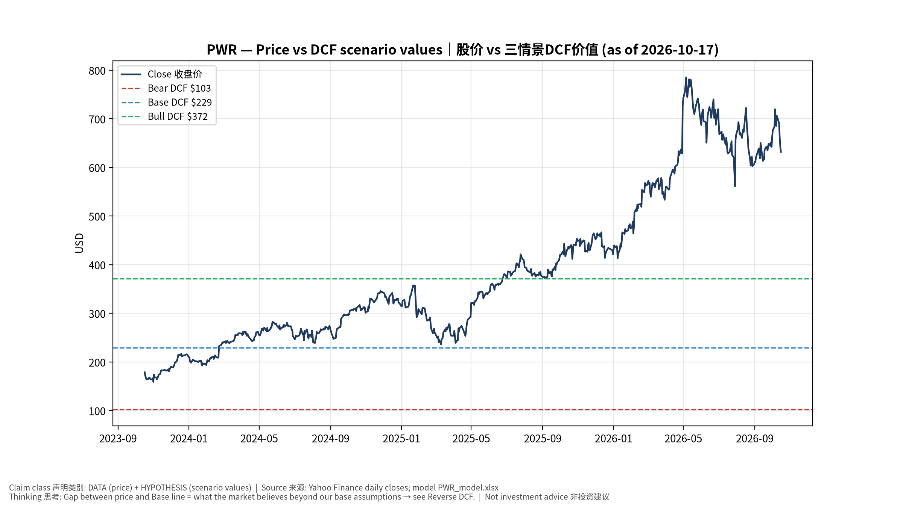
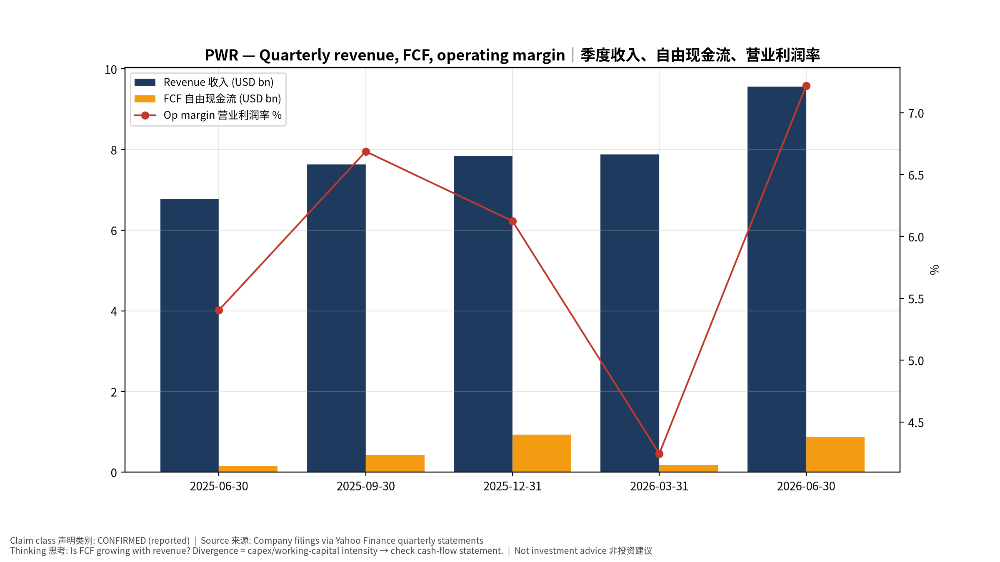
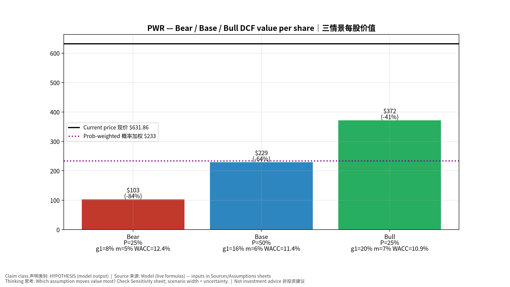
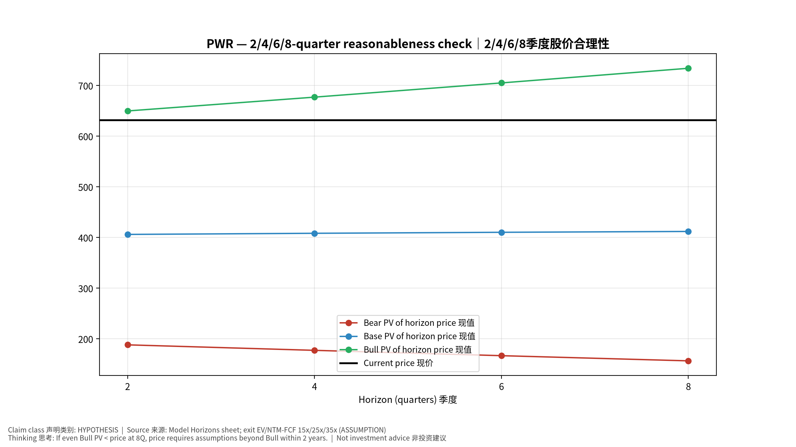
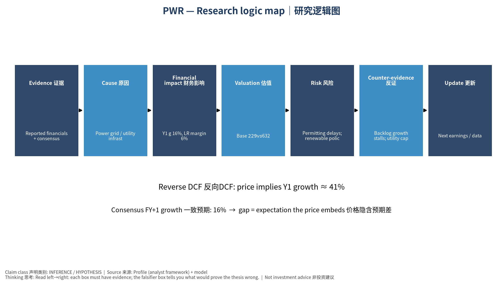

# PWR Quanta Services, Inc. — 个股深度研究 (专业中文版) v20261017-0755
> 数据截至 2026-10-17 07:55 SGT｜价格 $631.86｜市值 95.0 bn USD｜财报货币 USD｜非投资建议。事实=CONFIRMED/DATA；推断=INFERENCE；假设=ASSUMPTION/HYPOTHESIS。

## 1. 投资论点 Investment Thesis (HYPOTHESIS)
Quanta是'AI→电力需求→电网投资'传导链上的劳动力瓶颈龙头；电力公司资本开支计划是领先指标。

- **多头驱动**: Utility capex plans raised; large transmission awards｜电力公司上调Capex；大型输电项目
- **空头驱动**: Permitting delays; renewable policy reversal｜审批延迟；可再生政策逆转
- **证伪条件 Falsifiers**: Backlog growth stalls; utility capex cut｜积压停滞；电力Capex下修

## 2. 产品、客户与收入模式
- 主题 Theme: Power grid / utility infrastructure 电网基建
- 业务分部 Segments: Electric infrastructure 电力基础设施；Renewable infrastructure 可再生能源；Underground utility 地下管线
- 公司描述 (DATA, Yahoo/公司申报): Quanta Services, Inc. offers infrastructure solutions for the electric and gas utility, power generation, load center, manufacturing, communications, pipeline, and energy industries. The company's Electric Infrastructure Solutions segment engages in the design, procurement, construction, upgrade, repair, and maintenance of electric power transmission and distribution infrastructure and substation facilities; installation, maintenance, and upgrade of electric power infrastructure projects; installation of smart grid technologies on electric power networks; and design, installation, maintenance, and repair of commercial and industrial wirings. This segment offers aviation; emergency aerial firefighting services; emergency restoration; and other engineering and technical services; design and construction solutions to wireline and wireless communications, cable multi-system operators, techno
- 主要客户: Utilities, hyperscalers (via utilities), renewable developers｜电力公司、云厂、可再生开发商

## 3. 行业、竞争、监管与供应链 (ANALYST FRAMEWORK)
- 供应商/上游: Labor (linemen), transformers, cable｜线路工人、变压器、电缆
- 竞争者 (含业外): MasTec, MYR, Primoris, utility in-house crews｜MasTec、MYR、Primoris
- 瓶颈/监管: Interconnection queues, transformer lead times, skilled labor｜并网排队、变压器交期、技工
- 关键KPI: Backlog, adj. EBITDA margin, electric segment growth｜积压订单、调整后EBITDA利润率、电力业务增速
- 零部件现货/合约价: 本版未接入付费价格源(TrendForce/DRAMeXchange等)——标注 **UNAVAILABLE**，在KPI监控中以定性方式跟踪。

## 4. 历史财务与现金流 (CONFIRMED, 季度, USD)
| 季度 | 收入 | 毛利 | 营业利润 | 净利润 | FCF | 营业利润率 |
|---|---|---|---|---|---|---|
| 2026-06-30 | 9.6 bn USD | 1.5 bn USD | 0.7 bn USD | 0.5 bn USD | 0.9 bn USD | 7.2% |
| 2026-03-31 | 7.9 bn USD | 1.1 bn USD | 0.3 bn USD | 0.2 bn USD | 0.2 bn USD | 4.2% |
| 2025-12-31 | 7.8 bn USD | 1.2 bn USD | 0.5 bn USD | 0.3 bn USD | 0.9 bn USD | 6.1% |
| 2025-09-30 | 7.6 bn USD | 1.2 bn USD | 0.5 bn USD | 0.3 bn USD | 0.4 bn USD | 6.7% |
| 2025-06-30 | 6.8 bn USD | 1.0 bn USD | 0.4 bn USD | 0.2 bn USD | 0.2 bn USD | 5.4% |

资产负债: 现金 0.5 bn USD；总负债 6.6 bn USD；净现金 -6.1 bn USD。TTM FCF 2.4 bn USD（FCF率 7.3%）。

## 5. 最新财报: 实际 vs 一致预期 vs 指引
| 季度 | EPS实际 | EPS一致预期 | 超预期% |
|---|---|---|---|
| 2025-09-30 | 3.33 | 3.25905 | 0.0218 |
| 2025-12-31 | 3.16 | 3.01855 | 0.0469 |
| 2026-03-31 | 2.68 | 2.03337 | 0.318 |
| 2026-06-30 | 4.24 | 3.30957 | 0.2811 |

- 管理层指引 Guidance: 自动数据源不含指引——**UNAVAILABLE（待从公司IR新闻稿录入）**。
- 下次财报日 (Yahoo, TENTATIVE 直至公司确认): **2026-10-29**；本季EPS一致预期 4.99588（21位分析师）；收入一致预期 10.9 bn USD。

## 6. 未来2/4/6/8季度驱动与价格合理性
| 期限 | 情景 | 期限价格现值 | 相对现价 |
|---|---|---|---|
| 2Q | Bear | $188.17 | -70.2% |
| 2Q | Base | $406.12 | -35.7% |
| 2Q | Bull | $649.80 | 2.8% |
| 4Q | Bear | $177.32 | -71.9% |
| 4Q | Base | $408.34 | -35.4% |
| 4Q | Bull | $677.05 | 7.2% |
| 6Q | Bear | $166.80 | -73.6% |
| 6Q | Base | $410.29 | -35.1% |
| 6Q | Bull | $705.12 | 11.6% |
| 8Q | Bear | $156.57 | -75.2% |
| 8Q | Base | $411.98 | -34.8% |
| 8Q | Bull | $734.04 | 16.2% |

现价隐含的 EV/NTM-FCF (Base 路径): | 期限 | 隐含倍数 |
|---|---|
| 2Q | 35.8x |
| 4Q | 33.9x |
| 6Q | 32.1x |
| 8Q | 30.4x |

解读: 如果8季度后Base情景所需倍数仍远高于25x，说明价格依赖更远期的增长。

## 7. 三情景 Bear / Base / Bull (HYPOTHESIS)
| 情景 | Y1增速 | 长期FCF率 | WACC | 永续g | 概率 | 每股价值 | 相对现价 |
|---|---|---|---|---|---|---|---|
| Bear | 7.9% | 4.8% | 12.4% | 2.5% | 25.0% | $102.69 | -83.7% |
| Base | 15.8% | 6.0% | 11.4% | 3.0% | 50.0% | $229.34 | -63.7% |
| Bull | 20.5% | 6.9% | 10.9% | 3.5% | 25.0% | $371.64 | -41.2% |

概率加权价值 **$233.25**（相对现价 -63.1%）。

## 8. 估值: DCF / Reverse DCF / ROIC-WACC / 同业 / 敏感度
- DCF Base: EV 40.6 bn USD；终值占比 49.0%。
- **Reverse DCF 反向DCF**: 在Base利润率与WACC下，现价隐含Y1收入增速 ≈ **40.9%**；一致预期FY+1增速 15.8%。
- WACC (CAPM) = rf 5.1% + β 1.27 × ERP 5.0% = 11.4%。
- SOTP segments 分部: Electric infrastructure 电力基础设施; Renewable infrastructure 可再生能源; Underground utility 地下管线. **Status: framework only** — segment revenues are INPUT REQUIRED from the latest 10-K/10-Q segment note (not auto-fed, left blank to avoid fabrication)｜分部收入需按最新财报手动录入，未自动填充以避免编造。
- 同业比较 Comps (DATA):
| Ticker | 市值 | EV/Sales | Fwd P/E | 收入增速 | 毛利率 | FCF收益率 |
|---|---|---|---|---|---|---|
| PWR | 95.0 bn USD | 3.1x | 31.8x | 41.1% | 15.5% | 2.5% |
| EME | 31.8 bn USD | 1.7x | 19.3x | 19.8% | 19.4% | 3.1% |
| MTZ | 15.3 bn USD | 1.1x | 15.4x | 23.4% | 12.9% | -0.4% |
| MYRG | 4.4 bn USD | 1.1x | 19.2x | 20.1% | 12.5% | 4.1% |
| 267260.KS | 18,572.2 bn USD | 4.1x | 15.6x | 26.0% | 34.7% | 3.3% |

- 敏感度: 见Excel `Sensitivity` 表 (WACC × 永续增长率)。

## 9. 风险、反方论证与证伪
- 反方观点 Counter-thesis: Permitting delays; renewable policy reversal｜审批延迟；可再生政策逆转
- 证伪指标: Backlog growth stalls; utility capex cut｜积压停滞；电力Capex下修
- 模型风险: 长期利润率与WACC为假设；终值占比高时估值对假设极敏感。

## 10. Source Ledger 来源账本
| Item | Value | Source/time |
|---|---|---|
| Price 股价 | 631.9 | Yahoo Finance quote, fetched 2026-10-17T07:55 SGT |
| Market cap 市值 | 9.5e+10 | Yahoo info.marketCap 2026-10-17T07:55 |
| Cash 现金 | 5.064e+08 | Yahoo info.totalCash (latest filing) 2026-10-17T07:55 |
| Debt 负债 | 6.603e+09 | Yahoo info.totalDebt (latest filing) 2026-10-17T07:55 |
| Revenue TTM 收入 | 3.291e+10 | Yahoo info.totalRevenue (TTM, USD) 2026-10-17T07:55 |
| FCF TTM 自由现金流 | 2.391e+09 | Sum of last 4 quarterly FCF (q_cash); quarters ['2026-06-30', '2026-03-31', '2025-12-31', '2025-09-30'] (USD) |
| Beta | 1.267 | Yahoo info.beta (5Y monthly) |
| Risk-free 10Y 无风险利率 | 0.051 | FRED DGS10 2026-10-15 |
| FX USD per USD | 1 | n/a (USD) |
| Consensus rev growth FY0 | 0.3892 | Yahoo revenue_estimate 0y |
| Consensus rev growth FY+1 | 0.1575 | Yahoo revenue_estimate +1y |

## 11. Assumption Register 假设登记表
| Assumption | Value | Rationale |
|---|---|---|
| ERP 股权风险溢价 | 0.05 | ASSUMPTION: 5.0% house mature-market ERP |
| Beta clamp | [0.8,1.6] → 1.27 | ASSUMPTION: limit extreme betas |
| Tax rate (ROIC) | 0.18 | ASSUMPTION: blended cash tax 18% |
| Year-1 growth (Base) | 0.1575 | Consensus FY+1 revenue growth (Yahoo revenue_estimate '+1y'); capped at 100% |
| Growth fade | linear Y1→terminal by Y10 | ASSUMPTION |
| Starting FCF margin | 0.07267 | DATA: FCF TTM / Revenue TTM, floored -50% |
| Long-run FCF margin (Base) | 0.06 | ASSUMPTION (analyst framework, reached by Y5; see profile) |
| Bear/Bull Y1 growth multiplier | 0.5x / 1.3x | ASSUMPTION |
| Bear/Bull margin multiplier | 0.8x / 1.15x | ASSUMPTION |
| WACC adj Bear/Bull | +1.0pp / -0.5pp | ASSUMPTION |
| Terminal g Bear/Base/Bull | 2.5% / 3.0% / 3.5% | ASSUMPTION |
| Scenario probabilities | 25% / 50% / 25% | ASSUMPTION |
| Horizon exit EV/NTM-FCF Bear/Base/Bull | 15x / 25x / 35x | ASSUMPTION |
| Per-share conversion | value × fx ÷ market cap × price | METHOD: avoids ADR/share-class mismatch |

## 12. Model Provenance 模型溯源
- Model file: `PWR_model_v20261017-0755.xlsx` (live formulas; sheets Inputs→Scenarios→DCF→ReverseDCF→Sensitivity→Horizons→SOTP→Comps→ROIC_WACC→History→Sources→Assumptions)
- Engine: `production/pipeline/model.py` (Python mirror; values in this report = Python mirror, verified against LibreOffice recalculation of the xlsx)
- Data snapshot: `data/snapshots/20261017-0755` (immutable) | Fetched 2026-10-17 07:55 SGT | Generated 2026-10-17 07:57 SGT
- Version: v20261017-0755. Prior versions are never overwritten (see company history page).

## 13. 版本与事件时间轴
- v20261017-0755: 首版生产系统报告 (27家同步)。下一事件: 财报 2026-10-29 (TENTATIVE)。

## 图片报告 Image Report

*股价vs三情景价值 Price vs scenario values*

*季度财务 Quarterly financials*

*三情景 Scenarios*

*2/4/6/8季度检验 Horizon check*

*研究逻辑图 Logic map*

---

# PWR Quanta Services, Inc. — Equity Deep Dive (Professional English) v20261017-0755
> Data as of 2026-10-17 07:55 SGT | Price $631.86 | Mkt cap 95.0 bn USD | Reporting currency USD | Not investment advice.

## 1. Investment thesis (HYPOTHESIS)
Quanta is the labor-bottleneck leader in the 'AI → power demand → grid investment' chain; utility capex plans are the leading indicator.

- **Bull drivers**: Utility capex plans raised; large transmission awards｜电力公司上调Capex；大型输电项目
- **Bear drivers**: Permitting delays; renewable policy reversal｜审批延迟；可再生政策逆转
- **Falsifiers**: Backlog growth stalls; utility capex cut｜积压停滞；电力Capex下修

## 2. Products, customers, revenue model
- Theme: Power grid / utility infrastructure 电网基建 | Segments: Electric infrastructure 电力基础设施; Renewable infrastructure 可再生能源; Underground utility 地下管线
- Business description (DATA): Quanta Services, Inc. offers infrastructure solutions for the electric and gas utility, power generation, load center, manufacturing, communications, pipeline, and energy industries. The company's Electric Infrastructure Solutions segment engages in the design, procurement, construction, upgrade, repair, and maintenance of electric power transmission and distribution infrastructure and substation facilities; installation, maintenance, and upgrade of electric power infrastructure projects; installation of smart grid technologies on electric power networks; and design, installation, maintenance, and repair of commercial and industrial wirings. This segment offers aviation; emergency aerial firefighting services; emergency restoration; and other engineering and technical services; design and construction solutions to wireline and wireless communications, cable multi-system operators, techno
- Customers: Utilities, hyperscalers (via utilities), renewable developers｜电力公司、云厂、可再生开发商

## 3. Industry, competition, regulation, supply chain (ANALYST FRAMEWORK)
- Suppliers: Labor (linemen), transformers, cable｜线路工人、变压器、电缆
- Competitors: MasTec, MYR, Primoris, utility in-house crews｜MasTec、MYR、Primoris
- Bottlenecks/regulation: Interconnection queues, transformer lead times, skilled labor｜并网排队、变压器交期、技工
- KPIs: Backlog, adj. EBITDA margin, electric segment growth｜积压订单、调整后EBITDA利润率、电力业务增速
- Component spot/contract prices: paid feeds not connected — **UNAVAILABLE**, tracked qualitatively.

## 4. Historical financials & cash flow (CONFIRMED, quarterly, USD)
| Quarter | Revenue | Gross profit | Op income | Net income | FCF | Op margin |
|---|---|---|---|---|---|---|
| 2026-06-30 | 9.6 bn USD | 1.5 bn USD | 0.7 bn USD | 0.5 bn USD | 0.9 bn USD | 7.2% |
| 2026-03-31 | 7.9 bn USD | 1.1 bn USD | 0.3 bn USD | 0.2 bn USD | 0.2 bn USD | 4.2% |
| 2025-12-31 | 7.8 bn USD | 1.2 bn USD | 0.5 bn USD | 0.3 bn USD | 0.9 bn USD | 6.1% |
| 2025-09-30 | 7.6 bn USD | 1.2 bn USD | 0.5 bn USD | 0.3 bn USD | 0.4 bn USD | 6.7% |
| 2025-06-30 | 6.8 bn USD | 1.0 bn USD | 0.4 bn USD | 0.2 bn USD | 0.2 bn USD | 5.4% |

Cash 0.5 bn USD; debt 6.6 bn USD; TTM FCF 2.4 bn USD (FCF margin 7.3%).

## 5. Latest earnings: actual vs consensus vs guidance
| Quarter | EPS actual | EPS consensus | Surprise |
|---|---|---|---|
| 2025-09-30 | 3.33 | 3.25905 | 0.0218 |
| 2025-12-31 | 3.16 | 3.01855 | 0.0469 |
| 2026-03-31 | 2.68 | 2.03337 | 0.318 |
| 2026-06-30 | 4.24 | 3.30957 | 0.2811 |

- Management guidance: not in automated feed — **UNAVAILABLE (to be entered from IR release)**.
- Next earnings (Yahoo; TENTATIVE until company-confirmed): **2026-10-29**; current-quarter EPS consensus 4.99588 (21 analysts); revenue consensus 10.9 bn USD.

## 6. 2/4/6/8-quarter drivers & price reasonableness
| Horizon | Scenario | PV of horizon price | vs current |
|---|---|---|---|
| 2Q | Bear | $188.17 | -70.2% |
| 2Q | Base | $406.12 | -35.7% |
| 2Q | Bull | $649.80 | 2.8% |
| 4Q | Bear | $177.32 | -71.9% |
| 4Q | Base | $408.34 | -35.4% |
| 4Q | Bull | $677.05 | 7.2% |
| 6Q | Bear | $166.80 | -73.6% |
| 6Q | Base | $410.29 | -35.1% |
| 6Q | Bull | $705.12 | 11.6% |
| 8Q | Bear | $156.57 | -75.2% |
| 8Q | Base | $411.98 | -34.8% |
| 8Q | Bull | $734.04 | 16.2% |

Current-price implied EV/NTM-FCF on Base path: | Horizon | Implied multiple |
|---|---|
| 2Q | 35.8x |
| 4Q | 33.9x |
| 6Q | 32.1x |
| 8Q | 30.4x |

## 7. Bear / Base / Bull (HYPOTHESIS)
| Scenario | Y1 growth | LR FCF margin | WACC | Terminal g | Prob. | Value/share | vs price |
|---|---|---|---|---|---|---|---|
| Bear | 7.9% | 4.8% | 12.4% | 2.5% | 25.0% | $102.69 | -83.7% |
| Base | 15.8% | 6.0% | 11.4% | 3.0% | 50.0% | $229.34 | -63.7% |
| Bull | 20.5% | 6.9% | 10.9% | 3.5% | 25.0% | $371.64 | -41.2% |

Probability-weighted value **$233.25** (-63.1% vs price).

## 8. Valuation: DCF / Reverse DCF / ROIC-WACC / comps / sensitivity
- Base DCF EV 40.6 bn USD; terminal share 49.0%.
- **Reverse DCF**: at Base margin/WACC the price implies Y1 revenue growth ≈ **40.9%** vs consensus FY+1 15.8%.
- WACC (CAPM) = rf 5.1% + β 1.27 × ERP 5.0% = 11.4%.
- SOTP segments: Electric infrastructure 电力基础设施; Renewable infrastructure 可再生能源; Underground utility 地下管线 — framework only; segment revenue inputs pending from filings.
- Comps (DATA): see table in Chinese section / Excel `Comps`.
- Sensitivity: Excel `Sensitivity` (WACC × terminal g).

## 9. Risks, counterarguments, falsifiers
Permitting delays; renewable policy reversal｜审批延迟；可再生政策逆转 | Falsifiers: Backlog growth stalls; utility capex cut｜积压停滞；电力Capex下修

## 10–12. Source Ledger / Assumption Register / Model Provenance
See tables above (shared, bilingual). - Model file: `PWR_model_v20261017-0755.xlsx` (live formulas; sheets Inputs→Scenarios→DCF→ReverseDCF→Sensitivity→Horizons→SOTP→Comps→ROIC_WACC→History→Sources→Assumptions)
- Engine: `production/pipeline/model.py` (Python mirror; values in this report = Python mirror, verified against LibreOffice recalculation of the xlsx)
- Data snapshot: `data/snapshots/20261017-0755` (immutable) | Fetched 2026-10-17 07:55 SGT | Generated 2026-10-17 07:57 SGT
- Version: v20261017-0755. Prior versions are never overwritten (see company history page).
