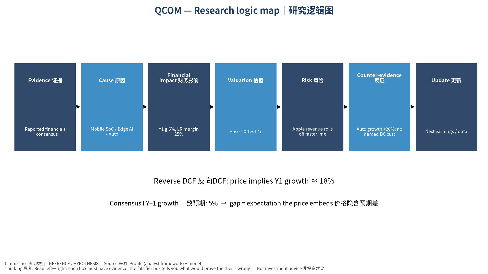

# QCOM 初学者教学版 (中文) v20261014-0758
## ① 一句话
QUALCOMM Incorporated 是一家 Mobile SoC / Edge AI / Auto 手机芯片/边缘AI/汽车 公司。现在股价 $176.86。我们的Base模型认为每股价值约 $104（-41.5%）。

## ② 发生了什么
最近一季财报EPS实际 vs 预期: ['2026-06-30', '2.21', '2.22643', '-0.0074']（实际、预期、超预期%）。下次财报约 2026-11-05。

## ③ 术语 Glossary
- DCF (Discounted Cash Flow｜现金流折现): 把未来每年能拿到的现金，按"时间成本"折回今天加总。
- FCF (Free Cash Flow｜自由现金流) = 经营现金流 − 资本开支。
- WACC (Weighted Average Cost of Capital｜加权平均资本成本): 投资人要求的年回报率，用作折现率。
- Reverse DCF (反向DCF): 反过来问"现价要求公司增长多快"。
- Consensus (一致预期): 分析师预测的平均值。
- Falsifier (证伪指标): 一旦出现就说明论点错了的信号。

## ④ 生活比喻
买这家公司股票≈买一棵果树。DCF就是估算果树未来每年结多少果(FCF)，再考虑"明年的一斤果不如今天的一斤果值钱"(WACC折现)。

## ⑤ 因果箭头
Mobile SoC / Edge AI / Auto 手机芯片/边缘AI/汽车 需求 → 收入增长 (g) → 自由现金流 (FCF = 收入 × FCF率) → 折现 (÷(1+WACC)^t) → 每股价值 → 与股价比较 → 预期差

## ⑥ 数字例题（符号定义）
设 R₀ = 过去12个月收入 = 44.1 bn USD；g₁ = 第一年增速 = 4.8%；m = 长期FCF率 = 25.0%；W = WACC = 13.2%。
第一年收入 R₁ = R₀ × (1+g₁) = 46.2 bn USD。
若第5年FCF率达到 m，则第1年FCF ≈ R₁ × m₁（m₁ 由当前 23.6% 向 25.0% 线性过渡）= 11.0 bn USD；
折现到今天: FCF₁ ÷ (1+W)¹ = 9.7 bn USD。十年加总 + 终值 = EV 117.5 bn USD。

## ⑦ 事实 / 预测 / 市场预期
- 事实: 过去财务数据(第4节)、现价。
- 预测(我们的假设): 长期FCF率 25.0%、三情景。
- 市场预期: 一致预期增速 4.8%；价格隐含增速 18.3%。

## ⑧ 三情景
Bear $68 / Base $104 / Bull $137；概率加权 $103。

## ⑨ 反方观点与失效条件
反方: Apple revenue rolls off faster; memory costs hurt handset demand｜苹果收入加速流失；存储涨价压手机需求
失效条件: Auto growth <20%; no named DC customer revenue; QCT handset revenue declining｜汽车增速<20%；数据中心无具名客户收入；手机芯片收入下滑

## 自我检验题
1. 如果WACC上升1个百分点，价值会升还是降？为什么？（提示：分母变大）
2. 反向DCF隐含增速高于一致预期意味着什么？

---

# QCOM Beginner Teaching Edition (English) v20261014-0758
## ① In one line
QUALCOMM Incorporated is a Mobile SoC / Edge AI / Auto 手机芯片/边缘AI/汽车 company. Price $176.86; our Base model value ≈ $104 (-41.5%).
## ② What happened
Last quarter EPS actual vs consensus: ['2026-06-30', '2.21', '2.22643', '-0.0074']. Next earnings ≈ 2026-11-05 (TENTATIVE).
## ③ Glossary
DCF (Discounted Cash Flow｜现金流折现); FCF (Free Cash Flow｜自由现金流) = operating cash flow − capex; WACC (Weighted Average Cost of Capital｜加权平均资本成本) = the yearly return investors demand; Reverse DCF (反向DCF) = what growth the price requires; Consensus (一致预期); Falsifier (证伪指标).
## ④ Analogy
Owning the stock ≈ owning a fruit tree: DCF estimates future fruit (FCF) and discounts it because fruit next year is worth less than fruit today.
## ⑤ Causal arrows
Demand → revenue growth (g) → FCF (= revenue × FCF margin) → discounting ÷(1+WACC)^t → value/share → compare with price → expectation gap
## ⑥ Worked example (symbols)
R₀ = TTM revenue = 44.1 bn USD; g₁ = 4.8%; m = long-run FCF margin = 25.0%; W = 13.2%.
R₁ = R₀×(1+g₁) = 46.2 bn USD; FCF₁ = 11.0 bn USD; PV = FCF₁/(1+W) = 9.7 bn USD; 10 years + terminal → EV 117.5 bn USD.
## ⑦ Fact vs forecast vs market expectation
Facts: reported financials, price. Forecast: our margin/scenario assumptions. Market: consensus growth 4.8%; price-implied growth 18.3%.
## ⑧ Three scenarios
Bear $68 / Base $104 / Bull $137; weighted $103.
## ⑨ Counterview & failure conditions
Apple revenue rolls off faster; memory costs hurt handset demand｜苹果收入加速流失；存储涨价压手机需求 — Falsifiers: Auto growth <20%; no named DC customer revenue; QCT handset revenue declining｜汽车增速<20%；数据中心无具名客户收入；手机芯片收入下滑
## Self-check
1. WACC +1pp → value up or down? 2. What does price-implied growth > consensus mean?

