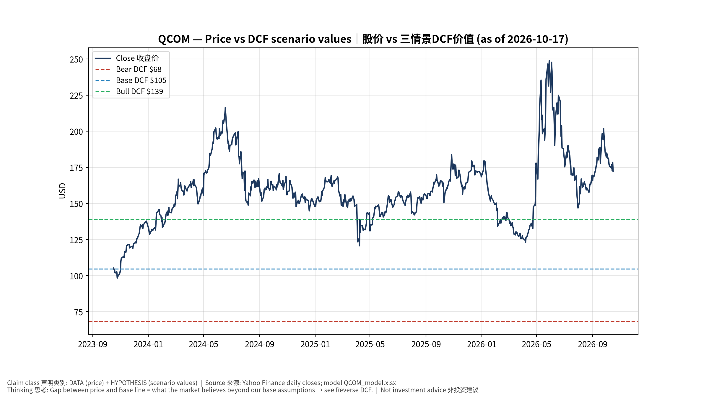
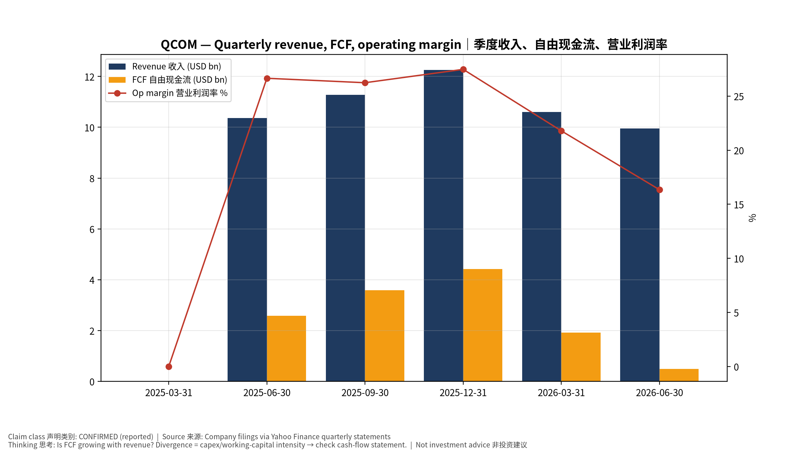
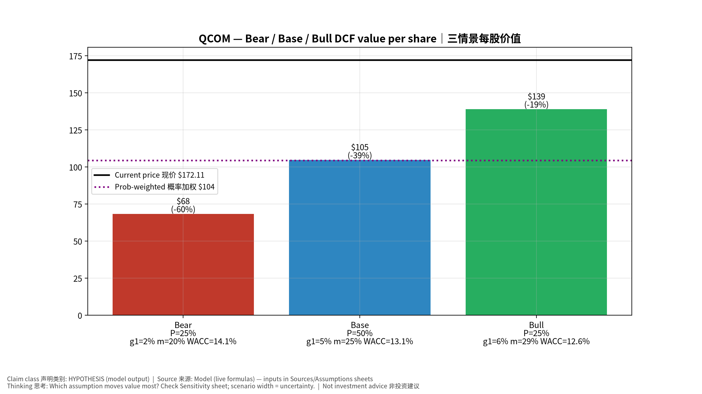
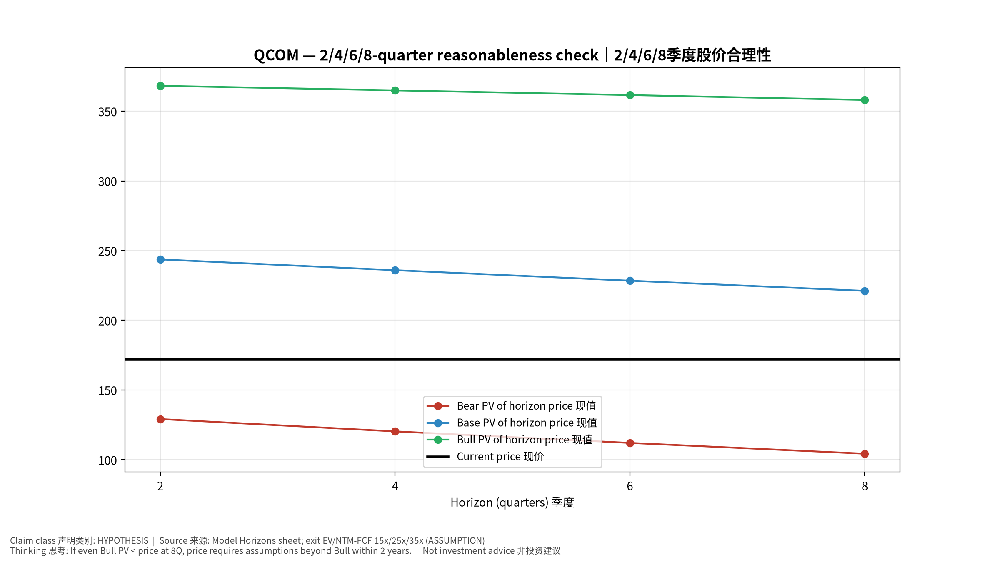
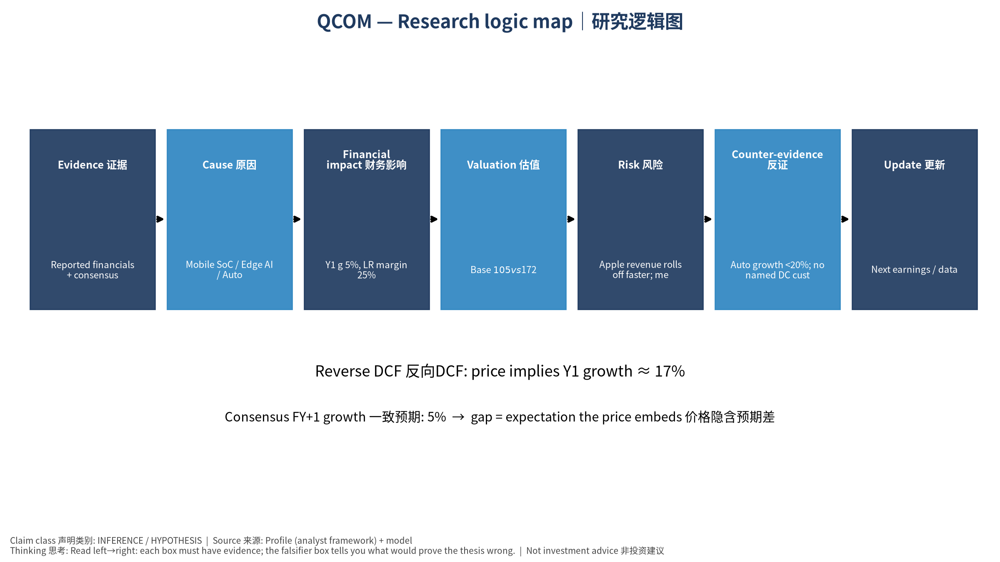

# QCOM QUALCOMM Incorporated — 个股深度研究 (专业中文版) v20261017-0755
> 数据截至 2026-10-17 07:55 SGT｜价格 $172.11｜市值 183.8 bn USD｜财报货币 USD｜非投资建议。事实=CONFIRMED/DATA；推断=INFERENCE；假设=ASSUMPTION/HYPOTHESIS。

## 1. 投资论点 Investment Thesis (HYPOTHESIS)
高通低估值反映手机成熟与苹果基带流失；多元化(汽车、PC、AI200数据中心推理)是重估关键，但需证据。

- **多头驱动**: Auto/IoT reach targets; DC inference wins; premium Android share held｜汽车/IoT达标；数据中心推理获单；高端安卓份额稳
- **空头驱动**: Apple revenue rolls off faster; memory costs hurt handset demand｜苹果收入加速流失；存储涨价压手机需求
- **证伪条件 Falsifiers**: Auto growth <20%; no named DC customer revenue; QCT handset revenue declining｜汽车增速<20%；数据中心无具名客户收入；手机芯片收入下滑

## 2. 产品、客户与收入模式
- 主题 Theme: Mobile SoC / Edge AI / Auto 手机芯片/边缘AI/汽车
- 业务分部 Segments: Handsets 手机；Automotive 汽车；IoT/PC；QTL licensing 授权
- 公司描述 (DATA, Yahoo/公司申报): QUALCOMM Incorporated engages in the development and commercialization of foundational technologies for the wireless industry worldwide. It operates through three segments: Qualcomm CDMA Technologies (QCT); Qualcomm Technology Licensing (QTL); and Qualcomm Strategic Initiatives (QSI). The QCT segment develops and supplies integrated circuits and system software with connectivity and computing technologies for use in mobile devices; automotive systems for connectivity, digital cockpit, and ADAS/AD; and IoT, including consumer electronic devices, industrial devices, and edge networking products. The QTL segment grants licenses or provides rights to use portions of its intellectual property portfolio, which include various patent rights useful in the manufacture and sale of wireless products comprising products implementing LTE, and/or OFDMA-based 5G products and derivatives; to use cellula
- 主要客户: Samsung, Xiaomi/Chinese OEMs, Apple (modems—declining), automakers, PC OEMs｜三星、中国手机厂、苹果(基带递减)、车厂、PC厂

## 3. 行业、竞争、监管与供应链 (ANALYST FRAMEWORK)
- 供应商/上游: TSMC, Samsung Foundry; memory｜台积电、三星代工；存储
- 竞争者 (含业外): MediaTek, Apple in-house modem, Intel/AMD (PC), NVDA/Mobileye (auto)｜联发科、苹果自研基带、x86 PC、汽车对手
- 瓶颈/监管: Apple modem loss, Android share vs MediaTek, ARM licensing dispute｜苹果基带流失、安卓份额、与ARM授权纠纷
- 关键KPI: QCT handset/auto/IoT revenue, QTL, GM%, buybacks｜各业务收入、授权收入、毛利率、回购
- 零部件现货/合约价: 本版未接入付费价格源(TrendForce/DRAMeXchange等)——标注 **UNAVAILABLE**，在KPI监控中以定性方式跟踪。

## 4. 历史财务与现金流 (CONFIRMED, 季度, USD)
| 季度 | 收入 | 毛利 | 营业利润 | 净利润 | FCF | 营业利润率 |
|---|---|---|---|---|---|---|
| 2026-06-30 | 9.9 bn USD | 5.3 bn USD | 1.6 bn USD | 2.0 bn USD | 0.5 bn USD | 16.3% |
| 2026-03-31 | 10.6 bn USD | 5.7 bn USD | 2.3 bn USD | 7.4 bn USD | 1.9 bn USD | 21.8% |
| 2025-12-31 | 12.3 bn USD | 6.7 bn USD | 3.4 bn USD | 3.0 bn USD | 4.4 bn USD | 27.5% |
| 2025-09-30 | 11.3 bn USD | 6.2 bn USD | 3.0 bn USD | -3.1 bn USD | 3.6 bn USD | 26.2% |
| 2025-06-30 | 10.4 bn USD | 5.8 bn USD | 2.8 bn USD | 2.7 bn USD | 2.6 bn USD | 26.6% |
| 2025-03-31 | N/A | N/A | N/A | N/A | N/A | N/A |

资产负债: 现金 8.3 bn USD；总负债 15.3 bn USD；净现金 -7.0 bn USD。TTM FCF 10.4 bn USD（FCF率 23.6%）。

## 5. 最新财报: 实际 vs 一致预期 vs 指引
| 季度 | EPS实际 | EPS一致预期 | 超预期% |
|---|---|---|---|
| 2025-09-30 | 3.0 | 2.87578 | 0.0432 |
| 2025-12-31 | 3.5 | 3.40235 | 0.0287 |
| 2026-03-31 | 2.65 | 2.56433 | 0.0334 |
| 2026-06-30 | 2.21 | 2.22643 | -0.0074 |

- 管理层指引 Guidance: 自动数据源不含指引——**UNAVAILABLE（待从公司IR新闻稿录入）**。
- 下次财报日 (Yahoo, TENTATIVE 直至公司确认): **2026-11-05**；本季EPS一致预期 2.15531（26位分析师）；收入一致预期 10.1 bn USD。

## 6. 未来2/4/6/8季度驱动与价格合理性
| 期限 | 情景 | 期限价格现值 | 相对现价 |
|---|---|---|---|
| 2Q | Bear | $129.16 | -25.0% |
| 2Q | Base | $243.70 | 41.6% |
| 2Q | Bull | $368.21 | 113.9% |
| 4Q | Bear | $120.32 | -30.1% |
| 4Q | Base | $235.95 | 37.1% |
| 4Q | Bull | $364.95 | 112.0% |
| 6Q | Bear | $112.06 | -34.9% |
| 6Q | Base | $228.44 | 32.7% |
| 6Q | Bull | $361.56 | 110.1% |
| 8Q | Bear | $104.33 | -39.4% |
| 8Q | Base | $221.15 | 28.5% |
| 8Q | Bull | $358.06 | 108.0% |

现价隐含的 EV/NTM-FCF (Base 路径): | 期限 | 隐含倍数 |
|---|---|
| 2Q | 16.8x |
| 4Q | 16.3x |
| 6Q | 15.9x |
| 8Q | 15.4x |

解读: 如果8季度后Base情景所需倍数仍远高于25x，说明价格依赖更远期的增长。

## 7. 三情景 Bear / Base / Bull (HYPOTHESIS)
| 情景 | Y1增速 | 长期FCF率 | WACC | 永续g | 概率 | 每股价值 | 相对现价 |
|---|---|---|---|---|---|---|---|
| Bear | 2.3% | 20.0% | 14.1% | 2.5% | 25.0% | $68.40 | -60.3% |
| Base | 4.7% | 25.0% | 13.1% | 3.0% | 50.0% | $104.76 | -39.1% |
| Bull | 6.1% | 28.7% | 12.6% | 3.5% | 25.0% | $139.03 | -19.2% |

概率加权价值 **$104.24**（相对现价 -39.4%）。

## 8. 估值: DCF / Reverse DCF / ROIC-WACC / 同业 / 敏感度
- DCF Base: EV 118.8 bn USD；终值占比 40.2%。
- **Reverse DCF 反向DCF**: 在Base利润率与WACC下，现价隐含Y1收入增速 ≈ **17.2%**；一致预期FY+1增速 4.7%。
- WACC (CAPM) = rf 5.1% + β 1.60 × ERP 5.0% = 13.1%。
- SOTP segments 分部: Handsets 手机; Automotive 汽车; IoT/PC; QTL licensing 授权. **Status: framework only** — segment revenues are INPUT REQUIRED from the latest 10-K/10-Q segment note (not auto-fed, left blank to avoid fabrication)｜分部收入需按最新财报手动录入，未自动填充以避免编造。
- 同业比较 Comps (DATA):
| Ticker | 市值 | EV/Sales | Fwd P/E | 收入增速 | 毛利率 | FCF收益率 |
|---|---|---|---|---|---|---|
| QCOM | 183.8 bn USD | 4.3x | 16.9x | -4.0% | 54.2% | 5.7% |
| 2454.TW | 6,787.9 bn USD | 11.2x | 28.8x | 1.2% | 46.3% | 0.8% |
| ARM | 243.3 bn USD | 46.5x | 74.4x | 22.4% | 97.5% | 0.5% |
| AAPL | 5,012.5 bn USD | 10.8x | 35.9x | 16.4% | 48.7% | 2.1% |
| AVGO | 1,569.3 bn USD | 18.0x | 17.0x | 85.5% | 75.5% | 1.9% |

- 敏感度: 见Excel `Sensitivity` 表 (WACC × 永续增长率)。

## 9. 风险、反方论证与证伪
- 反方观点 Counter-thesis: Apple revenue rolls off faster; memory costs hurt handset demand｜苹果收入加速流失；存储涨价压手机需求
- 证伪指标: Auto growth <20%; no named DC customer revenue; QCT handset revenue declining｜汽车增速<20%；数据中心无具名客户收入；手机芯片收入下滑
- 模型风险: 长期利润率与WACC为假设；终值占比高时估值对假设极敏感。

## 10. Source Ledger 来源账本
| Item | Value | Source/time |
|---|---|---|
| Price 股价 | 172.1 | Yahoo Finance quote, fetched 2026-10-17T07:55 SGT |
| Market cap 市值 | 1.838e+11 | Yahoo info.marketCap 2026-10-17T07:55 |
| Cash 现金 | 8.304e+09 | Yahoo info.totalCash (latest filing) 2026-10-17T07:55 |
| Debt 负债 | 1.527e+10 | Yahoo info.totalDebt (latest filing) 2026-10-17T07:55 |
| Revenue TTM 收入 | 4.407e+10 | Yahoo info.totalRevenue (TTM, USD) 2026-10-17T07:55 |
| FCF TTM 自由现金流 | 1.042e+10 | Sum of last 4 quarterly FCF (q_cash); quarters ['2026-06-30', '2026-03-31', '2025-12-31', '2025-09-30'] (USD) |
| Beta | 1.651 | Yahoo info.beta (5Y monthly) |
| Risk-free 10Y 无风险利率 | 0.051 | FRED DGS10 2026-10-15 |
| FX USD per USD | 1 | n/a (USD) |
| Consensus rev growth FY0 | -0.0288 | Yahoo revenue_estimate 0y |
| Consensus rev growth FY+1 | 0.0468 | Yahoo revenue_estimate +1y |

## 11. Assumption Register 假设登记表
| Assumption | Value | Rationale |
|---|---|---|
| ERP 股权风险溢价 | 0.05 | ASSUMPTION: 5.0% house mature-market ERP |
| Beta clamp | [0.8,1.6] → 1.60 | ASSUMPTION: limit extreme betas |
| Tax rate (ROIC) | 0.18 | ASSUMPTION: blended cash tax 18% |
| Year-1 growth (Base) | 0.0468 | Consensus FY+1 revenue growth (Yahoo revenue_estimate '+1y'); capped at 100% |
| Growth fade | linear Y1→terminal by Y10 | ASSUMPTION |
| Starting FCF margin | 0.2364 | DATA: FCF TTM / Revenue TTM, floored -50% |
| Long-run FCF margin (Base) | 0.25 | ASSUMPTION (analyst framework, reached by Y5; see profile) |
| Bear/Bull Y1 growth multiplier | 0.5x / 1.3x | ASSUMPTION |
| Bear/Bull margin multiplier | 0.8x / 1.15x | ASSUMPTION |
| WACC adj Bear/Bull | +1.0pp / -0.5pp | ASSUMPTION |
| Terminal g Bear/Base/Bull | 2.5% / 3.0% / 3.5% | ASSUMPTION |
| Scenario probabilities | 25% / 50% / 25% | ASSUMPTION |
| Horizon exit EV/NTM-FCF Bear/Base/Bull | 15x / 25x / 35x | ASSUMPTION |
| Per-share conversion | value × fx ÷ market cap × price | METHOD: avoids ADR/share-class mismatch |

## 12. Model Provenance 模型溯源
- Model file: `QCOM_model_v20261017-0755.xlsx` (live formulas; sheets Inputs→Scenarios→DCF→ReverseDCF→Sensitivity→Horizons→SOTP→Comps→ROIC_WACC→History→Sources→Assumptions)
- Engine: `production/pipeline/model.py` (Python mirror; values in this report = Python mirror, verified against LibreOffice recalculation of the xlsx)
- Data snapshot: `data/snapshots/20261017-0755` (immutable) | Fetched 2026-10-17 07:55 SGT | Generated 2026-10-17 07:56 SGT
- Version: v20261017-0755. Prior versions are never overwritten (see company history page).

## 13. 版本与事件时间轴
- v20261017-0755: 首版生产系统报告 (27家同步)。下一事件: 财报 2026-11-05 (TENTATIVE)。

## 图片报告 Image Report

*股价vs三情景价值 Price vs scenario values*

*季度财务 Quarterly financials*

*三情景 Scenarios*

*2/4/6/8季度检验 Horizon check*

*研究逻辑图 Logic map*

---

# QCOM QUALCOMM Incorporated — Equity Deep Dive (Professional English) v20261017-0755
> Data as of 2026-10-17 07:55 SGT | Price $172.11 | Mkt cap 183.8 bn USD | Reporting currency USD | Not investment advice.

## 1. Investment thesis (HYPOTHESIS)
QCOM's low multiple reflects a mature handset market and the Apple modem loss; diversification (auto, PC, AI200 data-center inference) is the rerating key but needs evidence.

- **Bull drivers**: Auto/IoT reach targets; DC inference wins; premium Android share held｜汽车/IoT达标；数据中心推理获单；高端安卓份额稳
- **Bear drivers**: Apple revenue rolls off faster; memory costs hurt handset demand｜苹果收入加速流失；存储涨价压手机需求
- **Falsifiers**: Auto growth <20%; no named DC customer revenue; QCT handset revenue declining｜汽车增速<20%；数据中心无具名客户收入；手机芯片收入下滑

## 2. Products, customers, revenue model
- Theme: Mobile SoC / Edge AI / Auto 手机芯片/边缘AI/汽车 | Segments: Handsets 手机; Automotive 汽车; IoT/PC; QTL licensing 授权
- Business description (DATA): QUALCOMM Incorporated engages in the development and commercialization of foundational technologies for the wireless industry worldwide. It operates through three segments: Qualcomm CDMA Technologies (QCT); Qualcomm Technology Licensing (QTL); and Qualcomm Strategic Initiatives (QSI). The QCT segment develops and supplies integrated circuits and system software with connectivity and computing technologies for use in mobile devices; automotive systems for connectivity, digital cockpit, and ADAS/AD; and IoT, including consumer electronic devices, industrial devices, and edge networking products. The QTL segment grants licenses or provides rights to use portions of its intellectual property portfolio, which include various patent rights useful in the manufacture and sale of wireless products comprising products implementing LTE, and/or OFDMA-based 5G products and derivatives; to use cellula
- Customers: Samsung, Xiaomi/Chinese OEMs, Apple (modems—declining), automakers, PC OEMs｜三星、中国手机厂、苹果(基带递减)、车厂、PC厂

## 3. Industry, competition, regulation, supply chain (ANALYST FRAMEWORK)
- Suppliers: TSMC, Samsung Foundry; memory｜台积电、三星代工；存储
- Competitors: MediaTek, Apple in-house modem, Intel/AMD (PC), NVDA/Mobileye (auto)｜联发科、苹果自研基带、x86 PC、汽车对手
- Bottlenecks/regulation: Apple modem loss, Android share vs MediaTek, ARM licensing dispute｜苹果基带流失、安卓份额、与ARM授权纠纷
- KPIs: QCT handset/auto/IoT revenue, QTL, GM%, buybacks｜各业务收入、授权收入、毛利率、回购
- Component spot/contract prices: paid feeds not connected — **UNAVAILABLE**, tracked qualitatively.

## 4. Historical financials & cash flow (CONFIRMED, quarterly, USD)
| Quarter | Revenue | Gross profit | Op income | Net income | FCF | Op margin |
|---|---|---|---|---|---|---|
| 2026-06-30 | 9.9 bn USD | 5.3 bn USD | 1.6 bn USD | 2.0 bn USD | 0.5 bn USD | 16.3% |
| 2026-03-31 | 10.6 bn USD | 5.7 bn USD | 2.3 bn USD | 7.4 bn USD | 1.9 bn USD | 21.8% |
| 2025-12-31 | 12.3 bn USD | 6.7 bn USD | 3.4 bn USD | 3.0 bn USD | 4.4 bn USD | 27.5% |
| 2025-09-30 | 11.3 bn USD | 6.2 bn USD | 3.0 bn USD | -3.1 bn USD | 3.6 bn USD | 26.2% |
| 2025-06-30 | 10.4 bn USD | 5.8 bn USD | 2.8 bn USD | 2.7 bn USD | 2.6 bn USD | 26.6% |
| 2025-03-31 | N/A | N/A | N/A | N/A | N/A | N/A |

Cash 8.3 bn USD; debt 15.3 bn USD; TTM FCF 10.4 bn USD (FCF margin 23.6%).

## 5. Latest earnings: actual vs consensus vs guidance
| Quarter | EPS actual | EPS consensus | Surprise |
|---|---|---|---|
| 2025-09-30 | 3.0 | 2.87578 | 0.0432 |
| 2025-12-31 | 3.5 | 3.40235 | 0.0287 |
| 2026-03-31 | 2.65 | 2.56433 | 0.0334 |
| 2026-06-30 | 2.21 | 2.22643 | -0.0074 |

- Management guidance: not in automated feed — **UNAVAILABLE (to be entered from IR release)**.
- Next earnings (Yahoo; TENTATIVE until company-confirmed): **2026-11-05**; current-quarter EPS consensus 2.15531 (26 analysts); revenue consensus 10.1 bn USD.

## 6. 2/4/6/8-quarter drivers & price reasonableness
| Horizon | Scenario | PV of horizon price | vs current |
|---|---|---|---|
| 2Q | Bear | $129.16 | -25.0% |
| 2Q | Base | $243.70 | 41.6% |
| 2Q | Bull | $368.21 | 113.9% |
| 4Q | Bear | $120.32 | -30.1% |
| 4Q | Base | $235.95 | 37.1% |
| 4Q | Bull | $364.95 | 112.0% |
| 6Q | Bear | $112.06 | -34.9% |
| 6Q | Base | $228.44 | 32.7% |
| 6Q | Bull | $361.56 | 110.1% |
| 8Q | Bear | $104.33 | -39.4% |
| 8Q | Base | $221.15 | 28.5% |
| 8Q | Bull | $358.06 | 108.0% |

Current-price implied EV/NTM-FCF on Base path: | Horizon | Implied multiple |
|---|---|
| 2Q | 16.8x |
| 4Q | 16.3x |
| 6Q | 15.9x |
| 8Q | 15.4x |

## 7. Bear / Base / Bull (HYPOTHESIS)
| Scenario | Y1 growth | LR FCF margin | WACC | Terminal g | Prob. | Value/share | vs price |
|---|---|---|---|---|---|---|---|
| Bear | 2.3% | 20.0% | 14.1% | 2.5% | 25.0% | $68.40 | -60.3% |
| Base | 4.7% | 25.0% | 13.1% | 3.0% | 50.0% | $104.76 | -39.1% |
| Bull | 6.1% | 28.7% | 12.6% | 3.5% | 25.0% | $139.03 | -19.2% |

Probability-weighted value **$104.24** (-39.4% vs price).

## 8. Valuation: DCF / Reverse DCF / ROIC-WACC / comps / sensitivity
- Base DCF EV 118.8 bn USD; terminal share 40.2%.
- **Reverse DCF**: at Base margin/WACC the price implies Y1 revenue growth ≈ **17.2%** vs consensus FY+1 4.7%.
- WACC (CAPM) = rf 5.1% + β 1.60 × ERP 5.0% = 13.1%.
- SOTP segments: Handsets 手机; Automotive 汽车; IoT/PC; QTL licensing 授权 — framework only; segment revenue inputs pending from filings.
- Comps (DATA): see table in Chinese section / Excel `Comps`.
- Sensitivity: Excel `Sensitivity` (WACC × terminal g).

## 9. Risks, counterarguments, falsifiers
Apple revenue rolls off faster; memory costs hurt handset demand｜苹果收入加速流失；存储涨价压手机需求 | Falsifiers: Auto growth <20%; no named DC customer revenue; QCT handset revenue declining｜汽车增速<20%；数据中心无具名客户收入；手机芯片收入下滑

## 10–12. Source Ledger / Assumption Register / Model Provenance
See tables above (shared, bilingual). - Model file: `QCOM_model_v20261017-0755.xlsx` (live formulas; sheets Inputs→Scenarios→DCF→ReverseDCF→Sensitivity→Horizons→SOTP→Comps→ROIC_WACC→History→Sources→Assumptions)
- Engine: `production/pipeline/model.py` (Python mirror; values in this report = Python mirror, verified against LibreOffice recalculation of the xlsx)
- Data snapshot: `data/snapshots/20261017-0755` (immutable) | Fetched 2026-10-17 07:55 SGT | Generated 2026-10-17 07:56 SGT
- Version: v20261017-0755. Prior versions are never overwritten (see company history page).
