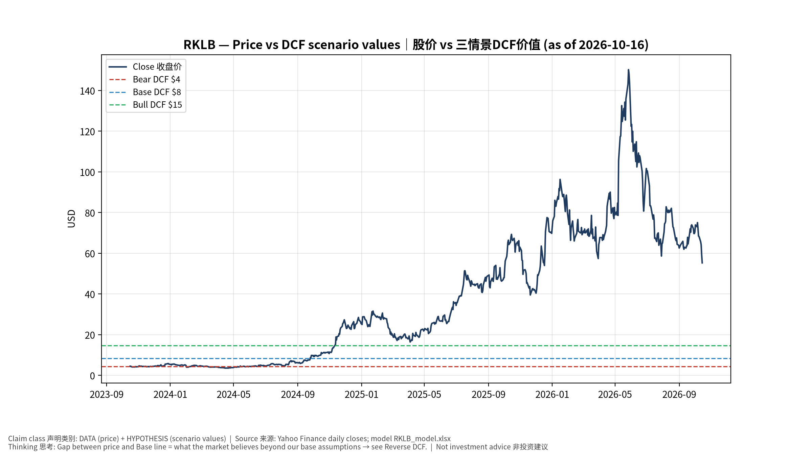
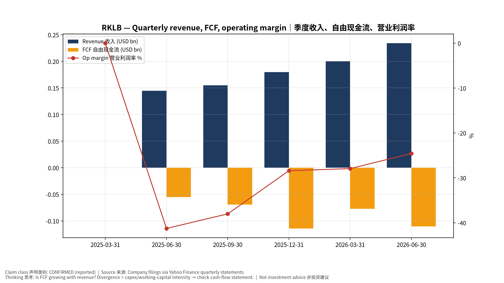
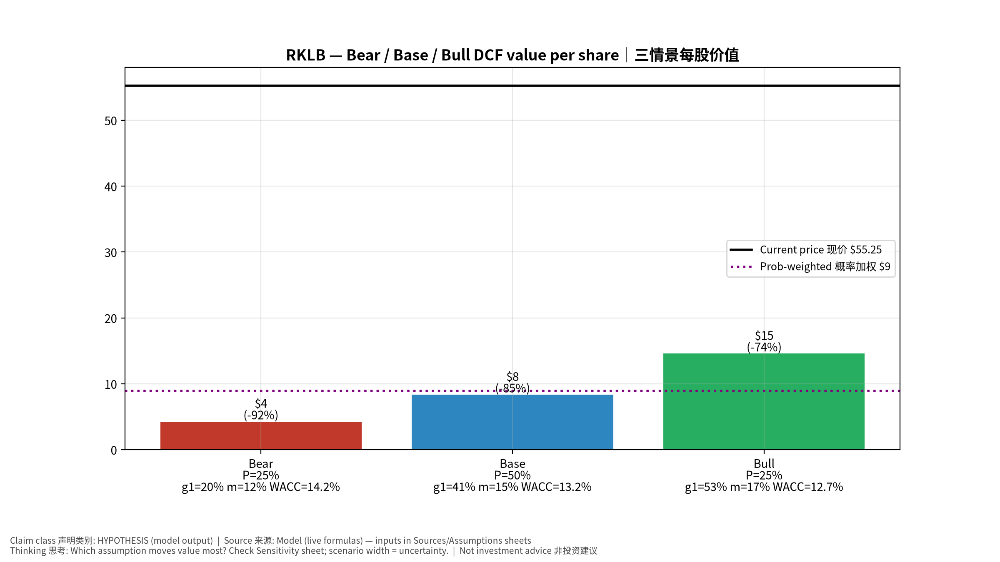
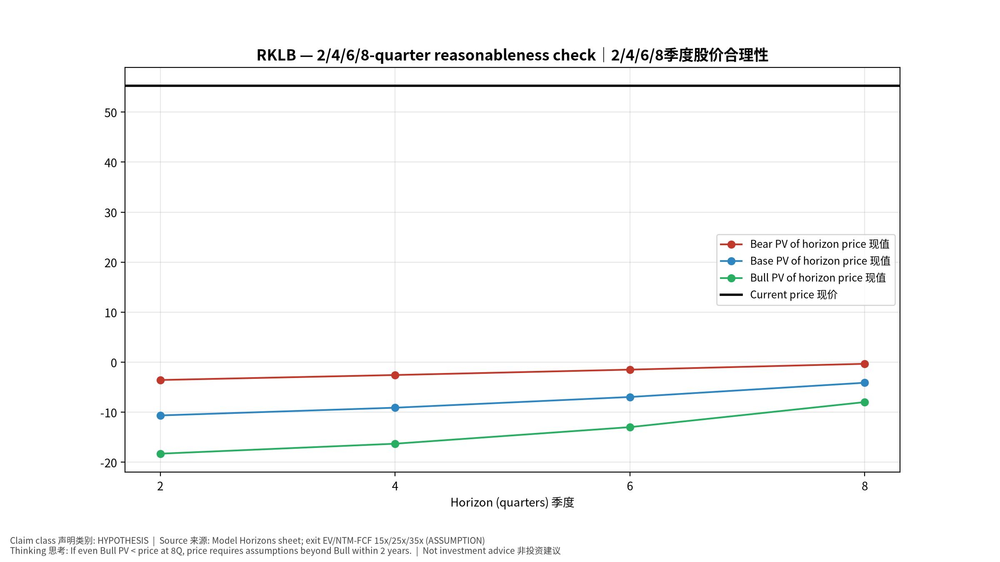
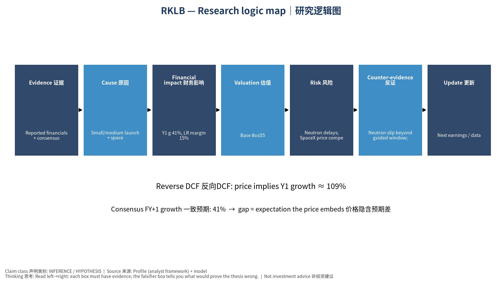

# RKLB Rocket Lab Corporation — 个股深度研究 (专业中文版) v20261016-0756
> 数据截至 2026-10-16 07:56 SGT｜价格 $55.25｜市值 35.3 bn USD｜财报货币 USD｜非投资建议。事实=CONFIRMED/DATA；推断=INFERENCE；假设=ASSUMPTION/HYPOTHESIS。

## 1. 投资论点 Investment Thesis (HYPOTHESIS)
Rocket Lab是'第二个SpaceX'叙事标的，Neutron中型火箭是关键拐点；目前FCF为负，估值依赖长期市场份额假设。

- **多头驱动**: Neutron flies successfully and wins NSSL/constellation work｜Neutron成功并获国家安全/星座订单
- **空头驱动**: Neutron delays; SpaceX price competition; dilution｜Neutron延期；SpaceX压价；稀释
- **证伪条件 Falsifiers**: Neutron slip beyond guided window; backlog growth stalls｜Neutron超出指引窗口；积压停滞

## 2. 产品、客户与收入模式
- 主题 Theme: Small/medium launch + space systems 中小型发射+航天系统
- 业务分部 Segments: Launch services 发射服务；Space systems 航天系统
- 公司描述 (DATA, Yahoo/公司申报): Rocket Lab Corporation, a space company, provides launch services and space systems solutions in the United States, Canada, Japan, and internationally. The company operates through launch services and space systems segments. The company provides launch services, spacecraft design services, spacecraft components, spacecraft manufacturing, optical systems, and other spacecraft and on-orbit management solutions and constellation management services, as well as designs and manufactures small and medium-class rockets and develops flight and ground software. It also designs, manufactures, and sells Electron, an orbital small launch vehicle for small spacecraft launch services, as well as develops Neutron launch vehicles for large constellation deployments, interplanetary missions, and potentially for human spaceflight. In addition, the company designs and manufactures a range of components and
- 主要客户: NASA, US Space Force/SDA, commercial constellations｜NASA、美国太空军/SDA、商业星座

## 3. 行业、竞争、监管与供应链 (ANALYST FRAMEWORK)
- 供应商/上游: In-house (solar, reaction wheels via acquisitions), carbon composites｜自研(收购获得太阳翼、飞轮)、碳复合材料
- 竞争者 (含业外): SpaceX, Firefly, Relativity, Blue Origin; satellite primes｜SpaceX、Firefly、Relativity、Blue Origin
- 瓶颈/监管: Neutron first flight & cadence, SDA contract execution｜Neutron首飞与节奏、SDA合同执行
- 关键KPI: Backlog, launches, Neutron milestones, GM%, cash burn｜积压订单、发射次数、Neutron里程碑、毛利率、现金消耗
- 零部件现货/合约价: 本版未接入付费价格源(TrendForce/DRAMeXchange等)——标注 **UNAVAILABLE**，在KPI监控中以定性方式跟踪。

## 4. 历史财务与现金流 (CONFIRMED, 季度, USD)
| 季度 | 收入 | 毛利 | 营业利润 | 净利润 | FCF | 营业利润率 |
|---|---|---|---|---|---|---|
| 2026-06-30 | 0.2 bn USD | 84.6 mn USD | -57.5 mn USD | -49.3 mn USD | -0.1 bn USD | -24.6% |
| 2026-03-31 | 0.2 bn USD | 76.5 mn USD | -56.0 mn USD | -45.0 mn USD | -77.4 mn USD | -27.9% |
| 2025-12-31 | 0.2 bn USD | 68.2 mn USD | -51.0 mn USD | -52.9 mn USD | -0.1 bn USD | -28.4% |
| 2025-09-30 | 0.2 bn USD | 57.3 mn USD | -59.0 mn USD | -18.3 mn USD | -69.4 mn USD | -38.0% |
| 2025-06-30 | 0.1 bn USD | 46.4 mn USD | -59.6 mn USD | -66.4 mn USD | -55.3 mn USD | -41.3% |
| 2025-03-31 | N/A | N/A | N/A | N/A | N/A | N/A |

资产负债: 现金 2.3 bn USD；总负债 0.1 bn USD；净现金 2.2 bn USD。TTM FCF -0.4 bn USD（FCF率 -48.3%）。

## 5. 最新财报: 实际 vs 一致预期 vs 指引
| 季度 | EPS实际 | EPS一致预期 | 超预期% |
|---|---|---|---|
| 2025-09-30 | -0.03 | -0.10452 | 0.71300006 |
| 2025-12-31 | -0.09 | -0.09803 | 0.08189999 |
| 2026-03-31 | -0.07 | -0.07868 | 0.1103 |
| 2026-06-30 | -0.08 | -0.07667 | -0.0434 |

- 管理层指引 Guidance: 自动数据源不含指引——**UNAVAILABLE（待从公司IR新闻稿录入）**。
- 下次财报日 (Yahoo, TENTATIVE 直至公司确认): **2026-11-10**；本季EPS一致预期 -0.06464（11位分析师）；收入一致预期 0.3 bn USD。

## 6. 未来2/4/6/8季度驱动与价格合理性
| 期限 | 情景 | 期限价格现值 | 相对现价 |
|---|---|---|---|
| 2Q | Bear | $-3.56 | -106.4% |
| 2Q | Base | $-10.64 | -119.3% |
| 2Q | Bull | $-18.29 | -133.1% |
| 4Q | Bear | $-2.56 | -104.6% |
| 4Q | Base | $-9.10 | -116.5% |
| 4Q | Bull | $-16.30 | -129.5% |
| 6Q | Bear | $-1.49 | -102.7% |
| 6Q | Base | $-6.96 | -112.6% |
| 6Q | Bull | $-12.98 | -123.5% |
| 8Q | Bear | $-0.32 | -100.6% |
| 8Q | Base | $-4.11 | -107.4% |
| 8Q | Bull | $-7.97 | -114.4% |

现价隐含的 EV/NTM-FCF (Base 路径): | 期限 | 隐含倍数 |
|---|---|
| 2Q | n/m (neg FCF) |
| 4Q | n/m (neg FCF) |
| 6Q | n/m (neg FCF) |
| 8Q | n/m (neg FCF) |

解读: 如果8季度后Base情景所需倍数仍远高于25x，说明价格依赖更远期的增长。

## 7. 三情景 Bear / Base / Bull (HYPOTHESIS)
| 情景 | Y1增速 | 长期FCF率 | WACC | 永续g | 概率 | 每股价值 | 相对现价 |
|---|---|---|---|---|---|---|---|
| Bear | 20.4% | 12.0% | 14.2% | 2.5% | 25.0% | $4.26 | -92.3% |
| Base | 40.8% | 15.0% | 13.2% | 3.0% | 50.0% | $8.34 | -84.9% |
| Bull | 53.1% | 17.2% | 12.7% | 3.5% | 25.0% | $14.57 | -73.6% |

概率加权价值 **$8.88**（相对现价 -83.9%）。

## 8. 估值: DCF / Reverse DCF / ROIC-WACC / 同业 / 敏感度
- DCF Base: EV 3.2 bn USD；终值占比 73.7%。
- **Reverse DCF 反向DCF**: 在Base利润率与WACC下，现价隐含Y1收入增速 ≈ **108.6%**；一致预期FY+1增速 40.8%。
- WACC (CAPM) = rf 5.2% + β 1.60 × ERP 5.0% = 13.2%。
- SOTP segments 分部: Launch services 发射服务; Space systems 航天系统. **Status: framework only** — segment revenues are INPUT REQUIRED from the latest 10-K/10-Q segment note (not auto-fed, left blank to avoid fabrication)｜分部收入需按最新财报手动录入，未自动填充以避免编造。
- 同业比较 Comps (DATA):
| Ticker | 市值 | EV/Sales | Fwd P/E | 收入增速 | 毛利率 | FCF收益率 |
|---|---|---|---|---|---|---|
| RKLB | 35.3 bn USD | 40.2x | 850.1x | 62.0% | 37.3% | -1.1% |
| SPCX | 1,959.1 bn USD | 167.4x | 74.8x | 91.9% | 51.9% | N/A |
| ASTS | 17.3 bn USD | 126.1x | -34.6x | 2626.6% | 38.9% | -10.4% |
| LUNR | 1.9 bn USD | 6.8x | -74.6x | 309.8% | 16.3% | -4.3% |
| PL | 5.3 bn USD | 13.0x | -11632.0x | 58.1% | 55.5% | 1.0% |

- 敏感度: 见Excel `Sensitivity` 表 (WACC × 永续增长率)。

## 9. 风险、反方论证与证伪
- 反方观点 Counter-thesis: Neutron delays; SpaceX price competition; dilution｜Neutron延期；SpaceX压价；稀释
- 证伪指标: Neutron slip beyond guided window; backlog growth stalls｜Neutron超出指引窗口；积压停滞
- 模型风险: 长期利润率与WACC为假设；终值占比高时估值对假设极敏感。

## 10. Source Ledger 来源账本
| Item | Value | Source/time |
|---|---|---|
| Price 股价 | 55.25 | Yahoo Finance quote, fetched 2026-10-16T07:56 SGT |
| Market cap 市值 | 3.533e+10 | Yahoo info.marketCap 2026-10-16T07:56 |
| Cash 现金 | 2.302e+09 | Yahoo info.totalCash (latest filing) 2026-10-16T07:56 |
| Debt 负债 | 1.337e+08 | Yahoo info.totalDebt (latest filing) 2026-10-16T07:56 |
| Revenue TTM 收入 | 7.691e+08 | Yahoo info.totalRevenue (TTM, USD) 2026-10-16T07:56 |
| FCF TTM 自由现金流 | -3.711e+08 | Sum of last 4 quarterly FCF (q_cash); quarters ['2026-06-30', '2026-03-31', '2025-12-31', '2025-09-30'] (USD) |
| Beta | 2.938 | Yahoo info.beta (5Y monthly) |
| Risk-free 10Y 无风险利率 | 0.0519 | FRED DGS10 2026-10-14 |
| FX USD per USD | 1 | n/a (USD) |
| Consensus rev growth FY0 | 0.5973 | Yahoo revenue_estimate 0y |
| Consensus rev growth FY+1 | 0.4083 | Yahoo revenue_estimate +1y |

## 11. Assumption Register 假设登记表
| Assumption | Value | Rationale |
|---|---|---|
| ERP 股权风险溢价 | 0.05 | ASSUMPTION: 5.0% house mature-market ERP |
| Beta clamp | [0.8,1.6] → 1.60 | ASSUMPTION: limit extreme betas |
| Tax rate (ROIC) | 0.18 | ASSUMPTION: blended cash tax 18% |
| Year-1 growth (Base) | 0.4083 | Consensus FY+1 revenue growth (Yahoo revenue_estimate '+1y'); capped at 100% |
| Growth fade | linear Y1→terminal by Y10 | ASSUMPTION |
| Starting FCF margin | -0.4825 | DATA: FCF TTM / Revenue TTM, floored -50% |
| Long-run FCF margin (Base) | 0.15 | ASSUMPTION (analyst framework, reached by Y5; see profile) |
| Bear/Bull Y1 growth multiplier | 0.5x / 1.3x | ASSUMPTION |
| Bear/Bull margin multiplier | 0.8x / 1.15x | ASSUMPTION |
| WACC adj Bear/Bull | +1.0pp / -0.5pp | ASSUMPTION |
| Terminal g Bear/Base/Bull | 2.5% / 3.0% / 3.5% | ASSUMPTION |
| Scenario probabilities | 25% / 50% / 25% | ASSUMPTION |
| Horizon exit EV/NTM-FCF Bear/Base/Bull | 15x / 25x / 35x | ASSUMPTION |
| Per-share conversion | value × fx ÷ market cap × price | METHOD: avoids ADR/share-class mismatch |

## 12. Model Provenance 模型溯源
- Model file: `RKLB_model_v20261016-0756.xlsx` (live formulas; sheets Inputs→Scenarios→DCF→ReverseDCF→Sensitivity→Horizons→SOTP→Comps→ROIC_WACC→History→Sources→Assumptions)
- Engine: `production/pipeline/model.py` (Python mirror; values in this report = Python mirror, verified against LibreOffice recalculation of the xlsx)
- Data snapshot: `data/snapshots/20261016-0756` (immutable) | Fetched 2026-10-16 07:56 SGT | Generated 2026-10-16 07:57 SGT
- Version: v20261016-0756. Prior versions are never overwritten (see company history page).

## 13. 版本与事件时间轴
- v20261016-0756: 首版生产系统报告 (27家同步)。下一事件: 财报 2026-11-10 (TENTATIVE)。

## 图片报告 Image Report

*股价vs三情景价值 Price vs scenario values*

*季度财务 Quarterly financials*

*三情景 Scenarios*

*2/4/6/8季度检验 Horizon check*

*研究逻辑图 Logic map*

---

# RKLB Rocket Lab Corporation — Equity Deep Dive (Professional English) v20261016-0756
> Data as of 2026-10-16 07:56 SGT | Price $55.25 | Mkt cap 35.3 bn USD | Reporting currency USD | Not investment advice.

## 1. Investment thesis (HYPOTHESIS)
Rocket Lab is the 'next SpaceX' narrative name; the Neutron medium-lift rocket is the key inflection. FCF is currently negative, so valuation rests on long-term share assumptions.

- **Bull drivers**: Neutron flies successfully and wins NSSL/constellation work｜Neutron成功并获国家安全/星座订单
- **Bear drivers**: Neutron delays; SpaceX price competition; dilution｜Neutron延期；SpaceX压价；稀释
- **Falsifiers**: Neutron slip beyond guided window; backlog growth stalls｜Neutron超出指引窗口；积压停滞

## 2. Products, customers, revenue model
- Theme: Small/medium launch + space systems 中小型发射+航天系统 | Segments: Launch services 发射服务; Space systems 航天系统
- Business description (DATA): Rocket Lab Corporation, a space company, provides launch services and space systems solutions in the United States, Canada, Japan, and internationally. The company operates through launch services and space systems segments. The company provides launch services, spacecraft design services, spacecraft components, spacecraft manufacturing, optical systems, and other spacecraft and on-orbit management solutions and constellation management services, as well as designs and manufactures small and medium-class rockets and develops flight and ground software. It also designs, manufactures, and sells Electron, an orbital small launch vehicle for small spacecraft launch services, as well as develops Neutron launch vehicles for large constellation deployments, interplanetary missions, and potentially for human spaceflight. In addition, the company designs and manufactures a range of components and
- Customers: NASA, US Space Force/SDA, commercial constellations｜NASA、美国太空军/SDA、商业星座

## 3. Industry, competition, regulation, supply chain (ANALYST FRAMEWORK)
- Suppliers: In-house (solar, reaction wheels via acquisitions), carbon composites｜自研(收购获得太阳翼、飞轮)、碳复合材料
- Competitors: SpaceX, Firefly, Relativity, Blue Origin; satellite primes｜SpaceX、Firefly、Relativity、Blue Origin
- Bottlenecks/regulation: Neutron first flight & cadence, SDA contract execution｜Neutron首飞与节奏、SDA合同执行
- KPIs: Backlog, launches, Neutron milestones, GM%, cash burn｜积压订单、发射次数、Neutron里程碑、毛利率、现金消耗
- Component spot/contract prices: paid feeds not connected — **UNAVAILABLE**, tracked qualitatively.

## 4. Historical financials & cash flow (CONFIRMED, quarterly, USD)
| Quarter | Revenue | Gross profit | Op income | Net income | FCF | Op margin |
|---|---|---|---|---|---|---|
| 2026-06-30 | 0.2 bn USD | 84.6 mn USD | -57.5 mn USD | -49.3 mn USD | -0.1 bn USD | -24.6% |
| 2026-03-31 | 0.2 bn USD | 76.5 mn USD | -56.0 mn USD | -45.0 mn USD | -77.4 mn USD | -27.9% |
| 2025-12-31 | 0.2 bn USD | 68.2 mn USD | -51.0 mn USD | -52.9 mn USD | -0.1 bn USD | -28.4% |
| 2025-09-30 | 0.2 bn USD | 57.3 mn USD | -59.0 mn USD | -18.3 mn USD | -69.4 mn USD | -38.0% |
| 2025-06-30 | 0.1 bn USD | 46.4 mn USD | -59.6 mn USD | -66.4 mn USD | -55.3 mn USD | -41.3% |
| 2025-03-31 | N/A | N/A | N/A | N/A | N/A | N/A |

Cash 2.3 bn USD; debt 0.1 bn USD; TTM FCF -0.4 bn USD (FCF margin -48.3%).

## 5. Latest earnings: actual vs consensus vs guidance
| Quarter | EPS actual | EPS consensus | Surprise |
|---|---|---|---|
| 2025-09-30 | -0.03 | -0.10452 | 0.71300006 |
| 2025-12-31 | -0.09 | -0.09803 | 0.08189999 |
| 2026-03-31 | -0.07 | -0.07868 | 0.1103 |
| 2026-06-30 | -0.08 | -0.07667 | -0.0434 |

- Management guidance: not in automated feed — **UNAVAILABLE (to be entered from IR release)**.
- Next earnings (Yahoo; TENTATIVE until company-confirmed): **2026-11-10**; current-quarter EPS consensus -0.06464 (11 analysts); revenue consensus 0.3 bn USD.

## 6. 2/4/6/8-quarter drivers & price reasonableness
| Horizon | Scenario | PV of horizon price | vs current |
|---|---|---|---|
| 2Q | Bear | $-3.56 | -106.4% |
| 2Q | Base | $-10.64 | -119.3% |
| 2Q | Bull | $-18.29 | -133.1% |
| 4Q | Bear | $-2.56 | -104.6% |
| 4Q | Base | $-9.10 | -116.5% |
| 4Q | Bull | $-16.30 | -129.5% |
| 6Q | Bear | $-1.49 | -102.7% |
| 6Q | Base | $-6.96 | -112.6% |
| 6Q | Bull | $-12.98 | -123.5% |
| 8Q | Bear | $-0.32 | -100.6% |
| 8Q | Base | $-4.11 | -107.4% |
| 8Q | Bull | $-7.97 | -114.4% |

Current-price implied EV/NTM-FCF on Base path: | Horizon | Implied multiple |
|---|---|
| 2Q | n/m (neg FCF) |
| 4Q | n/m (neg FCF) |
| 6Q | n/m (neg FCF) |
| 8Q | n/m (neg FCF) |

## 7. Bear / Base / Bull (HYPOTHESIS)
| Scenario | Y1 growth | LR FCF margin | WACC | Terminal g | Prob. | Value/share | vs price |
|---|---|---|---|---|---|---|---|
| Bear | 20.4% | 12.0% | 14.2% | 2.5% | 25.0% | $4.26 | -92.3% |
| Base | 40.8% | 15.0% | 13.2% | 3.0% | 50.0% | $8.34 | -84.9% |
| Bull | 53.1% | 17.2% | 12.7% | 3.5% | 25.0% | $14.57 | -73.6% |

Probability-weighted value **$8.88** (-83.9% vs price).

## 8. Valuation: DCF / Reverse DCF / ROIC-WACC / comps / sensitivity
- Base DCF EV 3.2 bn USD; terminal share 73.7%.
- **Reverse DCF**: at Base margin/WACC the price implies Y1 revenue growth ≈ **108.6%** vs consensus FY+1 40.8%.
- WACC (CAPM) = rf 5.2% + β 1.60 × ERP 5.0% = 13.2%.
- SOTP segments: Launch services 发射服务; Space systems 航天系统 — framework only; segment revenue inputs pending from filings.
- Comps (DATA): see table in Chinese section / Excel `Comps`.
- Sensitivity: Excel `Sensitivity` (WACC × terminal g).

## 9. Risks, counterarguments, falsifiers
Neutron delays; SpaceX price competition; dilution｜Neutron延期；SpaceX压价；稀释 | Falsifiers: Neutron slip beyond guided window; backlog growth stalls｜Neutron超出指引窗口；积压停滞

## 10–12. Source Ledger / Assumption Register / Model Provenance
See tables above (shared, bilingual). - Model file: `RKLB_model_v20261016-0756.xlsx` (live formulas; sheets Inputs→Scenarios→DCF→ReverseDCF→Sensitivity→Horizons→SOTP→Comps→ROIC_WACC→History→Sources→Assumptions)
- Engine: `production/pipeline/model.py` (Python mirror; values in this report = Python mirror, verified against LibreOffice recalculation of the xlsx)
- Data snapshot: `data/snapshots/20261016-0756` (immutable) | Fetched 2026-10-16 07:56 SGT | Generated 2026-10-16 07:57 SGT
- Version: v20261016-0756. Prior versions are never overwritten (see company history page).
