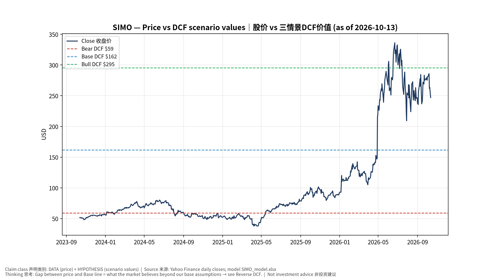
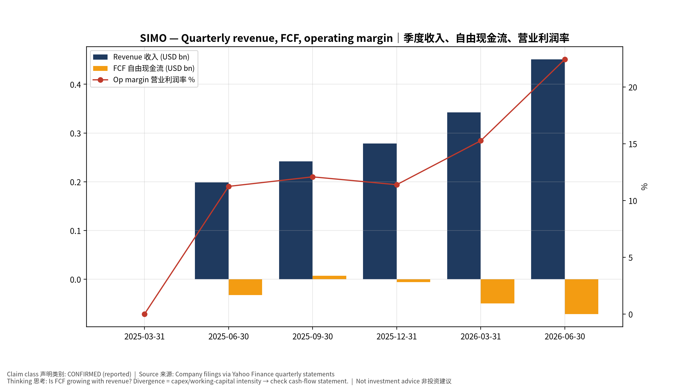
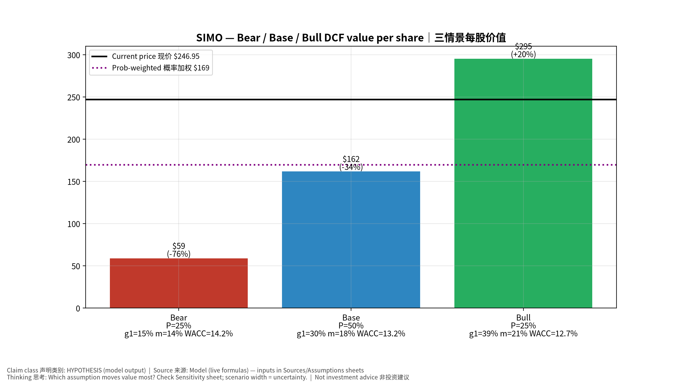
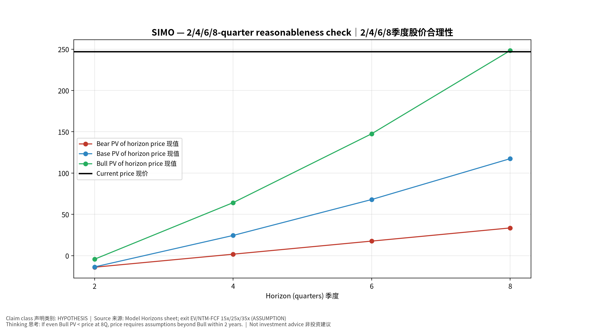
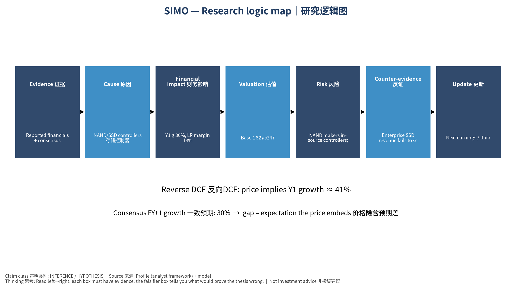

# SIMO Silicon Motion Technology Corporation — 个股深度研究 (专业中文版) v20261013-1622
> 数据截至 2026-10-13 16:22 SGT｜价格 $246.95｜市值 8.4 bn USD｜财报货币 USD｜非投资建议。事实=CONFIRMED/DATA；推断=INFERENCE；假设=ASSUMPTION/HYPOTHESIS。

## 1. 投资论点 Investment Thesis (HYPOTHESIS)
慧荣是NAND周期与AI企业级SSD的'卖铲人'；收入弹性大，NAND价格上涨期受益于出货与规格升级。注意最新数据期间FCF为负。

- **多头驱动**: Enterprise SSD (MonTitan) wins; PCIe Gen5/6 mix｜企业级SSD获单；PCIe 5/6升级
- **空头驱动**: NAND makers in-source controllers; cycle reverses｜原厂自研主控；周期反转
- **证伪条件 Falsifiers**: Enterprise SSD revenue fails to scale; GM <45%｜企业级SSD未放量；毛利率<45%

## 2. 产品、客户与收入模式
- 主题 Theme: NAND/SSD controllers 存储控制器
- 业务分部 Segments: SSD controllers SSD主控；eMMC/UFS controllers 嵌入式主控；Other 其他
- 公司描述 (DATA, Yahoo/公司申报): Silicon Motion Technology Corporation, together with its subsidiaries, designs, develops, and markets NAND flash controllers for solid-state storage devices and related devices in China, Japan, Singapore, Taiwan, Korea, the United States, and internationally. It offers controllers for computing-grade solid state drives (SSDs), which are used in PCs and other client devices; enterprise-grade SSDs used in enterprise and hyperscale data centers; eMMC and UFS mobile embedded storage for use in smartphones and IoT devices; flash memory cards and flash drives for use in expandable storage; and specialized SSDs that are used in industrial, commercial, and automotive applications. The company markets its controllers under the SMI brand; and single-chip SSDs under the FerriSSD, Ferri-eMMC, and Ferri-UFS brands. It markets and sells its products through direct sales personnel and independent elect
- 主要客户: Samsung, SK hynix, Micron, Kioxia/SanDisk, YMTC, module makers｜各NAND原厂与模组厂

## 3. 行业、竞争、监管与供应链 (ANALYST FRAMEWORK)
- 供应商/上游: TSMC (controller wafers), OSATs｜台积电、封测厂
- 竞争者 (含业外): Phison, Marvell, Samsung/WD in-house controllers｜群联、Marvell、原厂自研
- 瓶颈/监管: NAND bit growth, enterprise SSD controller design wins｜NAND位元增长、企业级SSD主控订单
- 关键KPI: Revenue by segment, GM%, enterprise SSD wins｜分业务收入、毛利率、企业级订单
- 零部件现货/合约价: 本版未接入付费价格源(TrendForce/DRAMeXchange等)——标注 **UNAVAILABLE**，在KPI监控中以定性方式跟踪。

## 4. 历史财务与现金流 (CONFIRMED, 季度, USD)
| 季度 | 收入 | 毛利 | 营业利润 | 净利润 | FCF | 营业利润率 |
|---|---|---|---|---|---|---|
| 2026-06-30 | 0.5 bn USD | 0.2 bn USD | 0.1 bn USD | 0.1 bn USD | -71.5 mn USD | 22.4% |
| 2026-03-31 | 0.3 bn USD | 0.2 bn USD | 52.2 mn USD | 66.8 mn USD | -49.4 mn USD | 15.3% |
| 2025-12-31 | 0.3 bn USD | 0.1 bn USD | 31.7 mn USD | 47.7 mn USD | -6.3 mn USD | 11.4% |
| 2025-09-30 | 0.2 bn USD | 0.1 bn USD | 29.2 mn USD | 39.1 mn USD | 6.8 mn USD | 12.1% |
| 2025-06-30 | 0.2 bn USD | 94.7 mn USD | 22.3 mn USD | 16.3 mn USD | -32.8 mn USD | 11.2% |
| 2025-03-31 | N/A | N/A | N/A | N/A | N/A | N/A |

资产负债: 现金 74.4 mn USD；总负债 72.5 mn USD；净现金 1.9 mn USD。TTM FCF -0.1 bn USD（FCF率 -9.2%）。

## 5. 最新财报: 实际 vs 一致预期 vs 指引
| 季度 | EPS实际 | EPS一致预期 | 超预期% |
|---|---|---|---|
| 2025-09-30 | 1.0 | 0.80667 | 0.23969999 |
| 2025-12-31 | 1.26 | 1.29834 | -0.0295 |
| 2026-03-31 | 1.58 | 1.30305 | 0.2125 |
| 2026-06-30 | 2.43 | 2.10662 | 0.1535 |

- 管理层指引 Guidance: 自动数据源不含指引——**UNAVAILABLE（待从公司IR新闻稿录入）**。
- 下次财报日 (Yahoo, TENTATIVE 直至公司确认): **2026-10-29**；本季EPS一致预期 3.33339（9位分析师）；收入一致预期 0.5 bn USD。

## 6. 未来2/4/6/8季度驱动与价格合理性
| 期限 | 情景 | 期限价格现值 | 相对现价 |
|---|---|---|---|
| 2Q | Bear | $-13.99 | -105.7% |
| 2Q | Base | $-13.64 | -105.5% |
| 2Q | Bull | $-4.30 | -101.7% |
| 4Q | Bear | $1.78 | -99.3% |
| 4Q | Base | $24.46 | -90.1% |
| 4Q | Bull | $64.18 | -74.0% |
| 6Q | Bear | $17.63 | -92.9% |
| 6Q | Base | $67.97 | -72.5% |
| 6Q | Bull | $147.58 | -40.2% |
| 8Q | Bear | $33.57 | -86.4% |
| 8Q | Base | $117.45 | -52.4% |
| 8Q | Bull | $248.34 | 0.6% |

现价隐含的 EV/NTM-FCF (Base 路径): | 期限 | 隐含倍数 |
|---|---|
| 2Q | n/m (neg FCF) |
| 4Q | 223.3x |
| 6Q | 75.4x |
| 8Q | 41.0x |

解读: 如果8季度后Base情景所需倍数仍远高于25x，说明价格依赖更远期的增长。

## 7. 三情景 Bear / Base / Bull (HYPOTHESIS)
| 情景 | Y1增速 | 长期FCF率 | WACC | 永续g | 概率 | 每股价值 | 相对现价 |
|---|---|---|---|---|---|---|---|
| Bear | 14.8% | 14.4% | 14.2% | 2.5% | 25.0% | $58.88 | -76.2% |
| Base | 29.6% | 18.0% | 13.2% | 3.0% | 50.0% | $161.80 | -34.5% |
| Bull | 38.5% | 20.7% | 12.7% | 3.5% | 25.0% | $295.30 | 19.6% |

概率加权价值 **$169.45**（相对现价 -31.4%）。

## 8. 估值: DCF / Reverse DCF / ROIC-WACC / 同业 / 敏感度
- DCF Base: EV 5.5 bn USD；终值占比 55.4%。
- **Reverse DCF 反向DCF**: 在Base利润率与WACC下，现价隐含Y1收入增速 ≈ **40.8%**；一致预期FY+1增速 29.6%。
- WACC (CAPM) = rf 5.2% + β 1.60 × ERP 5.0% = 13.2%。
- SOTP segments 分部: SSD controllers SSD主控; eMMC/UFS controllers 嵌入式主控; Other 其他. **Status: framework only** — segment revenues are INPUT REQUIRED from the latest 10-K/10-Q segment note (not auto-fed, left blank to avoid fabrication)｜分部收入需按最新财报手动录入，未自动填充以避免编造。
- 同业比较 Comps (DATA):
| Ticker | 市值 | EV/Sales | Fwd P/E | 收入增速 | 毛利率 | FCF收益率 |
|---|---|---|---|---|---|---|
| SIMO | 8.4 bn USD | 6.4x | 15.6x | 127.0% | 48.9% | -1.4% |
| MU | 1,119.0 bn USD | 8.1x | 4.8x | 379.3% | 80.7% | 2.6% |
| MRVL | 238.9 bn USD | 24.8x | 36.5x | 36.5% | 52.2% | 1.0% |
| 8299.TWO | 434.6 bn USD | 3.0x | 7.4x | 279.5% | 56.8% | -4.2% |

- 敏感度: 见Excel `Sensitivity` 表 (WACC × 永续增长率)。

## 9. 风险、反方论证与证伪
- 反方观点 Counter-thesis: NAND makers in-source controllers; cycle reverses｜原厂自研主控；周期反转
- 证伪指标: Enterprise SSD revenue fails to scale; GM <45%｜企业级SSD未放量；毛利率<45%
- 模型风险: 长期利润率与WACC为假设；终值占比高时估值对假设极敏感。

## 10. Source Ledger 来源账本
| Item | Value | Source/time |
|---|---|---|
| Price 股价 | 246.9 | Yahoo Finance quote, fetched 2026-10-13T16:22 SGT |
| Market cap 市值 | 8.374e+09 | Yahoo info.marketCap 2026-10-13T16:22 |
| Cash 现金 | 7.437e+07 | Yahoo info.totalCash (latest filing) 2026-10-13T16:22 |
| Debt 负债 | 7.249e+07 | Yahoo info.totalDebt (latest filing) 2026-10-13T16:22 |
| Revenue TTM 收入 | 1.314e+09 | Yahoo info.totalRevenue (TTM, USD) 2026-10-13T16:22 |
| FCF TTM 自由现金流 | -1.204e+08 | Sum of last 4 quarterly FCF (q_cash); quarters ['2026-06-30', '2026-03-31', '2025-12-31', '2025-09-30'] (USD) |
| Beta | 1.682 | Yahoo info.beta (5Y monthly) |
| Risk-free 10Y 无风险利率 | 0.0522 | FRED DGS10 2026-10-08 |
| FX USD per USD | 1 | n/a (USD) |
| Consensus rev growth FY0 | 1.117 | Yahoo revenue_estimate 0y |
| Consensus rev growth FY+1 | 0.2964 | Yahoo revenue_estimate +1y |

## 11. Assumption Register 假设登记表
| Assumption | Value | Rationale |
|---|---|---|
| ERP 股权风险溢价 | 0.05 | ASSUMPTION: 5.0% house mature-market ERP |
| Beta clamp | [0.8,1.6] → 1.60 | ASSUMPTION: limit extreme betas |
| Tax rate (ROIC) | 0.18 | ASSUMPTION: blended cash tax 18% |
| Year-1 growth (Base) | 0.2964 | Consensus FY+1 revenue growth (Yahoo revenue_estimate '+1y'); capped at 100% |
| Growth fade | linear Y1→terminal by Y10 | ASSUMPTION |
| Starting FCF margin | -0.0917 | DATA: FCF TTM / Revenue TTM, floored -50% |
| Long-run FCF margin (Base) | 0.18 | ASSUMPTION (analyst framework, reached by Y5; see profile) |
| Bear/Bull Y1 growth multiplier | 0.5x / 1.3x | ASSUMPTION |
| Bear/Bull margin multiplier | 0.8x / 1.15x | ASSUMPTION |
| WACC adj Bear/Bull | +1.0pp / -0.5pp | ASSUMPTION |
| Terminal g Bear/Base/Bull | 2.5% / 3.0% / 3.5% | ASSUMPTION |
| Scenario probabilities | 25% / 50% / 25% | ASSUMPTION |
| Horizon exit EV/NTM-FCF Bear/Base/Bull | 15x / 25x / 35x | ASSUMPTION |
| Per-share conversion | value × fx ÷ market cap × price | METHOD: avoids ADR/share-class mismatch |

## 12. Model Provenance 模型溯源
- Model file: `SIMO_model_v20261013-1622.xlsx` (live formulas; sheets Inputs→Scenarios→DCF→ReverseDCF→Sensitivity→Horizons→SOTP→Comps→ROIC_WACC→History→Sources→Assumptions)
- Engine: `production/pipeline/model.py` (Python mirror; values in this report = Python mirror, verified against LibreOffice recalculation of the xlsx)
- Data snapshot: `data/snapshots/20261013-1622` (immutable) | Fetched 2026-10-13 16:22 SGT | Generated 2026-10-13 16:23 SGT
- Version: v20261013-1622. Prior versions are never overwritten (see company history page).

## 13. 版本与事件时间轴
- v20261013-1622: 首版生产系统报告 (27家同步)。下一事件: 财报 2026-10-29 (TENTATIVE)。

## 图片报告 Image Report

*股价vs三情景价值 Price vs scenario values*

*季度财务 Quarterly financials*

*三情景 Scenarios*

*2/4/6/8季度检验 Horizon check*

*研究逻辑图 Logic map*

---

# SIMO Silicon Motion Technology Corporation — Equity Deep Dive (Professional English) v20261013-1622
> Data as of 2026-10-13 16:22 SGT | Price $246.95 | Mkt cap 8.4 bn USD | Reporting currency USD | Not investment advice.

## 1. Investment thesis (HYPOTHESIS)
Silicon Motion is a 'picks-and-shovels' play on the NAND cycle and AI enterprise SSDs; revenue is highly elastic and benefits from NAND upcycles and spec upgrades. Note negative FCF in latest data period.

- **Bull drivers**: Enterprise SSD (MonTitan) wins; PCIe Gen5/6 mix｜企业级SSD获单；PCIe 5/6升级
- **Bear drivers**: NAND makers in-source controllers; cycle reverses｜原厂自研主控；周期反转
- **Falsifiers**: Enterprise SSD revenue fails to scale; GM <45%｜企业级SSD未放量；毛利率<45%

## 2. Products, customers, revenue model
- Theme: NAND/SSD controllers 存储控制器 | Segments: SSD controllers SSD主控; eMMC/UFS controllers 嵌入式主控; Other 其他
- Business description (DATA): Silicon Motion Technology Corporation, together with its subsidiaries, designs, develops, and markets NAND flash controllers for solid-state storage devices and related devices in China, Japan, Singapore, Taiwan, Korea, the United States, and internationally. It offers controllers for computing-grade solid state drives (SSDs), which are used in PCs and other client devices; enterprise-grade SSDs used in enterprise and hyperscale data centers; eMMC and UFS mobile embedded storage for use in smartphones and IoT devices; flash memory cards and flash drives for use in expandable storage; and specialized SSDs that are used in industrial, commercial, and automotive applications. The company markets its controllers under the SMI brand; and single-chip SSDs under the FerriSSD, Ferri-eMMC, and Ferri-UFS brands. It markets and sells its products through direct sales personnel and independent elect
- Customers: Samsung, SK hynix, Micron, Kioxia/SanDisk, YMTC, module makers｜各NAND原厂与模组厂

## 3. Industry, competition, regulation, supply chain (ANALYST FRAMEWORK)
- Suppliers: TSMC (controller wafers), OSATs｜台积电、封测厂
- Competitors: Phison, Marvell, Samsung/WD in-house controllers｜群联、Marvell、原厂自研
- Bottlenecks/regulation: NAND bit growth, enterprise SSD controller design wins｜NAND位元增长、企业级SSD主控订单
- KPIs: Revenue by segment, GM%, enterprise SSD wins｜分业务收入、毛利率、企业级订单
- Component spot/contract prices: paid feeds not connected — **UNAVAILABLE**, tracked qualitatively.

## 4. Historical financials & cash flow (CONFIRMED, quarterly, USD)
| Quarter | Revenue | Gross profit | Op income | Net income | FCF | Op margin |
|---|---|---|---|---|---|---|
| 2026-06-30 | 0.5 bn USD | 0.2 bn USD | 0.1 bn USD | 0.1 bn USD | -71.5 mn USD | 22.4% |
| 2026-03-31 | 0.3 bn USD | 0.2 bn USD | 52.2 mn USD | 66.8 mn USD | -49.4 mn USD | 15.3% |
| 2025-12-31 | 0.3 bn USD | 0.1 bn USD | 31.7 mn USD | 47.7 mn USD | -6.3 mn USD | 11.4% |
| 2025-09-30 | 0.2 bn USD | 0.1 bn USD | 29.2 mn USD | 39.1 mn USD | 6.8 mn USD | 12.1% |
| 2025-06-30 | 0.2 bn USD | 94.7 mn USD | 22.3 mn USD | 16.3 mn USD | -32.8 mn USD | 11.2% |
| 2025-03-31 | N/A | N/A | N/A | N/A | N/A | N/A |

Cash 74.4 mn USD; debt 72.5 mn USD; TTM FCF -0.1 bn USD (FCF margin -9.2%).

## 5. Latest earnings: actual vs consensus vs guidance
| Quarter | EPS actual | EPS consensus | Surprise |
|---|---|---|---|
| 2025-09-30 | 1.0 | 0.80667 | 0.23969999 |
| 2025-12-31 | 1.26 | 1.29834 | -0.0295 |
| 2026-03-31 | 1.58 | 1.30305 | 0.2125 |
| 2026-06-30 | 2.43 | 2.10662 | 0.1535 |

- Management guidance: not in automated feed — **UNAVAILABLE (to be entered from IR release)**.
- Next earnings (Yahoo; TENTATIVE until company-confirmed): **2026-10-29**; current-quarter EPS consensus 3.33339 (9 analysts); revenue consensus 0.5 bn USD.

## 6. 2/4/6/8-quarter drivers & price reasonableness
| Horizon | Scenario | PV of horizon price | vs current |
|---|---|---|---|
| 2Q | Bear | $-13.99 | -105.7% |
| 2Q | Base | $-13.64 | -105.5% |
| 2Q | Bull | $-4.30 | -101.7% |
| 4Q | Bear | $1.78 | -99.3% |
| 4Q | Base | $24.46 | -90.1% |
| 4Q | Bull | $64.18 | -74.0% |
| 6Q | Bear | $17.63 | -92.9% |
| 6Q | Base | $67.97 | -72.5% |
| 6Q | Bull | $147.58 | -40.2% |
| 8Q | Bear | $33.57 | -86.4% |
| 8Q | Base | $117.45 | -52.4% |
| 8Q | Bull | $248.34 | 0.6% |

Current-price implied EV/NTM-FCF on Base path: | Horizon | Implied multiple |
|---|---|
| 2Q | n/m (neg FCF) |
| 4Q | 223.3x |
| 6Q | 75.4x |
| 8Q | 41.0x |

## 7. Bear / Base / Bull (HYPOTHESIS)
| Scenario | Y1 growth | LR FCF margin | WACC | Terminal g | Prob. | Value/share | vs price |
|---|---|---|---|---|---|---|---|
| Bear | 14.8% | 14.4% | 14.2% | 2.5% | 25.0% | $58.88 | -76.2% |
| Base | 29.6% | 18.0% | 13.2% | 3.0% | 50.0% | $161.80 | -34.5% |
| Bull | 38.5% | 20.7% | 12.7% | 3.5% | 25.0% | $295.30 | 19.6% |

Probability-weighted value **$169.45** (-31.4% vs price).

## 8. Valuation: DCF / Reverse DCF / ROIC-WACC / comps / sensitivity
- Base DCF EV 5.5 bn USD; terminal share 55.4%.
- **Reverse DCF**: at Base margin/WACC the price implies Y1 revenue growth ≈ **40.8%** vs consensus FY+1 29.6%.
- WACC (CAPM) = rf 5.2% + β 1.60 × ERP 5.0% = 13.2%.
- SOTP segments: SSD controllers SSD主控; eMMC/UFS controllers 嵌入式主控; Other 其他 — framework only; segment revenue inputs pending from filings.
- Comps (DATA): see table in Chinese section / Excel `Comps`.
- Sensitivity: Excel `Sensitivity` (WACC × terminal g).

## 9. Risks, counterarguments, falsifiers
NAND makers in-source controllers; cycle reverses｜原厂自研主控；周期反转 | Falsifiers: Enterprise SSD revenue fails to scale; GM <45%｜企业级SSD未放量；毛利率<45%

## 10–12. Source Ledger / Assumption Register / Model Provenance
See tables above (shared, bilingual). - Model file: `SIMO_model_v20261013-1622.xlsx` (live formulas; sheets Inputs→Scenarios→DCF→ReverseDCF→Sensitivity→Horizons→SOTP→Comps→ROIC_WACC→History→Sources→Assumptions)
- Engine: `production/pipeline/model.py` (Python mirror; values in this report = Python mirror, verified against LibreOffice recalculation of the xlsx)
- Data snapshot: `data/snapshots/20261013-1622` (immutable) | Fetched 2026-10-13 16:22 SGT | Generated 2026-10-13 16:23 SGT
- Version: v20261013-1622. Prior versions are never overwritten (see company history page).
