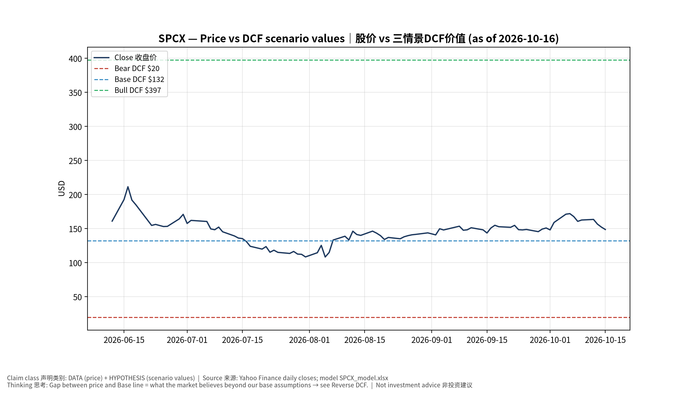
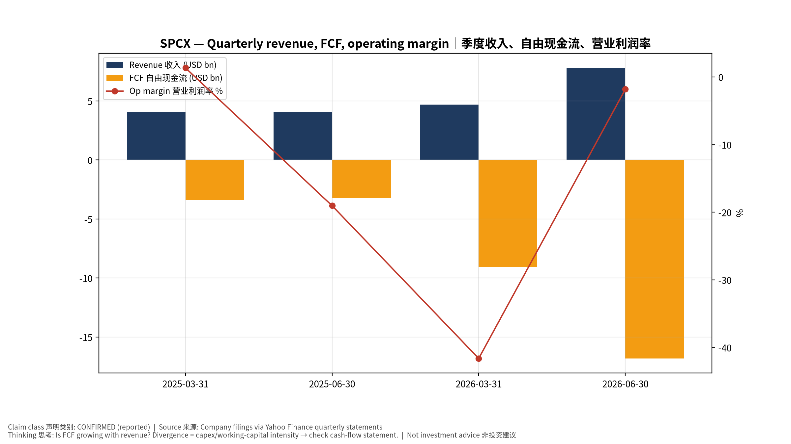
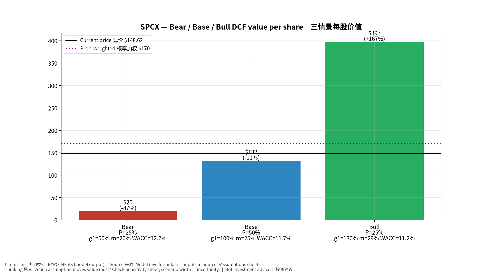
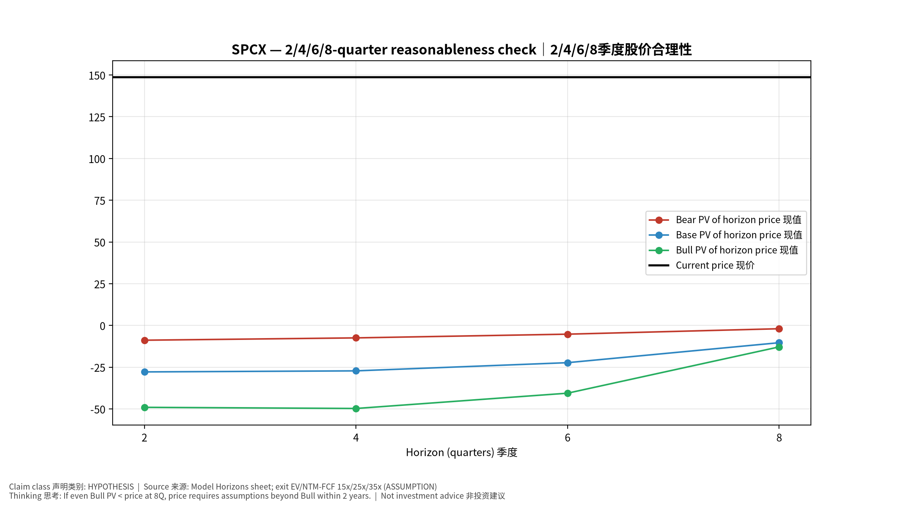
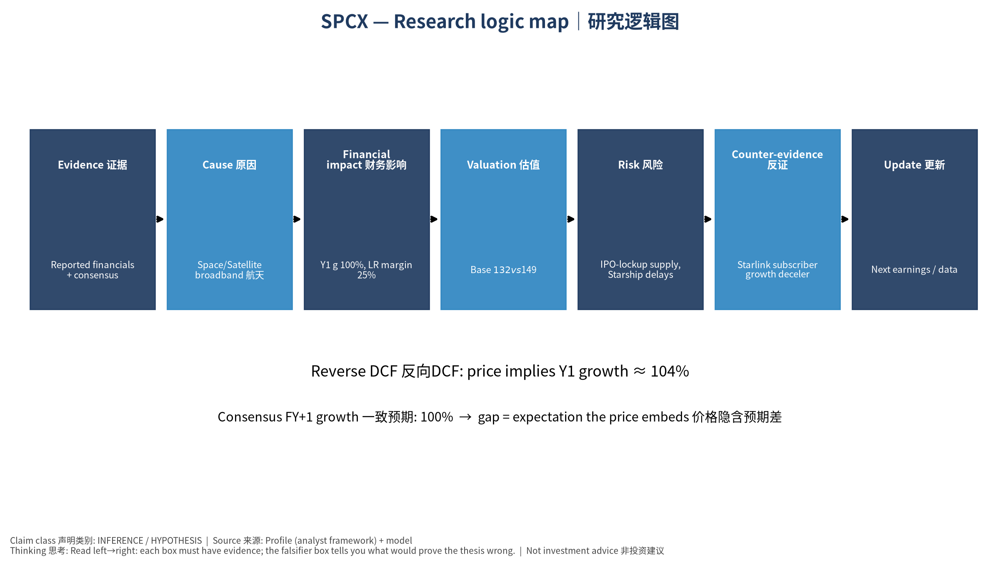

# SPCX Space Exploration Technologies Corp. — 个股深度研究 (专业中文版) v20261016-0756
> 数据截至 2026-10-16 07:56 SGT｜价格 $148.62｜市值 1,959.1 bn USD｜财报货币 USD｜非投资建议。事实=CONFIRMED/DATA；推断=INFERENCE；假设=ASSUMPTION/HYPOTHESIS。

## 1. 投资论点 Investment Thesis (HYPOTHESIS)
上市后的SpaceX核心价值在Starlink订阅现金流与发射垄断地位；估值高度依赖Starship降本与直连手机(D2C)等远期期权，市场定价包含大量远期增长。

- **多头驱动**: Starship reusability drives cost/kg sharply lower; D2C and enterprise/airline adoption accelerate｜星舰复用大幅降本；D2C与航空/企业加速
- **空头驱动**: IPO-lockup supply, Starship delays, regulatory/spectrum pushback, governance concentration｜解禁抛压、星舰延误、监管/频谱、治理集中
- **证伪条件 Falsifiers**: Starlink subscriber growth decelerating for 2+ quarters; Starship flight-rate targets missed; FCF stays negative｜Starlink用户增速连续两季放缓；星舰发射次数不达标；FCF持续为负

## 2. 产品、客户与收入模式
- 主题 Theme: Space/Satellite broadband 航天/卫星宽带
- 业务分部 Segments: Starlink 卫星宽带；Launch 发射服务；Government/Defense 政府国防；Other bets 其他(AI/Starship等)
- 公司描述 (DATA, Yahoo/公司申报): Space Exploration Technologies Corp. provides satellite-based broadband services in the United States, Ireland, Canada, and internationally. It operates through three operating segments: Space, Connectivity, and AI. The Space segment designs, manufactures, and launches reusable rockets to provide access to space. It also provides launch services for the deployment of payloads to intended orbits for commercial and government customers utilizing Falcon 9 and Falcon Heavy; and engages in the launch and development for the development of spacecraft and the provision of launch and mission services for government agency space programs utilizing Falcon 9, Falcon Heavy, Starship, and Dragon. Its company's Connectivity segment operates broadband data and communications network by various Starlink satellites in low-earth orbit, delivering connectivity to various consumers, enterprise, and governme
- 主要客户: Consumers & enterprises (Starlink), NASA/DoD/NRO, commercial satellite operators｜消费者与企业、NASA/美国国防部、商业卫星运营商

## 3. 行业、竞争、监管与供应链 (ANALYST FRAMEWORK)
- 供应商/上游: In-house vertical integration; RF components, solar cells, chips (merchant semis)｜高度垂直整合；射频器件、太阳能电池、商用芯片
- 竞争者 (含业外): Amazon Kuiper, OneWeb/Eutelsat, ULA, Blue Origin, Rocket Lab, China state launch｜亚马逊Kuiper、OneWeb、ULA、Blue Origin、Rocket Lab、中国国家队
- 瓶颈/监管: Starship cadence, spectrum rights, user-terminal cost, launch-site permits (FAA)｜星舰发射节奏、频谱、终端成本、FAA许可
- 关键KPI: Starlink subscribers, ARPU, launches/yr, Starship flights, backlog｜订阅数、ARPU、年发射数、星舰飞行数、在手订单
- 零部件现货/合约价: 本版未接入付费价格源(TrendForce/DRAMeXchange等)——标注 **UNAVAILABLE**，在KPI监控中以定性方式跟踪。

## 4. 历史财务与现金流 (CONFIRMED, 季度, USD)
| 季度 | 收入 | 毛利 | 营业利润 | 净利润 | FCF | 营业利润率 |
|---|---|---|---|---|---|---|
| 2026-06-30 | 7.8 bn USD | 4.3 bn USD | -0.1 bn USD | -0.5 bn USD | -16.8 bn USD | -1.8% |
| 2026-03-31 | 4.7 bn USD | 2.3 bn USD | -2.0 bn USD | -4.3 bn USD | -9.1 bn USD | -41.6% |
| 2025-06-30 | 4.1 bn USD | 1.8 bn USD | -0.8 bn USD | -1.0 bn USD | -3.2 bn USD | -19.0% |
| 2025-03-31 | 4.1 bn USD | 2.1 bn USD | 55.0 mn USD | -0.5 bn USD | -3.4 bn USD | 1.4% |

资产负债: 现金 100.0 bn USD；总负债 39.7 bn USD；净现金 60.3 bn USD。TTM FCF -32.5 bn USD（FCF率 -50.0%）。

## 5. 最新财报: 实际 vs 一致预期 vs 指引
| 季度 | EPS实际 | EPS一致预期 | 超预期% |
|---|---|---|---|
| 2026-03-31 | -1.27 |  |  |
| 2026-06-30 | -0.09 | -0.28931 | 0.6889 |

- 管理层指引 Guidance: 自动数据源不含指引——**UNAVAILABLE（待从公司IR新闻稿录入）**。
- 下次财报日 (Yahoo, TENTATIVE 直至公司确认): **2026-11-04**；本季EPS一致预期 0.16743（16位分析师）；收入一致预期 13.0 bn USD。

## 6. 未来2/4/6/8季度驱动与价格合理性
| 期限 | 情景 | 期限价格现值 | 相对现价 |
|---|---|---|---|
| 2Q | Bear | $-8.85 | -106.0% |
| 2Q | Base | $-27.84 | -118.7% |
| 2Q | Bull | $-49.04 | -133.0% |
| 4Q | Bear | $-7.46 | -105.0% |
| 4Q | Base | $-27.21 | -118.3% |
| 4Q | Bull | $-49.74 | -133.5% |
| 6Q | Bear | $-5.24 | -103.5% |
| 6Q | Base | $-22.31 | -115.0% |
| 6Q | Bull | $-40.58 | -127.3% |
| 8Q | Bear | $-1.97 | -101.3% |
| 8Q | Base | $-10.35 | -107.0% |
| 8Q | Bull | $-12.86 | -108.7% |

现价隐含的 EV/NTM-FCF (Base 路径): | 期限 | 隐含倍数 |
|---|---|
| 2Q | n/m (neg FCF) |
| 4Q | n/m (neg FCF) |
| 6Q | n/m (neg FCF) |
| 8Q | n/m (neg FCF) |

解读: 如果8季度后Base情景所需倍数仍远高于25x，说明价格依赖更远期的增长。

## 7. 三情景 Bear / Base / Bull (HYPOTHESIS)
| 情景 | Y1增速 | 长期FCF率 | WACC | 永续g | 概率 | 每股价值 | 相对现价 |
|---|---|---|---|---|---|---|---|
| Bear | 50.0% | 20.0% | 12.7% | 2.5% | 25.0% | $19.79 | -86.7% |
| Base | 100.0% | 25.0% | 11.7% | 3.0% | 50.0% | $131.93 | -11.2% |
| Bull | 130.0% | 28.7% | 11.2% | 3.5% | 25.0% | $397.44 | 167.4% |

概率加权价值 **$170.28**（相对现价 14.6%）。

## 8. 估值: DCF / Reverse DCF / ROIC-WACC / 同业 / 敏感度
- DCF Base: EV 1,678.8 bn USD；终值占比 69.0%。
- **Reverse DCF 反向DCF**: 在Base利润率与WACC下，现价隐含Y1收入增速 ≈ **104.2%**；一致预期FY+1增速 100.0%。
- WACC (CAPM) = rf 5.2% + β 1.30 × ERP 5.0% = 11.7%。
- SOTP segments 分部: Starlink 卫星宽带; Launch 发射服务; Government/Defense 政府国防; Other bets 其他(AI/Starship等). **Status: framework only** — segment revenues are INPUT REQUIRED from the latest 10-K/10-Q segment note (not auto-fed, left blank to avoid fabrication)｜分部收入需按最新财报手动录入，未自动填充以避免编造。
- 同业比较 Comps (DATA):
| Ticker | 市值 | EV/Sales | Fwd P/E | 收入增速 | 毛利率 | FCF收益率 |
|---|---|---|---|---|---|---|
| SPCX | 1,959.1 bn USD | 167.4x | 74.8x | 91.9% | 51.9% | -1.7% |
| RKLB | 35.3 bn USD | 40.2x | 850.1x | 62.0% | 37.3% | -0.7% |
| ASTS | 17.3 bn USD | 126.1x | -34.6x | 2626.6% | 38.9% | -10.4% |
| IRDM | 4.8 bn USD | 7.2x | 26.2x | 3.8% | 71.9% | 5.0% |

- 敏感度: 见Excel `Sensitivity` 表 (WACC × 永续增长率)。

## 9. 风险、反方论证与证伪
- 反方观点 Counter-thesis: IPO-lockup supply, Starship delays, regulatory/spectrum pushback, governance concentration｜解禁抛压、星舰延误、监管/频谱、治理集中
- 证伪指标: Starlink subscriber growth decelerating for 2+ quarters; Starship flight-rate targets missed; FCF stays negative｜Starlink用户增速连续两季放缓；星舰发射次数不达标；FCF持续为负
- 模型风险: 长期利润率与WACC为假设；终值占比高时估值对假设极敏感。

## 10. Source Ledger 来源账本
| Item | Value | Source/time |
|---|---|---|
| Price 股价 | 148.6 | Yahoo Finance quote, fetched 2026-10-16T07:56 SGT |
| Market cap 市值 | 1.959e+12 | Yahoo info.marketCap 2026-10-16T07:56 |
| Cash 现金 | 1e+11 | Yahoo info.totalCash (latest filing) 2026-10-16T07:56 |
| Debt 负债 | 3.971e+10 | Yahoo info.totalDebt (latest filing) 2026-10-16T07:56 |
| Revenue TTM 收入 | 2.304e+10 | Yahoo info.totalRevenue (TTM, USD) 2026-10-16T07:56 |
| FCF TTM 自由现金流 | -3.252e+10 | Sum of last 4 quarterly FCF (q_cash); quarters ['2026-06-30', '2026-03-31', '2025-06-30', '2025-03-31'] (USD) |
| Beta | 1.3 | ASSUMPTION (no beta history; recent IPO) = 1.3 |
| Risk-free 10Y 无风险利率 | 0.0519 | FRED DGS10 2026-10-14 |
| FX USD per USD | 1 | n/a (USD) |
| Consensus rev growth FY0 |  | Yahoo revenue_estimate 0y |
| Consensus rev growth FY+1 | 1.564 | Yahoo revenue_estimate +1y |

## 11. Assumption Register 假设登记表
| Assumption | Value | Rationale |
|---|---|---|
| ERP 股权风险溢价 | 0.05 | ASSUMPTION: 5.0% house mature-market ERP |
| Beta clamp | [0.8,1.6] → 1.30 | ASSUMPTION: limit extreme betas |
| Tax rate (ROIC) | 0.18 | ASSUMPTION: blended cash tax 18% |
| Year-1 growth (Base) | 1 | Consensus FY+1 revenue growth (Yahoo revenue_estimate '+1y'); capped at 100% |
| Growth fade | linear Y1→terminal by Y10 | ASSUMPTION |
| Starting FCF margin | -0.5 | DATA: FCF TTM / Revenue TTM, floored -50% |
| Long-run FCF margin (Base) | 0.25 | ASSUMPTION (analyst framework, reached by Y5; see profile) |
| Bear/Bull Y1 growth multiplier | 0.5x / 1.3x | ASSUMPTION |
| Bear/Bull margin multiplier | 0.8x / 1.15x | ASSUMPTION |
| WACC adj Bear/Bull | +1.0pp / -0.5pp | ASSUMPTION |
| Terminal g Bear/Base/Bull | 2.5% / 3.0% / 3.5% | ASSUMPTION |
| Scenario probabilities | 25% / 50% / 25% | ASSUMPTION |
| Horizon exit EV/NTM-FCF Bear/Base/Bull | 15x / 25x / 35x | ASSUMPTION |
| Per-share conversion | value × fx ÷ market cap × price | METHOD: avoids ADR/share-class mismatch |

## 12. Model Provenance 模型溯源
- Model file: `SPCX_model_v20261016-0756.xlsx` (live formulas; sheets Inputs→Scenarios→DCF→ReverseDCF→Sensitivity→Horizons→SOTP→Comps→ROIC_WACC→History→Sources→Assumptions)
- Engine: `production/pipeline/model.py` (Python mirror; values in this report = Python mirror, verified against LibreOffice recalculation of the xlsx)
- Data snapshot: `data/snapshots/20261016-0756` (immutable) | Fetched 2026-10-16 07:56 SGT | Generated 2026-10-16 07:57 SGT
- Version: v20261016-0756. Prior versions are never overwritten (see company history page).

## 13. 版本与事件时间轴
- v20261016-0756: 首版生产系统报告 (27家同步)。下一事件: 财报 2026-11-04 (TENTATIVE)。

## 图片报告 Image Report

*股价vs三情景价值 Price vs scenario values*

*季度财务 Quarterly financials*

*三情景 Scenarios*

*2/4/6/8季度检验 Horizon check*

*研究逻辑图 Logic map*

---

# SPCX Space Exploration Technologies Corp. — Equity Deep Dive (Professional English) v20261016-0756
> Data as of 2026-10-16 07:56 SGT | Price $148.62 | Mkt cap 1,959.1 bn USD | Reporting currency USD | Not investment advice.

## 1. Investment thesis (HYPOTHESIS)
Post-IPO SpaceX value rests on Starlink subscription cash flow plus launch dominance; valuation leans heavily on long-dated options (Starship cost-down, direct-to-cell), so the price embeds aggressive long-run growth.

- **Bull drivers**: Starship reusability drives cost/kg sharply lower; D2C and enterprise/airline adoption accelerate｜星舰复用大幅降本；D2C与航空/企业加速
- **Bear drivers**: IPO-lockup supply, Starship delays, regulatory/spectrum pushback, governance concentration｜解禁抛压、星舰延误、监管/频谱、治理集中
- **Falsifiers**: Starlink subscriber growth decelerating for 2+ quarters; Starship flight-rate targets missed; FCF stays negative｜Starlink用户增速连续两季放缓；星舰发射次数不达标；FCF持续为负

## 2. Products, customers, revenue model
- Theme: Space/Satellite broadband 航天/卫星宽带 | Segments: Starlink 卫星宽带; Launch 发射服务; Government/Defense 政府国防; Other bets 其他(AI/Starship等)
- Business description (DATA): Space Exploration Technologies Corp. provides satellite-based broadband services in the United States, Ireland, Canada, and internationally. It operates through three operating segments: Space, Connectivity, and AI. The Space segment designs, manufactures, and launches reusable rockets to provide access to space. It also provides launch services for the deployment of payloads to intended orbits for commercial and government customers utilizing Falcon 9 and Falcon Heavy; and engages in the launch and development for the development of spacecraft and the provision of launch and mission services for government agency space programs utilizing Falcon 9, Falcon Heavy, Starship, and Dragon. Its company's Connectivity segment operates broadband data and communications network by various Starlink satellites in low-earth orbit, delivering connectivity to various consumers, enterprise, and governme
- Customers: Consumers & enterprises (Starlink), NASA/DoD/NRO, commercial satellite operators｜消费者与企业、NASA/美国国防部、商业卫星运营商

## 3. Industry, competition, regulation, supply chain (ANALYST FRAMEWORK)
- Suppliers: In-house vertical integration; RF components, solar cells, chips (merchant semis)｜高度垂直整合；射频器件、太阳能电池、商用芯片
- Competitors: Amazon Kuiper, OneWeb/Eutelsat, ULA, Blue Origin, Rocket Lab, China state launch｜亚马逊Kuiper、OneWeb、ULA、Blue Origin、Rocket Lab、中国国家队
- Bottlenecks/regulation: Starship cadence, spectrum rights, user-terminal cost, launch-site permits (FAA)｜星舰发射节奏、频谱、终端成本、FAA许可
- KPIs: Starlink subscribers, ARPU, launches/yr, Starship flights, backlog｜订阅数、ARPU、年发射数、星舰飞行数、在手订单
- Component spot/contract prices: paid feeds not connected — **UNAVAILABLE**, tracked qualitatively.

## 4. Historical financials & cash flow (CONFIRMED, quarterly, USD)
| Quarter | Revenue | Gross profit | Op income | Net income | FCF | Op margin |
|---|---|---|---|---|---|---|
| 2026-06-30 | 7.8 bn USD | 4.3 bn USD | -0.1 bn USD | -0.5 bn USD | -16.8 bn USD | -1.8% |
| 2026-03-31 | 4.7 bn USD | 2.3 bn USD | -2.0 bn USD | -4.3 bn USD | -9.1 bn USD | -41.6% |
| 2025-06-30 | 4.1 bn USD | 1.8 bn USD | -0.8 bn USD | -1.0 bn USD | -3.2 bn USD | -19.0% |
| 2025-03-31 | 4.1 bn USD | 2.1 bn USD | 55.0 mn USD | -0.5 bn USD | -3.4 bn USD | 1.4% |

Cash 100.0 bn USD; debt 39.7 bn USD; TTM FCF -32.5 bn USD (FCF margin -50.0%).

## 5. Latest earnings: actual vs consensus vs guidance
| Quarter | EPS actual | EPS consensus | Surprise |
|---|---|---|---|
| 2026-03-31 | -1.27 |  |  |
| 2026-06-30 | -0.09 | -0.28931 | 0.6889 |

- Management guidance: not in automated feed — **UNAVAILABLE (to be entered from IR release)**.
- Next earnings (Yahoo; TENTATIVE until company-confirmed): **2026-11-04**; current-quarter EPS consensus 0.16743 (16 analysts); revenue consensus 13.0 bn USD.

## 6. 2/4/6/8-quarter drivers & price reasonableness
| Horizon | Scenario | PV of horizon price | vs current |
|---|---|---|---|
| 2Q | Bear | $-8.85 | -106.0% |
| 2Q | Base | $-27.84 | -118.7% |
| 2Q | Bull | $-49.04 | -133.0% |
| 4Q | Bear | $-7.46 | -105.0% |
| 4Q | Base | $-27.21 | -118.3% |
| 4Q | Bull | $-49.74 | -133.5% |
| 6Q | Bear | $-5.24 | -103.5% |
| 6Q | Base | $-22.31 | -115.0% |
| 6Q | Bull | $-40.58 | -127.3% |
| 8Q | Bear | $-1.97 | -101.3% |
| 8Q | Base | $-10.35 | -107.0% |
| 8Q | Bull | $-12.86 | -108.7% |

Current-price implied EV/NTM-FCF on Base path: | Horizon | Implied multiple |
|---|---|
| 2Q | n/m (neg FCF) |
| 4Q | n/m (neg FCF) |
| 6Q | n/m (neg FCF) |
| 8Q | n/m (neg FCF) |

## 7. Bear / Base / Bull (HYPOTHESIS)
| Scenario | Y1 growth | LR FCF margin | WACC | Terminal g | Prob. | Value/share | vs price |
|---|---|---|---|---|---|---|---|
| Bear | 50.0% | 20.0% | 12.7% | 2.5% | 25.0% | $19.79 | -86.7% |
| Base | 100.0% | 25.0% | 11.7% | 3.0% | 50.0% | $131.93 | -11.2% |
| Bull | 130.0% | 28.7% | 11.2% | 3.5% | 25.0% | $397.44 | 167.4% |

Probability-weighted value **$170.28** (14.6% vs price).

## 8. Valuation: DCF / Reverse DCF / ROIC-WACC / comps / sensitivity
- Base DCF EV 1,678.8 bn USD; terminal share 69.0%.
- **Reverse DCF**: at Base margin/WACC the price implies Y1 revenue growth ≈ **104.2%** vs consensus FY+1 100.0%.
- WACC (CAPM) = rf 5.2% + β 1.30 × ERP 5.0% = 11.7%.
- SOTP segments: Starlink 卫星宽带; Launch 发射服务; Government/Defense 政府国防; Other bets 其他(AI/Starship等) — framework only; segment revenue inputs pending from filings.
- Comps (DATA): see table in Chinese section / Excel `Comps`.
- Sensitivity: Excel `Sensitivity` (WACC × terminal g).

## 9. Risks, counterarguments, falsifiers
IPO-lockup supply, Starship delays, regulatory/spectrum pushback, governance concentration｜解禁抛压、星舰延误、监管/频谱、治理集中 | Falsifiers: Starlink subscriber growth decelerating for 2+ quarters; Starship flight-rate targets missed; FCF stays negative｜Starlink用户增速连续两季放缓；星舰发射次数不达标；FCF持续为负

## 10–12. Source Ledger / Assumption Register / Model Provenance
See tables above (shared, bilingual). - Model file: `SPCX_model_v20261016-0756.xlsx` (live formulas; sheets Inputs→Scenarios→DCF→ReverseDCF→Sensitivity→Horizons→SOTP→Comps→ROIC_WACC→History→Sources→Assumptions)
- Engine: `production/pipeline/model.py` (Python mirror; values in this report = Python mirror, verified against LibreOffice recalculation of the xlsx)
- Data snapshot: `data/snapshots/20261016-0756` (immutable) | Fetched 2026-10-16 07:56 SGT | Generated 2026-10-16 07:57 SGT
- Version: v20261016-0756. Prior versions are never overwritten (see company history page).
