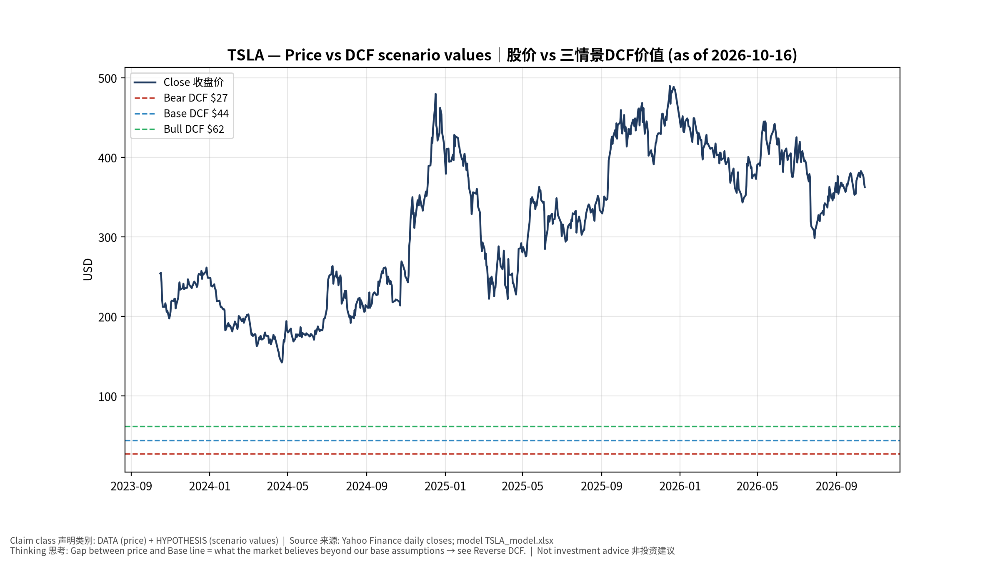
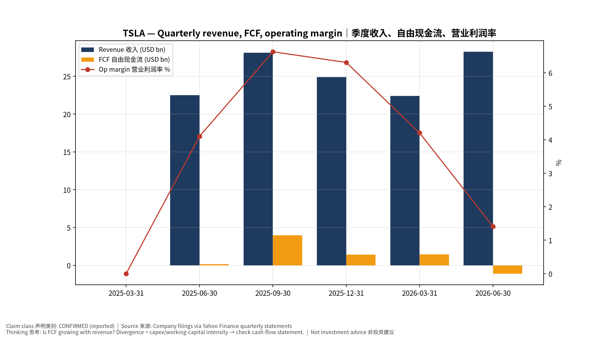
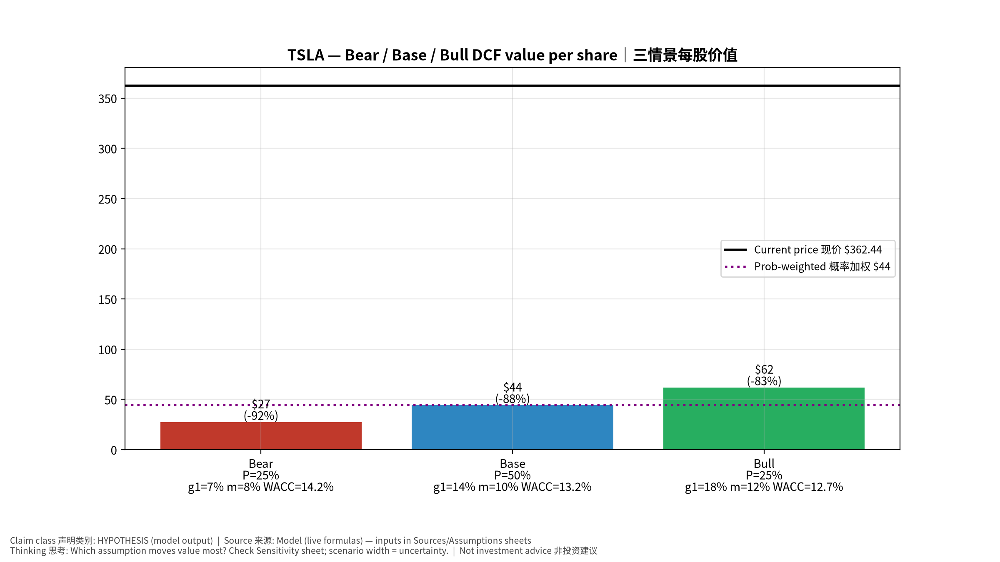
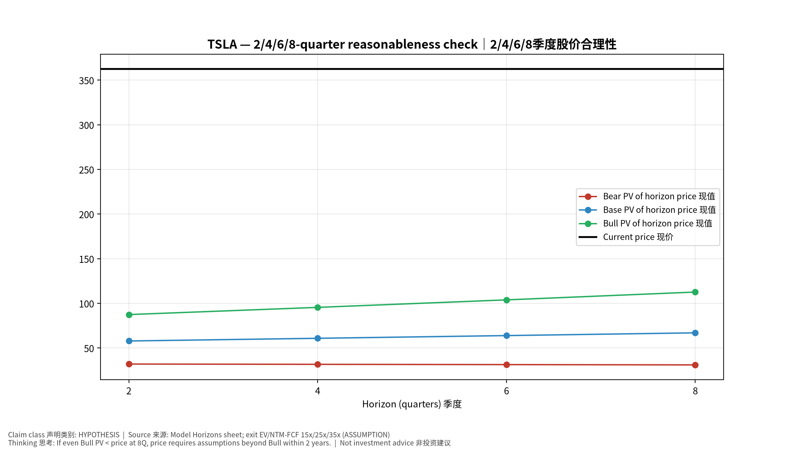
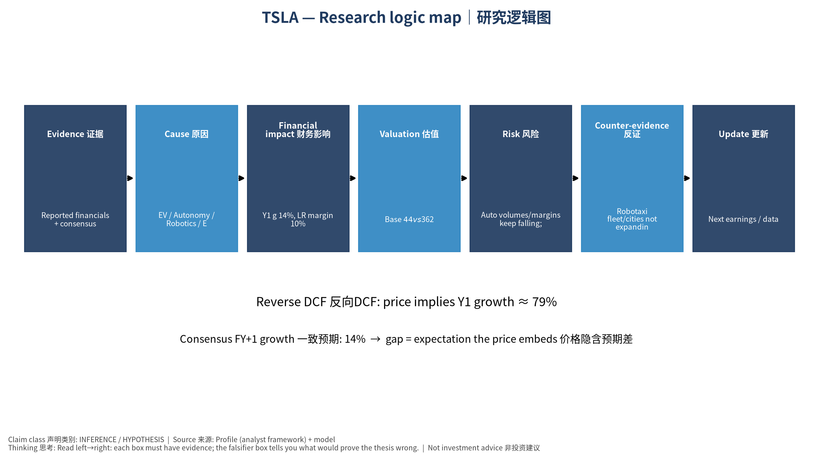

# TSLA Tesla, Inc. — 个股深度研究 (专业中文版) v20261016-0756
> 数据截至 2026-10-16 07:56 SGT｜价格 $362.44｜市值 1,431.5 bn USD｜财报货币 USD｜非投资建议。事实=CONFIRMED/DATA；推断=INFERENCE；假设=ASSUMPTION/HYPOTHESIS。

## 1. 投资论点 Investment Thesis (HYPOTHESIS)
汽车主业利润率受价格战压缩，估值主要来自Robotaxi/FSD与Optimus期权以及储能高增长；股价对自动驾驶里程碑的叙事极度敏感(反身性强)。

- **多头驱动**: Unsupervised FSD scales across cities; Robotaxi unit economics proven; storage margins stay high｜无监督FSD多城扩张；Robotaxi单位经济验证；储能高毛利
- **空头驱动**: Auto volumes/margins keep falling; robotaxi incidents/regulation; key-person risk｜销量与毛利下滑；Robotaxi事故/监管；关键人物风险
- **证伪条件 Falsifiers**: Robotaxi fleet/cities not expanding by guided dates; auto GM ex-credits declining; storage deployments flat｜Robotaxi未按期扩张；扣除碳积分汽车毛利下降；储能装机持平

## 2. 产品、客户与收入模式
- 主题 Theme: EV / Autonomy / Robotics / Energy storage 电动车/自动驾驶/机器人/储能
- 业务分部 Segments: Automotive 汽车；Energy storage 储能；Services & other 服务；FSD/Robotaxi option 自动驾驶期权；Optimus option 人形机器人期权
- 公司描述 (DATA, Yahoo/公司申报): Tesla, Inc. designs, develops, manufactures, leases, and sells electric vehicles, and energy generation and storage systems in the United States, China, and internationally. The company operates in two segments, Automotive; and Energy Generation and Storage. The company offers electric vehicles, as well as sells automotive regulatory credits; and non-warranty maintenance services and collision, automotive insurance services, as well as part sales and retail merchandise sale. It also provides sedans and sport utility vehicles through direct and used vehicle sales, a network of Tesla Superchargers, and in-app upgrades; purchase financing and leasing services; services for electric vehicles through its company-owned service locations and Tesla mobile service technicians; and vehicle limited warranties and extended service plans. In addition, the company engages in the design, manufacture, i
- 主要客户: Retail auto buyers, utilities/IPPs (Megapack), FSD subscribers｜零售购车者、电力公司(Megapack)、FSD订阅

## 3. 行业、竞争、监管与供应链 (ANALYST FRAMEWORK)
- 供应商/上游: Battery cells (Panasonic, LGES, CATL), chips (TSMC/Samsung for AI5), lithium｜电芯(松下、LGES、宁德)、芯片(台积电/三星)、锂
- 竞争者 (含业外): BYD, Geely, Waymo (robotaxi), Zoox, Chinese EV makers; Fluence/Sungrow in storage｜比亚迪、吉利、Waymo、Zoox；储能对手Fluence/阳光电源
- 瓶颈/监管: Robotaxi regulation (state/NHTSA), FSD safety data, cell supply/tariffs｜Robotaxi法规(州/NHTSA)、FSD安全数据、电芯供应与关税
- 关键KPI: Deliveries, auto GM ex-credits, storage GWh, FSD miles, robotaxi cities｜交付量、扣碳积分毛利、储能GWh、FSD里程、Robotaxi城市数
- 零部件现货/合约价: 本版未接入付费价格源(TrendForce/DRAMeXchange等)——标注 **UNAVAILABLE**，在KPI监控中以定性方式跟踪。

## 4. 历史财务与现金流 (CONFIRMED, 季度, USD)
| 季度 | 收入 | 毛利 | 营业利润 | 净利润 | FCF | 营业利润率 |
|---|---|---|---|---|---|---|
| 2026-06-30 | 28.2 bn USD | 4.8 bn USD | 0.4 bn USD | 1.1 bn USD | -1.1 bn USD | 1.4% |
| 2026-03-31 | 22.4 bn USD | 4.7 bn USD | 0.9 bn USD | 0.5 bn USD | 1.4 bn USD | 4.2% |
| 2025-12-31 | 24.9 bn USD | 5.0 bn USD | 1.6 bn USD | 0.8 bn USD | 1.4 bn USD | 6.3% |
| 2025-09-30 | 28.1 bn USD | 5.1 bn USD | 1.9 bn USD | 1.4 bn USD | 4.0 bn USD | 6.6% |
| 2025-06-30 | 22.5 bn USD | 3.9 bn USD | 0.9 bn USD | 1.2 bn USD | 0.1 bn USD | 4.1% |
| 2025-03-31 | N/A | N/A | N/A | N/A | N/A | N/A |

资产负债: 现金 43.5 bn USD；总负债 16.1 bn USD；净现金 27.4 bn USD。TTM FCF 5.8 bn USD（FCF率 5.6%）。

## 5. 最新财报: 实际 vs 一致预期 vs 指引
| 季度 | EPS实际 | EPS一致预期 | 超预期% |
|---|---|---|---|
| 2025-09-30 | 0.5 | 0.55885 | -0.105299994 |
| 2025-12-31 | 0.5 | 0.45061 | 0.1096 |
| 2026-03-31 | 0.41 | 0.34999 | 0.1715 |
| 2026-06-30 | 0.33 | 0.54236 | -0.39150003 |

- 管理层指引 Guidance: 自动数据源不含指引——**UNAVAILABLE（待从公司IR新闻稿录入）**。
- 下次财报日 (Yahoo, TENTATIVE 直至公司确认): **2026-10-22**；本季EPS一致预期 0.45223（24位分析师）；收入一致预期 28.1 bn USD。

## 6. 未来2/4/6/8季度驱动与价格合理性
| 期限 | 情景 | 期限价格现值 | 相对现价 |
|---|---|---|---|
| 2Q | Bear | $32.05 | -91.2% |
| 2Q | Base | $57.89 | -84.0% |
| 2Q | Bull | $87.47 | -75.9% |
| 4Q | Bear | $31.74 | -91.2% |
| 4Q | Base | $60.89 | -83.2% |
| 4Q | Bull | $95.52 | -73.6% |
| 6Q | Bear | $31.43 | -91.3% |
| 6Q | Base | $63.93 | -82.4% |
| 6Q | Bull | $103.92 | -71.3% |
| 8Q | Bear | $31.12 | -91.4% |
| 8Q | Base | $67.00 | -81.5% |
| 8Q | Bull | $112.68 | -68.9% |

现价隐含的 EV/NTM-FCF (Base 路径): | 期限 | 隐含倍数 |
|---|---|
| 2Q | 162.6x |
| 4Q | 143.4x |
| 6Q | 126.9x |
| 8Q | 112.7x |

解读: 如果8季度后Base情景所需倍数仍远高于25x，说明价格依赖更远期的增长。

## 7. 三情景 Bear / Base / Bull (HYPOTHESIS)
| 情景 | Y1增速 | 长期FCF率 | WACC | 永续g | 概率 | 每股价值 | 相对现价 |
|---|---|---|---|---|---|---|---|
| Bear | 6.8% | 8.0% | 14.2% | 2.5% | 25.0% | $27.41 | -92.4% |
| Base | 13.5% | 10.0% | 13.2% | 3.0% | 50.0% | $44.18 | -87.8% |
| Bull | 17.6% | 11.5% | 12.7% | 3.5% | 25.0% | $61.90 | -82.9% |

概率加权价值 **$44.42**（相对现价 -87.7%）。

## 8. 估值: DCF / Reverse DCF / ROIC-WACC / 同业 / 敏感度
- DCF Base: EV 147.0 bn USD；终值占比 45.4%。
- **Reverse DCF 反向DCF**: 在Base利润率与WACC下，现价隐含Y1收入增速 ≈ **79.4%**；一致预期FY+1增速 13.5%。
- WACC (CAPM) = rf 5.2% + β 1.60 × ERP 5.0% = 13.2%。
- SOTP segments 分部: Automotive 汽车; Energy storage 储能; Services & other 服务; FSD/Robotaxi option 自动驾驶期权; Optimus option 人形机器人期权. **Status: framework only** — segment revenues are INPUT REQUIRED from the latest 10-K/10-Q segment note (not auto-fed, left blank to avoid fabrication)｜分部收入需按最新财报手动录入，未自动填充以避免编造。
- 同业比较 Comps (DATA):
| Ticker | 市值 | EV/Sales | Fwd P/E | 收入增速 | 毛利率 | FCF收益率 |
|---|---|---|---|---|---|---|
| TSLA | 1,431.5 bn USD | 13.6x | 167.1x | 25.5% | 18.9% | 0.4% |
| BYDDY | 85.1 bn USD | 0.1x | 11.4x | -3.2% | 17.9% | -113.2% |
| GM | 73.4 bn USD | 1.0x | 5.5x | 1.9% | 10.2% | 29.9% |
| RIVN | 18.9 bn USD | 3.2x | -7.5x | 27.2% | 7.5% | -8.2% |
| UBER | 145.6 bn USD | 2.8x | 16.2x | 12.2% | 40.8% | 5.0% |

- 敏感度: 见Excel `Sensitivity` 表 (WACC × 永续增长率)。

## 9. 风险、反方论证与证伪
- 反方观点 Counter-thesis: Auto volumes/margins keep falling; robotaxi incidents/regulation; key-person risk｜销量与毛利下滑；Robotaxi事故/监管；关键人物风险
- 证伪指标: Robotaxi fleet/cities not expanding by guided dates; auto GM ex-credits declining; storage deployments flat｜Robotaxi未按期扩张；扣除碳积分汽车毛利下降；储能装机持平
- 模型风险: 长期利润率与WACC为假设；终值占比高时估值对假设极敏感。

## 10. Source Ledger 来源账本
| Item | Value | Source/time |
|---|---|---|
| Price 股价 | 362.4 | Yahoo Finance quote, fetched 2026-10-16T07:56 SGT |
| Market cap 市值 | 1.431e+12 | Yahoo info.marketCap 2026-10-16T07:56 |
| Cash 现金 | 4.352e+10 | Yahoo info.totalCash (latest filing) 2026-10-16T07:56 |
| Debt 负债 | 1.608e+10 | Yahoo info.totalDebt (latest filing) 2026-10-16T07:56 |
| Revenue TTM 收入 | 1.036e+11 | Yahoo info.totalRevenue (TTM, USD) 2026-10-16T07:56 |
| FCF TTM 自由现金流 | 5.755e+09 | Sum of last 4 quarterly FCF (q_cash); quarters ['2026-06-30', '2026-03-31', '2025-12-31', '2025-09-30'] (USD) |
| Beta | 1.916 | Yahoo info.beta (5Y monthly) |
| Risk-free 10Y 无风险利率 | 0.0519 | FRED DGS10 2026-10-14 |
| FX USD per USD | 1 | n/a (USD) |
| Consensus rev growth FY0 | 0.1303 | Yahoo revenue_estimate 0y |
| Consensus rev growth FY+1 | 0.1352 | Yahoo revenue_estimate +1y |

## 11. Assumption Register 假设登记表
| Assumption | Value | Rationale |
|---|---|---|
| ERP 股权风险溢价 | 0.05 | ASSUMPTION: 5.0% house mature-market ERP |
| Beta clamp | [0.8,1.6] → 1.60 | ASSUMPTION: limit extreme betas |
| Tax rate (ROIC) | 0.18 | ASSUMPTION: blended cash tax 18% |
| Year-1 growth (Base) | 0.1352 | Consensus FY+1 revenue growth (Yahoo revenue_estimate '+1y'); capped at 100% |
| Growth fade | linear Y1→terminal by Y10 | ASSUMPTION |
| Starting FCF margin | 0.05554 | DATA: FCF TTM / Revenue TTM, floored -50% |
| Long-run FCF margin (Base) | 0.1 | ASSUMPTION (analyst framework, reached by Y5; see profile) |
| Bear/Bull Y1 growth multiplier | 0.5x / 1.3x | ASSUMPTION |
| Bear/Bull margin multiplier | 0.8x / 1.15x | ASSUMPTION |
| WACC adj Bear/Bull | +1.0pp / -0.5pp | ASSUMPTION |
| Terminal g Bear/Base/Bull | 2.5% / 3.0% / 3.5% | ASSUMPTION |
| Scenario probabilities | 25% / 50% / 25% | ASSUMPTION |
| Horizon exit EV/NTM-FCF Bear/Base/Bull | 15x / 25x / 35x | ASSUMPTION |
| Per-share conversion | value × fx ÷ market cap × price | METHOD: avoids ADR/share-class mismatch |

## 12. Model Provenance 模型溯源
- Model file: `TSLA_model_v20261016-0756.xlsx` (live formulas; sheets Inputs→Scenarios→DCF→ReverseDCF→Sensitivity→Horizons→SOTP→Comps→ROIC_WACC→History→Sources→Assumptions)
- Engine: `production/pipeline/model.py` (Python mirror; values in this report = Python mirror, verified against LibreOffice recalculation of the xlsx)
- Data snapshot: `data/snapshots/20261016-0756` (immutable) | Fetched 2026-10-16 07:56 SGT | Generated 2026-10-16 07:57 SGT
- Version: v20261016-0756. Prior versions are never overwritten (see company history page).

## 13. 版本与事件时间轴
- v20261016-0756: 首版生产系统报告 (27家同步)。下一事件: 财报 2026-10-22 (TENTATIVE)。

## 图片报告 Image Report

*股价vs三情景价值 Price vs scenario values*

*季度财务 Quarterly financials*

*三情景 Scenarios*

*2/4/6/8季度检验 Horizon check*

*研究逻辑图 Logic map*

---

# TSLA Tesla, Inc. — Equity Deep Dive (Professional English) v20261016-0756
> Data as of 2026-10-16 07:56 SGT | Price $362.44 | Mkt cap 1,431.5 bn USD | Reporting currency USD | Not investment advice.

## 1. Investment thesis (HYPOTHESIS)
Core auto margins are compressed by price competition; valuation mostly rests on Robotaxi/FSD and Optimus optionality plus fast-growing storage. The stock is highly reflexive to autonomy milestones.

- **Bull drivers**: Unsupervised FSD scales across cities; Robotaxi unit economics proven; storage margins stay high｜无监督FSD多城扩张；Robotaxi单位经济验证；储能高毛利
- **Bear drivers**: Auto volumes/margins keep falling; robotaxi incidents/regulation; key-person risk｜销量与毛利下滑；Robotaxi事故/监管；关键人物风险
- **Falsifiers**: Robotaxi fleet/cities not expanding by guided dates; auto GM ex-credits declining; storage deployments flat｜Robotaxi未按期扩张；扣除碳积分汽车毛利下降；储能装机持平

## 2. Products, customers, revenue model
- Theme: EV / Autonomy / Robotics / Energy storage 电动车/自动驾驶/机器人/储能 | Segments: Automotive 汽车; Energy storage 储能; Services & other 服务; FSD/Robotaxi option 自动驾驶期权; Optimus option 人形机器人期权
- Business description (DATA): Tesla, Inc. designs, develops, manufactures, leases, and sells electric vehicles, and energy generation and storage systems in the United States, China, and internationally. The company operates in two segments, Automotive; and Energy Generation and Storage. The company offers electric vehicles, as well as sells automotive regulatory credits; and non-warranty maintenance services and collision, automotive insurance services, as well as part sales and retail merchandise sale. It also provides sedans and sport utility vehicles through direct and used vehicle sales, a network of Tesla Superchargers, and in-app upgrades; purchase financing and leasing services; services for electric vehicles through its company-owned service locations and Tesla mobile service technicians; and vehicle limited warranties and extended service plans. In addition, the company engages in the design, manufacture, i
- Customers: Retail auto buyers, utilities/IPPs (Megapack), FSD subscribers｜零售购车者、电力公司(Megapack)、FSD订阅

## 3. Industry, competition, regulation, supply chain (ANALYST FRAMEWORK)
- Suppliers: Battery cells (Panasonic, LGES, CATL), chips (TSMC/Samsung for AI5), lithium｜电芯(松下、LGES、宁德)、芯片(台积电/三星)、锂
- Competitors: BYD, Geely, Waymo (robotaxi), Zoox, Chinese EV makers; Fluence/Sungrow in storage｜比亚迪、吉利、Waymo、Zoox；储能对手Fluence/阳光电源
- Bottlenecks/regulation: Robotaxi regulation (state/NHTSA), FSD safety data, cell supply/tariffs｜Robotaxi法规(州/NHTSA)、FSD安全数据、电芯供应与关税
- KPIs: Deliveries, auto GM ex-credits, storage GWh, FSD miles, robotaxi cities｜交付量、扣碳积分毛利、储能GWh、FSD里程、Robotaxi城市数
- Component spot/contract prices: paid feeds not connected — **UNAVAILABLE**, tracked qualitatively.

## 4. Historical financials & cash flow (CONFIRMED, quarterly, USD)
| Quarter | Revenue | Gross profit | Op income | Net income | FCF | Op margin |
|---|---|---|---|---|---|---|
| 2026-06-30 | 28.2 bn USD | 4.8 bn USD | 0.4 bn USD | 1.1 bn USD | -1.1 bn USD | 1.4% |
| 2026-03-31 | 22.4 bn USD | 4.7 bn USD | 0.9 bn USD | 0.5 bn USD | 1.4 bn USD | 4.2% |
| 2025-12-31 | 24.9 bn USD | 5.0 bn USD | 1.6 bn USD | 0.8 bn USD | 1.4 bn USD | 6.3% |
| 2025-09-30 | 28.1 bn USD | 5.1 bn USD | 1.9 bn USD | 1.4 bn USD | 4.0 bn USD | 6.6% |
| 2025-06-30 | 22.5 bn USD | 3.9 bn USD | 0.9 bn USD | 1.2 bn USD | 0.1 bn USD | 4.1% |
| 2025-03-31 | N/A | N/A | N/A | N/A | N/A | N/A |

Cash 43.5 bn USD; debt 16.1 bn USD; TTM FCF 5.8 bn USD (FCF margin 5.6%).

## 5. Latest earnings: actual vs consensus vs guidance
| Quarter | EPS actual | EPS consensus | Surprise |
|---|---|---|---|
| 2025-09-30 | 0.5 | 0.55885 | -0.105299994 |
| 2025-12-31 | 0.5 | 0.45061 | 0.1096 |
| 2026-03-31 | 0.41 | 0.34999 | 0.1715 |
| 2026-06-30 | 0.33 | 0.54236 | -0.39150003 |

- Management guidance: not in automated feed — **UNAVAILABLE (to be entered from IR release)**.
- Next earnings (Yahoo; TENTATIVE until company-confirmed): **2026-10-22**; current-quarter EPS consensus 0.45223 (24 analysts); revenue consensus 28.1 bn USD.

## 6. 2/4/6/8-quarter drivers & price reasonableness
| Horizon | Scenario | PV of horizon price | vs current |
|---|---|---|---|
| 2Q | Bear | $32.05 | -91.2% |
| 2Q | Base | $57.89 | -84.0% |
| 2Q | Bull | $87.47 | -75.9% |
| 4Q | Bear | $31.74 | -91.2% |
| 4Q | Base | $60.89 | -83.2% |
| 4Q | Bull | $95.52 | -73.6% |
| 6Q | Bear | $31.43 | -91.3% |
| 6Q | Base | $63.93 | -82.4% |
| 6Q | Bull | $103.92 | -71.3% |
| 8Q | Bear | $31.12 | -91.4% |
| 8Q | Base | $67.00 | -81.5% |
| 8Q | Bull | $112.68 | -68.9% |

Current-price implied EV/NTM-FCF on Base path: | Horizon | Implied multiple |
|---|---|
| 2Q | 162.6x |
| 4Q | 143.4x |
| 6Q | 126.9x |
| 8Q | 112.7x |

## 7. Bear / Base / Bull (HYPOTHESIS)
| Scenario | Y1 growth | LR FCF margin | WACC | Terminal g | Prob. | Value/share | vs price |
|---|---|---|---|---|---|---|---|
| Bear | 6.8% | 8.0% | 14.2% | 2.5% | 25.0% | $27.41 | -92.4% |
| Base | 13.5% | 10.0% | 13.2% | 3.0% | 50.0% | $44.18 | -87.8% |
| Bull | 17.6% | 11.5% | 12.7% | 3.5% | 25.0% | $61.90 | -82.9% |

Probability-weighted value **$44.42** (-87.7% vs price).

## 8. Valuation: DCF / Reverse DCF / ROIC-WACC / comps / sensitivity
- Base DCF EV 147.0 bn USD; terminal share 45.4%.
- **Reverse DCF**: at Base margin/WACC the price implies Y1 revenue growth ≈ **79.4%** vs consensus FY+1 13.5%.
- WACC (CAPM) = rf 5.2% + β 1.60 × ERP 5.0% = 13.2%.
- SOTP segments: Automotive 汽车; Energy storage 储能; Services & other 服务; FSD/Robotaxi option 自动驾驶期权; Optimus option 人形机器人期权 — framework only; segment revenue inputs pending from filings.
- Comps (DATA): see table in Chinese section / Excel `Comps`.
- Sensitivity: Excel `Sensitivity` (WACC × terminal g).

## 9. Risks, counterarguments, falsifiers
Auto volumes/margins keep falling; robotaxi incidents/regulation; key-person risk｜销量与毛利下滑；Robotaxi事故/监管；关键人物风险 | Falsifiers: Robotaxi fleet/cities not expanding by guided dates; auto GM ex-credits declining; storage deployments flat｜Robotaxi未按期扩张；扣除碳积分汽车毛利下降；储能装机持平

## 10–12. Source Ledger / Assumption Register / Model Provenance
See tables above (shared, bilingual). - Model file: `TSLA_model_v20261016-0756.xlsx` (live formulas; sheets Inputs→Scenarios→DCF→ReverseDCF→Sensitivity→Horizons→SOTP→Comps→ROIC_WACC→History→Sources→Assumptions)
- Engine: `production/pipeline/model.py` (Python mirror; values in this report = Python mirror, verified against LibreOffice recalculation of the xlsx)
- Data snapshot: `data/snapshots/20261016-0756` (immutable) | Fetched 2026-10-16 07:56 SGT | Generated 2026-10-16 07:57 SGT
- Version: v20261016-0756. Prior versions are never overwritten (see company history page).
