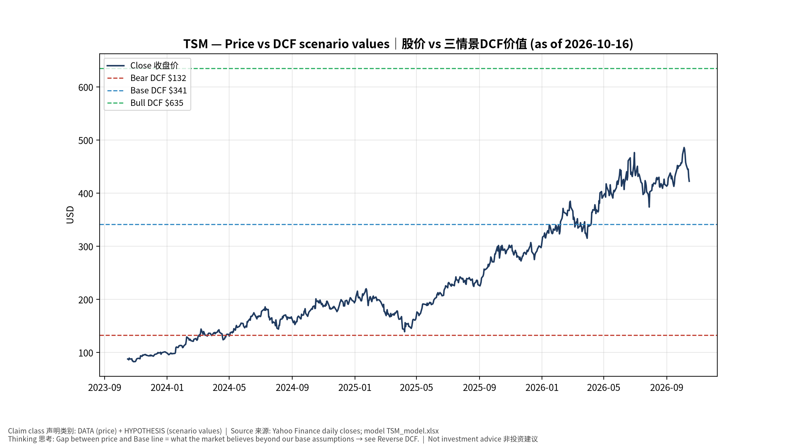
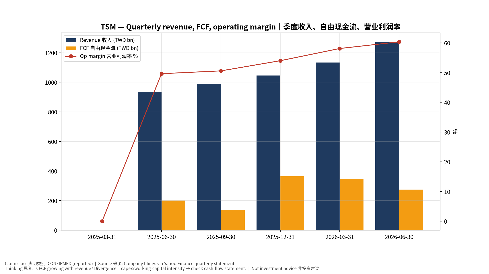
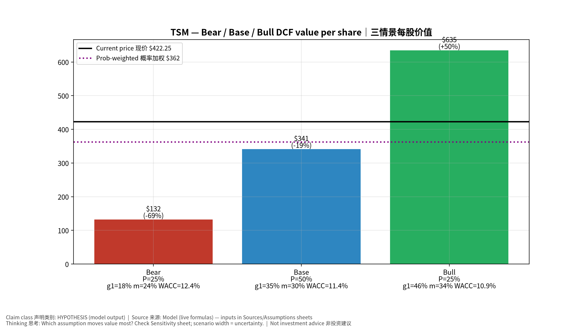
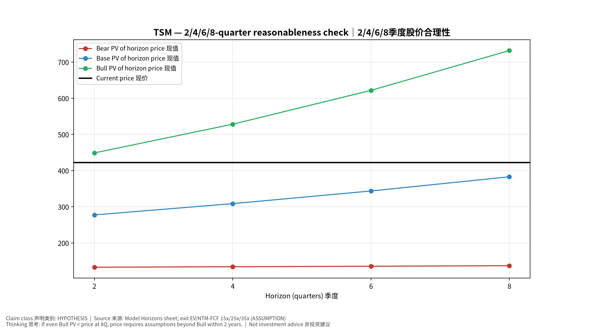
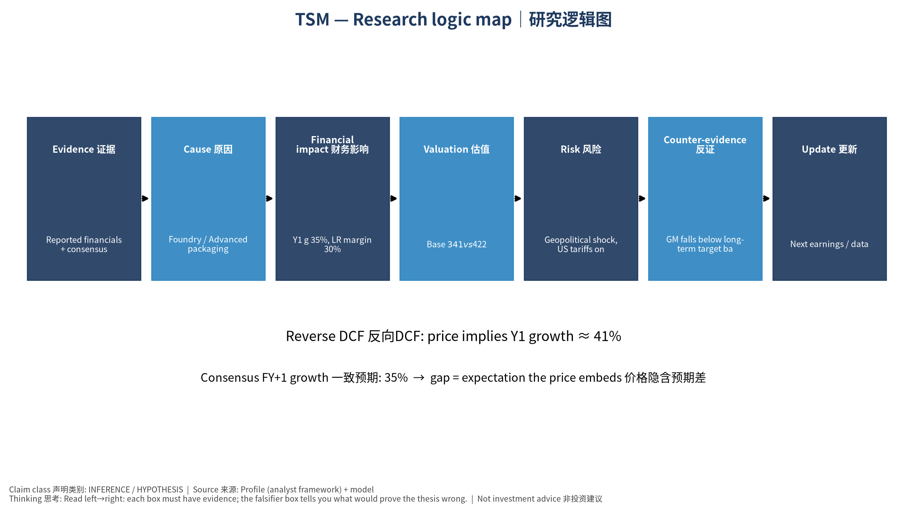

# TSM Taiwan Semiconductor Manufacturing Company Limited — 个股深度研究 (专业中文版) v20261016-0756
> 数据截至 2026-10-16 07:56 SGT｜价格 $422.25｜市值 2,190.0 bn USD｜财报货币 TWD｜非投资建议。事实=CONFIRMED/DATA；推断=INFERENCE；假设=ASSUMPTION/HYPOTHESIS。

## 1. 投资论点 Investment Thesis (HYPOTHESIS)
台积电是AI芯片无可替代的制造瓶颈，拥有定价权；主要风险是地缘政治与海外厂毛利稀释。财报以新台币计。

- **多头驱动**: N2 ramp + price increases; CoWoS doubling; AI accelerators >30% revenue｜N2爬坡+涨价；CoWoS倍增；AI加速器占比超30%
- **空头驱动**: Geopolitical shock, US tariffs on chips, Intel/Samsung regain share｜地缘冲击、美国芯片关税、英特尔/三星夺回份额
- **证伪条件 Falsifiers**: GM falls below long-term target band; monthly revenue y/y decelerates sharply; capex cut｜毛利率跌破长期目标区间；月营收同比骤降；Capex下修

## 2. 产品、客户与收入模式
- 主题 Theme: Foundry / Advanced packaging 晶圆代工/先进封装
- 业务分部 Segments: HPC/AI 高性能计算；Smartphone 智能手机；IoT/Auto/DCE 其他
- 公司描述 (DATA, Yahoo/公司申报): Taiwan Semiconductor Manufacturing Company Limited, together with its subsidiaries, manufactures, packages, tests, and sells integrated circuits and other semiconductor devices in Taiwan, China, Europe, the Middle East, Africa, Japan, the United States, and internationally. It provides various wafer fabrication processes, such as processes to manufacture complementary metal- oxide-semiconductor (CMOS) logic, mixed-signal, radio frequency, embedded memory, bipolar CMOS mixed-signal, and others. The company also involved in providing customer and engineering support services; manufacturing of masks; investment in technology start-up companies; research, designing, developing, manufacturing, packaging, testing, and sale of color filters; and investment activities. Its products are used in high performance computing, smartphones, Internet of things, automotive, and digital consumer electroni
- 主要客户: NVDA, Apple, AMD, Broadcom, Qualcomm, MediaTek, Marvell, hyperscaler ASICs｜NVDA、苹果、AMD、博通、高通、联发科、Marvell、云厂ASIC

## 3. 行业、竞争、监管与供应链 (ANALYST FRAMEWORK)
- 供应商/上游: ASML (EUV), AMAT/LRCX/TEL/KLAC, Shin-Etsu/SUMCO (wafers), chemicals｜ASML、设备商、硅片、化学品
- 竞争者 (含业外): Samsung Foundry, Intel Foundry (18A/14A), SMIC｜三星代工、英特尔代工、中芯国际
- 瓶颈/监管: CoWoS/SoIC capacity, N2/A16 ramp, overseas fab cost (Arizona/Japan), Taiwan geopolitics, power/water｜CoWoS/SoIC产能、N2/A16爬坡、海外厂成本、台海地缘、电力水资源
- 关键KPI: Monthly revenue, GM%, HPC mix, N3/N2 mix, capex, CoWoS capacity｜月营收、毛利率、HPC占比、先进制程占比、Capex、CoWoS产能
- 零部件现货/合约价: 本版未接入付费价格源(TrendForce/DRAMeXchange等)——标注 **UNAVAILABLE**，在KPI监控中以定性方式跟踪。

## 4. 历史财务与现金流 (CONFIRMED, 季度, TWD)
| 季度 | 收入 | 毛利 | 营业利润 | 净利润 | FCF | 营业利润率 |
|---|---|---|---|---|---|---|
| 2026-06-30 | 1,270.4 bn TWD | 860.3 bn TWD | 766.6 bn TWD | 706.6 bn TWD | 275.0 bn TWD | 60.3% |
| 2026-03-31 | 1,134.1 bn TWD | 751.3 bn TWD | 658.9 bn TWD | 572.5 bn TWD | 347.3 bn TWD | 58.1% |
| 2025-12-31 | 1,046.1 bn TWD | 652.0 bn TWD | 564.9 bn TWD | 485.5 bn TWD | 364.0 bn TWD | 54.0% |
| 2025-09-30 | 989.9 bn TWD | 588.5 bn TWD | 500.7 bn TWD | 452.3 bn TWD | 138.4 bn TWD | 50.6% |
| 2025-06-30 | 933.8 bn TWD | 547.4 bn TWD | 463.4 bn TWD | 398.3 bn TWD | 199.8 bn TWD | 49.6% |
| 2025-03-31 | N/A | N/A | N/A | N/A | N/A | N/A |

资产负债: 现金 3,518.0 bn TWD；总负债 1,068.6 bn TWD；净现金 2,449.5 bn TWD。TTM FCF 1,124.7 bn TWD（FCF率 25.3%）。

## 5. 最新财报: 实际 vs 一致预期 vs 指引
| 季度 | EPS实际 | EPS一致预期 | 超预期% |
|---|---|---|---|
| 2025-12-31 | 3.14 | 2.97556 | 0.0553 |
| 2026-03-31 | 3.49 | 3.33393 | 0.0468 |
| 2026-06-30 | 4.31 | 3.88658 | 0.1089 |
| 2026-09-30 | 4.6 | 4.52449 | 0.0167 |

- 管理层指引 Guidance: 自动数据源不含指引——**UNAVAILABLE（待从公司IR新闻稿录入）**。
- 下次财报日 (Yahoo, TENTATIVE 直至公司确认): **2026-10-15**；本季EPS一致预期 5.07666（8位分析师）；收入一致预期 1,700.4 bn TWD。

## 6. 未来2/4/6/8季度驱动与价格合理性
| 期限 | 情景 | 期限价格现值 | 相对现价 |
|---|---|---|---|
| 2Q | Bear | $132.89 | -68.5% |
| 2Q | Base | $277.41 | -34.3% |
| 2Q | Bull | $448.79 | 6.3% |
| 4Q | Bear | $134.19 | -68.2% |
| 4Q | Base | $308.58 | -26.9% |
| 4Q | Bull | $528.12 | 25.1% |
| 6Q | Bear | $135.58 | -67.9% |
| 6Q | Base | $343.56 | -18.6% |
| 6Q | Bull | $621.62 | 47.2% |
| 8Q | Bear | $137.03 | -67.5% |
| 8Q | Base | $382.77 | -9.3% |
| 8Q | Bull | $731.68 | 73.3% |

现价隐含的 EV/NTM-FCF (Base 路径): | 期限 | 隐含倍数 |
|---|---|
| 2Q | 36.6x |
| 4Q | 31.0x |
| 6Q | 26.2x |
| 8Q | 22.1x |

解读: 如果8季度后Base情景所需倍数仍远高于25x，说明价格依赖更远期的增长。

## 7. 三情景 Bear / Base / Bull (HYPOTHESIS)
| 情景 | Y1增速 | 长期FCF率 | WACC | 永续g | 概率 | 每股价值 | 相对现价 |
|---|---|---|---|---|---|---|---|
| Bear | 17.6% | 24.0% | 12.4% | 2.5% | 25.0% | $132.47 | -68.6% |
| Base | 35.2% | 30.0% | 11.4% | 3.0% | 50.0% | $341.27 | -19.2% |
| Bull | 45.8% | 34.5% | 10.9% | 3.5% | 25.0% | $634.70 | 50.3% |

概率加权价值 **$362.43**（相对现价 -14.2%）。

## 8. 估值: DCF / Reverse DCF / ROIC-WACC / 同业 / 敏感度
- DCF Base: EV 54,784.3 bn TWD；终值占比 56.2%。
- **Reverse DCF 反向DCF**: 在Base利润率与WACC下，现价隐含Y1收入增速 ≈ **41.4%**；一致预期FY+1增速 35.2%。
- WACC (CAPM) = rf 5.2% + β 1.24 × ERP 5.0% = 11.4%。
- SOTP segments 分部: HPC/AI 高性能计算; Smartphone 智能手机; IoT/Auto/DCE 其他. **Status: framework only** — segment revenues are INPUT REQUIRED from the latest 10-K/10-Q segment note (not auto-fed, left blank to avoid fabrication)｜分部收入需按最新财报手动录入，未自动填充以避免编造。
- 同业比较 Comps (DATA):
| Ticker | 市值 | EV/Sales | Fwd P/E | 收入增速 | 毛利率 | FCF收益率 |
|---|---|---|---|---|---|---|
| TSM | 2,190.0 bn USD | 3.5x | 18.4x | 36.0% | 64.2% | 1.6% |
| INTC | 504.1 bn USD | 9.1x | 45.3x | 25.4% | 38.9% | 1.0% |
| 005930.KS | 1,367,503.8 bn USD | 2.5x | 2.9x | 130.0% | 57.5% | 5.1% |
| UMC | 52.5 bn USD | -0.1x | 23.8x | 17.0% | 30.6% | 70.3% |
| GFS | 27.2 bn USD | 3.8x | 18.5x | 5.8% | 27.1% | 2.8% |

- 敏感度: 见Excel `Sensitivity` 表 (WACC × 永续增长率)。

## 9. 风险、反方论证与证伪
- 反方观点 Counter-thesis: Geopolitical shock, US tariffs on chips, Intel/Samsung regain share｜地缘冲击、美国芯片关税、英特尔/三星夺回份额
- 证伪指标: GM falls below long-term target band; monthly revenue y/y decelerates sharply; capex cut｜毛利率跌破长期目标区间；月营收同比骤降；Capex下修
- 模型风险: 长期利润率与WACC为假设；终值占比高时估值对假设极敏感。

## 10. Source Ledger 来源账本
| Item | Value | Source/time |
|---|---|---|
| Price 股价 | 422.2 | Yahoo Finance quote, fetched 2026-10-16T07:56 SGT |
| Market cap 市值 | 2.19e+12 | Yahoo info.marketCap 2026-10-16T07:56 |
| Cash 现金 | 3.518e+12 | Yahoo info.totalCash (latest filing) 2026-10-16T07:56 |
| Debt 负债 | 1.069e+12 | Yahoo info.totalDebt (latest filing) 2026-10-16T07:56 |
| Revenue TTM 收入 | 4.44e+12 | Yahoo info.totalRevenue (TTM, TWD) 2026-10-16T07:56 |
| FCF TTM 自由现金流 | 1.125e+12 | Sum of last 4 quarterly FCF (q_cash); quarters ['2026-06-30', '2026-03-31', '2025-12-31', '2025-09-30'] (TWD) |
| Beta | 1.239 | Yahoo info.beta (5Y monthly) |
| Risk-free 10Y 无风险利率 | 0.0519 | FRED DGS10 2026-10-14 |
| FX USD per TWD | 0.03093 | Yahoo FX quote |
| Consensus rev growth FY0 | 0.4493 | Yahoo revenue_estimate 0y |
| Consensus rev growth FY+1 | 0.3521 | Yahoo revenue_estimate +1y |

## 11. Assumption Register 假设登记表
| Assumption | Value | Rationale |
|---|---|---|
| ERP 股权风险溢价 | 0.05 | ASSUMPTION: 5.0% house mature-market ERP |
| Beta clamp | [0.8,1.6] → 1.24 | ASSUMPTION: limit extreme betas |
| Tax rate (ROIC) | 0.18 | ASSUMPTION: blended cash tax 18% |
| Year-1 growth (Base) | 0.3521 | Consensus FY+1 revenue growth (Yahoo revenue_estimate '+1y'); capped at 100% |
| Growth fade | linear Y1→terminal by Y10 | ASSUMPTION |
| Starting FCF margin | 0.2533 | DATA: FCF TTM / Revenue TTM, floored -50% |
| Long-run FCF margin (Base) | 0.3 | ASSUMPTION (analyst framework, reached by Y5; see profile) |
| Bear/Bull Y1 growth multiplier | 0.5x / 1.3x | ASSUMPTION |
| Bear/Bull margin multiplier | 0.8x / 1.15x | ASSUMPTION |
| WACC adj Bear/Bull | +1.0pp / -0.5pp | ASSUMPTION |
| Terminal g Bear/Base/Bull | 2.5% / 3.0% / 3.5% | ASSUMPTION |
| Scenario probabilities | 25% / 50% / 25% | ASSUMPTION |
| Horizon exit EV/NTM-FCF Bear/Base/Bull | 15x / 25x / 35x | ASSUMPTION |
| Per-share conversion | value × fx ÷ market cap × price | METHOD: avoids ADR/share-class mismatch |

## 12. Model Provenance 模型溯源
- Model file: `TSM_model_v20261016-0756.xlsx` (live formulas; sheets Inputs→Scenarios→DCF→ReverseDCF→Sensitivity→Horizons→SOTP→Comps→ROIC_WACC→History→Sources→Assumptions)
- Engine: `production/pipeline/model.py` (Python mirror; values in this report = Python mirror, verified against LibreOffice recalculation of the xlsx)
- Data snapshot: `data/snapshots/20261016-0756` (immutable) | Fetched 2026-10-16 07:56 SGT | Generated 2026-10-16 07:57 SGT
- Version: v20261016-0756. Prior versions are never overwritten (see company history page).

## 13. 版本与事件时间轴
- v20261016-0756: 首版生产系统报告 (27家同步)。下一事件: 财报 2026-10-15 (TENTATIVE)。

## 图片报告 Image Report

*股价vs三情景价值 Price vs scenario values*

*季度财务 Quarterly financials*

*三情景 Scenarios*

*2/4/6/8季度检验 Horizon check*

*研究逻辑图 Logic map*

---

# TSM Taiwan Semiconductor Manufacturing Company Limited — Equity Deep Dive (Professional English) v20261016-0756
> Data as of 2026-10-16 07:56 SGT | Price $422.25 | Mkt cap 2,190.0 bn USD | Reporting currency TWD | Not investment advice.

## 1. Investment thesis (HYPOTHESIS)
TSMC is the irreplaceable manufacturing bottleneck for AI chips with pricing power; key risks are geopolitics and overseas-fab margin dilution. Financials are reported in TWD.

- **Bull drivers**: N2 ramp + price increases; CoWoS doubling; AI accelerators >30% revenue｜N2爬坡+涨价；CoWoS倍增；AI加速器占比超30%
- **Bear drivers**: Geopolitical shock, US tariffs on chips, Intel/Samsung regain share｜地缘冲击、美国芯片关税、英特尔/三星夺回份额
- **Falsifiers**: GM falls below long-term target band; monthly revenue y/y decelerates sharply; capex cut｜毛利率跌破长期目标区间；月营收同比骤降；Capex下修

## 2. Products, customers, revenue model
- Theme: Foundry / Advanced packaging 晶圆代工/先进封装 | Segments: HPC/AI 高性能计算; Smartphone 智能手机; IoT/Auto/DCE 其他
- Business description (DATA): Taiwan Semiconductor Manufacturing Company Limited, together with its subsidiaries, manufactures, packages, tests, and sells integrated circuits and other semiconductor devices in Taiwan, China, Europe, the Middle East, Africa, Japan, the United States, and internationally. It provides various wafer fabrication processes, such as processes to manufacture complementary metal- oxide-semiconductor (CMOS) logic, mixed-signal, radio frequency, embedded memory, bipolar CMOS mixed-signal, and others. The company also involved in providing customer and engineering support services; manufacturing of masks; investment in technology start-up companies; research, designing, developing, manufacturing, packaging, testing, and sale of color filters; and investment activities. Its products are used in high performance computing, smartphones, Internet of things, automotive, and digital consumer electroni
- Customers: NVDA, Apple, AMD, Broadcom, Qualcomm, MediaTek, Marvell, hyperscaler ASICs｜NVDA、苹果、AMD、博通、高通、联发科、Marvell、云厂ASIC

## 3. Industry, competition, regulation, supply chain (ANALYST FRAMEWORK)
- Suppliers: ASML (EUV), AMAT/LRCX/TEL/KLAC, Shin-Etsu/SUMCO (wafers), chemicals｜ASML、设备商、硅片、化学品
- Competitors: Samsung Foundry, Intel Foundry (18A/14A), SMIC｜三星代工、英特尔代工、中芯国际
- Bottlenecks/regulation: CoWoS/SoIC capacity, N2/A16 ramp, overseas fab cost (Arizona/Japan), Taiwan geopolitics, power/water｜CoWoS/SoIC产能、N2/A16爬坡、海外厂成本、台海地缘、电力水资源
- KPIs: Monthly revenue, GM%, HPC mix, N3/N2 mix, capex, CoWoS capacity｜月营收、毛利率、HPC占比、先进制程占比、Capex、CoWoS产能
- Component spot/contract prices: paid feeds not connected — **UNAVAILABLE**, tracked qualitatively.

## 4. Historical financials & cash flow (CONFIRMED, quarterly, TWD)
| Quarter | Revenue | Gross profit | Op income | Net income | FCF | Op margin |
|---|---|---|---|---|---|---|
| 2026-06-30 | 1,270.4 bn TWD | 860.3 bn TWD | 766.6 bn TWD | 706.6 bn TWD | 275.0 bn TWD | 60.3% |
| 2026-03-31 | 1,134.1 bn TWD | 751.3 bn TWD | 658.9 bn TWD | 572.5 bn TWD | 347.3 bn TWD | 58.1% |
| 2025-12-31 | 1,046.1 bn TWD | 652.0 bn TWD | 564.9 bn TWD | 485.5 bn TWD | 364.0 bn TWD | 54.0% |
| 2025-09-30 | 989.9 bn TWD | 588.5 bn TWD | 500.7 bn TWD | 452.3 bn TWD | 138.4 bn TWD | 50.6% |
| 2025-06-30 | 933.8 bn TWD | 547.4 bn TWD | 463.4 bn TWD | 398.3 bn TWD | 199.8 bn TWD | 49.6% |
| 2025-03-31 | N/A | N/A | N/A | N/A | N/A | N/A |

Cash 3,518.0 bn TWD; debt 1,068.6 bn TWD; TTM FCF 1,124.7 bn TWD (FCF margin 25.3%).

## 5. Latest earnings: actual vs consensus vs guidance
| Quarter | EPS actual | EPS consensus | Surprise |
|---|---|---|---|
| 2025-12-31 | 3.14 | 2.97556 | 0.0553 |
| 2026-03-31 | 3.49 | 3.33393 | 0.0468 |
| 2026-06-30 | 4.31 | 3.88658 | 0.1089 |
| 2026-09-30 | 4.6 | 4.52449 | 0.0167 |

- Management guidance: not in automated feed — **UNAVAILABLE (to be entered from IR release)**.
- Next earnings (Yahoo; TENTATIVE until company-confirmed): **2026-10-15**; current-quarter EPS consensus 5.07666 (8 analysts); revenue consensus 1,700.4 bn TWD.

## 6. 2/4/6/8-quarter drivers & price reasonableness
| Horizon | Scenario | PV of horizon price | vs current |
|---|---|---|---|
| 2Q | Bear | $132.89 | -68.5% |
| 2Q | Base | $277.41 | -34.3% |
| 2Q | Bull | $448.79 | 6.3% |
| 4Q | Bear | $134.19 | -68.2% |
| 4Q | Base | $308.58 | -26.9% |
| 4Q | Bull | $528.12 | 25.1% |
| 6Q | Bear | $135.58 | -67.9% |
| 6Q | Base | $343.56 | -18.6% |
| 6Q | Bull | $621.62 | 47.2% |
| 8Q | Bear | $137.03 | -67.5% |
| 8Q | Base | $382.77 | -9.3% |
| 8Q | Bull | $731.68 | 73.3% |

Current-price implied EV/NTM-FCF on Base path: | Horizon | Implied multiple |
|---|---|
| 2Q | 36.6x |
| 4Q | 31.0x |
| 6Q | 26.2x |
| 8Q | 22.1x |

## 7. Bear / Base / Bull (HYPOTHESIS)
| Scenario | Y1 growth | LR FCF margin | WACC | Terminal g | Prob. | Value/share | vs price |
|---|---|---|---|---|---|---|---|
| Bear | 17.6% | 24.0% | 12.4% | 2.5% | 25.0% | $132.47 | -68.6% |
| Base | 35.2% | 30.0% | 11.4% | 3.0% | 50.0% | $341.27 | -19.2% |
| Bull | 45.8% | 34.5% | 10.9% | 3.5% | 25.0% | $634.70 | 50.3% |

Probability-weighted value **$362.43** (-14.2% vs price).

## 8. Valuation: DCF / Reverse DCF / ROIC-WACC / comps / sensitivity
- Base DCF EV 54,784.3 bn TWD; terminal share 56.2%.
- **Reverse DCF**: at Base margin/WACC the price implies Y1 revenue growth ≈ **41.4%** vs consensus FY+1 35.2%.
- WACC (CAPM) = rf 5.2% + β 1.24 × ERP 5.0% = 11.4%.
- SOTP segments: HPC/AI 高性能计算; Smartphone 智能手机; IoT/Auto/DCE 其他 — framework only; segment revenue inputs pending from filings.
- Comps (DATA): see table in Chinese section / Excel `Comps`.
- Sensitivity: Excel `Sensitivity` (WACC × terminal g).

## 9. Risks, counterarguments, falsifiers
Geopolitical shock, US tariffs on chips, Intel/Samsung regain share｜地缘冲击、美国芯片关税、英特尔/三星夺回份额 | Falsifiers: GM falls below long-term target band; monthly revenue y/y decelerates sharply; capex cut｜毛利率跌破长期目标区间；月营收同比骤降；Capex下修

## 10–12. Source Ledger / Assumption Register / Model Provenance
See tables above (shared, bilingual). - Model file: `TSM_model_v20261016-0756.xlsx` (live formulas; sheets Inputs→Scenarios→DCF→ReverseDCF→Sensitivity→Horizons→SOTP→Comps→ROIC_WACC→History→Sources→Assumptions)
- Engine: `production/pipeline/model.py` (Python mirror; values in this report = Python mirror, verified against LibreOffice recalculation of the xlsx)
- Data snapshot: `data/snapshots/20261016-0756` (immutable) | Fetched 2026-10-16 07:56 SGT | Generated 2026-10-16 07:57 SGT
- Version: v20261016-0756. Prior versions are never overwritten (see company history page).
