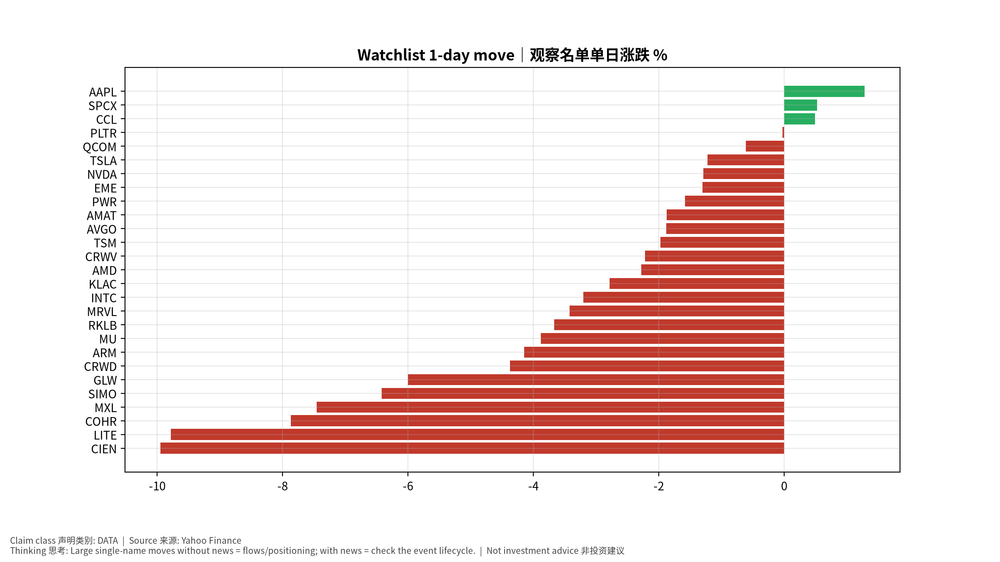
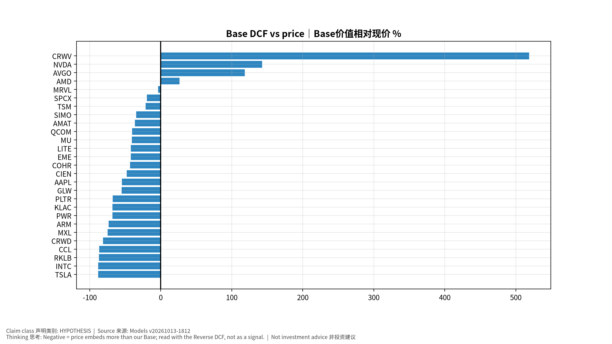

# 每日总览 Daily OS Overview — 2026-10-13 (v20261013-1812)
> 非投资建议。所有数字带来源；推断已标注。

## A. 今日要点 Headlines (INFERENCE)
1. 宏观: 核心PCE同比 +3.0%；套息压力 CALM；VIX 15.3。
2. 题材最强: KR Battery 电池, JP Test 测试, TW PCB/ABF Substrate 载板；最弱: KR Defense/Space 国防航天, KR Power Grid 电网, JP Memory 存储。
3. 未来7天: 2026-10-14 US CPI (Sep 2026)｜美国CPI; 2026-10-15 US PPI (Sep 2026)｜美国PPI; 2026-10-15 TSM earnings + call｜财报与电话会; 2026-10-16 US Import/Export Prices (Sep)。

## B. 宏观/利率/汇率/流动性 → 见 Macro 专题 (research/macro/v20261013-1812)
## C. 台日韩雷达 → 见 Radar (research/radar/v20261013-1812)
## D. 观察名单 27家 估值快照
| Ticker | 价格 | 1D | Bear/Base/Bull | 价格隐含Y1增速 | 一致预期FY+1 | 下次财报 |
|---|---|---|---|---|---|---|
| AAPL | $340.97 | +1.3% | $87/$154/$226 | +31.4% | +10.6% | 2026-11-03 |
| AMAT | $497.53 | -1.9% | $120/$316/$580 | +48.4% | +35.2% | 2026-11-13 |
| AMD | $594.24 | -2.3% | $160/$751/$1,870 | +67.0% | +74.6% | 2026-11-04 |
| ARM | $255.24 | -4.1% | $27/$67/$123 | +78.1% | +36.2% | 2026-11-05 |
| AVGO | $354.73 | -1.9% | $179/$774/$1,827 | +40.9% | +64.1% | 2026-12-10 |
| CCL | $26.48 | +0.5% | $-3/$4/$9 | +22.9% | +3.1% | 2026-12-18 |
| CIEN | $405.01 | -10.0% | $81/$211/$384 | +49.1% | +30.8% | 2026-09-03 |
| COHR | $288.02 | -7.9% | $42/$163/$337 | +53.8% | +38.8% | 2026-11-05 |
| CRWD | $263.01 | -4.4% | $24/$49/$79 | +73.7% | +22.6% | 2026-12-02 |
| CRWV | $80.26 | -2.2% | $-21/$497/$1,736 | +61.6% | +100.0% | 2026-11-12 |
| EME | $779.16 | -1.3% | $265/$450/$648 | +24.4% | +9.9% | 2026-10-29 |
| GLW | $147.28 | -6.0% | $27/$66/$113 | +39.7% | +19.6% | 2026-10-27 |
| INTC | $101.35 | -3.2% | $5/$12/$20 | +68.9% | +14.9% | 2026-10-30 |
| KLAC | $190.12 | -2.8% | $30/$61/$96 | +50.8% | +18.9% | 2026-10-29 |
| LITE | $995.41 | -9.8% | $157/$575/$1,270 | +73.8% | +56.4% | 2026-11-06 |
| MRVL | $265.86 | -3.4% | $60/$256/$597 | +64.3% | +63.1% | 2026-12-02 |
| MU | $989.04 | -3.9% | $327/$585/$865 | +30.6% | +15.7% | 2026-12-24 |
| MXL | $88.99 | -7.5% | $8/$22/$41 | +69.0% | +29.9% | 2026-10-23 |
| NVDA | $226.32 | -1.3% | $126/$549/$1,312 | +41.0% | +68.2% | 2026-11-18 |
| PLTR | $209.00 | -0.0% | $23/$68/$136 | +87.9% | +50.1% | 2026-11-03 |
| PWR | $694.79 | -1.6% | $100/$222/$359 | +44.0% | +15.5% | 2026-10-29 |
| QCOM | $174.43 | -0.6% | $68/$104/$138 | +17.9% | +4.8% | 2026-11-05 |
| RKLB | $65.71 | -3.7% | $4/$8/$15 | +115.2% | +41.3% | 2026-11-10 |
| SIMO | $246.95 | -6.4% | $59/$162/$295 | +40.8% | +29.6% | 2026-10-29 |
| SPCX | $163.42 | +0.5% | $20/$131/$395 | +107.8% | +100.0% | 2026-11-04 |
| TSLA | $378.03 | -1.2% | $27/$44/$62 | +80.9% | +13.6% | 2026-10-22 |
| TSM | $444.35 | -2.0% | $134/$350/$655 | +42.9% | +35.9% | 2026-10-15 |

## E. 事件生命周期状态
- US CPI 10/14: **Pre-release book ready** (events/v20261013-1812)；发布时/发布后部分待事件发生后生成。
## F. 今日教学 Teaching corner
"价格隐含增速 > 一致预期" = 市场比分析师更乐观 → 需要超预期才能维持股价。English: price-implied growth above consensus means the stock needs beats to hold.

