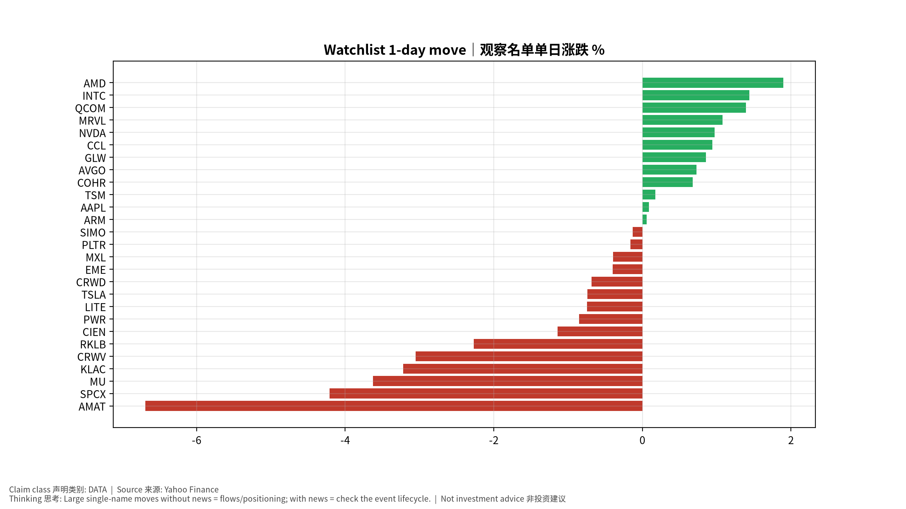
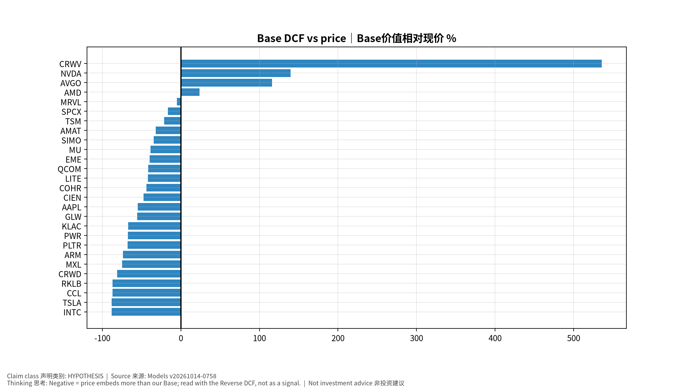

# 每日总览 Daily OS Overview — 2026-10-14 (v20261014-0758)
> 非投资建议。所有数字带来源；推断已标注。

**⏱ 30秒看懂**

1. **发生什么：**今天美国通胀(核心PCE同比 3.0%)仍高于2%目标，套息压力为 CALM，亚洲最强题材是 KR Battery 电池。
2. **和我的股票有什么关系：**通胀和利率决定高估值成长股的「折现率」；题材强弱告诉你资金正在流向哪条产业链。
3. **该看什么/做什么：**接下来最重要的事件：2026-10-14 US CPI (Sep 2026)｜美国CPI——事件前请读对应的发布前教学版。

**🗺 阅读地图**

| 你有多少时间 | 读哪里 |
|---|---|
| 2 分钟 | 只读「30秒看懂」。 |
| 10 分钟 | 加读 A 今日要点和 D 估值快照表（看「价格隐含增速」vs「一致预期」）。 |
| 30 分钟 | 全部，并点进宏观/雷达专题与事件书。 |

层级说明：**L1 故事**（人人能懂）→ **L2 关键数字**（带解释）→ **L3 专业细节**（网页可折叠，默认收起）。

**🧠 今日思考题（反向思考）：**今天最强的题材是 KR Battery 电池。如果它明天反转，最可能的原因是什么？你会先看哪个数据？（方法见 Academy「投研思维方法」）

## A. 今日要点 Headlines (INFERENCE)
1. 宏观: 核心PCE同比 +3.0%；套息压力 CALM；VIX 15.3。
2. 题材最强: KR Battery 电池, JP Test 测试, JP Power Grid 电网；最弱: KR Memory 存储, KR Defense/Space 国防航天, JP Memory 存储。
3. 未来7天: 2026-10-14 US CPI (Sep 2026)｜美国CPI; 2026-10-15 US PPI (Sep 2026)｜美国PPI; 2026-10-15 TSM earnings + call｜财报与电话会; 2026-10-16 US Import/Export Prices (Sep)。

## B. 宏观/利率/汇率/流动性 → 见 Macro 专题 (research/macro/v20261014-0758)
## C. 台日韩雷达 → 见 Radar (research/radar/v20261014-0758)
## D. 观察名单 27家 估值快照
| Ticker | 价格 | 1D | Bear/Base/Bull | 价格隐含Y1增速 | 一致预期FY+1 | 下次财报 |
|---|---|---|---|---|---|---|
| AAPL | $341.27 | +0.1% | $87/$153/$225 | +31.5% | +10.5% | 2026-11-03 |
| AMAT | $464.24 | -6.7% | $120/$315/$578 | +46.4% | +35.2% | 2026-11-13 |
| AMD | $605.53 | +1.9% | $159/$749/$1,865 | +67.7% | +74.6% | 2026-11-04 |
| ARM | $255.39 | +0.1% | $27/$67/$122 | +78.2% | +36.2% | 2026-11-05 |
| AVGO | $357.31 | +0.7% | $179/$772/$1,821 | +41.2% | +64.1% | 2026-12-10 |
| CCL | $26.73 | +0.9% | $-3/$3/$9 | +23.1% | +3.1% | 2026-12-18 |
| CIEN | $400.40 | -1.1% | $80/$210/$383 | +48.8% | +30.8% | 2026-09-03 |
| COHR | $289.98 | +0.7% | $42/$163/$336 | +54.1% | +38.8% | 2026-11-05 |
| CRWD | $261.21 | -0.7% | $24/$49/$79 | +73.6% | +22.6% | 2026-12-02 |
| CRWV | $77.81 | -3.1% | $-22/$495/$1,730 | +61.3% | +100.0% | 2026-11-12 |
| EME | $776.05 | -0.4% | $269/$467/$680 | +24.4% | +10.9% | 2026-10-29 |
| GLW | $148.54 | +0.9% | $27/$66/$113 | +40.0% | +19.6% | 2026-10-27 |
| INTC | $102.81 | +1.4% | $5/$12/$20 | +69.5% | +14.9% | 2026-10-30 |
| KLAC | $184.00 | -3.2% | $30/$61/$96 | +49.9% | +18.9% | 2026-10-29 |
| LITE | $987.99 | -0.7% | $156/$573/$1,266 | +73.7% | +56.4% | 2026-11-06 |
| MRVL | $268.73 | +1.1% | $60/$255/$595 | +64.7% | +63.1% | 2026-12-02 |
| MU | $953.19 | -3.6% | $326/$584/$863 | +29.6% | +15.7% | 2026-12-24 |
| MXL | $88.64 | -0.4% | $8/$22/$41 | +68.9% | +29.9% | 2026-10-23 |
| NVDA | $228.52 | +1.0% | $126/$548/$1,308 | +41.3% | +68.2% | 2026-11-18 |
| PLTR | $208.67 | -0.2% | $23/$67/$136 | +88.0% | +50.1% | 2026-11-03 |
| PWR | $688.88 | -0.9% | $101/$225/$363 | +43.9% | +15.8% | 2026-10-29 |
| QCOM | $176.86 | +1.4% | $68/$104/$137 | +18.3% | +4.8% | 2026-11-05 |
| RKLB | $64.22 | -2.3% | $4/$8/$15 | +114.4% | +41.3% | 2026-11-10 |
| SIMO | $246.63 | -0.1% | $59/$161/$294 | +40.9% | +29.6% | 2026-10-29 |
| SPCX | $156.54 | -4.2% | $20/$131/$394 | +106.4% | +100.0% | 2026-11-04 |
| TSLA | $375.23 | -0.7% | $27/$44/$62 | +80.8% | +13.6% | 2026-10-22 |
| TSM | $445.12 | +0.2% | $134/$350/$654 | +43.0% | +35.9% | 2026-10-15 |

## E. 事件生命周期状态
- US CPI 10/14: **Pre-release book ready** (events/v20261014-0758)；发布时/发布后部分待事件发生后生成。
## F. 今日教学 Teaching corner
"价格隐含增速 > 一致预期" = 市场比分析师更乐观 → 需要超预期才能维持股价。English: price-implied growth above consensus means the stock needs beats to hold.

