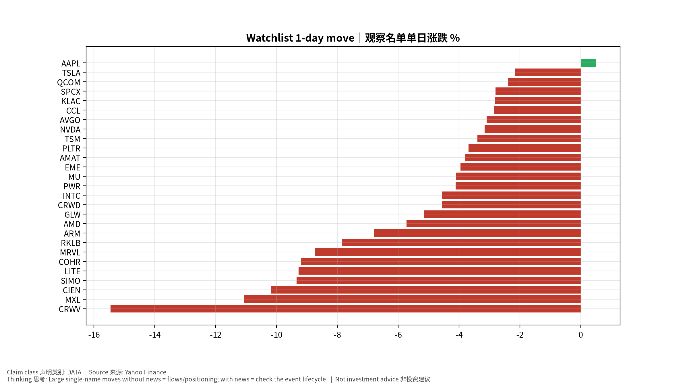
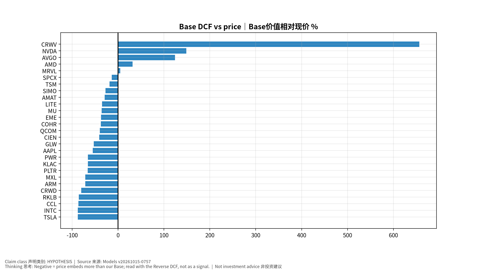

# 每日总览 Daily OS Overview — 2026-10-15 (v20261015-0757)
> 非投资建议。所有数字带来源；推断已标注。

**⏱ 30秒看懂**

1. **发生什么：**今天美国通胀(核心PCE同比 3.0%)仍高于2%目标，套息压力为 CALM，亚洲最强题材是 KR Battery 电池。
2. **和我的股票有什么关系：**通胀和利率决定高估值成长股的「折现率」；题材强弱告诉你资金正在流向哪条产业链。
3. **该看什么/做什么：**接下来最重要的事件：2026-10-14 US CPI (Sep 2026)｜美国CPI——事件前请读对应的发布前教学版。

**🗺 阅读地图**

| 你有多少时间 | 读哪里 |
|---|---|
| 2 分钟 | 只读「30秒看懂」。 |
| 10 分钟 | 加读 A 今日要点和 D 估值快照表（看「价格隐含增速」vs「一致预期」）。 |
| 30 分钟 | 全部，并点进宏观/雷达专题与事件书。 |

层级说明：**L1 故事**（人人能懂）→ **L2 关键数字**（带解释）→ **L3 专业细节**（网页可折叠，默认收起）。

**🧠 今日思考题（反向思考）：**今天最强的题材是 KR Battery 电池。如果它明天反转，最可能的原因是什么？你会先看哪个数据？（方法见 Academy「投研思维方法」）

## A. 今日要点 Headlines (INFERENCE)
1. 宏观: 核心PCE同比 +3.0%；套息压力 CALM；VIX 16.9。
2. 题材最强: KR Battery 电池, JP Test 测试, TW Optical 光通信；最弱: KR Memory 存储, KR Power Grid 电网, JP Memory 存储。
3. 未来7天: 2026-10-14 US CPI (Sep 2026)｜美国CPI; 2026-10-15 US PPI (Sep 2026)｜美国PPI; 2026-10-15 TSM earnings + call｜台积电财报与电话会; 2026-10-16 US Import/Export Prices (Sep); 2026-10-22 TSLA earnings + call｜财报与电话会。

## B. 宏观/利率/汇率/流动性 → 见 Macro 专题 (research/macro/v20261015-0757)
## C. 台日韩雷达 → 见 Radar (research/radar/v20261015-0757)
## D. 观察名单 27家 估值快照
| Ticker | 价格 | 1D | Bear/Base/Bull | 价格隐含Y1增速 | 一致预期FY+1 | 下次财报 |
|---|---|---|---|---|---|---|
| AAPL | $342.96 | +0.5% | $87/$154/$227 | +31.5% | +10.5% | 2026-11-03 |
| AMAT | $446.63 | -3.8% | $120/$316/$581 | +45.2% | +35.2% | 2026-11-13 |
| AMD | $570.82 | -5.7% | $160/$752/$1,873 | +65.6% | +74.6% | 2026-11-04 |
| ARM | $238.01 | -6.8% | $27/$68/$123 | +75.7% | +36.2% | 2026-11-05 |
| AVGO | $346.25 | -3.1% | $179/$775/$1,830 | +40.2% | +64.1% | 2026-12-10 |
| CCL | $25.97 | -2.8% | $-3/$4/$9 | +22.5% | +3.1% | 2026-12-18 |
| CIEN | $359.60 | -10.2% | $81/$212/$388 | +45.6% | +30.9% | 2026-09-03 |
| COHR | $263.32 | -9.2% | $42/$164/$339 | +51.3% | +38.9% | 2026-11-05 |
| CRWD | $249.29 | -4.6% | $24/$49/$80 | +71.9% | +22.7% | 2026-12-02 |
| CRWV | $65.78 | -15.5% | $-21/$498/$1,739 | +59.1% | +100.0% | 2026-11-12 |
| EME | $745.35 | -4.0% | $270/$468/$683 | +23.2% | +10.9% | 2026-10-29 |
| GLW | $140.89 | -5.2% | $27/$66/$113 | +38.4% | +19.6% | 2026-10-27 |
| INTC | $98.12 | -4.6% | $5/$12/$20 | +67.9% | +14.9% | 2026-10-30 |
| KLAC | $178.81 | -2.8% | $30/$61/$96 | +48.9% | +18.9% | 2026-10-29 |
| LITE | $896.33 | -9.3% | $158/$585/$1,298 | +70.4% | +57.0% | 2026-11-06 |
| MRVL | $245.28 | -8.7% | $60/$257/$599 | +61.8% | +63.2% | 2026-12-02 |
| MU | $914.13 | -4.1% | $327/$586/$866 | +28.3% | +15.7% | 2026-12-24 |
| MXL | $78.82 | -11.1% | $8/$22/$41 | +65.2% | +29.9% | 2026-10-23 |
| NVDA | $221.30 | -3.2% | $126/$550/$1,314 | +40.3% | +68.2% | 2026-11-18 |
| PLTR | $200.97 | -3.7% | $23/$68/$136 | +86.5% | +50.1% | 2026-11-03 |
| PWR | $660.53 | -4.1% | $101/$226/$365 | +42.6% | +15.8% | 2026-10-29 |
| QCOM | $172.62 | -2.4% | $68/$104/$138 | +17.6% | +4.8% | 2026-11-05 |
| RKLB | $59.18 | -7.8% | $4/$8/$15 | +111.2% | +41.3% | 2026-11-10 |
| SIMO | $223.58 | -9.3% | $59/$162/$296 | +38.1% | +29.6% | 2026-10-29 |
| SPCX | $152.16 | -2.8% | $20/$132/$396 | +105.2% | +100.0% | 2026-11-04 |
| TSLA | $367.16 | -2.2% | $27/$44/$62 | +79.9% | +13.6% | 2026-10-22 |
| TSM | $430.00 | -3.4% | $134/$350/$655 | +41.9% | +35.9% | 2026-10-15 |

## E. 事件生命周期状态
- US CPI 10/14: **Pre-release book ready** (events/v20261015-0757)；发布时/发布后部分待事件发生后生成。
## F. 今日教学 Teaching corner
"价格隐含增速 > 一致预期" = 市场比分析师更乐观 → 需要超预期才能维持股价。English: price-implied growth above consensus means the stock needs beats to hold.

