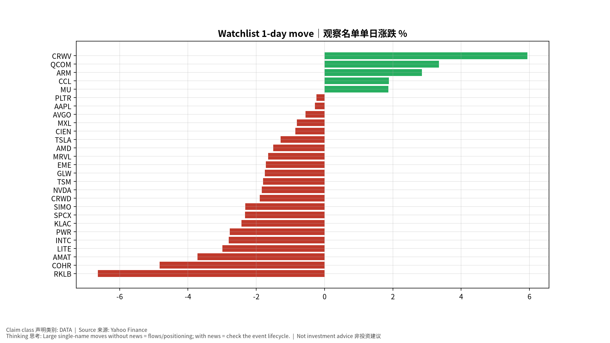
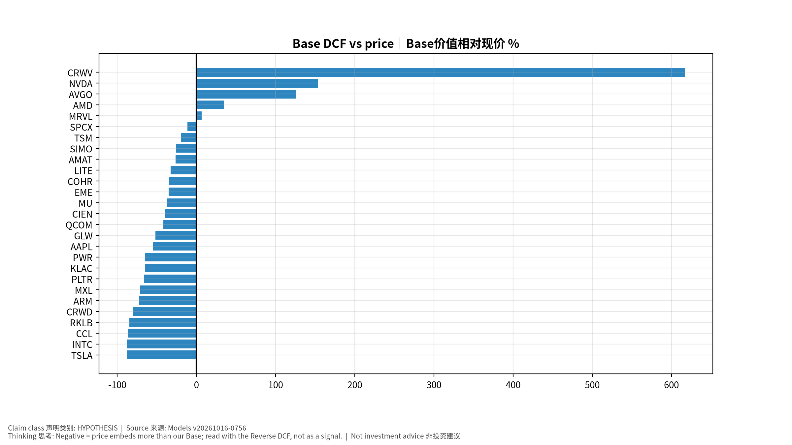

# 每日总览 Daily OS Overview — 2026-10-16 (v20261016-0756)
> 非投资建议。所有数字带来源；推断已标注。

**⏱ 30秒看懂**

1. **发生什么：**今天美国通胀(核心PCE同比 3.0%)仍高于2%目标，套息压力为 CALM，亚洲最强题材是 KR Battery 电池。
2. **和我的股票有什么关系：**通胀和利率决定高估值成长股的「折现率」；题材强弱告诉你资金正在流向哪条产业链。
3. **该看什么/做什么：**接下来最重要的事件：2026-10-14 US CPI (Sep 2026)｜美国CPI——事件前请读对应的发布前教学版。

**🗺 阅读地图**

| 你有多少时间 | 读哪里 |
|---|---|
| 2 分钟 | 只读「30秒看懂」。 |
| 10 分钟 | 加读 A 今日要点和 D 估值快照表（看「价格隐含增速」vs「一致预期」）。 |
| 30 分钟 | 全部，并点进宏观/雷达专题与事件书。 |

层级说明：**L1 故事**（人人能懂）→ **L2 关键数字**（带解释）→ **L3 专业细节**（网页可折叠，默认收起）。

**🧠 今日思考题（反向思考）：**今天最强的题材是 KR Battery 电池。如果它明天反转，最可能的原因是什么？你会先看哪个数据？（方法见 Academy「投研思维方法」）

## A. 今日要点 Headlines (INFERENCE)
1. 宏观: 核心PCE同比 +3.0%；套息压力 CALM；VIX 16.5。
2. 题材最强: KR Battery 电池, JP Power Grid 电网, TW PCB 印刷电路板；最弱: KR Memory 存储, KR Power Grid 电网, JP Memory 存储。
3. 未来7天: 2026-10-14 US CPI (Sep 2026)｜美国CPI; 2026-10-15 US PPI (Sep 2026)｜美国PPI; 2026-10-15 US Retail Sales (Sep 2026)｜美国零售销售; 2026-10-15 Fed Chair Warsh × IMF Georgieva fireside｜Warsh与IMF总裁对话; 2026-10-16 US Import/Export Prices (Sep); 2026-10-22 TSLA earnings + call｜财报与电话会; 2026-10-23 MXL earnings + call｜财报与电话会。

## B. 宏观/利率/汇率/流动性 → 见 Macro 专题 (research/macro/v20261016-0756)
## C. 台日韩雷达 → 见 Radar (research/radar/v20261016-0756)
## D. 观察名单 27家 估值快照
| Ticker | 价格 | 1D | Bear/Base/Bull | 价格隐含Y1增速 | 一致预期FY+1 | 下次财报 |
|---|---|---|---|---|---|---|
| AAPL | $342.00 | -0.3% | $87/$154/$226 | +31.4% | +10.4% | 2026-11-03 |
| AMAT | $430.01 | -3.7% | $120/$317/$582 | +44.0% | +35.2% | 2026-11-13 |
| AMD | $562.23 | -1.5% | $161/$759/$1,894 | +65.1% | +74.8% | 2026-11-04 |
| ARM | $244.79 | +2.8% | $27/$68/$123 | +76.5% | +36.2% | 2026-11-05 |
| AVGO | $344.33 | -0.6% | $180/$778/$1,837 | +39.9% | +64.2% | 2026-12-10 |
| CCL | $26.46 | +1.9% | $-3/$4/$9 | +22.8% | +3.1% | 2026-12-18 |
| CIEN | $356.52 | -0.9% | $81/$213/$389 | +45.2% | +30.9% | 2026-09-03 |
| COHR | $250.60 | -4.8% | $43/$164/$340 | +49.9% | +38.9% | 2026-11-05 |
| CRWD | $244.57 | -1.9% | $24/$49/$80 | +71.2% | +22.7% | 2026-12-02 |
| CRWV | $69.69 | +5.9% | $-21/$500/$1,746 | +59.7% | +100.0% | 2026-11-12 |
| EME | $732.53 | -1.7% | $272/$474/$695 | +22.6% | +11.1% | 2026-10-29 |
| GLW | $138.43 | -1.7% | $27/$67/$114 | +37.9% | +19.6% | 2026-10-27 |
| INTC | $95.37 | -2.8% | $5/$12/$20 | +67.0% | +14.8% | 2026-10-30 |
| KLAC | $174.46 | -2.4% | $30/$61/$97 | +48.1% | +18.9% | 2026-10-29 |
| LITE | $869.54 | -3.0% | $158/$587/$1,302 | +69.3% | +57.0% | 2026-11-06 |
| MRVL | $241.24 | -1.6% | $60/$258/$601 | +61.2% | +63.2% | 2026-12-02 |
| MU | $931.24 | +1.9% | $326/$582/$858 | +28.7% | +15.5% | 2026-12-24 |
| MXL | $78.18 | -0.8% | $8/$22/$41 | +64.9% | +29.9% | 2026-10-23 |
| NVDA | $217.23 | -1.8% | $126/$551/$1,318 | +39.7% | +68.2% | 2026-11-18 |
| PLTR | $200.50 | -0.2% | $23/$68/$137 | +86.4% | +50.1% | 2026-11-03 |
| PWR | $642.21 | -2.8% | $101/$226/$366 | +41.7% | +15.8% | 2026-10-29 |
| QCOM | $178.40 | +3.3% | $68/$104/$138 | +18.4% | +4.7% | 2026-11-05 |
| RKLB | $55.25 | -6.6% | $4/$8/$15 | +108.6% | +40.8% | 2026-11-10 |
| SIMO | $218.39 | -2.3% | $59/$162/$297 | +37.4% | +29.6% | 2026-10-29 |
| SPCX | $148.62 | -2.3% | $20/$132/$397 | +104.2% | +100.0% | 2026-11-04 |
| TSLA | $362.44 | -1.3% | $27/$44/$62 | +79.4% | +13.5% | 2026-10-22 |
| TSM | $422.25 | -1.8% | $132/$341/$635 | +41.4% | +35.2% | 2026-10-15 |

## E. 事件生命周期状态
- US CPI 10/14: **Pre-release book ready** (events/v20261016-0756)；发布时/发布后部分待事件发生后生成。
## F. 今日教学 Teaching corner
"价格隐含增速 > 一致预期" = 市场比分析师更乐观 → 需要超预期才能维持股价。English: price-implied growth above consensus means the stock needs beats to hold.

