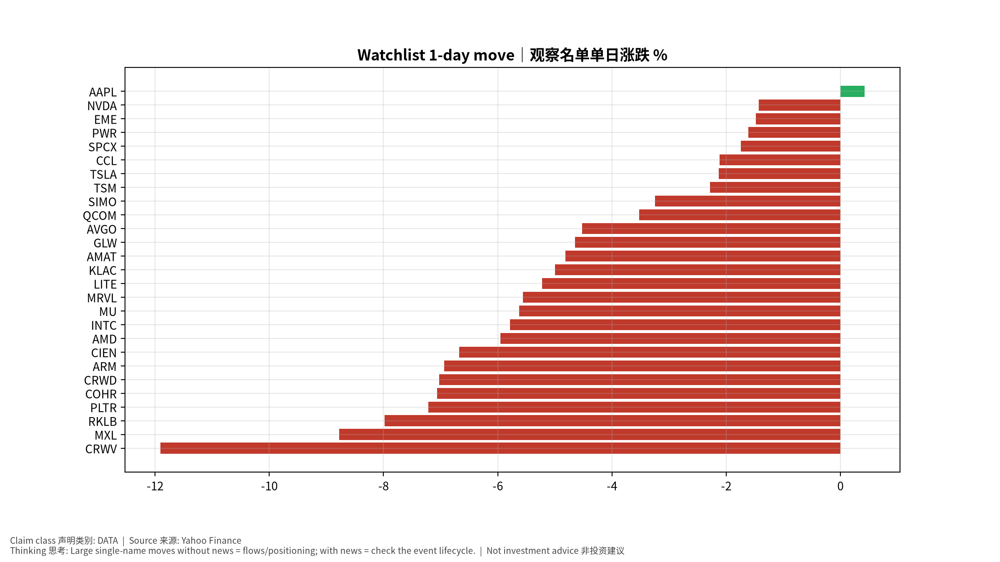
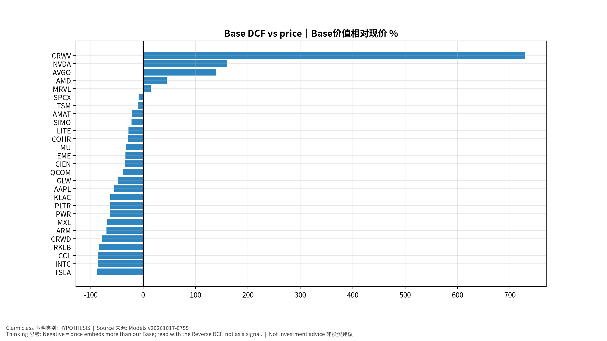

# 每日总览 Daily OS Overview — 2026-10-17 (v20261017-0755)
> 非投资建议。所有数字带来源；推断已标注。

**⏱ 30秒看懂**

1. **发生什么：**今天美国通胀(核心PCE同比 3.0%)仍高于2%目标，套息压力为 CALM，亚洲最强题材是 TW PCB 印刷电路板。
2. **和我的股票有什么关系：**通胀和利率决定高估值成长股的「折现率」；题材强弱告诉你资金正在流向哪条产业链。
3. **该看什么/做什么：**接下来最重要的事件：2026-10-21 SPCX earnings + call｜财报与电话会——事件前请读对应的发布前教学版。

**🗺 阅读地图**

| 你有多少时间 | 读哪里 |
|---|---|
| 2 分钟 | 只读「30秒看懂」。 |
| 10 分钟 | 加读 A 今日要点和 D 估值快照表（看「价格隐含增速」vs「一致预期」）。 |
| 30 分钟 | 全部，并点进宏观/雷达专题与事件书。 |

层级说明：**L1 故事**（人人能懂）→ **L2 关键数字**（带解释）→ **L3 专业细节**（网页可折叠，默认收起）。

**🧠 今日思考题（反向思考）：**今天最强的题材是 TW PCB 印刷电路板。如果它明天反转，最可能的原因是什么？你会先看哪个数据？（方法见 Academy「投研思维方法」）

## A. 今日要点 Headlines (INFERENCE)
1. 宏观: 核心PCE同比 +3.0%；套息压力 CALM；VIX 20.0。
2. 题材最强: TW PCB 印刷电路板, TW Thermal 散热, JP Power Grid 电网；最弱: KR Memory 存储, KR Power Grid 电网, JP Memory 存储。
3. 未来7天: 2026-10-21 SPCX earnings + call｜财报与电话会; 2026-10-22 TSLA earnings + call｜财报与电话会; 2026-10-23 MXL earnings + call｜财报与电话会。

## B. 宏观/利率/汇率/流动性 → 见 Macro 专题 (research/macro/v20261017-0755)
## C. 台日韩雷达 → 见 Radar (research/radar/v20261017-0755)
## D. 观察名单 27家 估值快照
| Ticker | 价格 | 1D | Bear/Base/Bull | 价格隐含Y1增速 | 一致预期FY+1 | 下次财报 |
|---|---|---|---|---|---|---|
| AAPL | $343.46 | +0.4% | $88/$156/$229 | +31.1% | +10.4% | 2026-11-03 |
| AMAT | $409.29 | -4.8% | $121/$321/$590 | +42.2% | +35.2% | 2026-11-13 |
| AMD | $528.75 | -6.0% | $162/$768/$1,919 | +62.8% | +74.8% | 2026-11-04 |
| ARM | $227.80 | -6.9% | $27/$68/$125 | +73.8% | +36.2% | 2026-11-05 |
| AVGO | $328.75 | -4.5% | $182/$788/$1,863 | +38.3% | +64.2% | 2026-12-10 |
| CCL | $25.90 | -2.1% | $-3/$4/$10 | +22.2% | +3.1% | 2026-12-18 |
| CIEN | $332.73 | -6.7% | $82/$216/$395 | +42.9% | +30.9% | 2026-09-03 |
| COHR | $232.90 | -7.1% | $43/$167/$345 | +47.6% | +38.9% | 2026-11-05 |
| CRWD | $227.39 | -7.0% | $25/$50/$81 | +68.4% | +22.8% | 2026-12-02 |
| CRWV | $61.39 | -11.9% | $-20/$509/$1,776 | +57.7% | +100.0% | 2026-11-12 |
| EME | $721.66 | -1.5% | $274/$480/$704 | +21.9% | +11.1% | 2026-10-29 |
| GLW | $132.00 | -4.6% | $28/$68/$116 | +36.3% | +19.6% | 2026-10-27 |
| INTC | $89.85 | -5.8% | $5/$12/$21 | +64.8% | +15.1% | 2026-10-30 |
| KLAC | $165.74 | -5.0% | $31/$62/$98 | +46.2% | +18.9% | 2026-10-29 |
| LITE | $824.13 | -5.2% | $160/$594/$1,320 | +67.2% | +57.0% | 2026-11-06 |
| MRVL | $227.83 | -5.6% | $61/$261/$609 | +59.1% | +63.2% | 2026-12-02 |
| MU | $878.84 | -5.6% | $330/$593/$878 | +26.8% | +15.7% | 2026-12-24 |
| MXL | $71.32 | -8.8% | $8/$23/$42 | +61.7% | +29.9% | 2026-10-23 |
| NVDA | $214.13 | -1.4% | $128/$558/$1,335 | +38.9% | +68.2% | 2026-11-18 |
| PLTR | $186.03 | -7.2% | $24/$69/$138 | +83.3% | +50.1% | 2026-11-03 |
| PWR | $631.86 | -1.6% | $103/$229/$372 | +40.9% | +15.8% | 2026-10-29 |
| QCOM | $172.11 | -3.5% | $68/$105/$139 | +17.2% | +4.7% | 2026-11-05 |
| RKLB | $50.84 | -8.0% | $4/$8/$14 | +105.0% | +38.8% | 2026-11-10 |
| SIMO | $211.30 | -3.2% | $60/$164/$300 | +36.2% | +29.6% | 2026-10-29 |
| SPCX | $146.03 | -1.7% | $20/$134/$404 | +103.1% | +100.0% | 2026-10-21 |
| TSLA | $354.72 | -2.1% | $28/$45/$63 | +78.2% | +13.5% | 2026-10-22 |
| TSM | $412.61 | -2.3% | $138/$373/$711 | +40.5% | +37.5% | 2027-01-14 |

## E. 事件生命周期状态
- US CPI 10/14: **Pre-release book ready** (events/v20261017-0755)；发布时/发布后部分待事件发生后生成。
## F. 今日教学 Teaching corner
"价格隐含增速 > 一致预期" = 市场比分析师更乐观 → 需要超预期才能维持股价。English: price-implied growth above consensus means the stock needs beats to hold.

