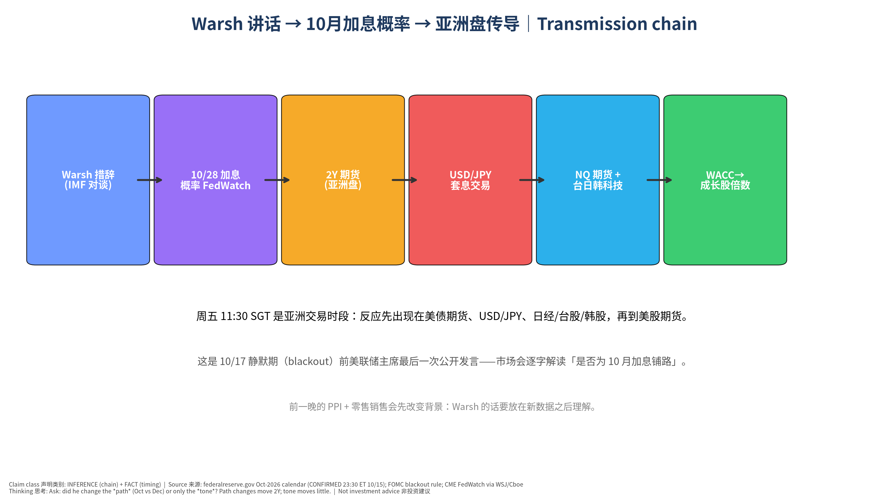
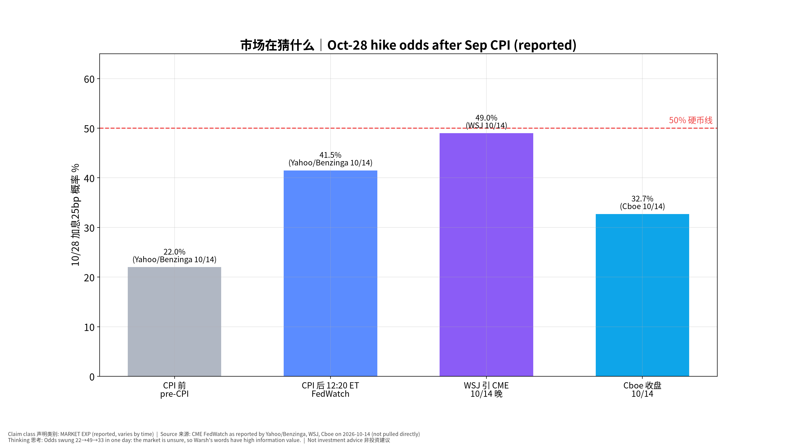
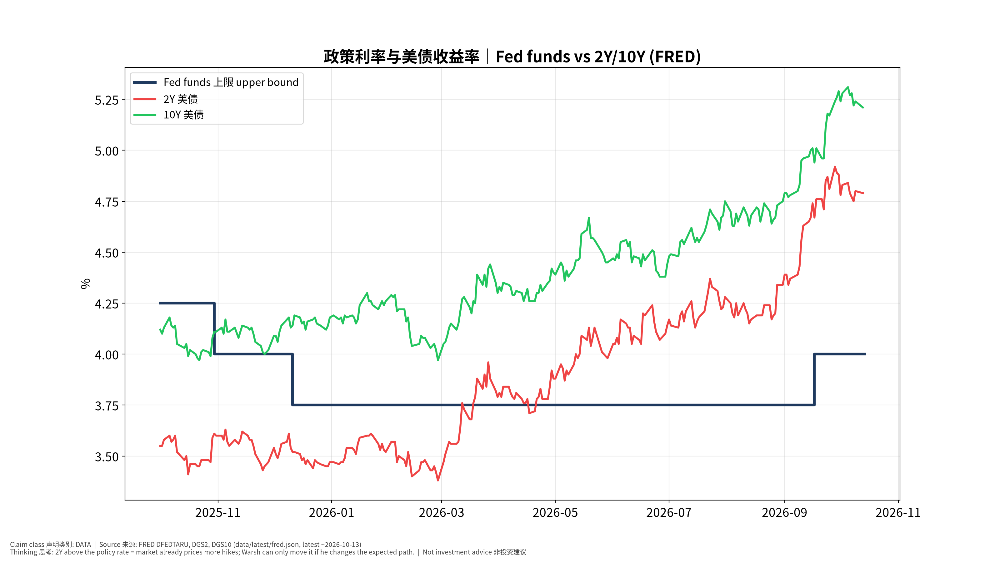

# 美联储主席 Warsh × IMF Georgieva 对谈 发布前事件书｜Fed Chair Warsh Fireside Chat Pre-Event Book — 专业中文版

> **时间：2026-10-15（周四）23:30 美东 = 2026-10-16（周五）11:30 新加坡时间 (SGT)** = 曼谷 10:30｜状态 **CONFIRMED**（federalreserve.gov 2026 年 10 月日程：「Discussion – Chairman Kevin Warsh, Fireside Chat with IMF MD Kristalina Georgieva, Bangkok」，有直播 Watch Live）
> 形式：对谈（discussion），未列主题；**是 10/27–28 FOMC 静默期（10/17 起）前主席最后一次公开亮相**（Cboe 10/14 亦指出）。
> 发布前快照锁定：**2026-10-15 18:05 SGT**（版本 v20261015-1805）。PPI、零售销售（今晚 20:30 SGT）结果出来前锁定——不得事后改写。非投资建议。

**⏱ 30秒看懂**

1. **发生什么：**明天（周五）上午 11:30 SGT，美联储主席沃什（Kevin Warsh）在曼谷与 IMF 总裁对谈——这是 10 月议息会前他最后一次公开说话。
2. **和我的股票有什么关系：**市场正在赌 10/28 会不会再加息（概率在 33–49% 之间摇摆）。他一句话就能把概率推过或拉回 50%，进而影响美债利率、日元和台日韩科技股（TSM、NVDA 供应链）。
3. **该看什么/做什么：**只听一件事：他有没有改变「10 月 vs 12 月」的路径。说「不预判」= 中性；说「通胀没有清楚且足够快地回落」= 偏鹰。

**🗺 阅读地图**

| 你有多少时间 | 读哪里 |
|---|---|
| 2 分钟 | ⏱30秒 + 图05 措辞解码器。 |
| 10 分钟 | 第1–4节 + 图01/02/03。 |
| 30 分钟 | 全文 + 思考过程 + 教学版 + 测验 + 事后作业。 |

层级说明：**L1 故事**（人人能懂）→ **L2 关键数字**（带解释）→ **L3 专业细节**（网页可折叠，默认收起）。

## 0. 背景事实 Context (FACT)
- 9/16 FOMC 一致决定加息 25bp 至 **3.75–4.00%**——三年来首次加息（Fed 发布会实录；Fortune 报道一致投票）。Warsh 原话：「I would be hard pressed to describe broad financial conditions as restrictive… So we removed a dose of accommodation.」并称「I am not going to pre-judge any future decisions」。
- 声明删除了前瞻指引；成立 5 个任务组（沟通、资产负债表、数据、生产率与就业含 AI、通胀框架），年底前后报告（TickerGrove/CNBC 报道）。
- Warsh 的加息门槛：需确信基础通胀「清楚且以足够速度」回到 2%（Jackson Hole 框架，9/16 重申「尚未满足」）。
- 中性利率：他称其「学术上有用」但对操作「没有作用」（CNBC 9/18）。
- 资产负债表 6.7 万亿美元：他长期主张缩表，但尚未落地（CNBC 9/25）。
- 9 月 CPI：+0.6% / 3.7%，核心 +0.3% / 2.6%（BLS；本系统 CPI 复盘 v20261015-0800-post）。
- 市场（MARKET EXP）：10/28 加息概率 22%（CPI 前）→ 41.5%（FedWatch 12:20 ET）→ 49%（WSJ）→ 约 32.7%（Cboe 收盘）；期货隐含 2027 年底约 4.635%（CNBC 9/18，当时值）。

## 1. 执行摘要 Executive Summary
1. **事件性质**：不是议息决定，而是对谈；但处于「数据密集 + 静默期前最后一次」的时点，信息价值高。
2. **市场在猜什么**：10 月加息是「抛硬币」；12 月加息被更大程度定价（多家机构基准：10 月按兵不动、12 月加息）。
3. **我们 (HYPOTHESIS)**：中性 50% / 偏鹰 30% / 偏鸽 20%。理由：他 9/16 明确不做前瞻指引、Cboe 评「close-to-the-vest」；但 CPI 偏热 + 「金融条件不紧」论述让偏鹰尾部 > 偏鸽尾部。基础概率：**不可得**（主席非议息会对谈的措辞分类无可靠历史样本）——如实说明，未校准。
4. **最关键的条件依赖**：今晚 PPI + 零售销售先公布。若两者都偏热，「中性」措辞也会被市场读成「不反对 10 月」→ 偏鹰反应。
5. **观察名单**：亚洲盘 TSM（台股）、SK 海力士/三星（韩股，经 MU/SIMO 映射）、日经（USD/JPY）；美股盘前 NVDA、ARM、PLTR、RKLB、CRWV、CCL（利率敏感）。

## 2. 市场定价 vs 我们 Expectation Gap
| 项目 | 市场 MARKET EXP | 来源 | 我们 HYPOTHESIS | 含义 |
|---|---|---|---|---|
| 10/28 加息 25bp 概率 | 33–49%（10/14 区间） | CME FedWatch via WSJ/Cboe/Yahoo | 讲话后大概率仍在 30–55% | 讲话大概率不「定案」 |
| 讲话基调 | 无共识（市场预期「谨慎不表态」） | Cboe 10/14 | 中性为主，偏鹰尾部 | 尾部风险不对称 |
| 12 月加息 | 被更大程度定价（Reuters 引述多家机构） | Reuters/Investing.com 10/14 | 同意 | 真正的问题是「10 月还是 12 月」 |

## 3. 情景树 Scenarios (HYPOTHESIS，未校准：无基础概率)
| 情景 | 触发措辞 | 概率 | 10月概率 | 2Y | USD/JPY | NQ/亚洲科技 |
|---|---|---|---|---|---|---|
| 偏鹰 Hawkish | 通胀未「清楚且足够快」回落；能源二次传导；金融条件仍不紧 | 30% | ≥55% | +3~+6bp | +0.3~+0.6 | −0.5~−1% |
| 中性 Neutral | 「不预判」；谈全球/IMF/独立性/AI | 50% | ±5pp | ±2bp | 持平 | 由数据/财报主导 |
| 偏鸽 Dovish | 看穿能源；已加息需看累积效果；AI 生产率压通胀 | 20% | ≤30% | −3~−6bp | −0.3~−0.6 | +0.3~+0.8% |

## 4. 盘中观察清单 Live-Observation Checklist（周五 11:30 SGT 起）
| # | 看什么 | 偏鸽 | 偏鹰 | 初学者注释 |
|---|---|---|---|---|
| 1 | 是否提到 10 月/「下次会议」 | 「不急」「看累积效应」 | 「全部选项在桌上」 | 路径信号 > 语气 |
| 2 | 通胀门槛原句 | 「取得进展」 | 「尚未清楚且足够快」 | 9/16 的加息理由 |
| 3 | 能源/汽油 | 「看穿 look through」 | 「二次传导 second-round」 | 9 月 CPI 汽油 +9.1% |
| 4 | 金融条件 | 「已收紧」 | 「仍不紧 not restrictive」 | 他的加息核心论点 |
| 5 | 2Y 期货首15分钟 | ≤−3bp | ≥+3bp | 市场对路径的投票 |
| 6 | USD/JPY | 跌 ≥0.3 | 涨 ≥0.3 | 亚洲时段最快的传导 |
| 7 | 台股 TSM / 韩股存储 | 走强 | 走弱 | 同时受 TSM 财报影响，注意归因 |
| 8 | AI 生产率 | 「供给侧利好、抑制通胀」 | 「需求侧拉动、投资过热」 | 本系统生产率模块的直接检验 |
| 9 | 资产负债表 | 不提 | 暗示加速缩表 | 影响长端 10Y 期限溢价 |

**📊 怎么看这张图**

- **坐标/颜色：**每行=一句可能出现的话 → 对应的鹰/鸽含义。
- **只记住一件事：**把措辞对应到「10 月 vs 12 月」路径，不对应到情绪。
- **什么会改变结论：**若他说了偏鹰的话但 2Y 不动，说明市场已经定价或不信。

## 5. 受影响观察名单
- **亚洲时段首先反应**：TSM（台股，叠加昨日财报）、MU/SIMO 映射的韩国存储、日经（USD/JPY 方向）。
- **利率敏感**：ARM、PLTR、RKLB、CRWV、CRWD、MRVL、TSLA。
- **AI 资本开支链**：NVDA、AVGO、AMD、EME、PWR——若谈 AI 需求侧过热，属于叙事风险（INFERENCE）。
- **消费/旅游**：CCL（利率与消费双重）。

## 6. 证伪条件 Falsifiers
1. 他明确偏鹰但 2Y 升 <2bp、10 月概率变动 <5pp → 市场已定价，或不认为主席一人能左右委员会 → 下调「主席讲话」信号权重。
2. 他只谈全球/IMF，但市场大动 → 动因是同时段的其他信息（日本数据、地缘、TSM），本书传导链当日失效。
3. 偏鸽措辞 + 10Y 上升 → 市场担心 Fed 落后于通胀（期限溢价上升）——「鸽=利好长久期」映射失效。
4. 我们中性 50% 却出现明确路径指引 → Probability Calibration 误差，复盘时记录。

## 7. 思考过程 Thinking walkthrough（七步法）
1. **先问对问题：谁在乎、为什么在乎**：谁在乎？利率交易员（10 月加息是 50/50）、日元套息交易者、成长股持有人。为什么？这是静默期前最后的信号。
2. **市场已经定价了什么**：10 月约 33–49%、12 月更高；2Y（4.79%）已高于政策利率上限 4.00%——市场已经计入「还会加」。
3. **搭因果链，每环配一个检验数据**：措辞 → FedWatch → 2Y → USD/JPY → 亚洲科技 → NQ → WACC。检验数据：FedWatch、2Y 期货、USD/JPY、TAIEX/KOSPI、NQ。
4. **找每一环的断点**：断点①他不表态（模态结果）；②主席≠委员会（Reuters：多位官员暗示 10 月不急）；③中期选举前的政治考量（UBS 称选举前加息「politically untenable」——一家观点）；④同一时段 TSM 财报余波。
5. **用工具箱逐一质疑**：见下方工具。
6. **给对立观点最强版本，再用证据裁判**：见「对立观点」。
7. **写下「如果我错了，会先看到什么」**：如果我错了，会先看到他主动提「October」或「next meeting」并给出条件。

### 反向思考 Inversion
- **是什么：**什么会让我错？
- **为什么用：**我们的模态是「中性」——反过来想，什么会让他必须表态？
- **用在本事件上：**若今晚 PPI ≥0.7% 且零售控制组 ≥0.6%，主席沉默本身就会被读成「默许 10 月加息」——此时「中性」措辞 ≈ 偏鹰结果。
- **✍ 轮到你：**如果 PPI 和零售都偏冷，同样一句「我不预判」会被市场怎么读？

### 谁在对手盘 Counterparty
- **是什么：**如果我对，谁错？
- **为什么用：**帮助判断是否已被定价。
- **用在本事件上：**押 10 月加息的一方（约 41–49%）vs 押 12 月的一方。若 Warsh 中性，押 10 月的人会逐步平仓 → 2Y 小幅回落（约 −1~−3bp）。
- **✍ 轮到你：**你能想出一个让两边都「错」的结果吗？（提示：12 月也不加）

### 第一性原理 First principles
- **是什么：**价格 = 未来现金流 ÷ 折现。
- **为什么用：**讲话不改变公司现金流，只改变折现率预期。
- **用在本事件上：**若 10 年期上升 10bp，长久期成长股的估值压力远大于公用事业型公司（EME/PWR 有合同现金流）。
- **✍ 轮到你：**对 TSLA，讲话改变的是现金流还是折现率？两者都有吗？

**我们的观点：**讲话大概率中性，不会定案 10 月；偏鹰尾部大于偏鸽尾部。

**对立观点最强版本：**
1. 他 9/16 已经用「金融条件不紧」为加息辩护；CPI 偏热后，他有动机提前给市场「打预防针」以免 10 月加息造成冲击。
2. IMF 场合他可能谈全球通胀与美元，市场会把「全球通胀风险」读成偏鹰。
3. 静默期前最后机会——历史上主席有时在此窗口校准市场预期。

| 证据 | 支持我们 | 支持对立 | 权重 |
|---|---|---|---|
| 9/16「不预判」原话、取消前瞻指引 | ✔ |  | 高 |
| Cboe 评其「close-to-the-vest」 | ✔ |  | 中 |
| CPI 偏热、10 月概率飙升 |  | ✔ | 中 |
| 多位官员称 10 月不急（Reuters 引述） | ✔ |  | 中 |

**裁判：**证据仍支持「中性为主」，但偏鹰尾部 30% 合理；若今晚数据双热，我们会把偏鹰情景视为更可能——但**快照不改写**，只在复盘中记录。

## 8. 最终自我质疑 Final Self-Challenge
- 「中性 50%」是否只是逃避判断？基础概率不可得，这个数字是主观的——复盘时检验是否偏离过大。
- 我们可能过度重视主席个人：FOMC 是委员会投票，市场也知道。
- 亚洲时段流动性较低，首 15 分钟的 2Y 期货/USD/JPY 可能夸大反应；以美股开盘后为二次确认。

## 9. Source Ledger
| 来源 | 日期 | 用途 | 类别 |
|---|---|---|---|
| federalreserve.gov/newsevents/2026-october.htm | 查证 2026-10-15 | 时间 CONFIRMED（23:30 ET） | FACT |
| Fed 9/16 发布会实录 FOMCpresconf20260916.pdf | 2026-09-16 | 原话、加息至 3.75–4.00% | FACT |
| CNBC 9/18、9/25；TickerGrove 9/16 | 2026-09 | 中性利率、任务组、缩表 | 报道（二手） |
| Yahoo/Benzinga、WSJ、Cboe、Reuters/Investing.com | 2026-10-14 | 10 月加息概率、机构观点 | MARKET EXP / Analyst |
| Capital Finance Bureau / Kiplinger | 2026-10-14 | 本周美联储讲话日程 | 报道 |
| FRED DFEDTARU/DGS2/DGS10 | data/latest | 利率图 | DATA |

## 10. Assumption Register
1. 静默期 10/17 开始（FOMC 规则：会议前第二个周六），本讲话为会前主席最后一次（ASSUMPTION，与 Cboe 表述一致）。
2. 情景概率为主观（HYPOTHESIS），基础概率不可得，未校准。
3. 亚洲时段反应可在美股开盘时部分逆转（HYPOTHESIS）。
4. 反应幅度为数量级示意（HYPOTHESIS）。

## 11. Model Provenance
Builder `pipeline/build_1015_pre.py`；版本 v20261015-1805；与零售书同一批锁定，均在 20:30 SGT 数据公布之前。

## 图表 Charts

**📊 怎么看这张图**

- **坐标/颜色：**每根柱=不同时点/来源报道的 10 月加息概率；红虚线=50%。
- **只记住一件事：**一天内从 22% 摆到 49% 再回 33%——市场很不确定，所以讲话有信息价值。
- **什么会改变结论：**若讲话后概率稳定在 >55% 或 <25%，说明他给了路径信号。

**📊 怎么看这张图**

- **坐标/颜色：**深蓝阶梯=政策利率上限；红=2年期；绿=10年期。
- **只记住一件事：**2 年期高于政策利率 → 市场已预期继续加息。
- **什么会改变结论：**若讲话后 2 年期跌回 4.00% 附近，说明市场放弃「再加」。

## 12. 事后作业 Post-event homework（不改本书）
| 环节 | 成立/断开 | 证据 | 学到什么 |
|---|---|---|---|
| ①措辞→10月加息概率 | ____ | ____ | ____ |
| ②→2年期期货 | ____ | ____ | ____ |
| ③→USD/JPY | ____ | ____ | ____ |
| ④→台日韩科技/NQ | ____ | ____ | ____ |
| ⑤→美股利率敏感股 | ____ | ____ | ____ |

