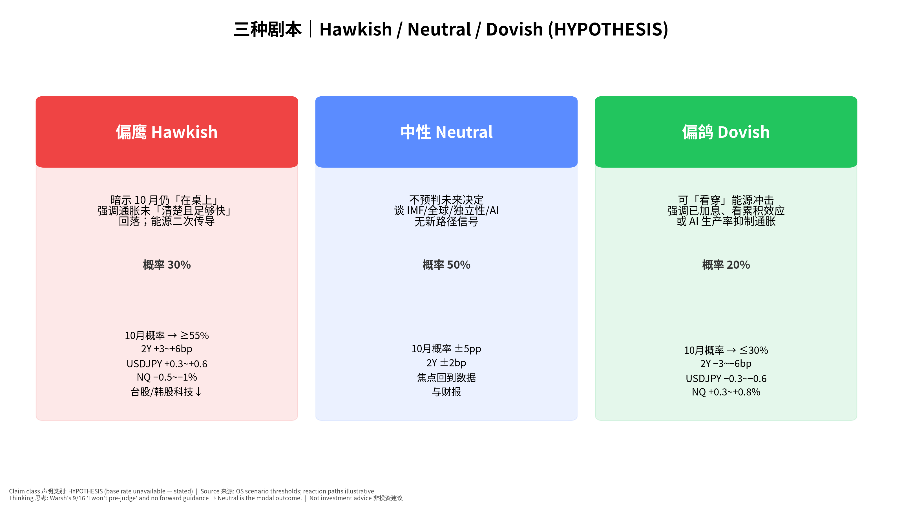
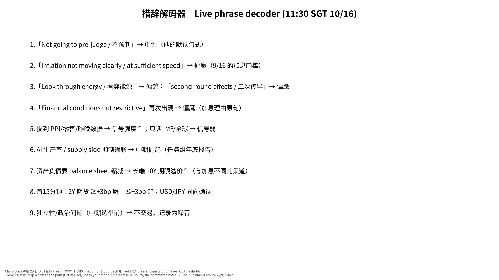

# Warsh 讲话 发布前·教学版｜v20261015-1805

> 时间：**2026-10-16（周五）11:30 SGT**。非投资建议。

**⏱ 30秒看懂**

1. **发生什么：**美联储主席沃什明天上午在曼谷和 IMF 总裁聊天，这是 10 月底开会前他最后一次公开说话。
2. **和我的股票有什么关系：**市场在猜美联储 10/28 会不会再加息（大约一半一半）。他的话会让美债利率、日元、台股/美股科技股马上动起来。
3. **该看什么/做什么：**只听他有没有说「下次会议」或「通胀还不够快回落」——前者给路径，后者偏鹰；只说「不预判」就是中性。

**🗺 阅读地图**

| 你有多少时间 | 读哪里 |
|---|---|
| 2 分钟 | 30秒 + 图05 措辞解码器。 |
| 10 分钟 | 专业版第1–4节。 |
| 30 分钟 | 全文 + 测验。 |

层级说明：**L1 故事**（人人能懂）→ **L2 关键数字**（带解释）→ **L3 专业细节**（网页可折叠，默认收起）。

## 1. 为什么一次「聊天」也重要（L1）
美联储开会前约 10 天会进入「静默期」，官员不再公开谈政策。所以静默期前的最后一次讲话，就像董事会开会前 CEO 最后一次对外表态——大家会逐字解读。

## 2. 鹰 vs 鸽（L2）
- **鹰 Hawkish**：更想加息/保持高利率来压通胀。
- **鸽 Dovish**：更愿意等、担心经济被压坏。
- 他 9 月说「移除一剂宽松」——意思是：现在的利率其实还不算紧，所以加一点是「把油门松一点」，不是「踩刹车」。

**数字例题**：2 年期美债收益率 4.79% 高于政策利率上限 4.00%。差约 0.79 个百分点 ≈ 市场预期未来两年平均还要再加约 3.2 次 25bp（粗略估算，忽略期限溢价）。如果他偏鹰，这个差会变大。

## 3. 三种剧本

**📊 怎么看这张图**

- **坐标/颜色：**红=偏鹰，蓝=中性，绿=偏鸽；方框下部=市场可能反应。
- **只记住一件事：**最可能是中性：他习惯「不预判」。
- **什么会改变结论：**如果今晚通胀和消费数据都很热，中性的话也可能被当作偏鹰。

## 4. 怎么听

**✅ 自我测验 Check your understanding**

Q1. 他说「我不会预判未来决定」，这是鹰还是鸽？

**答案：**中性——这是他的默认句式；要看后面有没有给出条件。

Q2. 为什么周五上午讲话先影响日元和台股，而不是美股？

**答案：**11:30 SGT 是亚洲交易时段，美股还没开盘；最先动的是美债期货、USD/JPY 和亚洲股市。

Q3. 他偏鹰但 2 年期利率不动，说明什么？

**答案：**市场已经定价，或者不认为主席一人能决定委员会投票。

## 术语
| 术语 | 白话 | English | 比喻 |
|---|---|---|---|
| 静默期 | 开会前官员不公开谈政策 | blackout period | 财报前公司的静默期 |
| 鹰/鸽 | 偏紧/偏松 | hawkish / dovish | 偏保守/偏进取的财务总监 |
| 前瞻指引 | 央行提前暗示未来动作 | forward guidance | 提前给市场的「业绩指引」 |
| FedWatch | 用期货价格算出的加息概率 | CME FedWatch | 博彩赔率换算成概率 |
| 套息交易 | 借低息日元买高息资产 | carry trade | 借便宜的钱投贵的项目 |
