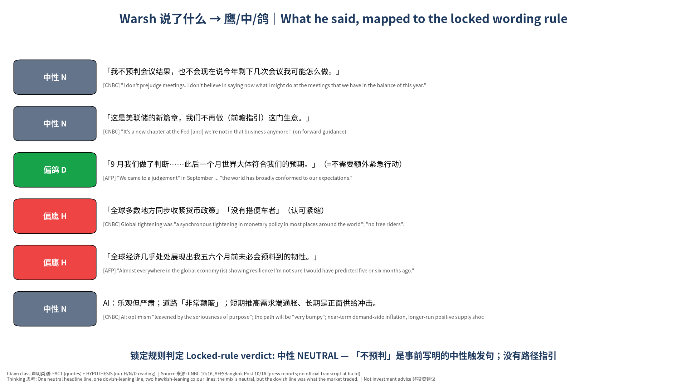
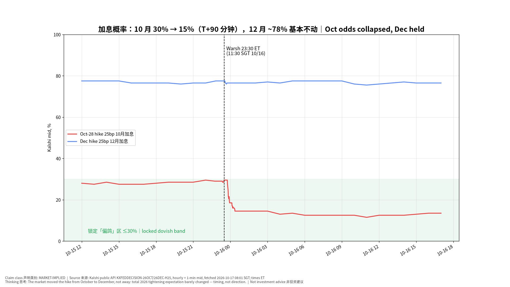
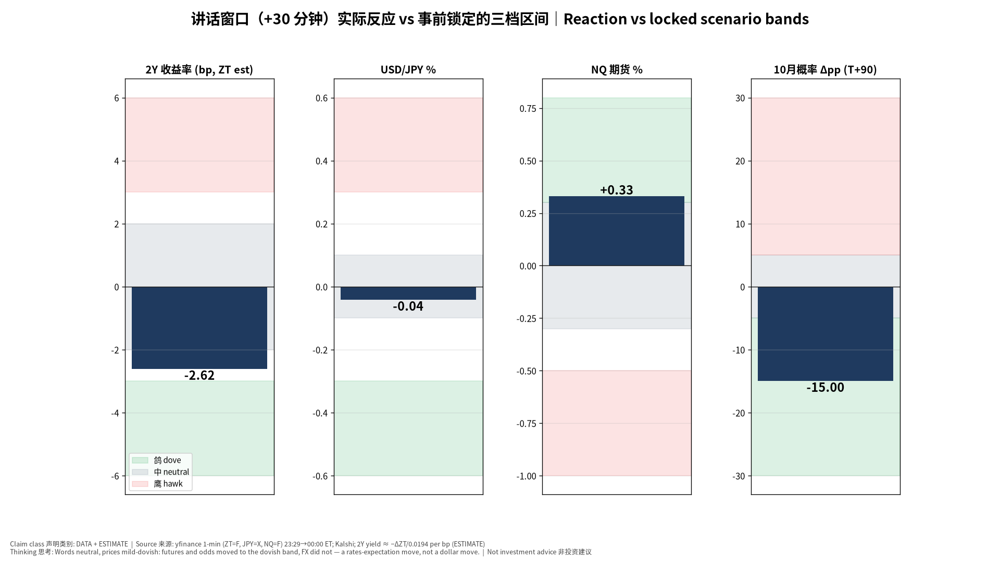
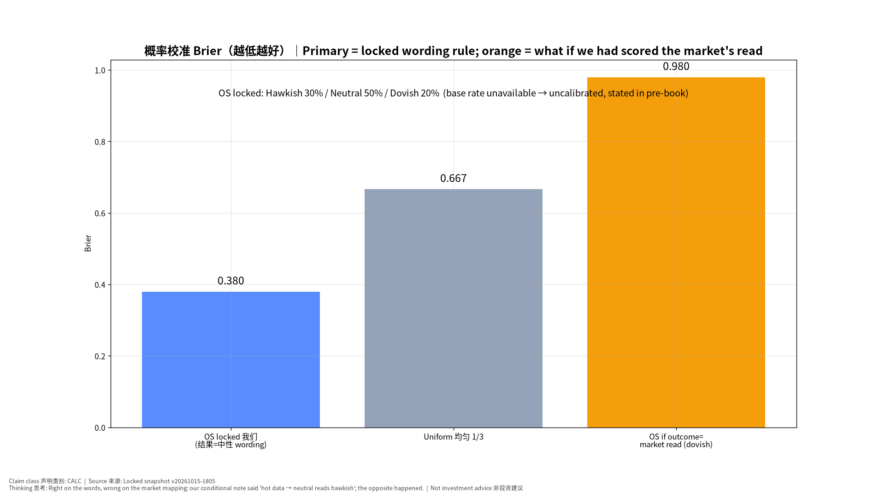
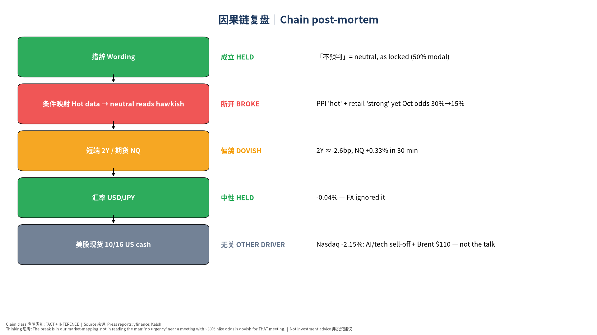

# Warsh × IMF 对谈 事后复盘｜Fed Chair Warsh at IMF (Bangkok) Post-Event Book

> 版本 v20261017-0801-post｜生成 2026-10-17 08:01 SGT｜基于锁定事前书 **v20261015-1805**（完整性校验通过，未改写）｜事件：2026-10-16 11:30 SGT（10/15 23:30 ET）｜CONFIRMED｜非投资建议 Not investment advice
> 说明：本书比讲话晚约 44 小时——讲话在新加坡上午，不在「美股早盘即时复盘」的时间窗内，日报补做。官方逐字稿未发布，引语来自 CNBC、法新社/曼谷邮报报道（二手，已注明）。

**⏱ 30秒看懂**

1. **发生什么：**美联储主席 Warsh 在曼谷 IMF 年会对谈中**拒绝给出 10 月是否加息的信号**（「我不预判会议」），称 9 月加息后「世界大体符合我们的预期」，并认可全球「同步紧缩」。
2. **和我的股票有什么关系：**按事前锁定的措辞规则，这是 **中性**（我们给了 50%，最可能情景）。但市场把它读成「10 月不急」：Kalshi 10 月加息概率 **30% → 15%**（讲话后 90 分钟），12 月加息概率仍约 78%——加息被**推迟**而不是取消。纳指期货 30 分钟内 +0.33%。
3. **该看什么/做什么：**当天晚上美股大跌（纳指 −2.15%）与讲话无关，主因是 AI/科技股抛售与布伦特原油触及 110 美元。接下来盯：10/27–28 FOMC；我们的教训——「主席不表态」在加息概率不低时 = 对那次会议偏鸽。

**🗺 阅读地图**

| 你有多少时间 | 读哪里 |
|---|---|
| 2 分钟 | ⏱30秒 + 图2（加息概率路径） |
| 10 分钟 | 加读 §1 说了什么、§2 市场反应、§4 我们错在哪 |
| 30 分钟 | 全读，含 §5 对估值的影响、§6 对立观点、§8–10 来源/假设/模型来源、自我测验 |

层级说明：**L1 故事**（人人能懂）→ **L2 关键数字**（带解释）→ **L3 专业细节**（网页可折叠，默认收起）。

## 1. 他说了什么｜What he said（事实 FACT，二手报道）
| 原话（中文意译） | 来源 | 我们的读法 HYPOTHESIS |
|---|---|---|
| 「我不预判会议结果，也不会现在说今年剩下几次会议我可能怎么做。」 | CNBC | 中性 |
| 「这是美联储的新篇章，我们不再做（前瞻指引）这门生意。」 | CNBC | 中性 |
| 「9 月我们做了判断……此后一个月世界大体符合我们的预期。」（=不需要额外紧急行动） | AFP | 偏鸽 |
| 「全球多数地方同步收紧货币政策」「没有搭便车者」（认可紧缩） | CNBC | 偏鹰 |
| 「全球经济几乎处处展现出我五六个月前未必会预料到的韧性。」 | AFP | 偏鹰 |
| AI：乐观但严肃；道路「非常颠簸」；短期推高需求端通胀、长期是正面供给冲击。 | CNBC | 中性 |

**同场与市场解读（MARKET/THIRD-PARTY）：**
- Goldman Sachs (Hatzius) note via CNBC: Warsh's comments, alongside other FOMC participants, "indicate that the FOMC is set to pause in October"; still expects a second and final hike in December.（CNBC）
- CME FedWatch 72.3% probability of no change at Oct 27–28 (CNBC, updated 10/16 08:36 ET).（CNBC）
- IMF MD Georgieva (same day): central banks should be "laser focused on price stability"; IMF supports the recent tightening by the Fed, ECB and BOJ; US/German/Japanese 10Y yields recently at highest since 2002/2009/1996.（IMF）

**锁定规则判定：中性 NEUTRAL。** Opening quote is the locked neutral trigger (「不预判」) and no path guidance was given; no 'not falling clearly/fast enough' (hawk trigger) and no look-through-energy (dove trigger) language reported.

**📊 怎么看这张图**

- **坐标/颜色：**每一行是一句报道中的原话；左边色块=我们按事前规则的读法（红=偏鹰，灰=中性，绿=偏鸽）。
- **只记住一件事：**开场就是事前写好的中性触发句「不预判」，所以整体判中性。
- **什么会改变结论：**如果官方逐字稿出现「通胀没有清楚且足够快地回落」之类原话，判定要改为偏鹰（会在下一版注明，不改本书）。

## 2. 市场反应｜Market Reaction（DATA + ESTIMATE）
### 2a. 加息概率（Kalshi，MARKET-IMPLIED）
| 合约 | 讲话前 23:29 ET | 00:00 ET | 01:00 ET | 10/16 16:00 ET | 最新 |
|---|---|---|---|---|---|
| 10/28 会议加息 25bp | 0.295 | 0.185 | 0.14500000000000002 | 0.135 | 0.13 |
| 12 月会议加息 25bp | 0.775 | | | 0.765 | 0.76 |

10 月「维持利率」合约最新 0.87（≈87%）；CME FedWatch 同日 72.3% 维持（CNBC 10/16 08:36 ET）。两个来源一致：**10 月暂停成为主流**。

**📊 怎么看这张图**

- **坐标/颜色：**红线=10 月加息合约价格（≈概率），蓝线=12 月；黑虚线=讲话开始。
- **只记住一件事：**红线在讲话那一小时从约 30% 掉到约 19%，之后一路滑到 13% 左右；蓝线几乎不动。
- **什么会改变结论：**如果 10/27 前公布的数据（如初请失业金、PMI）大幅偏热，红线会重新抬头——那说明市场的「推迟」判断被数据推翻。

### 2b. 讲话窗口（亚洲时段）各资产变化
| 资产（2Y 为 bp 估算，其余 %） | +15 分钟 | +30 分钟 | +60 分钟 | +4 小时 |
|---|---|---|---|---|
| ZT=F | -1.01 | -2.62 | -1.61 | -2.82 |
| JPY=X | +0.00 | -0.04 | -0.06 | -0.03 |
| NQ=F | +0.09 | +0.33 | +0.25 | +0.20 |
| ES=F | +0.05 | +0.17 | +0.15 | +0.10 |
| DX-Y.NYB | -0.01 | -0.15 | -0.11 | -0.21 |
| GC=F | +0.02 | +0.31 | +0.21 | +0.44 |
| CL=F | -0.08 | -0.19 | -0.08 | +0.04 |

| 变量（对照锁定区间） | 落在哪档 |
|---|---|
| Oct odds 10月概率 (level after) | dovish |
| 2Y (bp, +30m) | neutral |
| USD/JPY (% , +30m) | neutral |
| NQ fut (% , +30m) | dovish |

**📊 怎么看这张图**

- **坐标/颜色：**每个小图一个资产；三种底色=我们事前锁定的鸽/中/鹰区间；深蓝柱=实际变化。
- **只记住一件事：**利率期货、纳指期货和加息概率都落在「偏鸽」一侧，只有日元没动。
- **什么会改变结论：**如果当晚美股开盘后 2Y 反向大涨，说明亚洲时段的反应只是流动性稀薄的噪音。

### 2c. 10/16 美股现货（背景，**不归因于讲话**）
| 标的 | 10/15 收盘 | 10/16 收盘 | 变化（%；TNX 为 bp；VIX 为点） |
|---|---|---|---|
| ^GSPC | 7744.06005859375 | 7659.43994140625 | -1.09 |
| ^IXIC | 26713.029296875 | 26140.033203125 | -2.15 |
| ^NDX | 29935.599609375 | 29187.548828125 | -2.50 |
| ^SOX | 11581.2099609375 | 11137.287109375 | -3.83 |
| ^DJI | 52177.69140625 | 52002.41015625 | -0.34 |
| ^VIX | 16.459999084472656 | 19.989999771118164 | +3.53 |
| ^TNX | 5.089000225067139 | 5.0980000495910645 | +0.90 |
| CL=F | 97.97000122070312 | 99.04000091552734 | +1.09 |
| BZ=F | 105.91999816894531 | 109.69000244140625 | +3.56 |
| JPY=X | 157.95700073242188 | 157.98699951171875 | +0.02 |
| NVDA | 217.22999572753906 | — | — |
| AMD | 562.22998046875 | — | — |
| CRWV | 69.69000244140625 | — | — |
| TSLA | 362.44000244140625 | — | — |
| MU | 931.239990234375 | — | — |
| TSM | 422.25 | — | — |

报道（AP / Yahoo Finance 10/16）：标普 −1.1% 收 7,659.44，纳指 −2.1% 收 26,140.03，道指 −0.34%；全周纳指 −4.5%、标普 −1.95%，为 6 月下旬以来最差一周；布伦特原油盘中触及 110 美元（5 月以来首次，霍尔木兹海峡局势升级）；CoreWeave 因债务担忧再度承压。**标题驱动 vs 基本面**：讲话造成的是「利率预期」小幅鸽派移动；当晚股价下跌的主角是 AI 交易去拥挤 + 油价，两者方向相反——这正是要分开看的原因。

## 3. 分类与校准｜Classification & Calibration
- 锁定规则 → **中性**。Brier：我们 0.380，均匀猜测 0.667 → **比均匀猜测好**（模态情景命中）。
- 但如果按「市场怎么读」打分（偏鸽），我们的 Brier 是 0.980——比均匀还差。这说明：**我们读懂了人，没读懂市场会怎么解读他。**
- 误差类别：**Market-Reaction（市场反应）误差**为主。事前书写了条件判断「若 PPI 和零售都偏热，中性措辞会被读成偏鹰」——实际 PPI 判「hot」、零售判「strong」，条件成立，但市场读成了偏鸽。

**📊 怎么看这张图**

- **坐标/颜色：**蓝=我们按锁定规则的得分，灰=每档 1/3 的瞎猜，橙=如果按市场解读打分。
- **只记住一件事：**措辞判断对了（蓝柱低），但市场映射错了（橙柱高）。
- **什么会改变结论：**官方逐字稿若改变措辞判定，蓝/橙会互换。

## 4. 我们错在哪 & 为什么｜Post-mortem

**📊 怎么看这张图**

- **坐标/颜色：**从上到下是我们事前写的传导链；颜色=这一环成立（绿）/断开（红）/偏离（橙）/另有主因（灰）。
- **只记住一件事：**断在第二环：我们以为「热数据 + 不表态」= 默许 10 月加息。
- **什么会改变结论：**如果 10 月真的加息，那么断的是市场而不是我们——到时在 FOMC 复盘里改判。

**根因（INFERENCE）：**
1. **离会议只剩 12 天、概率约 30% 时，「不急」本身就是信息。** 不做前瞻指引的主席不会主动给鹰派信号；没有鹰派信号 → 押 10 月加息的人平仓。我们把「沉默」当成了「默许」。
2. **「世界大体符合我们 9 月的预期」= 9 月的路径还有效**——而 9 月路径是「12 月再加一次」，不是「10 月」。这句话我们事前没有列入词典。
3. **其他 FOMC 官员近期讲话**（高盛报告提及）已在铺垫 10 月暂停；我们的事前书没有汇总其他官员的言论（盲点）。
4. 「认可全球同步紧缩」听起来偏鹰，但它说的是**过去**，市场交易的是**下一次会议**。

**模型修正（Model Recalibration）：**
- 新增观察区候选（Observation Zone — Candidate）：「无前瞻指引型主席，在会前 ≤2 周、加息概率 20–45% 时的中性措辞 → 该会议概率向暂停衰减」。需 ≥3 个样本再升级为规则。
- 央行讲话事前书增加：①其他官员近 2 周言论汇总；②「回顾上次决策是否仍成立」类措辞的鸽/鹰词典条目。
- 不改写事前概率；不因一次结果调整基础概率（本事件无可靠基础概率）。

## 5. 对估值与组合的影响｜Valuation impact
- **无公司层面重大信息 → 27 家公司模型不做估值修正**（No Material Information = No Forced Update）。
- 利率路径：市场从「10 月+12 月」转为「12 月为主」，全年紧缩幅度大致不变 → 折现率 / WACC 假设不变。10Y 当日收在约 5.0980000495910645%（10/16 收盘），仍在高位，长久期科技股的估值压力来自长端利率与油价，而非这次讲话。
- 日元：USD/JPY 约 158，讲话未改变 Fed–BOJ 利差叙事；IMF 同时点名支持 BOJ 收紧——日元**速度**仍是全球流动性观察重点。

## 6. 对立观点（最强版本）与裁判
**我们的观点：**讲话中性，市场的鸽派解读是对「沉默」的合理定价，10 月大概率暂停。

**对立观点最强版本：**
1. 他明确认可全球同步紧缩、说经济「有韧性」——这是鹰派底色，市场低估了 10 月加息的可能。
2. 9 月 CPI 3.7%、PPI 偏热，数据依赖的主席面对热数据，不表态恰恰是为加息留后路。
3. Kalshi 夜间流动性薄，亚洲时段的移动可能被少数交易者放大。

| 证据 | 支持我们 | 支持对立 | 权重 |
|---|---|---|---|
| Kalshi 10 月概率 30%→13% 且持续到收盘 | ✔ |  | 高 |
| CME FedWatch 72.3% 维持（独立来源） | ✔ |  | 高 |
| 高盛：10 月暂停、12 月再加 | ✔ |  | 中 |
| 「韧性」「同步紧缩」原话 |  | ✔ | 中 |
| 9 月 CPI/PPI 偏热 |  | ✔ | 中 |
| 日元未动 |  | ✔ | 低 |

**裁判：**证据偏向我们：两个独立的市场价格来源 + 卖方解读一致，且移动持续一整天而非夜盘噪音。但对立观点的第 2 点仍有效——10/27 前若数据继续偏热，10 月加息概率可能回升，这是本结论的主要风险。

## 7. 接下来看什么｜Watch next
1. **10/27–28 FOMC（CONFIRMED）**：结果 + 声明对 12 月的措辞——将另立事前书。
2. 会前数据：初请失业金（每周四）、10 月标普全球 PMI（TENTATIVE 日期以官方日历为准）。
3. 其他 FOMC 官员讲话——尤其投票委员是否反驳「10 月暂停」。
4. 原油：布伦特 \$110 若持续，能源二次传导是让 10 月概率回升的最可能路径。

## 8. 来源台账｜Source Ledger
| 内容 | 来源 | 类别 | 时间 |
|---|---|---|---|
| 讲话引语（不预判、新篇章、同步紧缩、AI 颠簸） | [CNBC](https://www.cnbc.com/2026/10/16/feds-warsh-says-ai-development-path-will-be-very-bumpy-.html) | FACT（报道） | 2026-10-16 |
| 讲话引语（韧性、世界符合预期） | [AFP / Bangkok Post](https://www.bangkokpost.com/world/3338205/feds-warsh-surprised-by-world-economys-resilience) | FACT（报道） | 2026-10-16 |
| 讲话要点 | [WSJ](https://www.wsj.com/economy/central-banking/kevin-warsh-fed-chair-imf-speech-62c97df8)、[AP](https://apnews.com/article/us-economy-warsh-fed-ai-imf-4c80750c113a82a464a46f58a4fdab43) | FACT（报道） | 2026-10-16 |
| Georgieva 全会讲话 | [IMF](https://www.imf.org/en/news/articles/2026/10/16/101626-managing-director-annual-meetings-plenary) | FACT（一手） | 2026-10-16 |
| 高盛解读、CME FedWatch 72.3% | [CNBC](https://www.cnbc.com/2026/10/16/feds-warsh-says-ai-development-path-will-be-very-bumpy-.html) | MARKET / THIRD-PARTY | 2026-10-16 08:36 ET |
| 10/16 美股收盘与周度表现、油价 | [AP](https://apnews.com/article/stocks-markets-us-ai-oil-tech-warsh-d2655f64db7ec8ae450525d58f97b628)、[Yahoo Finance](https://finance.yahoo.com/markets/live/stock-market-today-dow-sp-500-nasdaq-futures-mixed-amid-volatile-week-112939401.html) | FACT（报道） | 2026-10-16 |
| Kalshi 合约路径 | api.elections.kalshi.com 公共 API | MARKET-IMPLIED | 2026-10-17 08:01 SGT |
| 期货/外汇 1 分钟、日收盘 | yfinance | DATA | 2026-10-17 08:01 SGT |
| 事前预期 | 锁定事前书 v20261015-1805 | HYPOTHESIS | 2026-10-15T18:05:53.902945+08:00 |

## 9. 假设登记｜Assumption Register
| # | 假设 | 类型 | 如何检验 / 失效 |
|---|---|---|---|
| 1 | 报道引语准确代表讲话 | ASSUMPTION | 官方逐字稿/视频发布后核对 |
| 2 | 2Y ≈ −ΔZT ÷ 0.0194/bp | ESTIMATE | 与现货 2Y 相差 >3bp 时以现货为准 |
| 3 | Kalshi 中间价 ≈ 市场概率 | ASSUMPTION | 价差 >5c 或成交稀薄时不可靠 |
| 4 | 10 月概率下降主要由讲话引起 | INFERENCE | 若同一小时有其他官员/数据消息则失效 |
| 5 | 10/16 美股下跌与讲话无关 | INFERENCE | 若 2Y 当日大涨则需重新归因 |

## 10. 模型来源｜Model Provenance
构建脚本 `pipeline/build_warsh_post.py`；事前快照 `v20261015-1805`（只读）；Excel 含实时公式（措辞判定计数、Brier、窗口变化、Kalshi 变化）；规则：锁定事前书 §0/§3 措辞规则与区间。

**✅ 自我测验 Check your understanding**

Q1. Warsh 什么方向都没表态，为什么 10 月加息概率会大跌？

**答案：**因为离会议只有 12 天、概率约 30%：押加息的人需要主席「点头」才能坚持；他不点头且说「世界符合 9 月预期」（9 月路径是 12 月加息），所以他们平仓，概率从 30% 掉到 15% 左右。

Q2. 12 月加息概率几乎不变，说明什么？

**答案：**市场不是认为 Fed 变鸽了，而是把加息从 10 月挪到 12 月——时间点变了，方向没变。

Q3. 当晚纳指跌 2%，能说是 Warsh 讲话导致的吗？

**答案：**不能。讲话在 12 小时前、方向是利率预期偏鸽（对股票偏利好）；当晚的下跌来自 AI/科技抛售与布伦特 110 美元。把两件事混在一起就是「标题驱动」错误。

**✍ 事后作业**：打开 Excel「Calibration」表，把 Outcome 从 neutral 改成 dovish，看我们的 Brier 怎么变；再想一想：如果事前你会怎么给概率？

## Final Self-Challenge
我们说「市场读成偏鸽」——但如果 10/28 真的加息，那今天的「推迟」只是市场的错误，我们的措辞判断和条件映射反而是对的。所以本书的「市场映射误差」结论要等 FOMC 之后才算最终确认；在那之前，它是 **INFERENCE**，不是事实。

- 构建日志：pre-event integrity (v20261015-1805): 32/32 files match manifest sha256 — lock intact, not rewritten
- 构建日志：Kalshi Oct hike 25bp: pre(23:29 ET) 0.295 → 00:00 0.185 → 01:00 0.14500000000000002 → 16:00 0.135 (last 0.13); Dec hike pre 0.775 → close 0.765
- 构建日志：window +30m: 2Y(ZT est) -2.62bp, USD/JPY -0.042%, NQ 0.33%; Oct odds T+90 -15.0pp
- 构建日志：market-reaction buckets: {'Oct odds 10月概率 (level after)': 'dovish', '2Y (bp, +30m)': 'neutral', 'USD/JPY (% , +30m)': 'neutral', 'NQ fut (% , +30m)': 'dovish'}
- 构建日志：Excel recalc: Brier OS=0.38; Kalshi band=dovish band; errors=none
