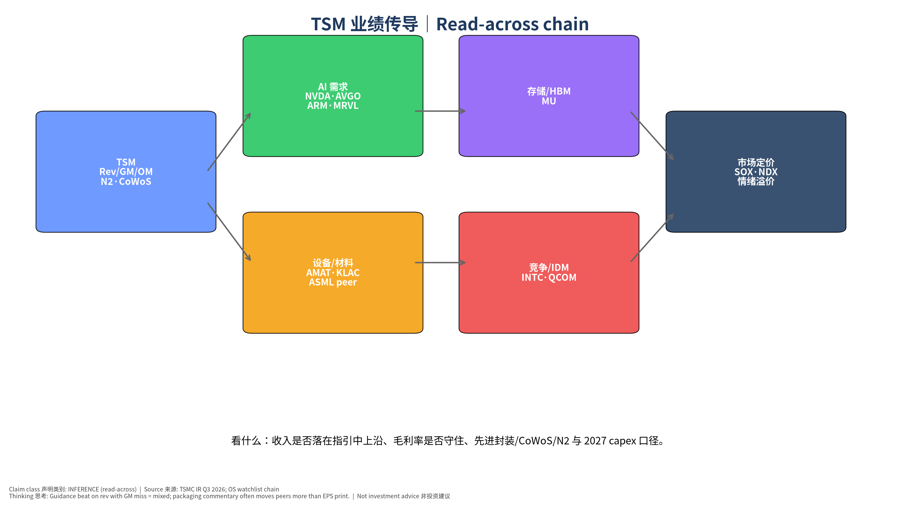
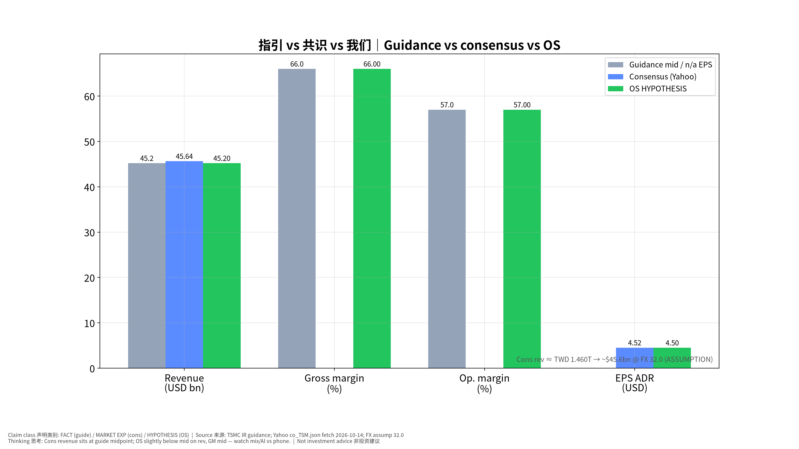
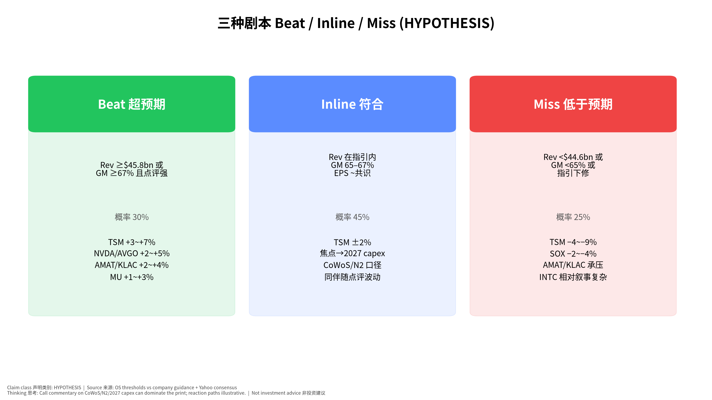
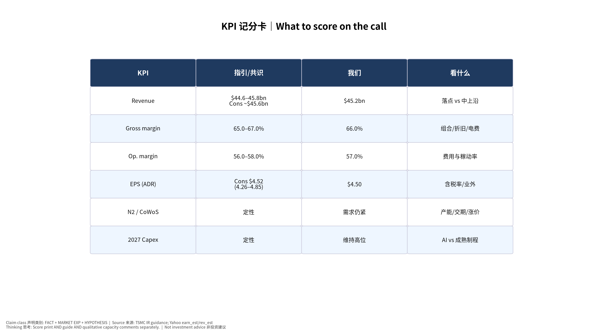
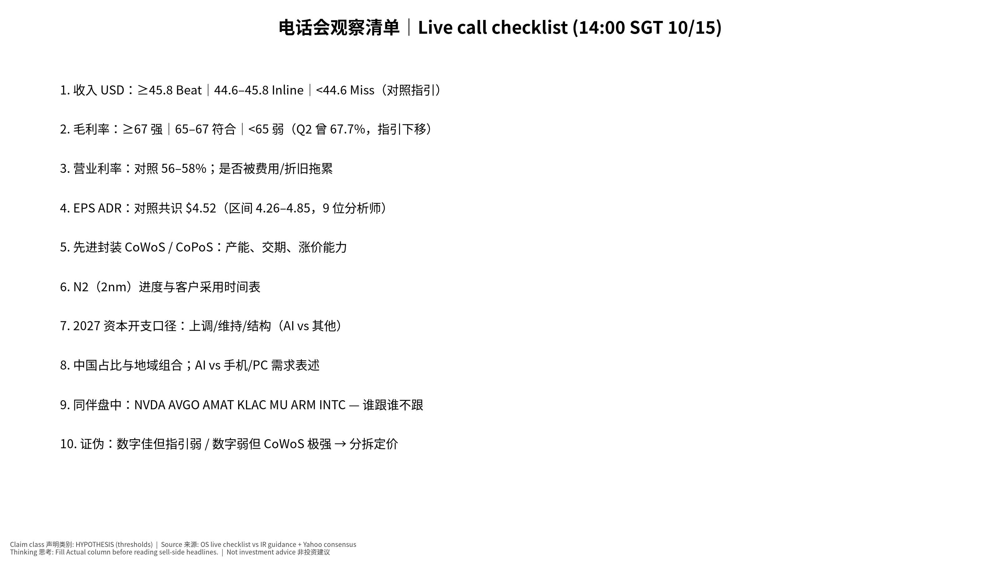

# 台积电 TSM Q3 2026 发布前事件书｜TSMC Earnings Pre-Event Book

> **电话会：2026-10-15（周四）14:00 台湾时间 = 14:00 新加坡时间 (SGT) = 02:00 ET**｜状态 **CONFIRMED**（[TSMC IR Q3 2026](https://investor.tsmc.com/english/quarterly-results/2026/q3)）
> 静默期 Quiet period：10/5–10/14（电话会前结束）。快照锁定 **2026-10-14 18:06 SGT**（v20261014-1806）。非投资建议。

**⏱ 30秒看懂**

1. **发生什么：**明天下午 14:00 SGT 台积电开季报电话会（已确认，不再是 Yahoo 上的待定）。
2. **和我的股票有什么关系：**数字看收入/毛利率是否落在指引内；更重要的是 CoWoS/N2 与 2027 资本开支口径——会牵动 NVDA、AVGO、AMAT、KLAC、MU 等观察名单。
3. **该看什么/做什么：**对照：指引收入 $44.6–45.8bn、毛利率 65–67%；共识 EPS 约 $4.52、收入约合 $45.6bn。先填清单再听点评。

**🗺 阅读地图**

| 你有多少时间 | 读哪里 |
|---|---|
| 2 分钟 | 30秒 + 情景表 + 第4节清单。 |
| 10 分钟 | 第1–3、5节 + 图01/02。 |
| 30 分钟 | 全文教学 + 证伪 + 同伴归因。 |

层级说明：**L1 故事**（人人能懂）→ **L2 关键数字**（带解释）→ **L3 专业细节**（网页可折叠，默认收起）。

## 1. 执行摘要
1. **公司指引 (FACT / Management Guidance)**：Q3 收入 **US$44.6–45.8bn**（FX 假设 USD/NTD **32.0**），毛利率 **65.0–67.0%**，营业利率 **56.0–58.0%**。Q2 实际：收入 40.20bn、GM 67.7%、OM 60.3%。
2. **共识 (MARKET EXP, Yahoo `co_TSM.json` 2026-10-14)**：EPS ADR 均 **$4.524**（低 4.26 / 高 4.85，9 位）；收入均 **TWD 1.460T**（28 位）≈ **US$45.6bn @ 32**（指引中枢附近）；同比增速约 **47.5%**。Year-ago EPS 2.92。现价约 **$445.12**。
3. **交叉核对**：MarketBeat/Yahoo 量级 EPS ~4.45–4.52、收入 ~$45.3–45.7bn（MARKET EXP cross-check）。
4. **我们 (HYPOTHESIS)**：收入 **$45.2bn**（略低于中枢）、GM **66%**、OM **57%**、EPS **$4.50**；概率 Beat 30% / Inline 45% / Miss 25%。UNCERTAINTY：无内部订单簿；信心来自指引与共识重合度。
5. **为何重要**：AI 晶圆与先进封装定价锚；读穿至 GPU/ASIC、设备、HBM。叠加同日 PPI（20:30 SGT）情绪。

## 2. 预期差 Expectation Gap

| 项目 | Q2 实际 | 公司指引 | 共识 | 我们 | 差（我们−共识/中枢） |
|---|---|---|---|---|---|
| 收入 USD bn | 40.20 | 44.6–45.8 | ~45.6 | **45.2** | 略低 |
| 毛利率 % | 67.7 | 65–67 | — | **66** | 中位 |
| 营业利率 % | 60.3 | 56–58 | — | **57** | 中位 |
| EPS ADR $ | — | — | **4.52** | **4.50** | ≈0 |

## 3. 情景与反应路径 (HYPOTHESIS)

| 情景 | 阈值 | 概率 | TSM | NVDA/AVGO | AMAT/KLAC | MU | SOX |
|---|---|---|---|---|---|---|---|
| Beat | Rev≥45.8 或 GM≥67 + 强点评 | 30% | +3~+7% | +2~+5% | +2~+4% | +1~+3% | +2~+4% |
| Inline | 指引内 + EPS~共识 | 45% | ±2% | 随 CoWoS/N2 | 随 capex | 中性 | ±1.5% |
| Miss | Rev<44.6 或 GM<65 或指引下修 | 25% | −4~−9% | −2~−5% | −2~−5% | −1~−3% | −2~−4% |

INTC/QCOM/MRVL/ARM：叙事依赖「客户组合与竞争」点评，方向可能与 SOX 不完全一致。

## 4. 电话会观察清单 Live Call Checklist（14:00 SGT）

| # | 看什么 | Beat/强 | Miss/弱 | 初学者注释 |
|---|---|---|---|---|
| 1 | 收入 USD | ≥45.8 | <44.6 | 先看是否在指引内，再看中上沿 |
| 2 | 毛利率 | ≥67 | <65 | Q2 67.7%→指引下移，守住 65 是底线叙事 |
| 3 | 营业利率 | 上沿 | 下破 56 | 费用与折旧 |
| 4 | EPS ADR | >4.60 | <4.35 | 共识 4.52；区间 4.26–4.85 |
| 5 | CoWoS/先进封装 | 产能紧、涨价 | 松动/推迟 | 常比 EPS 更能带动同伴 |
| 6 | N2 进度 | 客户/放量明确 | 推迟 | 长期倍数故事 |
| 7 | 2027 Capex | 上调或结构偏 AI | 下调 | 设备链 AMAT/KLAC |
| 8 | AI vs 手机/PC | AI 强且手机稳 | 双弱 | 组合质量 |
| 9 | 中国占比 | 稳定可解释 | 突然变化 | 政策敏感 |
| 10 | 同伴背离 | — | 数字好但 SOX 跌 | 仓位/PPI 情绪抢戏 |

## 5. 受影响观察名单 Affected Watchlist
- **主驱动**：TSM（ADR）。
- **AI 需求读穿**：NVDA、AVGO、ARM、MRVL、QCOM。
- **设备**：AMAT、KLAC（+ ASML 同伴，非名单但相关）。
- **存储/HBM**：MU。
- **竞争叙事**：INTC。
- **宏观叠油**：同日 PPI 20:30 SGT；若 Miss + PPI Hot，SOX 压力非对称放大（INFERENCE）。

## 6. 证伪 Falsifiers
1. Rev/GM Beat 但股价跌 >3% → 指引或 CoWoS 口径才是定价锚；上调「点评权重」。
2. Miss 但 SOX 涨 → 市场交易「坏消息出尽」或 PPI/宏观主导。
3. Capex 上调但 AMAT/KLAC 跌 → 市场解读为回报率担忧而非量增。
4. 我们的 $45.2bn / 66% GM 落在情景外 → Fundamental Forecast 误差。
5. 中国占比表述引发独立抛售而基本面数字正常 → 政治溢价主导，模型需加 geopolitics 项。

## 7. 思维教程
看什么（Rev/GM + CoWoS/N2/Capex）→ 为什么（AI 链锚）→ 证据（指引区间与共识重合）→ 传导（同伴读穿）→ 其他解释（PPI、仓位、汇率）→ 证伪 → 下一步（会后模型更新、FOMC 前风险偏好）。

## 8. 最终自我质疑
- 共识已在指引中枢，Beat 空间是否被高估？
- GM 指引低于 Q2，是保守还是结构恶化？若只是折旧节奏，市场可能过度惩罚。
- 静默期刚结束，信息真空后的首个口径波动可能被放大（ΔPositioning）。

## 9. Source Ledger
| 来源 | 日期 | 用途 | 类 |
|---|---|---|---|
| investor.tsmc.com/.../2026/q3 | 确认 2026-10-14 | 时间 CONFIRMED；指引 | FACT |
| Yahoo co_TSM.json | 2026-10-14 | EPS/Rev 共识、现价 | MARKET EXP / DATA |
| MarketBeat/Yahoo cross-check | 任务说明 | EPS/Rev 量级 | MARKET EXP |
| OS CPI/PPI books | 同日 | 宏观叠油 | Link |

## 10. Assumption Register
1. USD 收入用指引 FX 32 换算共识 TWD（ASSUMPTION）。
2. Beat/Miss 阈值锚定公司指引上下沿（HYPOTHESIS）。
3. 反应路径为示意，非交易指令。
4. CoWoS 点评对同伴的弹性高于 EPS 意外（INFERENCE）。

## 图表

