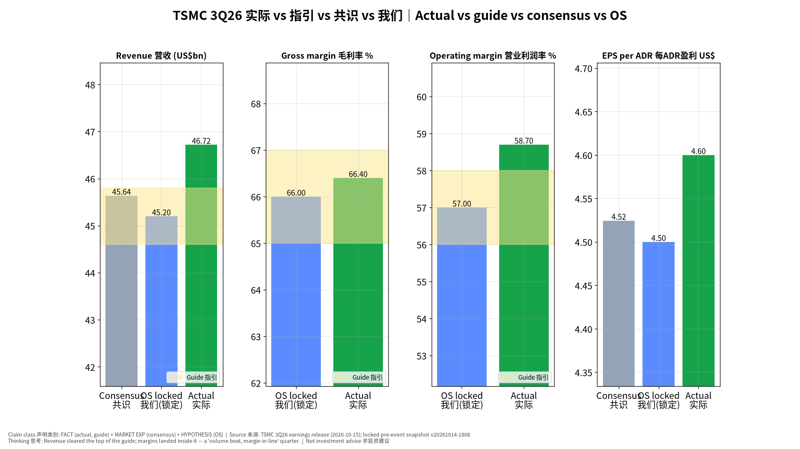
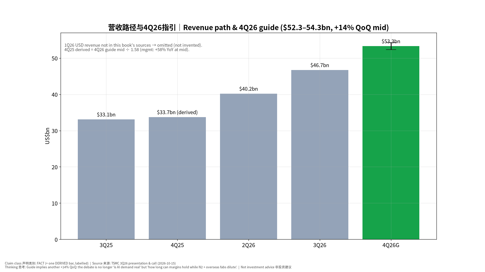
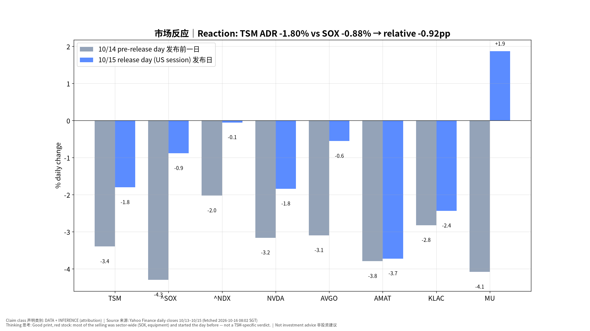
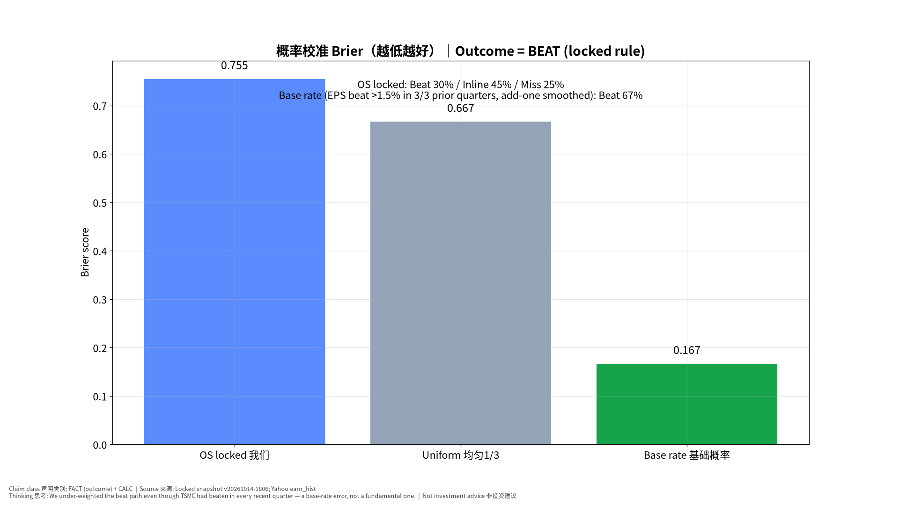
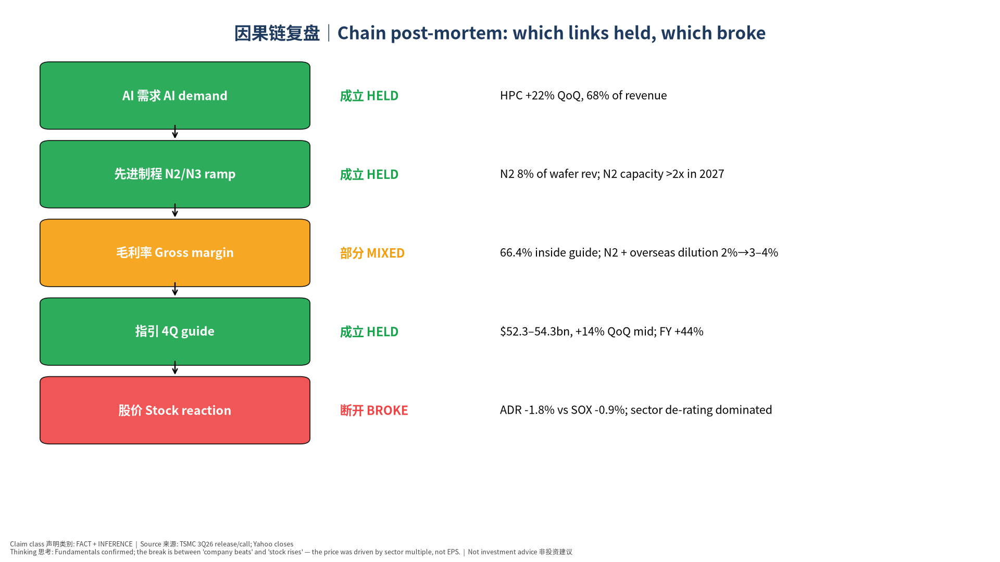

# 台积电 TSM 3Q26 财报事后复盘｜TSMC Q3 2026 Post-Event Book

> 版本 v20261016-0802-post｜生成 2026-10-16 08:02 SGT｜基于锁定的事前书 **v20261014-1806**（完整性校验通过，未改写）｜财报发布 2026-10-15 约 14:00 台北/新加坡时间｜非投资建议 Not investment advice

**⏱ 30秒看懂**

1. **发生什么：**台积电第三季营收 **46.72亿美元×10**（即 \$46.72bn），**高于指引上沿 \$45.8bn**；毛利率 66.4%、营业利润率 58.7% 落在/高于指引；每 ADR 盈利 \$4.60，略高于共识 \$4.52。第四季指引 \$52.3–54.3bn（中值环比 +14%）。
2. **和我的股票有什么关系：**按事前锁定规则这是 **Beat（超预期）**，但美股 ADR 当天 **-1.80%**，费城半导体 SOX -0.88%，设备股 AMAT -3.7%、KLAC -2.4%。好成绩≠股价涨：当天定价的主角是整个半导体板块的估值收缩。
3. **该看什么/做什么：**盯三件事：①台股 2330 今天怎么反应；②毛利率稀释（N2 + 海外厂 2%→3–4%）会不会压过营收增长；③2027 资本开支口径（'显著高于过去三年'）对设备股 AMAT/KLAC 是利好还是'回报担忧'。

**🗺 阅读地图**

| 你有多少时间 | 读哪里 |
|---|---|
| 2 分钟 | 只看 ⏱30秒 + 图1、图3 |
| 10 分钟 | 加读 §1 实际vs预期、§2 市场反应、§4 我们错在哪 |
| 30 分钟 | 全读，含 §5 估值、§6 对立观点、§7 来源与假设、自我测验 |

层级说明：**L1 故事**（人人能懂）→ **L2 关键数字**（带解释）→ **L3 专业细节**（网页可折叠，默认收起）。

## 1. 实际 vs 预期｜Actual vs Expected（事实 FACT）
| 指标 | 公司指引 | 共识 (锁定, MARKET EXP) | 我们 (锁定, HYPOTHESIS) | 实际 FACT | 判定 |
|---|---|---|---|---|---|
| 营收 Revenue US\$bn | 44.6–45.8 | 45.64 | 45.2 | **46.72** | 高于指引上沿 +0.92 |
| 毛利率 GM % | 65.0–67.0 | — | 66.0 | **66.4** | 指引内（环比 −1.3pp，N2 稀释） |
| 营业利润率 OM % | 56.0–58.0 | — | 57.0 | **58.7** | 高于指引上沿 |
| EPS/ADR US\$ | — | 4.52（4.26–4.85） | 4.5 | **4.6** | 比共识 +1.7% |
| 汇率 USD/TWD | 32.0 | | | 31.98 | 台币略弱，利好台币计价利润 |

其他事实：净利 NT\$763.06bn（+68.7% YoY），ROE 45.5%，出货 4476k 片（12寸当量），季度 capex \$13.8bn，现金及有价证券约 NT\$4.0tn，存货天数 82 天。制程结构：N2 8% / N3 33% / N5 28% / N7 10%，7nm 及以下 79%。平台：HPC 68%（环比 +22%），手机 21%（+10%）。

**4Q26 指引（管理层指引 GUIDANCE）**：营收 \$52.3–54.3bn，毛利率 65–67%，营业利润率 56.5–58.5%，汇率假设 31.8。
**电话会要点（GUIDANCE / 管理层表述）：**
- FY2026 USD revenue growth now ~44% (2026 全年美元营收增长约44%)
- 2026 capex reiterated \$60–64bn; 2026–28 capex 'even more significantly higher' than prior 3 years
- AI accelerator CAGR (2024–29, mid-to-high 50s%): 'probably will be higher' — no formal update
- N2 capacity to more than double in 2027; A14 risk production 2027, volume 2028
- Arizona Fab 2 volume production 3Q27 (slightly ahead); extra 3nm fab in Tainan (1H28)
- Overseas-fab GM dilution ~2% now, widening to 3–4% in later years
- Consumer / price-sensitive segments challenged by rising component prices → 'prudent' 2027 planning
- Advanced packaging: 5x reticle in production; 9x and 14x in development; GlobalFoundries interposer deal for back-end shortage

**📊 怎么看这张图**

- **坐标/颜色：**每个小图是一个指标：灰=共识，蓝=我们事前锁定的数字，绿=实际，黄色带=公司指引区间。
- **只记住一件事：**营收冲出黄色带上沿，利润率留在带内——'量超预期、利润率符合'。
- **什么会改变结论：**如果下季毛利率跌出 65% 下沿，说明稀释比管理层说的快，结论要改。

**📊 怎么看这张图**

- **坐标/颜色：**柱子=每季美元营收；最右橙柱是第四季指引中值，黑色线段是指引上下沿。
- **只记住一件事：**第四季还要再长 14%，需求端没有放缓信号。
- **什么会改变结论：**若 1 月公布的 4Q 实际低于 \$52.3bn 下沿，'需求无上限'叙事破裂。

## 2. 市场反应｜Market Reaction（DATA + INFERENCE）
| 标的 | 10/14 发布前一日 % | 10/15 发布日 % |
|---|---|---|
| TSM | -3.40 | -1.80 |
| ^SOX | -4.30 | -0.88 |
| ^NDX | -2.02 | -0.05 |
| NVDA | -3.16 | -1.84 |
| AVGO | -3.10 | -0.55 |
| AMD | -5.73 | -1.50 |
| AMAT | -3.79 | -3.72 |
| KLAC | -2.82 | -2.43 |
| MU | -4.08 | +1.87 |
| ARM | -6.81 | +2.85 |
| INTC | -4.56 | -2.80 |

- TSM ADR 发布日 -1.80%，相对 SOX -0.92pp。两天累计 ADR -5.14%（445.12→422.25）。
- 台股 2330 的反应要看 10/16 台北交易时段（财报在 10/15 台股收盘后发布）；本书生成时尚无数据，明日日报补上。
- 同日美国宏观：9 月零售销售（总体 +0.8%，控制组约 +0.1%，见零售事后书）与 PPI 同日公布；10 年期美债 10/15 小幅回落。**标题驱动 vs 基本面**：TSM 自身基本面向好（Fundamental Change 正面），但当天价格主要跟随板块估值（Headline/Sector 反应）。
- 分解（INFERENCE，非精确归因）：ΔPrice ≈ ΔEPS(+，Q4 共识 EPS 7日前 4.98→现 5.08) + ΔMultiple(板块, −) + ΔPositioning(−，设备股连续下跌显示 AI 链在去拥挤)。

**📊 怎么看这张图**

- **坐标/颜色：**灰柱=发布前一天，蓝柱=发布当天（美股），单位%。
- **只记住一件事：**TSM 跌得比 SOX 多一点，但设备股跌得更多——卖压集中在板块整体和设备股（MU、ARM 当天反而上涨），不是针对台积电成绩。
- **什么会改变结论：**如果台股 2330 今天大涨，说明美股反应只是板块情绪，台股才是'对成绩投票'。

## 3. 判定与校准｜Classification & Calibration
- 锁定规则（事前书 §3）：营收 ≥ \$45.8bn 或 毛利率 ≥ 67% → Beat。实际营收 \$46.72bn → **BEAT**。
- 我们事前概率 Beat 30% / Inline 45% / Miss 25% → Brier **0.755**；均匀 1/3 → 0.667；基础概率（Yahoo 记录前 3 季中 3 季 EPS 超共识 >1.5%，加一平滑后 Beat 67%）→ 0.167。
- **结论：我们输给了'什么都不知道'的均匀猜测。** 错误类型 = 概率校准错误（Probability Calibration），不是基本面预测错误：我们的点预测（营收 \$45.2bn）低于实际 3.3%，而台积电过去几季几乎每季都超过指引上沿/共识。教训：对'习惯性保守指引'的公司，Beat 的基础概率应 ≥60%。

**📊 怎么看这张图**

- **坐标/颜色：**柱子越低=概率预测越准。
- **只记住一件事：**我们的 Brier 比均匀猜测还高——事前把 Beat 只给 30% 是错的。
- **什么会改变结论：**未来 4 季若台积电出现 Inline/Miss，基础概率要相应下调。

## 4. 事后复盘：我们错在哪｜Post-Mortem
| 环节 | 成立/断开 | 证据 | 学到什么 |
|---|---|---|---|
| AI 需求 | 成立 | HPC 环比 +22%，占比 68%；CEO：需求'远高于供给' | 需求端信号仍然最强 |
| N2/N3 爬坡 | 成立 | N2 占 8%；2027 年 N2 产能翻倍以上；新增台南 3nm 厂 | 产能扩张=未来 2–3 年营收能见度 |
| 毛利率 | 部分成立 | 66.4% 指引内，但 N2 + 海外厂稀释 2%→3–4% | 利润率是下一阶段的主要争议 |
| 指引 | 成立 | 4Q +14% QoQ；全年 +44% | 与共识 2026 全年 +44.9%（TWD）基本一致 → 已被定价 |
| 股价 | 断开 | ADR -1.8%，SOX -0.9%，AMAT -3.7% | 板块估值 > 单季成绩；事前证伪条件 #1（Beat 但跌 >3%）**未触发**（跌幅 <3%），但方向一致 |

**错误分类**：①概率校准错误（主要）②市场反应错误（次要：事前 Beat 剧本预期 ADR +3~+7%，实际 -1.8%）。**根因**：忽视了 10/13–10/14 半导体板块已在去拥挤（AMAT 两日 -10.2%），个股成绩难以对抗板块资金流。**逻辑修正**：财报剧本要加入'板块动量/拥挤度'条件，Beat 剧本拆为'Beat+板块顺风'和'Beat+板块逆风'。

## 5. 模型与估值更新｜Model / Valuation Update
- 原则：没有重大新信息就不强行改估值；**不改写事前预测**。
- 本次信息是重大的（季度实际 + 新指引），但它与共识大体一致：用公司数据推算 2026 全年营收 ≈ 1Q NT\$1134bn + 2Q 1270 + 3Q 1494 + 4Q 指引中值×31.8 ≈ 1695 = **NT\$5,594bn**（DERIVED），相比 2025 年 NT\$3,809bn 增长 **46.9%**；共识（Yahoo 0y）NT\$5,520bn。差距 +1.3%。
- 因此：**三情景 DCF 结构不变**，只做机械刷新（价格、共识、利率）。公司模型最新两版：v20261015-0757: Bear \$134 / Base \$350 / Bull \$655（价格 \$430.00）；v20261016-0756: Bear \$132 / Base \$341 / Bull \$635（价格 \$422.25）。
- 需要上调的假设（记入假设登记表，等下季验证）：2027 年 capex 强度（'显著高于过去三年'）→ 对设备股是营收利好，但对台积电自由现金流是压力；海外厂毛利稀释 3–4% 纳入熊市情景。

## 6. 对立观点最强版本｜Steelman
**我们的观点：**台积电基本面持续超预期，股价下跌主要是板块估值收缩，中期价值未受损。

**对立观点最强版本：**
1. 营收超预期已经是'惯例'，市场早已按'超上沿'定价，所以这不是真正的惊喜。
2. 毛利率连续两季环比下滑（67.7%→66.4%→指引中值66%），N2 与海外厂稀释可能持续多年，'量增利减'会压低估值倍数。
3. 2026–28 capex 大幅上升 + 设备涨价，意味着自由现金流转化率下降；如果 AI 需求在 2027 年放缓，产能将过剩。
4. CEO 承认消费类需求受零部件涨价冲击，2027 规划'审慎'。

| 证据 | 支持我们 | 支持对立 | 权重 |
|---|---|---|---|
| 营收高于指引上沿 \$0.9bn | ✔ |  | 中 |
| 毛利率环比 −1.3pp |  | ✔ | 中 |
| 4Q 指引中值 +14% QoQ | ✔ |  | 高 |
| 全年 +44% ≈ 共识 +44.9% |  | ✔ | 高 |
| capex 2026–28 显著上升 | ✔ | ✔ | 中 |
| 发布日 ADR 跑输 SOX |  | ✔ | 低（一天噪音大） |

**裁判：**证据双方都有；'基本面强'成立，但'这些已经被定价'同样成立。我们维持基本面判断，但承认短期股价由板块与毛利率路径决定。

## 7. 证伪与下一步｜Falsifiers & Watch Next
1. 11 月 10 日前后公布的 10 月营收若环比转负 → '+14% QoQ' 指引可信度下降。
2. 4Q 毛利率低于 65%（1 月公布）→ 稀释快于指引，熊市情景权重上调。
3. 设备股（AMAT/KLAC）在台积电重申高 capex 后仍继续下跌 → 市场在交易'资本回报担忧'而非'订单利好'。
4. 台股 2330 今日若明显跑赢 ADR → 美股反应是情绪/时区噪音。

## 8. 来源登记｜Source Ledger
| 项目 | 来源 | 类别 | 时间 |
|---|---|---|---|
| 3Q26 实际、4Q26 指引 | [TSMC 3Q26 Earnings Release](https://investor.tsmc.com/english/encrypt/files/encrypt_file/reports/2026-10/526b65af7305df2dde6b9ece6812b1fdf1e49f9b/3Q26%20EarningsRelease.pdf)；[SEC 6-K](https://www.sec.gov/Archives/edgar/data/1046179/000104617926000726/a3q26e_withguidancexfinal.htm) | FACT | 2026-10-15 |
| 制程/平台结构、汇率、出货 | [TSMC 3Q26 Presentation](https://investor.tsmc.com/english/encrypt/files/encrypt_file/reports/2026-10/9f58506f6f114f91cefbf86820cc63297b39b130/3Q26%20Presentation%20(E).pdf) | FACT | 2026-10-15 |
| 电话会表述 | [Motley Fool transcript](https://www.fool.com/earnings/call-transcripts/2026/10/15/tsmc-tsm-q3-2026-earnings-call-transcript/) | GUIDANCE（管理层表述） | 2026-10-15 |
| 事前共识/我们的预测 | 锁定快照 v20261014-1806（Yahoo co_TSM 2026-10-14） | MARKET EXP / HYPOTHESIS | 2026-10-14 18:06 SGT |
| 股价 | Yahoo Finance 日收盘（yfinance） | DATA | 抓取 2026-10-16 08:02 SGT |
| EPS 超预期历史 | Yahoo earn_hist | DATA | 抓取 2026-10-16 08:02 SGT |

## 9. 假设登记｜Assumption Register
| # | 假设 | 类型 | 检验/失效条件 |
|---|---|---|---|
| 1 | 4Q 营收落在指引内 | GUIDANCE | 1 月财报；月营收 |
| 2 | 毛利率稀释（N2+海外）≤ 管理层口径 | HYPOTHESIS | 4Q GM < 65% 即失效 |
| 3 | 发布日 ADR 下跌主要由板块驱动 | INFERENCE | 若 2330 今日也明显跑输台股大盘则失效 |
| 4 | 4Q25 美元营收 = 指引中值 ÷ 1.58（推导） | DERIVED | 用公司年报数字替换 |
| 5 | Beat 基础概率 ≈ 历史 EPS 超预期频率 | HYPOTHESIS | 样本仅 3 季，需扩充 |

## 10. 模型来源｜Model Provenance
构建脚本 `pipeline/build_tsm_post.py`；事前快照 `v20261014-1806`（只读）；Excel 含实时公式（记分卡、Brier、反应、全年营收推算）；公司模型 `research/companies/TSM/` 最新版由 `build_companies.py` 生成。

**✅ 自我测验 Check your understanding**

Q1. 营收超过指引上沿，股价却跌了，最可能的原因是什么？

**答案：**当天整个半导体板块和设备股都在跌，TSM 跑输 SOX 不到 1 个百分点——板块估值收缩压过了单季成绩；而且'超指引'对台积电已是常态，部分已被定价。

Q2. 为什么我们的 Brier 分数比均匀猜测还差？

**答案：**结果是 Beat，我们只给了 Beat 30%。台积电近几季几乎每季超预期，我们没用基础概率。

Q3. 毛利率在指引内，为什么还被当作风险？

**答案：**因为方向在下滑（67.7%→66.4%→66%），且管理层说海外厂稀释会扩大到 3–4%：营收增长的同时每一美元赚得更少。

**✍ 事后作业**：打开 Excel 'FY2026_Bridge' 表，把第四季营收改成指引下沿 52.3，看看全年增长和与共识的差距怎么变。

## Final Self-Challenge
如果明天台股 2330 大涨、而 SOX 继续跌，我们的'板块驱动'解释是否还成立？——是的，这正好说明 TSM 自身的成绩在被单独认可；真正推翻我们的是：2330 同样大幅跑输台股大盘。

- 构建日志：pre-event integrity (v20261014-1806): 32/32 files match manifest sha256 — lock intact, not rewritten
- 构建日志：locked-rule class=beat; Brier OS 0.755 | uniform 0.667 | EPS-beat base rate (3 prior qtrs, Yahoo earn_hist) 0.167
- 构建日志：2330.TW 10/16 session: not yet trading / no data at build time (Taiwan reacts on 10/16 because results came after the 10/15 TWSE close)
- 构建日志：Excel recalc: class=beat; Brier OS=0.755; FY26 growth=46.8517642438254; errors=none
