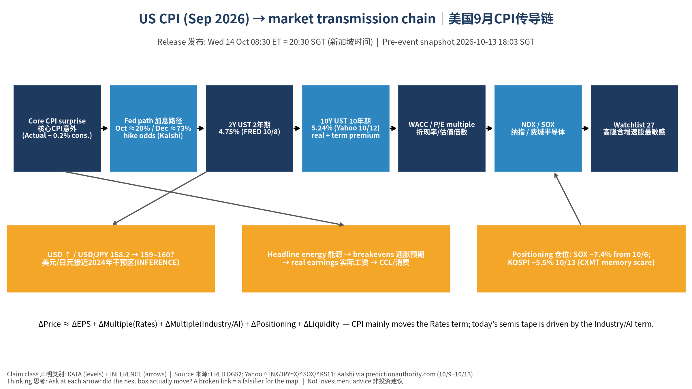
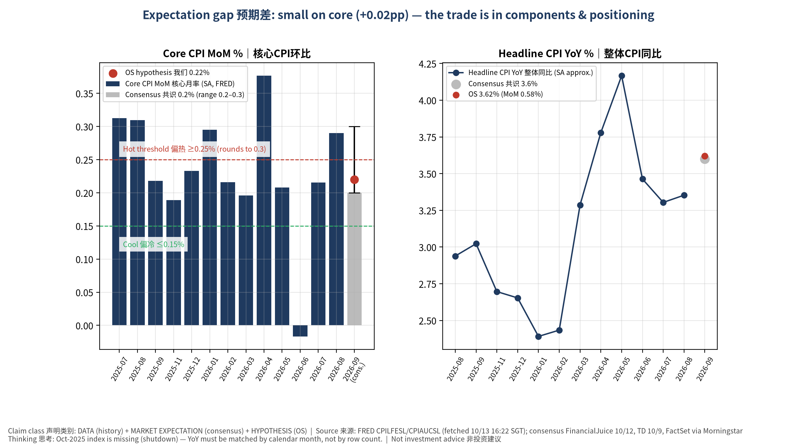
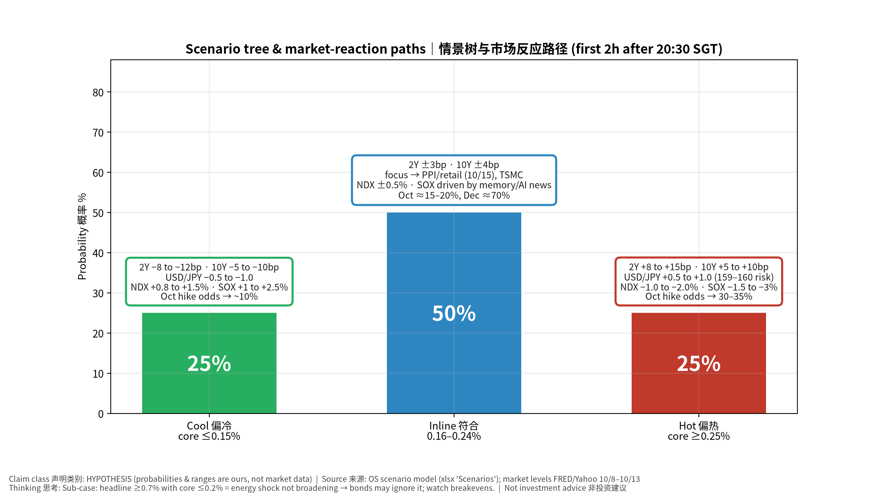
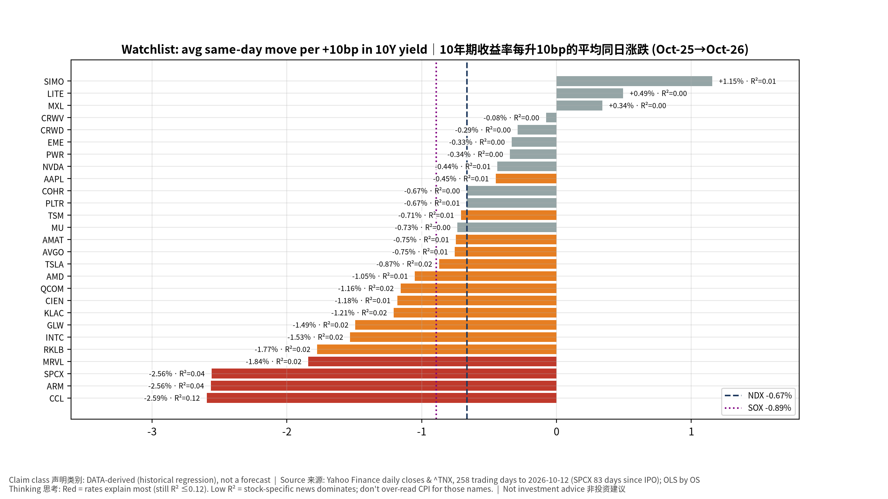
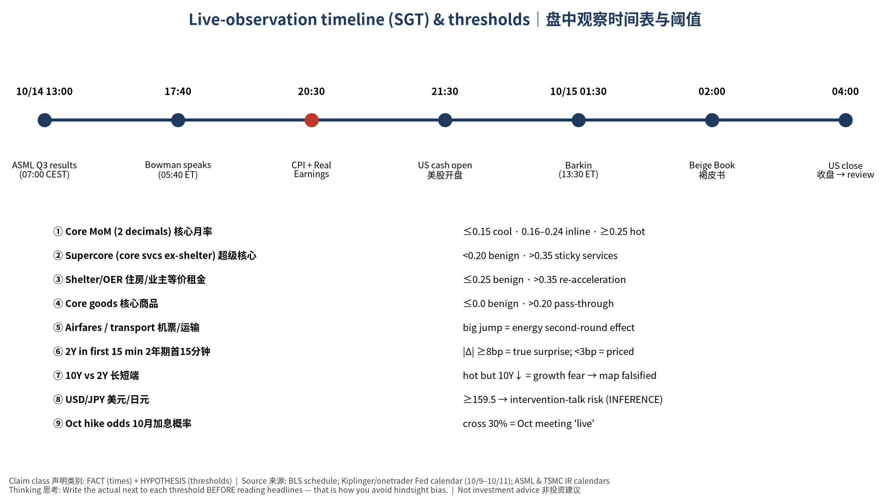

# US CPI (Sep 2026) Pre-Event Book｜美国9月CPI 发布前事件书 — Professional English

> **Release: Wed 2026-10-14, 08:30 ET = 20:30 SGT (Singapore time)**. Status CONFIRMED (BLS schedule).
> Pre-event snapshot locked **2026-10-13 18:03 SGT** (version v20261013-1803). Not rewritten after the fact; actuals and the post-mortem go into the next Daily OS update.
> Not investment advice. Labels: FACT · DATA · MARKET EXP (market expectation) · HYPOTHESIS (ours) · INFERENCE.

## 0. Major events in the next ~36 hours (SGT)

| Time SGT | Event | Status | OS link |
|---|---|---|---|
| 10/14 13:00 | ASML Q3 results (07:00 Amsterdam); call 21:00 | CONFIRMED date (time via secondary sources) | Not on watchlist; bellwether for AMAT/KLAC/TSM/INTC/MU |
| 10/14 17:40 | Fed Vice Chair for Supervision Bowman (05:40 ET) | TENTATIVE time | Mostly regulation |
| **10/14 20:30** | **US CPI (Consumer Price Index｜消费者价格指数), September + Real Earnings** | **CONFIRMED** | **Main event** |
| 10/15 01:30 | Richmond Fed's Barkin (13:30 ET) | TENTATIVE | First Fed reaction after the data |
| 10/15 02:00 | Fed Beige Book (褐皮书) | CONFIRMED | Anecdotal evidence before the Oct 27–28 FOMC |
| Watchlist earnings | None in window (TSM is 10/15 14:00 SGT, covered in tomorrow's run) | — | — |

## 1. Executive Summary
1. **Consensus (MARKET EXP)**: headline +0.6% m/m (FactSet +0.5%), 3.6% y/y (prior 3.4%); core +0.2% m/m (prior +0.3%), 2.5% y/y (FactSet 2.4%; prior 2.4%).
2. **Ours (HYPOTHESIS)**: headline +0.58% / 3.6%; core **+0.22%** / 2.4%. Core y/y sits on the 2.4/2.5 rounding edge (≥0.2215% m/m rounds to ~2.5% on our SA approximation). **The core expectation gap is only about +0.02pp, so the trade is in the components and in positioning, not the headline number.**
3. **Why it matters**: last CPI before the Oct 27–28 FOMC. The Fed hiked in September; the target range is 3.75–4.00% (FRED upper bound 4.00%). Kalshi prices about 20% for an October hike and about 73% for December (10/13). September payrolls were only +29k with unemployment at 4.2% (FRED), which already pulled October odds from about 70% to about 20%.
4. **Fragile tape**: 10Y UST at 5.24% (near multi-decade highs), SOX −7.4% since 10/6, KOSPI −5.46% today on CXMT memory-supply fears and foreign selling. Broadcom's and Intel's CEOs just named capital and the cost of capital as the binding constraint on AI expansion, so the AI chain's sensitivity to rates is rising.
5. **Asymmetry**: a hot core print (≥0.25%) would stack the cost-of-capital story on top of broken semis; a cool print could spark a relief bounce, but memory names (MU/SIMO) are trading supply news, not CPI.

## 2. Consensus vs Ours (Expectation Gap)

| Measure | Aug prior | Consensus | Range | Ours | Gap (pp) |
|---|---|---|---|---|---|
| Headline m/m | 0.4% | 0.6% (FactSet 0.5) | 0.5–0.7 | 0.58 | −0.02 |
| Headline y/y | 3.4% | 3.6% | 3.5–3.8 | 3.6 | 0 |
| **Core m/m** | 0.3% (0.29) | **0.2%** | 0.2–0.3 | **0.22** | **+0.02** |
| Core y/y | 2.4% | 2.5% (FactSet 2.4) | 2.3–2.6 | 2.4 | −0.1 |

**Why we lean slightly above consensus**: Deutsche Bank 0.16%, Wells Fargo 0.20%, Crédit Agricole 0.20% (FinancialJuice, 10/12). Drags: reversal of August's wireless-services spike and softer used cars. Supports: a modest shelter pickup, a medical-services rebound, and jet fuel feeding airfares. We think the last two are underweighted by 0.02–0.04pp.
**Base effects (DATA + calculation)**: at +0.22% core, the 3-month annualised rate jumps to about 2.9% as June's −0.02% drops out, so an "inflation momentum re-accelerates" headline is possible even on an in-line print.
**The Fed targets PCE**: August core PCE was about 3.0% y/y (FRED, our calculation), above core CPI at 2.45%. Thursday's PPI components (medical, airfares, portfolio management) matter as much as CPI for the PCE mapping.

## 3. Scenario Tree and Market-Reaction Paths (HYPOTHESIS)

| Scenario | Core m/m | Prob | 2Y | 10Y | USD/JPY | NDX | SOX | Oct hike odds |
|---|---|---|---|---|---|---|---|---|
| Bull, Cool | ≤0.15% | 25% | −8 to −12bp | −5 to −10bp | −0.5 to −1.0 | +0.8 to +1.5% | +1 to +2.5% | to ~10% |
| Base, Inline | 0.16–0.24% | 50% | ±3bp | ±4bp | flat | ±0.5% | memory/AI news | 15–20% |
| Bear, Hot | ≥0.25% | 25% | +8 to +15bp | +5 to +10bp | +0.5 to +1.0 (159–160 risk) | −1.0 to −2.0% | −1.5 to −3% | to 30–35% |

Sub-case: **headline ≥0.7% with core ≤0.2%** means an energy shock that isn't broadening; bonds may look through it, but a >5bp rise in the 10Y breakeven (now 2.33%) would signal second-round fears.
**Transmission**: core surprise → Fed path (Oct/Dec odds) → 2Y → 10Y (2.87% real yield + term premium) → USD and USD/JPY → WACC and multiples → NDX/SOX → watchlist (high price-implied growth names are most sensitive). See charts 01 and 03.

## 4. Live-Observation Checklist (from 20:30 SGT)
Write the actual next to each threshold before reading headlines; the Excel `LiveChecklist` sheet classifies automatically.

| # | Watch | Cool | Hot | Why (beginner note) |
|---|---|---|---|---|
| 1 | Core m/m to two decimals | ≤0.15 | ≥0.25 | 0.24 and 0.25 round to 0.2 and 0.3, which produce opposite headlines |
| 2 | Core y/y | ≤2.35 | ≥2.55 | 2.4 vs 2.5 is the headline split |
| 3 | Supercore (core services ex-shelter) | <0.20 | >0.35 | wage-linked and sticky; the Fed's focus |
| 4 | Shelter / OER (owners' equivalent rent) | ≤0.25 | >0.35 | about a third of CPI; slow but heavy |
| 5 | Core goods | ≤0.0 | >0.20 | tariff and supply pass-through |
| 6 | Airfares, transport services | — | big jump | energy second-round effects |
| 7 | 2Y, first 15 minutes | ≤−8bp | ≥+8bp | the market's vote on the Fed path; <3bp means priced |
| 8 | 10Y vs 2Y direction | — | hot but 10Y falls | growth fear, so our map fails for the day |
| 9 | USD/JPY | ≤157 | ≥159.5 | Japan intervened near 160 in 2024 (FACT); verbal-intervention risk rises (INFERENCE) |
| 10 | Oct hike odds (CME/Kalshi) | ≤12% | ≥30% | above 30% makes Oct 28 "live" |
| 11 | First 30 min vs close | — | — | headline reaction vs fundamental change; a reversal means positioning |

## 5. Affected Watchlist Stocks
**Rate sensitivity (DATA: average same-day move per +10bp in the 10Y over the past year; R² is low, so treat as a guide)**: CCL −2.59% (R² 0.12, the highest; also hit by fuel and real incomes), ARM −2.56%, SPCX −2.56% (83 trading days since IPO), MRVL −1.84%, RKLB −1.77%, INTC −1.53%, GLW −1.49%, KLAC −1.21%, CIEN −1.18%, QCOM −1.16%, AMD −1.05%; NDX −0.67%, SOX −0.89%. Low sensitivity: CRWV, CRWD, EME, PWR, NVDA, AAPL. SIMO, LITE and MXL show positive but noise-level betas (R² about 0). See chart 04.
**Valuation lens (OS models, HYPOTHESIS)**: the widest gaps between price-implied Y1 growth and consensus are RKLB (115% vs 41%), TSLA (81% vs 14%), INTC (69% vs 15%), CRWD (74% vs 23%), ARM (78% vs 36%), PLTR (88% vs 50%), KLAC and PWR. These are long-duration assets that need continued beats; a lasting discount-rate rise hurts their fair value most (Excel `Valuation`: a sustained +8bp cuts NVDA's fair value by about 0.8% using a duration approximation).
**Names on the event chain**: TSM reports 10/15 14:00 SGT (Q3 guide US$44.6–45.8bn, GM 65–67%), so CPI sets the mood. AMAT/KLAC/INTC read ASML at 13:00 SGT first. MU/SIMO fell today on CXMT, not rates; if CPI is cool and MU still lags, the driver is the Industry/AI multiple. CCL is exposed to gasoline and the Real Earnings release. EME/PWR/CRWV carry project-financing sensitivity to long rates.

## 6. Falsifiers
1. Core ≥0.25% but the 10Y falls and the 2Y rises <5bp: already priced or a growth scare; the hot → rates up → tech down map fails.
2. Core ≤0.15% but SOX still falls >1.5%: semis are trading AI cost of capital and memory supply; downweight the Rates term.
3. An in-line print that moves October odds by >15pp: extreme positioning fragility; raise the ΔPositioning weight.
4. Headline ≥0.7%, core ≤0.2%, and the 10Y breakeven up >5bp: second-round energy fear; the "Fed can look through energy" assumption fails.
5. If actual core lands outside 0.16–0.24, log a Fundamental Forecast error and identify which component (shelter, medical, airfares) we misjudged.

## 7. Beige Book and ASML Previews
- **Beige Book (10/15 02:00 SGT)**: (a) are firms passing energy costs through; (b) how broad is hiring softness; (c) AI-investment anecdotes on power, construction and hiring. "Modest price gains plus flat or softer employment" supports an October pause.
- **ASML (10/14 13:00 SGT)**: prior guide Q3 sales €11–12bn, GM 55–57%, FY €43–45bn (secondary sources). Watch bookings, 2027 visibility, China share and memory-customer capex, which matters more after today's Korean memory rout.

## 8. Thinking Tutorial
What to observe (core m/m to two decimals, supercore) → why (the Fed's reaction function runs on sticky inflation) → evidence (components plus the 2Y in the first 15 minutes) → transmission (2Y → 10Y → WACC → multiples) → alternatives (growth fear, positioning, AI cost-of-capital, yen) → falsifiers (section 6) → watch next (10/15 PPI and retail sales, TSMC, Warsh 10/16 11:30 SGT).

## 9. Final Self-Challenge
- Is our 0.22% lean anchored on August's 0.29%? Bank forecasts cluster at 0.16–0.20%, so our tilt may be noise.
- A 10Y above 5.2% mostly reflects term premium and fiscal supply, not CPI; even a cool print may not lift the long end, so growth-stock valuation pressure may not ease.
- Today's semis problem (CXMT, cost of capital) has nothing to do with CPI; attributing tomorrow night's semis move entirely to CPI would be a classic misattribution.

## 10. Data Conflicts and Model Notes
- Morningstar's text says "Wednesday, Oct. 15", which conflicts with the BLS schedule (Wednesday 10/14); we follow BLS. predictionauthority mislabels 10/14 as Tuesday.
- Core y/y consensus differs: 2.4% (FactSet) vs 2.5% (TD/FinancialJuice); headline m/m 0.5% vs 0.6%.
- **OS pipeline issue**: the dashboard's CPI y/y uses a 12-row lag; with October 2025 missing (shutdown) it shows CPI 3.71% and core 2.76% instead of the correct 3.35% and 2.45% for August. This book uses calendar-matched y/y. Pipeline fix pending.

Source Ledger, Assumption Register and Model Provenance are in the Excel workbook's sheets of the same names; the Chinese edition and beginner teaching editions are in the same folder.

## 图表 Charts

