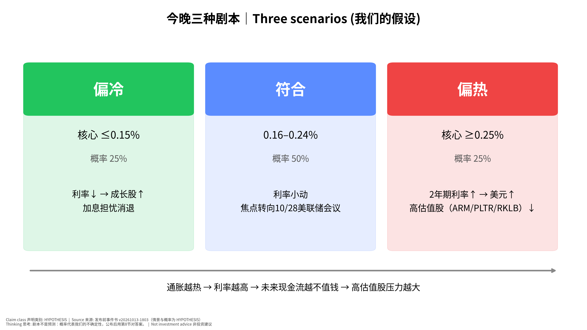
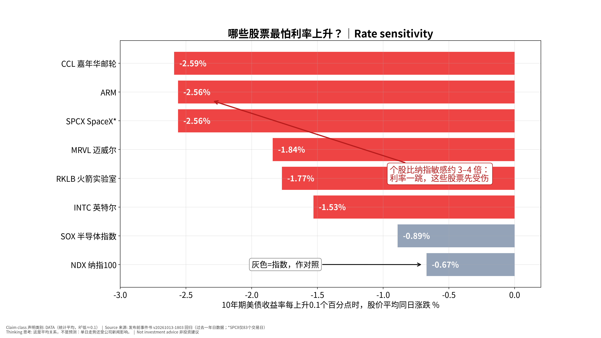

# 美国9月CPI 发布前·教学版｜US CPI (Sep 2026) Pre-Event — Teaching Edition v20261013-2043-teach
> 公布时间：**2026-10-14（周三）20:30 新加坡时间**（美东 08:30，BLS 官方日程 CONFIRMED）。本版是对已锁定的发布前事件书 **v20261013-1803** 的「初学者重写版」，所有数字与原书一致，原书不改动。非投资建议。

**⏱ 30秒看懂**

1. **发生什么：**美国明晚公布9月的物价数据（CPI），看美国东西是不是还在快速变贵。
2. **和我的股票有什么关系：**如果物价比大家猜的更热，美联储可能继续加息，利率上升会让 ARM、PLTR、RKLB 这类「靠未来赚钱」的高估值股票先跌。
3. **该看什么/做什么：**只盯一个数：核心CPI月度涨幅。≤0.15% 偏好消息，0.16–0.24% 正常，≥0.25% 偏坏消息；公布后用第8节「对答案」。

**🗺 阅读地图**

| 你有多少时间 | 读哪里 |
|---|---|
| 2 分钟 | 只读上面的「30秒看懂」+ 第4节的判断表。 |
| 10 分钟 | 再读第1–3节故事和第5节对股票的影响，看图1和图2的「怎么看这张图」。 |
| 30 分钟 | 全部读完，展开 L3 专业细节，做第9节自我测验和第10节事后作业。 |

层级说明：**L1 故事**（人人能懂）→ **L2 关键数字**（带解释）→ **L3 专业细节**（网页可折叠，默认收起）。

## 1. 发生什么（L1 故事）
美国劳工统计局（BLS）每个月公布一次 <abbr title="消费者价格指数：一篮子日常消费品和服务的价格，用来量通胀｜Consumer Price Index｜比喻：像公司的「采购成本指数」——同样的东西今年比去年贵了多少">CPI</abbr>（Consumer Price Index：消费者价格指数：一篮子日常消费品和服务的价格，用来量通胀）。明晚公布的是9月的数据。我们最关心的是 <abbr title="剔除食品和能源后的CPI，波动小，更能看出通胀的「底色」｜Core CPI｜比喻：像扣除一次性项目后的「经常性费用」">核心CPI</abbr>（Core CPI：剔除食品和能源后的CPI，波动小，更能看出通胀的「底色」），因为它去掉了油价、菜价这些忽上忽下的项目，更能看出物价上涨的「底色」。

**用你熟悉的方式理解：**把美国经济想成一家公司。CPI 就是这家公司的「采购成本指数」。美联储是财务总监，目标是让成本每年只涨 2%。如果成本涨得太快，财务总监就会提高「资金成本」（<abbr title="美联储提高政策利率，借钱变贵｜rate hike｜比喻：银行贷款利率上调，项目融资成本上升">加息</abbr>（rate hike：美联储提高政策利率，借钱变贵）），让大家少花钱。

## 2. 市场在猜什么（L2 关键数字）
| 指标 | 上个月（8月）实际 | 这次 <abbr title="分析师预测的平均值，代表「市场在猜的数」｜consensus｜比喻：像集团给你的预算数">共识</abbr>（consensus：分析师预测的平均值，代表「市场在猜的数」） | 我们的猜测 |
|---|---|---|---|
| 核心CPI <abbr title="和上个月比的变化｜month-over-month, MoM｜比喻：像本月费用 vs 上月费用">环比</abbr>（month-over-month, MoM：和上个月比的变化） | 0.3%（精确 0.29%） | **0.2%** | 0.22% |
| 核心CPI <abbr title="和去年同月比的变化｜year-over-year, YoY｜比喻：像今年9月 vs 去年9月的同期对比">同比</abbr>（year-over-year, YoY：和去年同月比的变化） | 2.4% | 2.5%（FactSet 为 2.4%） | 2.4% |
| 整体CPI 环比 | 0.4% | 0.6%（FactSet 0.5%） | 0.58% |

**财务经理视角：**共识就是「预算」，公布值就是「实际」。实际 − 预算 = <abbr title="实际值减去共识，正数=比预期热｜surprise / expectation gap｜比喻：实际 vs 预算的差异（variance）">预期差</abbr>（surprise / expectation gap：实际值减去共识，正数=比预期热）（variance）。市场只对「差异」反应，不对数字本身反应——就像老板只问你「为什么超支」，不问「花了多少」。

**为什么这次重要：**这是 10/27–28 美联储会议（<abbr title="美联储决定利率的会议｜Federal Open Market Committee｜比喻：像董事会定「全公司的资金成本」">FOMC</abbr>（Federal Open Market Committee：美联储决定利率的会议））前最后一份通胀数据。美联储9月已经加过一次息；目前市场认为10月再加息的概率约 20%（Kalshi，10/13，来源见原书）。

L3 专业细节：为什么我们略高于共识（点击展开）

投行预测集中在 0.16–0.20%（德银 0.16%、富国 0.20%）。我们给 0.22%，因为认为住房、医疗服务回升以及航油传导到机票被低估约 0.02–0.04 个百分点（HYPOTHESIS）。差距只有 0.02pp，基本是噪声——真正的看点是分项结构（<abbr title="核心服务剔除住房，与工资最相关、最「黏」｜supercore｜比喻：像人工成本——一旦涨上去很难降">超级核心</abbr>（supercore：核心服务剔除住房，与工资最相关、最「黏」）、<abbr title="业主等价租金：估算自住房「如果出租能收多少」，约占CPI三分之一｜Owners&#x27; Equivalent Rent｜比喻：像自用办公楼的「内部租金」分摊">OER</abbr>（Owners' Equivalent Rent：业主等价租金：估算自住房「如果出租能收多少」，约占CPI三分之一））。若核心 +0.22%，三个月年化会升到约 2.9%，因为6月的 −0.02% 移出了窗口。

## 3. 我们怎么想（L1→L2）
我们的基本判断：**大概率「符合预期」（50%）**，偏冷和偏热各 25%。见图3。

**📊 怎么看这张图**

- **坐标/颜色：**三个方框是三种剧本，颜色：绿=偏冷（对股票友好），蓝=符合，红=偏热（对股票不友好）；下方箭头是因果方向。
- **只记住一件事：**最可能是中间的「符合」，市场注意力会转向 10/28 的美联储会议。
- **什么会改变结论：**如果核心CPI ≥0.25%（红框），我们会预期利率上升、高估值股下跌；若公布后不是这样，就说明市场在交易别的东西（见第7节）。

## 4. 公布时看什么（带数字例子）
**只看一个数：核心CPI环比，看到小数点后两位。**

| 公布的核心环比 | 意思 | 对股票的大方向 |
|---|---|---|
| ≤0.15% | 偏冷：通胀在降温 | 利率↓，成长股↑ |
| 0.16–0.24% | 符合预期 | 小波动，看后续新闻 |
| ≥0.25% | 偏热：通胀还在跑 | 利率↑，高估值股↓ |

### 带符号的数字例题（如果核心是 0.3%，意味着什么？）
符号定义：
- **I₀** = 8月核心CPI指数 = **337.765**（FRED，BLS 数据）
- **m** = 9月核心环比涨幅（假设为 0.3%，这是举例，不是预测）
- **I₁** = 9月核心CPI指数 = I₀ × (1 + m)
- **I₋₁₂** = 去年9月核心CPI指数 = **330.418**（FRED）
- **Y** = 同比 = I₁ ÷ I₋₁₂ − 1

计算：
1. I₁ = 337.765 × 1.003 = **338.778**
2. Y = 338.778 ÷ 330.418 − 1 = **2.53%**（高于共识 2.5%）
3. <abbr title="把一个月的涨幅按12个月复利放大成一年的速度｜annualized｜比喻：月度超支0.1%，全年就是约1.2%的超支">年化</abbr>（annualized：把一个月的涨幅按12个月复利放大成一年的速度）：(1.003)¹² − 1 = **3.7%**，几乎是美联储 2% 目标的两倍。

**预算差异的说法：**预算（共识）0.2%，实际 0.3%，不利差异 0.1pp/月；年化后相当于每年多出约 1.2pp 的通胀——这就是市场会紧张的原因。

### 对股票的数字例题
- **β** = <abbr title="10年期利率每升0.1个百分点，股票平均同日涨跌多少｜rate sensitivity (beta to 10Y)｜比喻：像汇率敏感度：汇率动1%，利润动多少">利率敏感度</abbr>（rate sensitivity (beta to 10Y)：10年期利率每升0.1个百分点，股票平均同日涨跌多少）（ARM 约 −2.56% / 每 +0.1pp 10年期利率，统计平均，见图2）
- **Δr** = 10年期利率变化（假设偏热时 +0.08pp，即 +8bp，来自原书情景区间）
- 预期影响 ≈ β × (Δr ÷ 0.1) = −2.56% × 0.8 ≈ **−2.0%**
⚠ 这只是平均关系（R² 约 0.1，意思是利率只能解释约一成的日波动），当天公司新闻可能完全盖过它。

## 5. 对哪些股票有什么影响？为什么？
**一句话原理：**股票的价值 = 未来现金流 ÷ 折现。利率是「折现率」的地基（<abbr title="把未来的钱换算成今天的钱时用的利率｜discount rate / WACC｜比喻：像你评估投资项目时的门槛回报率（hurdle rate）">折现率</abbr>（discount rate / WACC：把未来的钱换算成今天的钱时用的利率））。利率上升 → 未来的钱在今天更不值钱 → 「靠很远未来赚钱」的公司受伤最大。

**📊 怎么看这张图**

- **坐标/颜色：**横轴是「10年期美债收益率每上升 0.1 个百分点时，股价当天平均跌多少」，越往左越怕利率；红色=个股，灰色=指数。
- **只记住一件事：**CCL、ARM、SPCX、MRVL、RKLB 对利率最敏感，大约是纳指的 3–4 倍。
- **什么会改变结论：**这是过去一年的平均关系；如果某天有公司自己的大新闻（例如 MU 的存储扩产担忧），利率的影响会被盖过。

| 股票 | 为什么受影响 | 偏热时 |
|---|---|---|
| ARM、PLTR、RKLB、TSLA | <abbr title="反向DCF算出的、现价已经「默认」的增长率｜price-implied growth｜比喻：像售价已经把未来涨价预期算进去了">价格隐含增速</abbr>（price-implied growth：反向DCF算出的、现价已经「默认」的增长率）远高于分析师预期（例如 RKLB 价格隐含首年增速 115% vs 共识 41%，见 OS 模型），属于「长久期」资产 | 压力最大 |
| CCL（邮轮） | 同时受油价和消费者实际收入影响 | 敏感度最高 |
| EME、PWR、CRWV | 数据中心项目要借钱，长期利率影响融资成本 | 中等 |
| MU、SIMO | 近期主因是中国存储扩产（CXMT），**不是** CPI | 别把下跌全怪 CPI |
| TSM | CPI 定情绪，10/15 14:00 SGT 就开业绩会 | 看业绩更重要 |

## 6. 图：核心通胀每个月涨多少

**📊 怎么看这张图**

- **坐标/颜色：**柱子=每个月核心CPI涨了多少（%）；绿区=偏冷，红区=偏热，黑色虚线=每月约 0.165%，相当于一年 2% 的目标；最右边虚线框=这次的共识 0.2%。
- **只记住一件事：**8月已经在红区（0.29%），市场希望9月回到 0.2% 左右。
- **什么会改变结论：**如果9月又在红区，就是连续两个月偏热，「通胀卷土重来」的说法会变强。注：2025年10月数据因政府停摆缺失，图中不画该月，避免错位。

## 7. 我们可能错在哪（<abbr title="一旦出现就说明我们看错了的信号｜falsifier｜比喻：像预警指标：触发就要重新做预测">证伪条件</abbr>（falsifier：一旦出现就说明我们看错了的信号））
1. 核心 ≥0.25% 但 10 年期利率反而下跌 → 市场在担心经济变差，而不是通胀；我们的「偏热→利率升→科技跌」逻辑当天失效。
2. 核心 ≤0.15% 但半导体还跌超 1.5% → 半导体由行业新闻驱动（存储供给、AI 资本成本），不是利率。
3. 我们 0.22% 的猜测可能只是「锚定」了8月的 0.29%；投行集中在 0.16–0.20%。
4. 10 年期利率在 5.2% 以上更多反映财政和期限溢价，即使 CPI 偏冷，长端利率也可能不降。

## 8. 事后对答案（公布后填写）
| 项目 | 共识 | 我们 | 实际 | 差异（实际−共识） | 我们对了吗 |
|---|---|---|---|---|---|
| 核心环比 | 0.2% | 0.22% | ____ | ____ | ____ |
| 核心同比 | 2.5% | 2.4% | ____ | ____ | ____ |
| 2年期利率首15分钟 | — | 见剧本 | ____ | — | ____ |
| NDX / SOX 收盘 | — | 见剧本 | ____ | — | ____ |
误差分类（选一）：基本面预测错 / 市场预期定价错 / 市场反应判断错 / 时机错 / 概率校准错。

**✅ 自我测验 Check your understanding**

Q1. 共识是 0.2%，实际 0.3%，这对股票通常是好消息还是坏消息？为什么？

**答案：**通常是坏消息：比预算（共识）更热 → 市场预期美联储更鹰 → 利率上升 → 折现率上升 → 高估值股受压。

Q2. 为什么看「核心」而不是「整体」CPI？

**答案：**核心去掉了波动很大的食品和能源，更能反映持续的通胀趋势，美联储也更看重它。

Q3. ARM 的利率敏感度是 −2.56%/0.1pp。如果 10 年期利率升 0.05pp，平均影响是多少？

**答案：**−2.56% × 0.5 ≈ −1.3%。但这是统计平均，当天公司新闻可能完全盖过。

Q4. CPI 偏冷，但 MU 还在跌，说明什么？

**答案：**MU 的驱动可能是行业新闻（例如中国存储扩产），而不是利率——不要错误归因。

Q5. 月度 0.3% 为什么「听起来很小」却让市场紧张？

**答案：**年化 (1.003)^12−1 ≈ 3.7%，几乎是 2% 目标的两倍。

## 10. 事后作业（公布后 30 分钟内完成）
1. 把实际值填入第8节表格，计算差异。
2. 记录 2 年期利率在公布后 15 分钟变动了多少 bp，判断属于哪个剧本。
3. 看图2中的 5 只股票当天涨跌，是否符合「越敏感跌越多」？不符合的写下你认为的原因。
4. 用一句话写：「这次我学到了什么？」——会进入下一份每日 OS 更新的学习记录。

## 11. 术语表 Glossary（鼠标悬停正文中带下划线的词也可看到解释）
| 术语 | 白话意思 | English | 生活/财务比喻 |
|---|---|---|---|
| CPI | 消费者价格指数：一篮子日常消费品和服务的价格，用来量通胀 | Consumer Price Index | 像公司的「采购成本指数」——同样的东西今年比去年贵了多少 |
| 核心CPI | 剔除食品和能源后的CPI，波动小，更能看出通胀的「底色」 | Core CPI | 像扣除一次性项目后的「经常性费用」 |
| 加息 | 美联储提高政策利率，借钱变贵 | rate hike | 银行贷款利率上调，项目融资成本上升 |
| 共识 | 分析师预测的平均值，代表「市场在猜的数」 | consensus | 像集团给你的预算数 |
| 环比 | 和上个月比的变化 | month-over-month, MoM | 像本月费用 vs 上月费用 |
| 同比 | 和去年同月比的变化 | year-over-year, YoY | 像今年9月 vs 去年9月的同期对比 |
| 预期差 | 实际值减去共识，正数=比预期热 | surprise / expectation gap | 实际 vs 预算的差异（variance） |
| FOMC | 美联储决定利率的会议 | Federal Open Market Committee | 像董事会定「全公司的资金成本」 |
| 超级核心 | 核心服务剔除住房，与工资最相关、最「黏」 | supercore | 像人工成本——一旦涨上去很难降 |
| OER | 业主等价租金：估算自住房「如果出租能收多少」，约占CPI三分之一 | Owners' Equivalent Rent | 像自用办公楼的「内部租金」分摊 |
| 年化 | 把一个月的涨幅按12个月复利放大成一年的速度 | annualized | 月度超支0.1%，全年就是约1.2%的超支 |
| 利率敏感度 | 10年期利率每升0.1个百分点，股票平均同日涨跌多少 | rate sensitivity (beta to 10Y) | 像汇率敏感度：汇率动1%，利润动多少 |
| 折现率 | 把未来的钱换算成今天的钱时用的利率 | discount rate / WACC | 像你评估投资项目时的门槛回报率（hurdle rate） |
| 价格隐含增速 | 反向DCF算出的、现价已经「默认」的增长率 | price-implied growth | 像售价已经把未来涨价预期算进去了 |
| 证伪条件 | 一旦出现就说明我们看错了的信号 | falsifier | 像预警指标：触发就要重新做预测 |

## 12. 来源与模型溯源
- 共识、我们的预测、情景概率、利率敏感度回归、Kalshi 概率：全部来自发布前事件书 **v20261013-1803**（Source Ledger 与 Assumption Register 见该版本 Excel）。
- 核心CPI指数与月度涨幅：FRED CPILFESL（BLS），数据快照 20261013-1812。
- 价格隐含增速：OS 公司模型 v20261013-1812（反向DCF）。
- 本版只改写表达方式，不新增预测。

---

# English summary (beginner)
**30-second read:** US September CPI is out Oct 14, 20:30 SGT. If core CPI is hotter than the 0.2% consensus, rate-hike fears rise and long-duration, high-valuation stocks (ARM, PLTR, RKLB) tend to fall first. Watch one number: core CPI month-over-month — ≤0.15% cool, 0.16–0.24% inline, ≥0.25% hot.
**Finance-manager lens:** consensus = budget, actual = actual, the market trades the variance.
**Worked example:** if core m/m = 0.3%, index 337.765 → 338.778, YoY 2.53%, annualized 3.7% (≈2× the Fed's 2% target). ARM's rate beta −2.56% per +10bp × 0.8 ≈ −2.0% (statistical average, low R²).
**Where we could be wrong:** hot print but falling 10Y (growth scare); semis driven by industry news, not rates; our 0.22% may be anchored on August.
