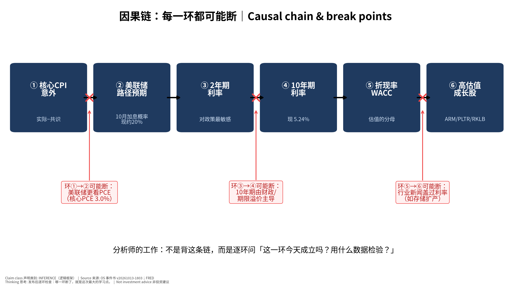
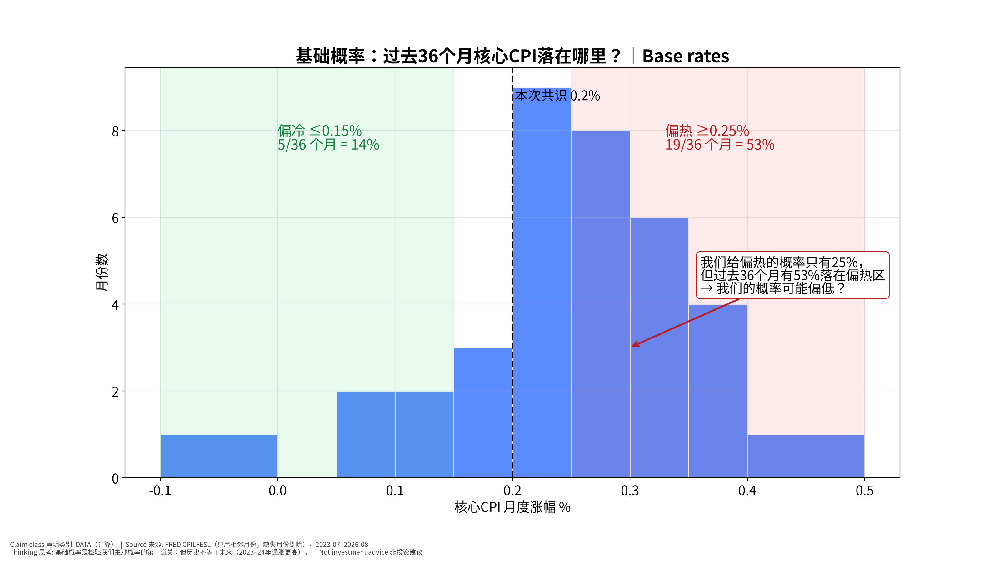
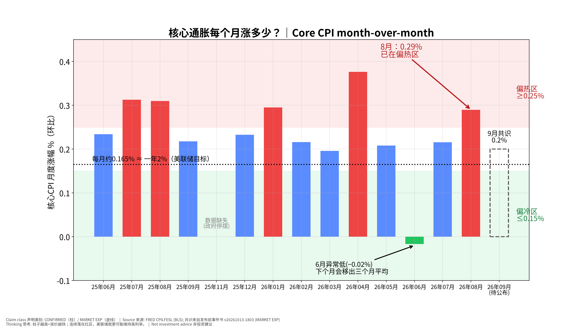

# 美国9月CPI：分析师的思考过程｜How an Analyst Thinks Through US CPI (Sep 2026) v20261013-2047-think
> 公布：**2026-10-14 20:30 新加坡时间**（BLS，CONFIRMED）。本版是对锁定的发布前事件书 **v20261013-1803** 的「思考过程重写版」；所有市场数字取自该书或 FRED，不新增预测。上一版教学试点 v20261013-2043-teach 保留。非投资建议。

> **一句话：**这份文件不是告诉你「答案」，而是演示一个分析师从零开始怎样**提问、查证、搭因果链、找断点、反过来想**——你可以把同样步骤用在任何事件或股票上。

**🗺 阅读地图**

| 你有多少时间 | 读哪里 |
|---|---|
| 2 分钟 | 读第0节「思考路线图」。 |
| 10 分钟 | 读第1节思考过程（Step 1–7）和第3节对立观点。 |
| 30 分钟 | 全部读完，做第4节推理题；公布后完成第5节推理复盘。 |

层级说明：**L1 故事**（人人能懂）→ **L2 关键数字**（带解释）→ **L3 专业细节**（网页可折叠，默认收起）。

## 0. 思考路线图（你会看到的 7 步）
① 先问对问题 → ② 找出「市场已经定价了什么」→ ③ 搭因果链 → ④ 找每一环的断点 → ⑤ 用工具箱逐一质疑 → ⑥ 给对立观点最强版本，再用证据裁判 → ⑦ 写下「如果我错了，会先看到什么」。

## 1. 思考过程 Thinking walkthrough
### Step 1：第一个问题不是「CPI会是多少」，而是「谁在乎，为什么在乎」
- 我们关心 CPI，是因为它会改变**美联储的下一步**，而美联储决定**资金成本**，资金成本决定**股票估值的分母**。
- 所以真正的问题是：**这次 CPI 会不会改变市场对 10/28 美联储会议的预期？**
- 查什么：市场现在给10月加息的概率约 **20%**，12月约 **73%**（Kalshi，10/13，原书）。→ 说明市场认为「10月大概率不动、年底可能动」。
- **为什么这一步重要：**如果 CPI 改变不了这个预期，它对股票的影响就有限——无论数字多「吓人」。

### Step 2：市场已经定价了什么？（<abbr title="分析师预测的平均值，代表「市场在猜的数」｜consensus｜比喻：像集团给你的预算数">共识</abbr>（consensus：分析师预测的平均值，代表「市场在猜的数」） vs 现实）
- 共识：核心环比 **0.2%**、同比 2.5%（FactSet 2.4%）。我们：0.22%。差距只有 0.02 个百分点。
- **推论：**当所有人都猜 0.2%，**0.2% 本身不是新闻**。股价只对<abbr title="实际值减去共识，正数=比预期热｜surprise / expectation gap｜比喻：实际 vs 预算的差异（variance）">预期差</abbr>（surprise / expectation gap：实际值减去共识，正数=比预期热）反应。
- **财务经理类比：**预算是 0.2，实际也是 0.2 → 没有差异报告要写。只有超支或节余才会让老板（市场）反应。

### Step 3：搭因果链，并给每一环找一个可检验的数据

**📊 怎么看这张图**

- **坐标/颜色：**6个深蓝方框是因果顺序（从左到右）；红色 × 和红框是可能断开的位置。
- **只记住一件事：**CPI 影响股票要经过 5 次传导，每一环都可能失效。
- **什么会改变结论：**发布后用数据逐环检验：2年期动了吗？10年期跟了吗？成长股跌得比指数多吗？

| 环节 | 检验数据（发布后看） | 成立的样子 |
|---|---|---|
| ①→② CPI意外 → 美联储预期 | 10月加息概率（CME/Kalshi） | 偏热时 ≥30% |
| ②→③ → 2年期 | 2年期首15分钟变化 | 偏热时 ≥+8bp |
| ③→④ → 10年期 | 10年期是否同向 | 同向上升 |
| ④→⑤ → 折现率 | 实际利率（10Y 实际 2.87%）| 上升 |
| ⑤→⑥ → 成长股 | ARM/PLTR/RKLB vs 纳指 | 跌幅大于指数 |

### Step 4：每一环可能在哪里断？（这是新手最常忽略的一步）
1. **①→② 可能断：**美联储真正的目标是 **PCE**，不是 CPI。8月核心PCE 同比约 **3.0%**，比核心CPI（2.45%）更高。所以10/15的 PPI（会映射进 PCE）可能比 CPI 更重要。
2. **③→④ 可能断：**10年期已在 **5.24%**，原书判断主要是**期限溢价和财政**（借钱太多）推动的。CPI 偏冷，10年期也未必降。
3. **⑤→⑥ 可能断：**半导体自 10/6 已跌 **7.4%**，主因是**中国存储扩产（CXMT）**和「AI 资本成本」叙事，不是 CPI。把明晚半导体的涨跌全归因于 CPI，是典型的错误归因。

### Step 5：用工具箱逐一质疑（见第2节）
### Step 6：给对立观点最强版本，再用证据裁判（见第3节）
### Step 7：写下证伪信号——「如果我错了，我会先看到什么」
- 我们说「大概率符合预期、影响有限」。**如果我们错了**，最先出现的信号是：公布后15分钟内 2年期变动 ≥8bp，且10月加息概率 ≥30%。看到这两个，就要承认「CPI 这次是大事件」。

## 2. 质疑工具箱 Questioning toolkit（每个都用在这次 CPI 上）
### ① 第一性原理 First principles
- **是什么：**把问题拆到最基本的事实：价格 = 未来现金流 ÷ 折现。
- **为什么用：**避免被新闻标题带着走，只问「这件事改变了现金流还是折现率？」
- **用在这次CPI上：**CPI 不直接改变 ARM 或 NVDA 卖多少芯片（现金流），它只可能改变折现率。所以 CPI 对股票的影响**上限**取决于它能把利率推多远。例：ARM 对10年期的<abbr title="10年期利率每升0.1个百分点，股票平均同日涨跌多少｜rate sensitivity (beta to 10Y)｜比喻：像汇率敏感度：汇率动1%，利润动多少">利率敏感度</abbr>（rate sensitivity (beta to 10Y)：10年期利率每升0.1个百分点，股票平均同日涨跌多少）约 −2.56%/+10bp，若偏热推高 10年期 8bp → 约 −2.0%（统计平均，R²≈0.1）。
- **✍ 轮到你：**选一只你关注的股票：这次 CPI 会改变它的**现金流**吗？还是只改变**折现率**？

### ② 二阶思维 Second-order (然后呢？)
- **是什么：**不止问「会发生什么」，还问「然后呢？谁会因此改变行为？」
- **为什么用：**一阶效果人人都想到，已被定价；二阶效果才可能是机会或风险。
- **用在这次CPI上：**一阶：偏热 → 利率↑ → 成长股↓。二阶：利率↑ → 美元↑ → USD/JPY 接近 **160**（2024年日本曾在此附近干预，FACT）→ 日本可能干预 → 日元急升 → 套息交易平仓 → 全球风险资产被动卖出。三阶：若日元急升，台日韩半导体链（雷达）可能比美股跌得更多。
- **✍ 轮到你：**如果 CPI 偏**冷**，写出它的一阶和二阶影响（提示：美元↓、日元↑会怎样？）。

### ③ 反向思考 Inversion
- **是什么：**不问「我怎么对」，而问「什么情况会让我错？相反的结论要成立，需要哪些条件都为真？」
- **为什么用：**人天然只找支持自己的证据（确认偏误）；反过来想能逼出盲点。
- **用在这次CPI上：**我们的观点：「大概率符合，影响有限」。反过来：要让「CPI 引发大跌」成立，需要同时为真：(a) 核心 ≥0.25%；(b) 分项显示**超级核心**（与工资相关）也在加速，而不只是一次性项目；(c) 10月加息概率跳升到 ≥30%；(d) 10年期与2年期同向上升。四个条件里，(a) 的基础概率不低（见工具⑥），但 (b)(c)(d) 同时成立需要更强证据——这就是我们给偏热 25% 的理由，也是可能出错的地方。
- **✍ 轮到你：**写出让「CPI 引发大涨」成立的 3 个必要条件。

### ④ 市场已经定价了什么 Expectations vs reality
- **是什么：**价格反映的是**预期**；只有「实际 − 预期」才会推动价格。
- **为什么用：**同样是 0.3%，如果大家都猜 0.3%，股市可能不跌；如果都猜 0.2%，就会跌。
- **用在这次CPI上：**共识 0.2%；加息概率 10月 20%、12月 73%；半导体已跌 7.4%、10年期已 5.24%。**推论：**市场已经相当悲观（利率高、半导体已调整）。所以「符合预期」甚至「略热」都可能出现**利空出尽**的反弹；而偏冷的惊喜空间可能比偏热更大。
- **✍ 轮到你：**找一个今天的数字说明「市场已经担心通胀」。（提示：10年期在哪里？）

### ⑤ 谁在对手盘 Who is on the other side
- **是什么：**每笔交易都有买卖双方。问：如果我是对的，谁是错的？他们为什么会错？
- **为什么用：**如果想不出谁会错，说明你的观点很可能已被定价。
- **用在这次CPI上：**若你押「偏热→科技股跌」，对手盘是已在低位买入半导体、押「利空出尽」的资金；还有已经做空、准备在数据后平仓的空头（平仓=买入，会推高价格）。韩国 KOSPI 当天 −5.46%、外资抛售（原书）说明很多人已经卖了——**剩下的卖家变少**。
- **✍ 轮到你：**如果你想在 CPI 前买入 NVDA，你的对手盘是谁？他们知道什么你不知道的？

### ⑥ 基础概率与历史类比 Base rates
- **是什么：**先问「这类事情历史上多常发生」，再用本次特殊信息调整。
- **为什么用：**防止被一个故事说服而忽略统计规律。
- **用在这次CPI上：**过去 **36** 个可比月份（2023-07–2026-08，剔除停摆缺失月）核心CPI月度涨幅：偏热(≥0.25%) **19次（53%）**，符合 **12次（33%）**，偏冷 **5次（14%）**；平均 0.25%，波动（标准差）0.09%。最近12个月偏热 5 次。**→ 我们给偏热只有 25%，低于基础概率 53%。**为什么还可能合理？因为共识与投行都在 0.16–0.20%，8月有一次性项目会回吐（原书）。但基础概率提醒我们：**25% 可能偏低**，这是本次最值得记录的不确定性。
- **✍ 轮到你：**用图5：如果你只看基础概率不看新闻，你会给偏热多少概率？和我们的 25% 差多少？

**📊 怎么看这张图**

- **坐标/颜色：**横轴=核心CPI月度涨幅，柱高=有几个月落在这个区间；绿区偏冷、红区偏热；虚线=本次共识0.2%。
- **只记住一件事：**过去36个月有一半以上落在偏热区——「偏热」并不罕见。
- **什么会改变结论：**如果把时间窗口拉长到疫情前（2015–2019，月度涨幅多在0.1–0.2%），偏热的基础概率会低很多：选哪个窗口本身就是一个假设。

### ⑦ 假设清单与证伪 Assumption list & falsifiers
- **是什么：**把观点背后的每个假设写出来，并给每个假设一个「一旦出现就推翻它」的信号。
- **为什么用：**观点会错，但假设清单让你知道**错在哪**，下次能改。
- **用在这次CPI上：**| # | 我们的假设 | 证伪信号（发布后） |
|---|---|---|
| A1 | 8月的一次性项目（无线通信费）会回吐 | 分项中通信服务继续上涨 |
| A2 | 住房/OER 只小幅回升 | OER ≥0.35% |
| A3 | 市场主要通过 2年期反应 | 2年期变动 <3bp 但股市大幅波动 |
| A4 | 半导体的主驱动不是 CPI | CPI 符合预期但 SOX 跌 >1.5% → 支持 A4；CPI 偏冷而 SOX 大涨 → 推翻 A4 |
| A5 | 偏热概率 25% | 若偏热，记录为「概率校准误差」并对照基础概率 |
- **✍ 轮到你：**给 A2 想一个你能在 BLS 报告里查到的具体数字。

## 3. 对立观点：先把它说到最强，再用证据裁判
**我们的观点（Base）：**符合预期，核心 ≈0.2%，影响有限，焦点转向 10/28。

**对立观点的最强版本（Steelman）：**「通胀正在重新加速，市场低估了。」
1. 基础概率：过去 36 个月 53% 偏热，最近12个月 5 次偏热。
2. 8月核心 0.29% 已偏热；若9月 ≥0.25%，就是连续两个月，「趋势」成立。
3. 三个月年化即使「符合」也会升至约 2.9%（6月 −0.02% 移出窗口，原书）——标题会写「通胀动能回升」。
4. 核心PCE 已约 3.0%，美联储9月刚加息，说明美联储自己也认为通胀没降下来。
5. 油价上升（原书：航油→机票）有二次传导，超级核心与工资相关，最难降。

**用证据裁判：**
| 证据 | 支持我们 | 支持对立观点 | 权重 |
|---|---|---|---|
| 共识与投行预测（0.16–0.20%） | ✔ | | 中（共识也常错） |
| 基础概率（偏热 53%） | | ✔ | 高 |
| 8月一次性项目回吐 | ✔ | | 中（是我们的假设A1） |
| 劳动力降温（9月非农仅 +29k，失业率 4.2%） | ✔（工资压力↓） | | 中 |
| 核心PCE 3.0%、美联储已加息 | | ✔ | 高 |
**裁判结果：**证据大致平衡，对立观点**比我们原来给的 25% 更有力**。一个更诚实的表述是：偏热概率可能在 **30–40%**（推断，基于基础概率调整）。**我们保留原书锁定的 25% 不改写**（避免事后修改），但把「概率校准」列为本次复盘的头号检查项。

## 4. 推理测验（考「为什么」和「如果…会怎样」，不考记忆）

**✅ 自我测验 Check your understanding**

Q1. 如果核心CPI是 0.3%，但 2年期只涨了 2bp，最可能的解释是什么？你会检查哪两个数据？

**答案：**市场已提前定价偏热、或分项显示是一次性项目（如机票）而非超级核心。检查：超级核心分项、10月加息概率是否变化。

Q2. 为什么「符合预期」也可能让股市上涨？

**答案：**市场在数据前已悲观（10年期 5.24%、SOX −7.4%），不确定性消除 + 空头平仓，会出现「利空出尽」。

Q3. 如果 CPI 偏冷但 MU 仍大跌，这说明因果链的哪一环断了？下一步你该看什么？

**答案：**⑤→⑥ 断：MU 的驱动是行业供给（CXMT 扩产），不是折现率。下一步看存储合约价、CXMT 产能新闻、海力士/三星股价。

Q4. 为什么美联储可能「不太在乎」这次 CPI？这对你的交易判断意味着什么？

**答案：**美联储目标是 PCE；CPI 中权重大的住房在 PCE 中权重较小。意味着 10/15 的 PPI（映射 PCE）可能同样重要，不应只押 CPI。

Q5. 如果你只能看一个数据来判断「CPI 是否改变了市场」，你选哪个？为什么不是 CPI 本身？

**答案：**选 10月/12月加息概率或 2年期首15分钟变化——它们直接衡量「预期是否改变」，而 CPI 只是输入。

## 5. 发布后：推理复盘（不是只填数字）
**第一步：先填事实**
| 项目 | 共识 | 我们 | 实际 |
|---|---|---|---|
| 核心环比 | 0.2% | 0.22% | ____ |
| 超级核心 | — | — | ____ |
| 2年期首15分钟 | — | — | ____ bp |
| 10年期 | — | — | ____ bp |
| 10月加息概率 | 20% | — | ____ |
| ARM/PLTR/RKLB vs NDX | — | 跌幅大于指数（若偏热） | ____ |

**第二步：逐环检查因果链（图4）**
| 环节 | 成立/断开 | 证据 | 学到什么 |
|---|---|---|---|
| ①→② | ____ | ____ | ____ |
| ②→③ | ____ | ____ | ____ |
| ③→④ | ____ | ____ | ____ |
| ④→⑤ | ____ | ____ | ____ |
| ⑤→⑥ | ____ | ____ | ____ |

**第三步：检查假设清单 A1–A5**：哪一个被证伪？
**第四步：误差归类**（选一）：基本面预测错 / 预期定价错 / 市场反应判断错 / 时机错 / 概率校准错。
**第五步：一句话教训**：「下一次遇到类似事件，我会先检查 ____，因为这次 ____ 环断了。」→ 写入下一份每日 OS 学习记录。

## 6. 补充图：核心CPI月度与利率敏感度

**📊 怎么看这张图**

- **坐标/颜色：**柱=每月核心CPI涨幅；绿区偏冷、红区偏热；黑虚线≈2%年目标的月度速度；最右虚框=本次共识。
- **只记住一件事：**8月已在偏热区，9月是否连续偏热是「趋势」与「噪声」的分界。
- **什么会改变结论：**若9月回到0.2%附近，8月更像噪声；若再≥0.25%，对立观点（通胀重新加速）胜出。

**📊 怎么看这张图**

- **坐标/颜色：**横轴=10年期每升0.1个百分点，股价平均同日涨跌；红=个股，灰=指数。
- **只记住一件事：**CCL/ARM/SPCX/MRVL/RKLB 对利率最敏感。
- **什么会改变结论：**这是低R²的平均关系：用它判断「方向和相对大小」，不要用它预测具体涨跌。

## 7. 术语表 Glossary（正文带下划线的词可悬停查看）
| 术语 | 白话意思 | English | 生活/财务比喻 |
|---|---|---|---|
| 共识 | 分析师预测的平均值，代表「市场在猜的数」 | consensus | 像集团给你的预算数 |
| 预期差 | 实际值减去共识，正数=比预期热 | surprise / expectation gap | 实际 vs 预算的差异（variance） |
| 利率敏感度 | 10年期利率每升0.1个百分点，股票平均同日涨跌多少 | rate sensitivity (beta to 10Y) | 像汇率敏感度：汇率动1%，利润动多少 |

## 8. 来源
- 共识、我们的预测与概率、Kalshi 概率、利率敏感度、半导体/KOSPI 走势、ASML/TSM 信息：发布前事件书 **v20261013-1803**（Source Ledger / Assumption Register 见其 Excel）。
- 核心CPI指数与基础概率：FRED CPILFESL（BLS），仅用相邻月份；2025年10月因政府停摆缺失。
- 核心PCE 同比：FRED PCEPILFE（计算）。

---
# English summary — How an analyst reasons about this CPI
Seven steps: ask who cares and why (does CPI change the Fed path priced at ~20% Oct / ~73% Dec hike odds?) → what is already priced (consensus core 0.2%) → build the causal chain (CPI surprise → Fed path → 2Y → 10Y → WACC → long-duration stocks) → find break points (Fed targets PCE ~3.0%; 10Y at 5.24% driven by term premium/fiscal; semis driven by China memory supply) → apply the toolkit (first principles, second-order, inversion, priced-in, counterparty, base rates, assumption list) → steelman the opposite (re-acceleration: 53% of the last 36 months were ≥0.25%) and judge with evidence (our locked 25% hot probability looks low vs base rates; kept unchanged, flagged for calibration) → write falsifiers. Quiz tests reasoning; the post-mortem checks each chain link and assumption A1–A5.
