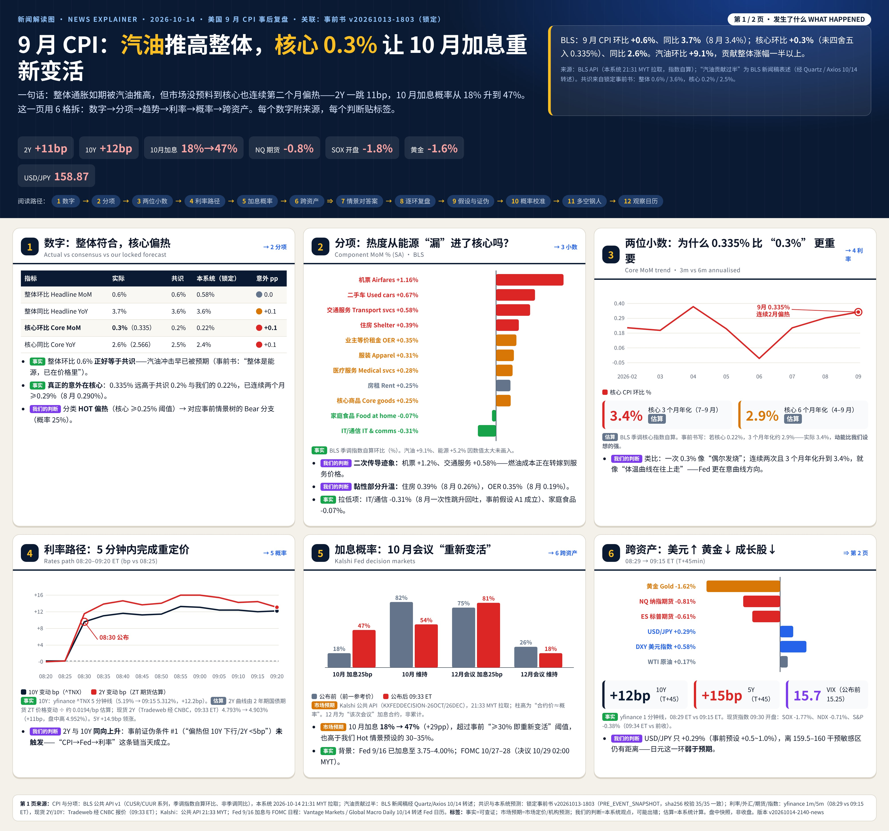
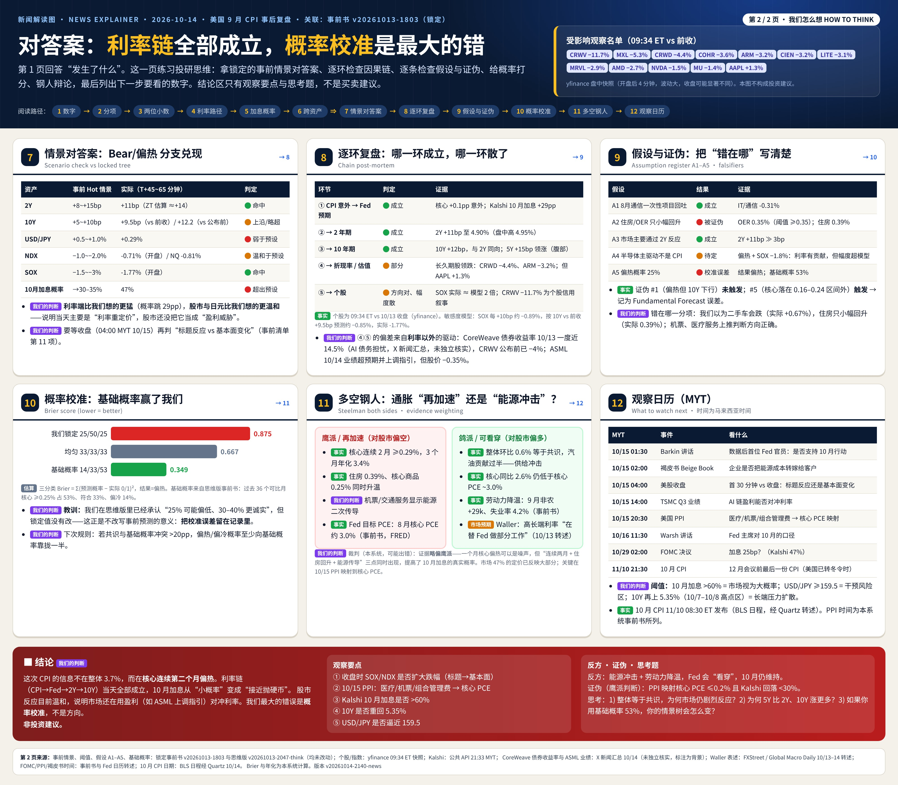

# US CPI Sep 2026 — 事后复盘 Post-Event Review v20261015-0800-post
> ✅ 正式复盘｜事前书（锁定）：v20261013-1803，快照 2026-10-13T18:03:00+08:00｜发布时间 2026-10-14 20:30 SGT｜数据来源：BLS API；市场 yfinance（交易日 2026-10-14）｜**非投资建议**

**⏱ 30秒看懂**

1. **发生什么：**9 月 CPI 结果：核心环比 0.3%（共识 0.2%），分类 **HOT 偏热**。
2. **和我的股票有什么关系：**10 年期变动 -2.7bp；事前我们说利率敏感股（CCL/ARM/SPCX…）受影响最大——下表检验。
3. **该看什么/做什么：**对照事前假设逐环复盘：哪一环成立、哪一环断了，就是这次最大的学习点。

## 1. 实际 vs 共识 vs 我们的事前假设
| 指标 | 实际 | 共识(事前锁定) | 本系统假设 | 意外 |
|---|---|---|---|---|
| headline_mom | 0.6% | 0.6% | 0.58% | +0.0pp |
| headline_yoy | 3.7% | 3.6% | 3.6% | +0.1pp |
| core_mom | 0.3% | 0.2% | 0.22% | +0.1pp |
| core_yoy | 2.6% | 2.5% | 2.4% | +0.1pp |

事前概率：偏冷 25% / 符合 50% / 偏热 25% → 结果：**HOT 偏热**

## 2. 市场反应（发布日收盘 vs 前收）
| 资产 | 收盘 | 前收 | 变动 |
|---|---|---|---|
| 10Y | 5.19 | 5.22 | -2.7bp |
| S&P500 | 7,718.94 | 7,805.45 | -1.11% |
| NDX | 29,950.82 | 30,569.48 | -2.02% |
| SOX | 11,684.38 | 12,208.79 | -4.30% |
| USDJPY | 158.32 | 158.52 | -0.12% |
| VIX | 16.87 | 15.27 | +10.48% |

事前（锁定）：10Y 5.24%、2Y 4.75%、VIX 15.48、Kalshi 10 月加息 20% / 12 月 73%

**Kalshi 事后（公开 API，抓取 2026-10-15 08:00 MYT，按最新成交价）：** 10 月会议加息 31%（前一日 20%；事前锁定 20%）｜12 月会议加息 83%（事前 73% 的合约口径未在锁定快照中注明，可能与"单次会议"合约不可比）。

## 3. 利率敏感度预测 vs 实际（检验事前模型）
| 个股 | 敏感度(每+10bp) | 预测涨跌 | 实际涨跌 | 偏差 |
|---|---|---|---|---|
| CCL | -2.59% | +0.70% | +0.94% | +0.24pp |
| ARM | -2.56% | +0.69% | +0.06% | -0.63pp |
| SPCX | -2.56% | +0.69% | -4.21% | -4.90pp |
| MRVL | -1.84% | +0.50% | +1.08% | +0.58pp |
| RKLB | -1.77% | +0.48% | -2.27% | -2.75pp |
| INTC | -1.53% | +0.41% | +1.44% | +1.03pp |
| GLW | -1.49% | +0.40% | +0.86% | +0.45pp |
| KLAC | -1.21% | +0.33% | -3.22% | -3.55pp |
| CIEN | -1.18% | +0.32% | -1.14% | -1.46pp |
| QCOM | -1.16% | +0.31% | +1.39% | +1.08pp |
| AMD | -1.05% | +0.28% | +1.90% | +1.62pp |
| NDX | -0.67% | +0.18% | -2.02% | -2.20pp |
| SOX | -0.89% | +0.24% | -4.30% | -4.54pp |

怎么读：偏差大=当天有利率以外的驱动（行业新闻、个股消息）——事前已提示 R² 很低。

## 3b. 概率校准 vs 基础概率（规则：共识/我们的概率与基础概率差 >20pp 时，向基础概率收缩 ≥50%）
| 情景 | 事前概率(锁定) | 基础概率(过去36个月核心环比) | 差距 | 校准后 | 实际结果 |
|---|---|---|---|---|---|
| cool | 25% | 14% | +11pp | 22% |  |
| inline | 50% | 33% | +17pp | 44% |  |
| hot | 25% | 53% | -28pp | 34% | ✔ |

分档：偏冷 ≤0.15%、符合 0.15–0.25%、偏热 ≥0.25%（核心 CPI 环比，FRED CPILFESL）。Brier 分数（越低越好）：事前 0.875 vs 校准后 0.675 vs 纯基础概率 0.353。Excel「Calibration」页为实时公式。

## 3c. 来源账本 Source Ledger
| 数据 | 数值 | 来源 | 时间 |
|---|---|---|---|
| CPI 实际（核心/整体 环比、同比） | {'headline_mom': 0.6, 'headline_yoy': 3.7, 'core_mom': 0.3, 'core_yoy': 2.6} | BLS API（SA 算环比，NSA 算同比） | 2026-10-14 20:30 SGT |
| 共识 | 核心环比 0.2%、同比 2.5% | 事前书 v20261013-1803（锁定） | 2026-10-13T18:03:00+08:00 |
| 10Y 变动 | -2.7bp | yfinance ^TNX | 2026-10-14 收盘 |
| Kalshi 10 月加息 | 0.31 | Kalshi 公开 API KXFEDDECISION-26OCT | 2026-10-15 08:00 MYT |
| Kalshi 12 月会议加息 | 0.8300000000000001 | Kalshi 公开 API KXFEDDECISION-26DEC | 2026-10-15 08:00 MYT |
| 利率敏感度 | 13 只 | 事前书 §利率敏感度（过去一年回归，R² 低） | 2026-10-13T18:03:00+08:00 |
| 基础概率 | 偏冷/符合/偏热 14%/33%/53% | FRED CPILFESL 过去 36 个月 | 本次运行 |
| 个股/指数涨跌 | 17 项 | yfinance | 2026-10-14 |

## 3d. 假设登记 Assumption Register
| # | 假设 | 类型 | 检验/失效条件 |
|---|---|---|---|
| 1 | 偏热阈值：核心环比 ≥0.25% 或意外 ≥+0.1pp | ASSUMPTION | 若市场对 0.25% 无反应，阈值需上调 |
| 2 | 利率敏感度在事件日仍成立 | HYPOTHESIS | 偏差 MAE > 1.5pp 视为失效（Excel Sensitivity!MAE） |
| 3 | Kalshi 最新成交价≈市场概率 | ASSUMPTION | 成交稀薄/价差 >5c 时不可靠 |
| 4 | 36 个月基础概率代表当前通胀体制 | ASSUMPTION | 若体制切换（如连续加息周期），基础概率需重算 |
| 5 | 概率校准规则：差 >20pp 收缩 ≥50% | RULE (master prompt v2026-10-14) | 累计 Brier 若校准后更差则复核规则 |

## 4. 推理复盘（逐环）Chain post-mortem
> ⚠ 时间口径：本节市场数据为**盘中快照**（公布后约 45–65 分钟，09:15–09:35 ET），**不是收盘**。收盘复核在美股收盘后（10/15 04:00 MYT）进行。

| 环节 | 成立/断开 | 证据 | 学到什么 |
|---|---|---|---|
| ①CPI意外→美联储预期 | ✅ 成立 | 核心 0.335%（共识 0.2%）；Kalshi 10 月加息 18%→47%（+29pp） | 市场对"连续两个月偏热"的反应大于单月意外的线性外推 |
| ②→2年期 | ✅ 成立 | 2Y 4.793%→4.903%（+11bp，盘中高 4.952%；Tradeweb 经 CNBC 09:33 ET）；ZT 期货估算距公布前约 +14bp | 2Y = 市场对 Fed 路径的投票，≥+8bp 阈值明确触发 |
| ③→10年期 | ✅ 成立 | 10Y 08:29 5.19% → 09:15 5.312%（+12.2bp），与 2Y 同向；5Y +14.9bp 领涨 | 腹部（5Y）最敏感：市场重定价的是"未来 1–3 年加息路径" |
| ④→折现率/估值 | 🟠 部分 | 长久期股领跌（CRWD -4.4%、ARM -3.2%），但 AAPL +1.3% | 折现率上升并非均匀作用；资金在高久期与防御型大盘股之间轮动 |
| ⑤→个股 | 🟠 方向对、幅度散 | SOX 开盘 -1.77% ≈ 敏感度模型预测（约 −0.85%）的 2 倍；CRWV -11.7%（公布前已约 −4%，AI 债务叙事） | R² 低的模型只能给方向；个股消息（信用、业绩）会盖过利率 |

### 4a. 分项拆解（BLS 季调指数自算环比）
| 分项 | 9 月 | 8 月 |
|---|---|---|
| 汽油 Gasoline | +9.09% | +3.90% |
| 能源 Energy | +5.20% | +2.10% |
| 住房 Shelter | +0.39% | +0.26% |
| 业主等价租金 OER | +0.35% | +0.19% |
| 房租 Rent of primary residence | +0.25% | +0.17% |
| 核心服务 Services less energy svcs | +0.37% | +0.33% |
| 核心商品 Core goods | +0.25% | +0.11% |
| 二手车 Used cars | +0.67% | +0.36% |
| 服装 Apparel | +0.31% | +0.02% |
| 机票 Airline fares | +1.16% | +2.68% |
| 交通服务 Transportation services | +0.58% | +0.45% |
| 医疗服务 Medical care services | +0.28% | -0.25% |
| 车险 Motor vehicle insurance | +0.07% | -0.75% |
| 信息技术/无线 IT | -0.31% | -0.32% |
| 家庭食品 Food at home | -0.07% | +0.04% |

- 核心 3 个月年化 **3.4%**（7–9 月：0.215% / 0.290% / 0.335%），6 个月年化 2.9%（估算，BLS 季调核心指数）。事前书写"若核心 0.22%，3 个月年化约 2.9%"——实际动能更强。
- 汽油贡献整体涨幅一半以上（BLS 新闻稿，经 Quartz/Axios 10/14 转述）。
- 超级核心（核心服务剔除住房）：BLS 不直接发布；按住房约占核心服务 58% 粗估 ≈0.34%（**估算**，接近但未超过事前 >0.35% 阈值）。

### 4b. 首 45 分钟市场反应（08:29 → 09:15 ET，yfinance 1 分钟线）
| 资产 | 公布前 08:29 | 09:15 | 变动 |
|---|---|---|---|
| 10Y (^TNX) | 5.190% | 5.312% | +12.2bp |
| 5Y (^FVX) | 4.980% | 5.129% | +14.9bp |
| 2Y 现货（Tradeweb/CNBC，vs 前收） | 4.793% | 4.903%（09:33） | +11bp |
| USD/JPY | 158.41 | 158.87 | +0.29% |
| DXY 美元指数 | 102.20 | 102.79 | +0.58% |
| NQ 纳指期货 | 30,840 | 30,589 | -0.81% |
| ES 标普期货 | 7,878.5 | 7,830.2 | -0.61% |
| 黄金期货 | 4,174.5 | 4,106.8 | -1.62% |
| WTI 原油 | 95.20 | 95.36 | +0.17% |
| VIX | 15.25 | 15.73 | +0.48 |
| SOX / NDX / S&P（09:34 ET vs 前收） | — | — | -1.77% / -0.71% / -0.38% |

### 4c. 加息概率（Kalshi 公共 API，21:33 MYT）
| 合约 | 公布前参考价 | 公布后 | 变动 |
|---|---|---|---|
| 10 月会议 加息 25bp | 18% | 47% | +29pp |
| 10 月会议 维持 | 82% | 54% | -28pp |
| 12 月会议 加息 25bp | 75% | 81% | +6pp |
| 12 月会议 加息 >25bp | 3% | 6% | +3pp |

事前（锁定）为 Kalshi 10 月 20% / 12 月 73%。注意 12 月合约是"该次会议"的决定，不是累计概率。

### 4d. 情景对答案（锁定情景树 Bear/偏热）
| 资产 | 事前 Hot 情景 | 实际 | 判定 |
|---|---|---|---|
| 2Y | +8~+15bp | +11bp | ✅ 命中 |
| 10Y | +5~+10bp | +9.5bp vs 前收 / +12.2bp vs 公布前 | 🟠 上沿/略超 |
| USD/JPY | +0.5~+1.0% | +0.29% | 🔴 弱于预设 |
| NDX | −1.0~−2.0% | -0.71%（开盘）/ NQ -0.81% | 🟠 温和于预设 |
| SOX | −1.5~−3% | -1.77%（开盘） | ✅ 命中 |
| 10 月加息概率 | →30–35% | 47% | 🔴 超出预设 |

### 4e. 假设清单与证伪
| 假设 / 证伪条件 | 结果 | 证据 |
|---|---|---|
| A1 8 月通信一次性项目回吐 | ✅ 成立 | IT/通信 -0.31% |
| A2 住房/OER 只小幅回升（证伪：OER ≥0.35%） | 🔴 被证伪 | OER 0.350%，住房 0.39% |
| A3 市场主要通过 2Y 反应 | ✅ 成立 | 2Y +11bp |
| A4 半导体主驱动不是 CPI | 🟠 待收盘 | 偏热 + SOX −1.8%：利率有贡献，但幅度约为模型 2 倍 |
| A5 偏热概率 25% | 🔴 概率校准误差 | 结果偏热；基础概率 53% |
| 证伪 #1 偏热但 10Y 下行/2Y <5bp | 未触发 | 2Y、10Y 同向大涨 → 传导映射当天有效 |
| 证伪 #4 整体 ≥0.7% 且核心 ≤0.2% | 不适用 | 整体 0.649%、核心 0.335% |
| 证伪 #5 核心落在 0.16–0.24 区间外 | 🔴 触发 | 0.335% → Fundamental Forecast 误差：二手车（+0.67%，我们预期下跌）与住房被低估 |

### 4f. 概率校准 Calibration
- 三分类 Brier 分数（越低越好）：我们锁定的 25/50/25 = **0.875**；均匀 1/3 = 0.667；基础概率 14/33/53 = **0.349**（本系统计算）。
- 我们在思维版（v20261013-2047-think）已写"偏热 30–40% 更诚实"，但锁定值保持 25% 不改——这次结果把这一校准误差留在记录里。
- 新规则（建议）：当共识/投行与基础概率差 >20pp，情景概率至少向基础概率靠拢一半，并在事前书单列"基础概率 vs 我们"一行。

### 4g. 多空钢人
- **鹰派/再加速：**核心连续两月 ≥0.29%，3 个月年化 3.4%；住房与核心商品同时升温；机票（+1.16%）与交通服务（+0.58%）显示能源二次传导；Fed 目标 PCE，8 月核心约 3.0%（事前书，FRED）。
- **鸽派/可看穿：**整体 0.6% 正好等于共识，汽油贡献过半（供给冲击）；核心同比 2.6% 仍低于核心 PCE；9 月非农 +29k、失业率 4.2%；Waller 称高长端利率"在做部分工作"（10/13 转述）。
- **裁判（我们的判断，可能出错）：**略偏鹰派——"连续两月 + 住房回升 + 能源传导"三点同时出现；但 Kalshi 47% 已反映大部分，下一步关键是 10/15 PPI 对核心 PCE 的映射。

### 4h. 观察名单影响（约 09:34 ET vs 10/13 收盘，盘中）
| 个股 | 变动 |
|---|---|
| CRWV | -11.66% |
| MXL | -5.28% |
| CRWD | -4.37% |
| COHR | -3.57% |
| ARM | -3.23% |
| CIEN | -3.21% |
| LITE | -3.09% |
| RKLB | -2.99% |
| MRVL | -2.92% |
| AMD | -2.74% |
| SIMO | -2.40% |
| SPCX | -2.24% |
| INTC | -2.21% |
| GLW | -2.13% |
| AMAT | -1.97% |
| CCL | -1.95% |
| AVGO | -1.90% |
| TSLA | -1.70% |
| PLTR | -1.62% |
| NVDA | -1.54% |
| QCOM | -1.48% |
| MU | -1.44% |
| KLAC | -1.25% |
| TSM | -1.23% |
| PWR | -0.83% |
| EME | -0.72% |
| ASML | -0.35% |
| AAPL | +1.31% |

读法：跌幅最大的 CRWV/MXL/CRWD/COHR/ARM/CIEN/LITE 中，CRWV 公布前已跌约 4%（AI 债务叙事），不能全部归因 CPI；AAPL 逆势上涨显示资金向防御型大盘股轮动；ASML 业绩超预期并上调 2026 指引，股价仍 -0.35%。

### 4i. 下一步看什么（MYT）
- 10/15 01:30 Barkin 讲话；02:00 褐皮书（能源成本转嫁？）；04:00 美股收盘（首 30 分钟 vs 收盘）。
- 10/15 14:00 TSMC Q3 业绩（AI 链盈利能否对冲利率）；20:30 美国 PPI（医疗/机票/组合管理费 → 核心 PCE）。
- 10/16 11:30 Warsh 讲话；10/29 02:00 FOMC 决议；11/10 21:30 10 月 CPI（美国已转冬令时）。
- 阈值：Kalshi 10 月加息 >60%；USD/JPY ≥159.5；10Y 重回 5.35%。

### 4j. 最终自我质疑
- 我们是否把盘中前一小时当成了结论？收盘可能完全不同（事前清单第 11 项）。
- 核心 0.335% 中二手车、服装等波动项占一部分；若 10 月回落，"再加速"叙事会被削弱。
- 5Y 领涨也可能部分来自供给/期限溢价而非 CPI；需要对照收盘与 PPI 再判断。

## 5. 运行日志 Run log
- pre-event integrity: 35/35 content files match locked sha256 (manifest.json is written after the lock by design)
- CPI 2026-09: {'headline_mom': 0.6, 'headline_yoy': 3.7, 'core_mom': 0.3, 'core_yoy': 2.6} source=BLS API
- market session used: 2026-10-14 (release day)
- Kalshi fetched 2026-10-15 08:00 MYT: Oct hike 0.31 (prev-day 0.2), Dec-meeting hike 0.8300000000000001

**✅ 自我测验 Check your understanding**

Q1. 如果核心意外为 0 但 10 年期大涨，链条哪一环'断'了？

**答案：**①→②成立与否无关；说明利率由其他因素（供给/期限溢价/其他数据）驱动——环③独立于CPI。

Q2. 敏感度预测与实际偏差很大，说明模型错了吗？

**答案：**不一定：R² 低意味着单日噪声大；要看多次事件的平均偏差（基础概率）。

