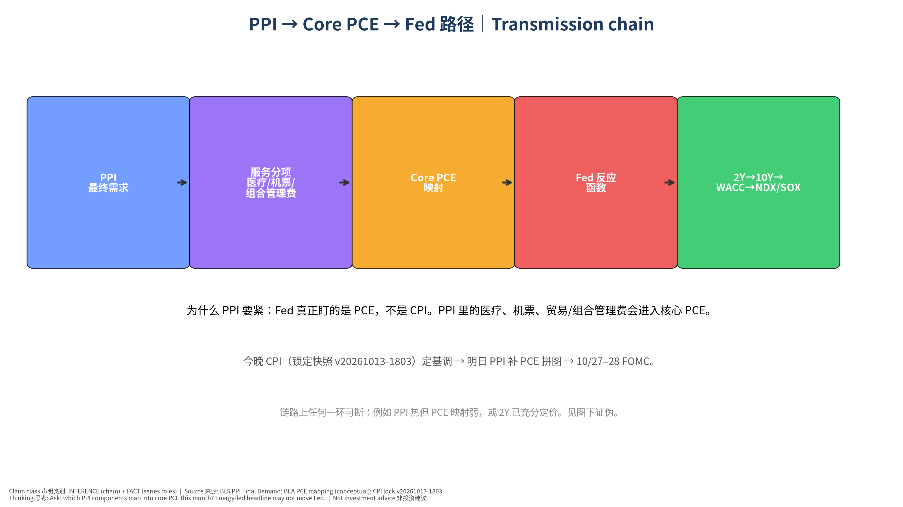
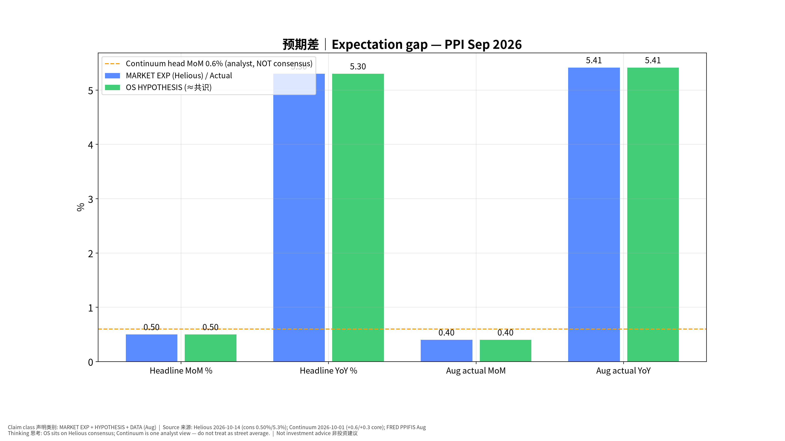
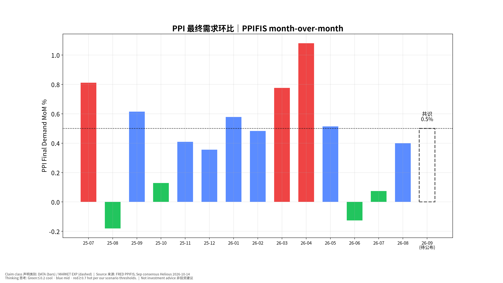
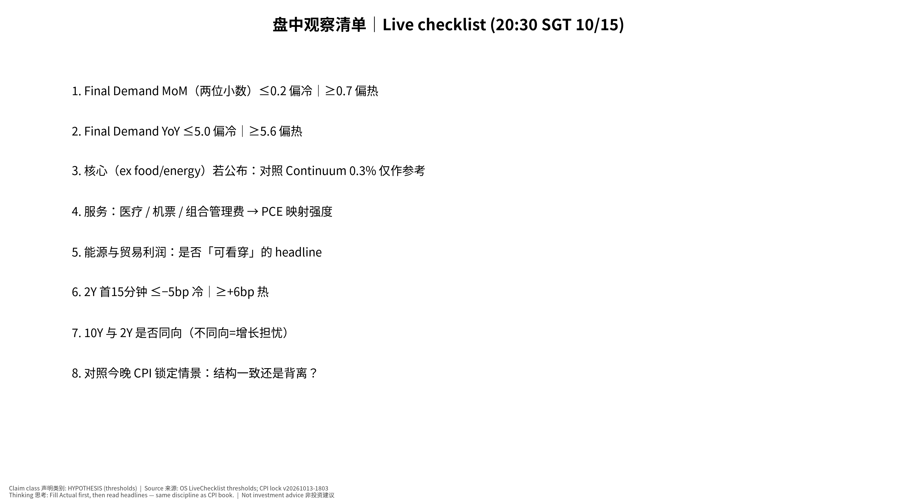

# 美国9月PPI 发布前事件书｜US PPI (Sep 2026) Pre-Event Book — 专业中文版

> **发布时间：2026-10-15（周四）08:30 美东 = 20:30 新加坡时间 (SGT)**｜状态 **CONFIRMED**（bls.gov/schedule/news_release/ppi.htm）
> 发布前快照锁定：**2026-10-14 18:06 SGT**（版本 v20261014-1806）。本文件不会在事后改写；实际值与复盘写入下一份 Daily OS / 21:20 事后流程。
> 非投资建议｜Not investment advice。标签：FACT｜DATA｜MARKET EXP｜HYPOTHESIS｜INFERENCE｜UNCERTAINTY。

**⏱ 30秒看懂**

1. **发生什么：**明天晚上 20:30 SGT 公布美国9月 PPI（生产者价格指数｜Producer Price Index）——工厂/企业卖出价格，不是你买菜的价格。
2. **和我的股票有什么关系：**Fed 真正盯的是 PCE；PPI 里的医疗、机票、组合管理费会映射进核心 PCE。今晚 CPI 定基调，PPI 补拼图，一起影响 10/27–28 FOMC 路径与利率敏感股。
3. **该看什么/做什么：**盯 Final Demand 环比：≤0.2% 偏冷，0.3–0.6% 符合（共识约 0.50%），≥0.7% 偏热；再看服务分项是否指向核心 PCE。

**🗺 阅读地图**

| 你有多少时间 | 读哪里 |
|---|---|
| 2 分钟 | ⏱30秒 + 第4节观察清单阈值。 |
| 10 分钟 | 第1–3节 + 图01/03：为什么 PPI→PCE，三种剧本。 |
| 30 分钟 | 全文 + 教学版 + 自我测验；对照今晚 CPI 锁定书。 |

层级说明：**L1 故事**（人人能懂）→ **L2 关键数字**（带解释）→ **L3 专业细节**（网页可折叠，默认收起）。

## 0. 与今晚 CPI 的关系（不改写锁定快照）
- CPI 锁定快照：`us-cpi-2026-09` **v20261013-1803**（只读）。共识核心环比 0.2%、我们 0.22%；情景 Cool/Inline/Hot 已锁。
- **本 PPI 书独立锁定**；不得回写 CPI 数字。
- 逻辑（INFERENCE）：若今晚核心偏热而明日 PPI 服务分项也热 → 核心 PCE 风险上升；若 CPI 热但 PPI 服务冷 → 可能是 CPI 住房等权重差异，Fed 反应更弱。

## 1. 执行摘要 Executive Summary
1. **共识 (MARKET EXP, Helious 2026-10-14)**：最终需求 PPI **+0.50% m/m、5.3% y/y**。8月实际 **+0.40% m/m / 5.4% y/y**（FRED PPIFIS 指数 Aug 157.411，与共识一致的量级）。
2. **分析师备选（非共识）**：Continuum Economics 预览（2026-10-01）预计 headline **+0.6%**（能源带动）、核心 ex food/energy **+0.3%**——标注为 analyst view，**不是** street consensus。
3. **我们 (HYPOTHESIS)**：贴近 Helious 共识 **+0.50% / 5.3%**；概率 Cool 25% / Inline 50% / Hot 25%。**UNCERTAINTY：我们没有独立分项模型，故不发明更「精确」的共识或假装高信心。**
4. **为什么重要**：PCE 是 Fed 偏好指标；PPI→PCE 映射 + 今晚 CPI 结构 = FOMC 前最后通胀拼图之一。10Y 已处高位、半导体对利率敏感 → 偏热路径对 NDX/SOX 非对称偏空。
5. **观察名单**：利率敏感（ARM/PLTR/RKLB/CCL…）与 AI 融资叙事（EME/PWR/CRWV）；TSM 同日下午财报情绪叠加油。

## 2. 共识 vs 我们 Expectation Gap

| 指标 | 8月前值 (DATA) | 共识 MARKET EXP | 来源/日期 | 我们 HYPOTHESIS | 差 |
|---|---|---|---|---|---|
| Final Demand MoM | +0.40% | **+0.50%** | Helious 2026-10-14 | **+0.50%** | 0 |
| Final Demand YoY | +5.41% (FRED calc) | **5.3%** | Helious 2026-10-14 | **5.3%** | 0 |
| Core ex F/E MoM | — | 未见统一街共识 | Continuum 估 +0.3% (2026-10-01) | 无独立点估计；看分项 | — |

FRED PPIFIS：Aug 157.411 / Jul 156.784 / Aug-2025 149.327。

## 3. 情景树 Scenarios (HYPOTHESIS)

| 情景 | 阈值 | 概率 | 2Y | 10Y | USD/JPY | NDX | SOX |
|---|---|---|---|---|---|---|---|
| Cool 偏冷 | FD MoM ≤0.2% 或 YoY ≤5.0% | 25% | −5~−10bp | −3~−8bp | −0.3~−0.8 | +0.5~+1.2% | +0.8~+2% |
| Inline 符合 | MoM 0.3–0.6%；YoY ~5.1–5.5% | 50% | ±3bp | ±4bp | 持平 | ±0.5% | 由 AI/财报主导 |
| Hot 偏热 | MoM ≥0.7% 或 YoY ≥5.6% | 25% | +6~+12bp | +4~+8bp | +0.4~+0.9 | −0.8~−1.8% | −1~−2.5% |

子情景：**Headline ≥0.7% 但核心/服务软** = 能源冲击可看穿；债市可能分化。**服务（医疗/机票/组合管理）强** = PCE 映射担忧上升。

## 4. 发布时观察清单 Live-Observation Checklist（20:30 SGT 10/15）

先填实际值，再看标题。

| # | 看什么 | 偏冷 | 偏热 | 初学者注释 |
|---|---|---|---|---|
| 1 | Final Demand 环比（两位小数） | ≤0.2 | ≥0.7 | 共识约 0.50%；0.5 与 0.7 标题差很大 |
| 2 | Final Demand 同比 | ≤5.0 | ≥5.6 | 8月约 5.4%；共识 5.3% |
| 3 | 核心（若公布） | 明显 <0.3 | 明显 >0.4 | Continuum 0.3% 仅参考，非共识 |
| 4 | 医疗服务、机票、组合管理费 | 温和 | 大幅跳升 | 这些更可能进核心 PCE |
| 5 | 能源与贸易利润 | — | 主导 headline | 「可看穿」vs「二次传导」 |
| 6 | 2Y 首15分钟 | ≤−5bp | ≥+6bp | 市场对 Fed 路径的投票 |
| 7 | 10Y 与 2Y 方向 | 同向 | 热但 10Y 跌 | 增长担忧 → 传导图当天失效 |
| 8 | 与今晚 CPI 结构对照 | 双冷 | 双热/服务共振 | 一致性决定 PCE 叙事强度 |

## 5. 受影响观察名单
- **利率路径**：ARM、PLTR、RKLB、CCL、MRVL、INTC（与 CPI 书同一敏感度框架，DATA 来自 CPI 锁定书回归，R² 低仅参考）。
- **AI 资本成本叙事**：EME、PWR、CRWV、NVDA、AVGO。
- **同日 TSM**：14:00 SGT 财报；PPI 若偏热可能压制 ADR 风险偏好（情绪，非基本面因果）。
- **存储**：MU/SIMO 仍可能由供给新闻主导（CXMT 叙事）——若 PPI 冷而 MU 弱，确认驱动在 Industry multiple。

## 6. 证伪条件 Falsifiers
1. FD ≥0.7% 但 2Y 升幅 <3bp → 已定价或交易增长；Hot→Rates→Tech 映射失效。
2. FD ≤0.2% 但 SOX 仍跌 >1.5% → 半导体由供给/AI capex 叙事驱动。
3. Headline 热、服务分项冷，但 10Y 盈亏平衡大涨 → 市场担心二次传导，「可看穿能源」假设失效。
4. 我们贴共识却落在 Cool/Hot 阈值外 → Fundamental Forecast 误差（记录分项）。
5. PPI 与今晚 CPI 服务方向严重背离且 PCE 预期不动 → 下调 PPI→PCE 当月权重。

## 7. 思维教程 Thinking Tutorial
看什么（FD MoM + 服务分项）→ 为什么（PCE 映射 + FOMC）→ 证据（分项 + 2Y）→ 传导（2Y→10Y→WACC→倍数）→ 其他解释（能源一次性、仓位、TSM 情绪）→ 证伪（§6）→ 下一步（零售销售/进口价格、TSM 会后、FOMC）。

## 8. 最终自我质疑
- 我们把 OS 贴在 Helious 上，是诚实的不确定性，还是偷懒？若 Continuum 0.6% 更接近真实，我们的 Inline 带宽是否过宽？
- Headline 共识可能被能源主导；真正的研究问题是服务→PCE，而街面上核心共识稀薄——**UNCERTAINTY 本身就是结论的一部分**。
- 同日 TSM 可能盖过 PPI 对 SOX 的影响；归因时勿把财报反应算进 PPI。

## 9. Source Ledger（摘要）
| 来源 | 日期 | 用途 | 类别 |
|---|---|---|---|
| bls.gov/schedule/news_release/ppi.htm | 查证 2026-10-14 | 发布时间 CONFIRMED | FACT |
| Helious forecast page | 2026-10-14 | FD +0.50% / 5.3% | MARKET EXP |
| Continuum Economics preview | 2026-10-01 | +0.6% head / +0.3% core | Analyst view（非共识） |
| FRED PPIFIS | 拉取至 Aug 2026 | 前值指数与 MoM/YoY | DATA |
| CPI PRE_EVENT_SNAPSHOT v20261013-1803 | 2026-10-13 | 联动，不改写 | Locked |

## 10. Assumption Register
1. Helious 数字代表可用的街共识代理（ASSUMPTION）——若日后获得 Bloomberg 调查中位数将替换并标注。
2. Cool/Hot 阈值围绕 0.50% 对称加宽（HYPOTHESIS）。
3. 反应路径为数量级示意，非交易信号（HYPOTHESIS）。
4. PPI 服务分项→核心 PCE 映射在当月成立（INFERENCE；可被 BEA 细节证伪）。

## 图表 Charts

