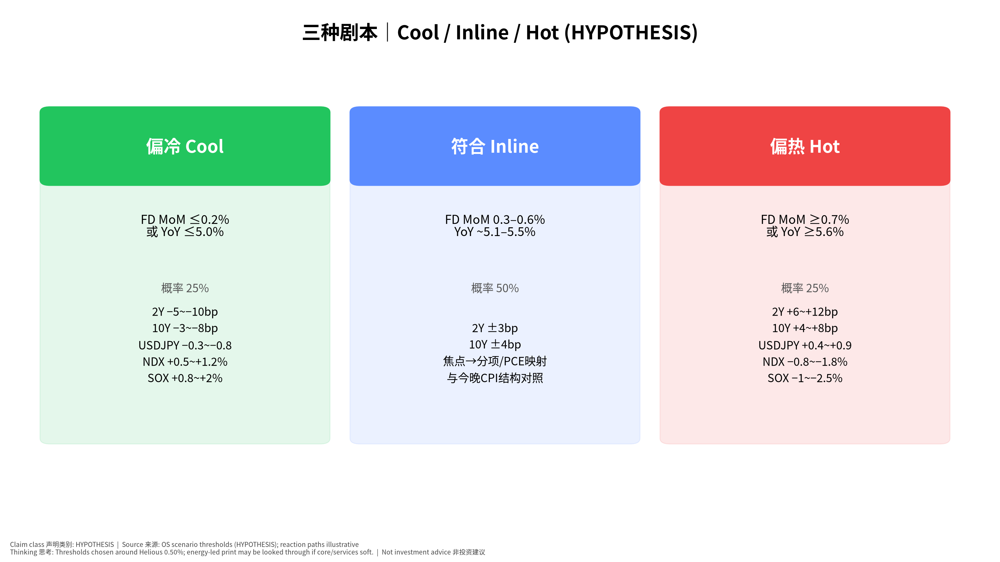

# 美国9月PPI 发布前·教学版｜v20261014-1806

> 公布：**2026-10-15（周四）20:30 SGT**。对照 CPI 锁定书 v20261013-1803（不改写）。非投资建议。

**⏱ 30秒看懂**

1. **发生什么：**PPI 是「企业卖出价格」指数，比 CPI 更靠生产端。
2. **和我的股票有什么关系：**它影响美联储看的 PCE：医疗、机票等费用会从 PPI 渗进核心 PCE，从而影响利率和成长股估值。
3. **该看什么/做什么：**只记：Final Demand 环比 ≤0.2 偏好消息，约 0.5 正常，≥0.7 偏坏；并问「热在能源还是热在服务？」

**🗺 阅读地图**

| 你有多少时间 | 读哪里 |
|---|---|
| 2 分钟 | 30秒 + 情景表。 |
| 10 分钟 | 第1–4节 + 图01。 |
| 30 分钟 | 对照 CPI 教学版，做测验。 |

层级说明：**L1 故事**（人人能懂）→ **L2 关键数字**（带解释）→ **L3 专业细节**（网页可折叠，默认收起）。

## 1. 发生什么（L1）
劳工统计局公布 **PPI (Producer Price Index｜生产者价格指数)**。你买东西看 CPI；工厂出厂价看 PPI。美联储更关心 **PCE**，而 PPI 的一部分服务会「流进」PCE。

## 2. 市场在猜什么（L2）
街面上我们引用的共识（Helious，2026-10-14）：**+0.50% 环比、5.3% 同比**。Continuum（10/01）另给出 +0.6% / 核心 +0.3%——那是一家的看法，不是共识。我们的假设贴着 0.50%，因为没有更强模型（诚实的不确定性）。

## 3. 三种剧本
见图03：绿偏冷 / 蓝符合 / 红偏热。概率 25/50/25。

**📊 怎么看这张图**

- **坐标/颜色：**三色方框=三种结果；下方是利率与股指的可能方向。
- **只记住一件事：**中间「符合」最可能；真正要学的是问「热在哪一分项」。
- **什么会改变结论：**若能源很热但服务很冷，标题吓人但 Fed 可能不太动。

## 4. 公布时看什么
用专业版第4节表格；先填数再看新闻。

## 5. 和今晚 CPI 怎么一起想
CPI 已锁定。若两者服务都热 → 更担心核心 PCE；若一个热一个冷 → 先别下死结论，等 PCE。

## 6. 证伪（白话）
数字很热但美债利率不怎么动 → 市场早知道了或在担心经济变差；别机械地以为「热通胀=科技股必跌」。

**✅ 自我测验 Check your understanding**

Q1. PPI 和 CPI 哪个更贴近美联储的正式目标？

**答案：**都不是正式目标本身——**PCE** 才是；PPI/CPI 是拼图。

Q2. Helious 的 0.50% 和 Continuum 的 0.6% 哪个是共识？

**答案：**Helious 在本书中作 MARKET EXP 代理；Continuum 明确标为分析师观点，不是共识。

Q3. 为什么要看医疗/机票而不是只看能源？

**答案：**它们更容易映射进核心 PCE；能源常被「看穿」。

## 术语
| 术语 | 白话 | English |
|---|---|---|
| PPI | 生产者出厂价格指数 | Producer Price Index |
| Final Demand | 最终需求：卖给最终用户的价格 | PPI Final Demand |
| PCE | 美联储偏好的通胀指标 | Personal Consumption Expenditures price index |
| 映射 | 一个指数的分项如何进入另一个指数 | pass-through / mapping |
