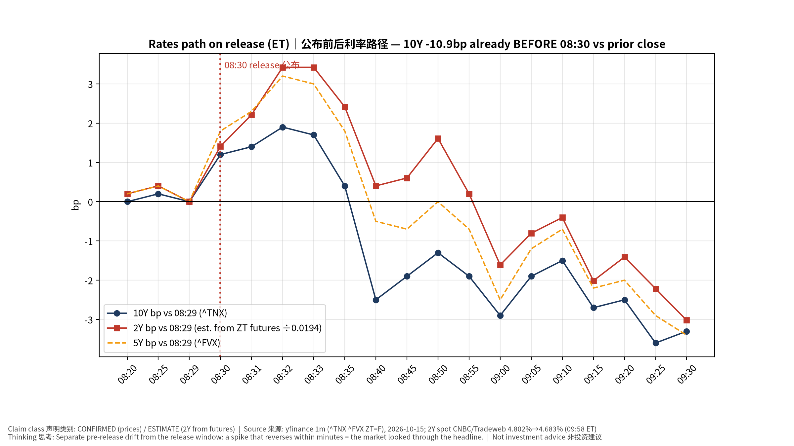
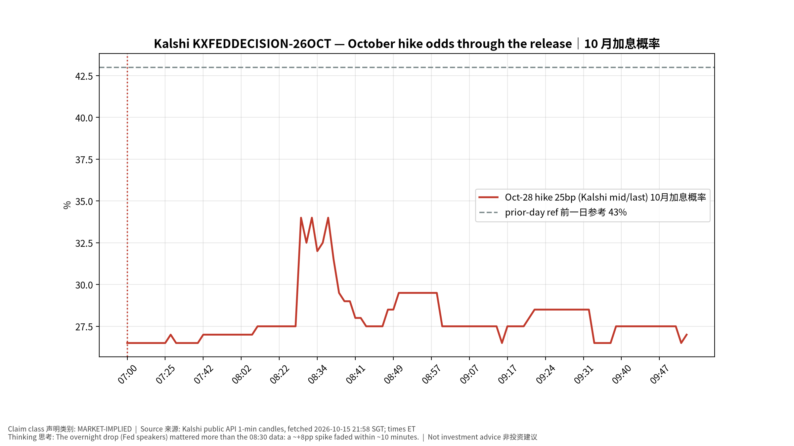
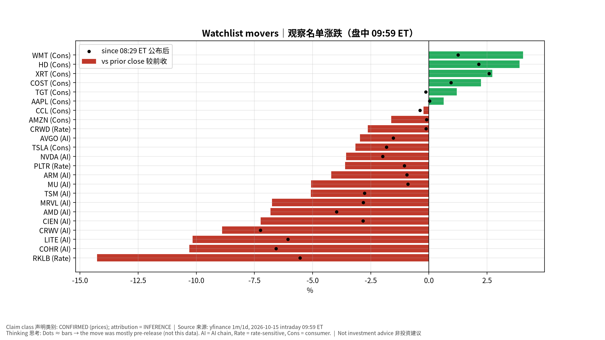
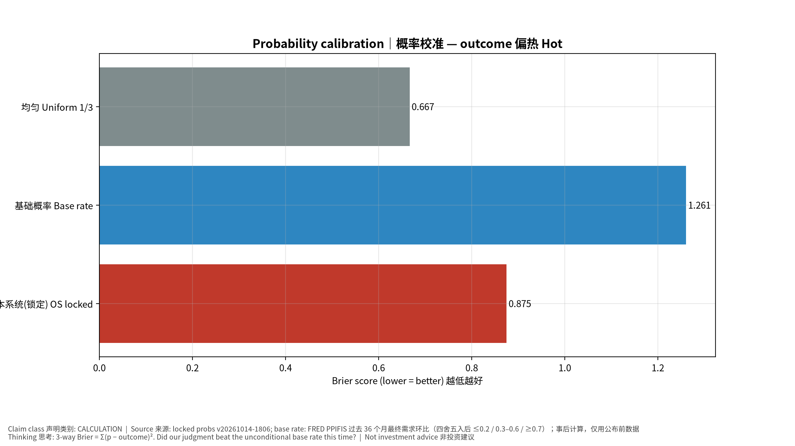
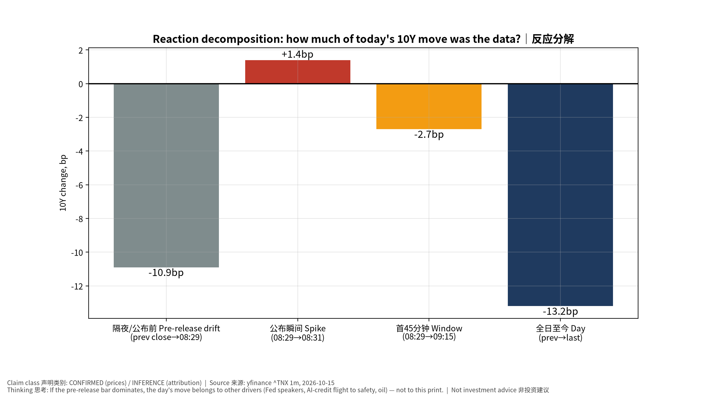

# 美国9月PPI — 重要事件即时复盘 Post-Event Review v20261015-2158-post
> ✅ 正式复盘（盘中版：市场数据截至 09:59 ET，收盘后复核）｜事前书（锁定，未改写）：v20261014-1806，快照 2026-10-14T18:06｜发布 2026-10-15 20:30 SGT（2026-10-15 08:30 ET）｜数据：BLS public API v1: SA indexes for MoM (WPSFD4, WPSFD49104, WPSFD49116), NSA for YoY (WPUFD…｜**非投资建议 Not investment advice**
> 标签：FACT 事实｜MARKET EXP 市场预期｜HYPOTHESIS 我们的事前假设｜INFERENCE 推断｜ESTIMATE 估算

**⏱ 30秒看懂**

1. **发生什么：**美国9月PPI：最终需求 +1.3%、同比 +6.3%（共识 0.5% / 5.3%，我们锁定贴共识），核心 +0.7%；判定 **偏热 Hot**，热度主要来自能源与运输。
2. **和我的股票有什么关系：**10Y 全日 -13.2bp，但其中 -10.9bp 发生在 08:30 之前；公布后 45 分钟仅 -2.7bp。10 月加息概率 28%→峰值 36%→28%。科技股下跌主因是 AI 信用/拥挤仓位，不是这份数据。
3. **该看什么/做什么：**学会「拆时间窗」：先看公布前漂移，再看公布瞬间，再看 45 分钟后是否回吐——回吐=市场看穿了标题。

**🗺 阅读地图**

| 你有多少时间 | 读哪里 |
|---|---|
| 2 分钟 | ⏱30秒 + 第 2 节情景对答案 + 图03/08 |
| 10 分钟 | 第 1–3 节 + 第 4 节逐环复盘 |
| 30 分钟 | 全文 + 钢人辩论 + 校准 + 测验 + Excel |

层级说明：**L1 故事**（人人能懂）→ **L2 关键数字**（带解释）→ **L3 专业细节**（网页可折叠，默认收起）。

## 1. 实际 vs 共识 vs 锁定预测（FACT vs MARKET EXP vs HYPOTHESIS）
| 指标 | 实际（OS 计算） | 官方四舍五入 | 共识（锁定） | 本系统（锁定） | 意外 vs 共识 | 我们的误差 |
|---|---|---|---|---|---|---|
| 最终需求 Final demand MoM | +1.34% |  | 0.5% | 0.5% | +0.84pp | +0.84pp |
| 最终需求 Final demand YoY | +6.34% |  | 5.3% | 5.3% | +1.04pp | +1.04pp |
| 核心（除食品能源）Core ex F&E MoM〔对照列=Continuum 分析师观点 0.3%，非共识〕 | +0.68% |  | 0.3% | — | +0.38pp | N/A |
| 核心 Core ex F&E YoY | +4.97% |  | — | — | N/A | N/A |
| 除食品能源贸易 Ex F/E/trade MoM | +0.49% |  | — | — | N/A | N/A |

前月最终需求环比修订后 +0.47%（锁定书前值 +0.40%）。核心(除食品能源)同比 +4.97%；除食品能源贸易同比 +5.04%。

### 1a. 分项 Components
| 分项 | 本月环比 | 前月环比（修订后） |
|---|---|---|
| 能源 Energy (goods) | +10.78% | +4.46% |
| 运输仓储 Transport & warehousing | +3.44% | +2.18% |
| 机票 Airline passenger svcs* | +3.81% | +2.58% |
| 食品 Foods | +1.22% | -0.32% |
| 贸易利润 Trade margins | +1.38% | +0.19% |
| 最终需求商品 FD goods | +2.65% | +1.09% |
| 服务 FD services | +0.82% | +0.21% |
| 医院住院 Hospital inpatient | +0.32% | +0.33% |
| 核心商品 Goods ex food&energy | +0.27% | +0.39% |
| 组合管理费 Portfolio mgmt* | +0.27% | +0.29% |
| 服务(除贸易运输) Svcs less trade/transp. | +0.25% | -0.00% |
| 医生服务 Physician care | -0.02% | +0.13% |

## 2. 情景对答案（锁定情景树，不改写）
| 情景 | 锁定概率 | 基础概率 | 结果 |
|---|---|---|---|
| 偏冷 Cool | 25% | 44% |  |
| 符合 Inline | 50% | 47% |  |
| 偏热 Hot | 25% | 8% | ✔ 实际 |

- 按锁定规则机械判定：**偏热 Hot**。
- 按「质量」变量（除食品能源贸易 ex F/E/T）判定：**偏热 Hot**（事后质量视角，阈值 ≤0.1%/≥0.5% 为事后设定、非锁定，仅用于教学对照）。两者不一致本身就是学习点（见第 4 节）。

## 3. 首 45 分钟市场反应（盘中快照，截至 09:59 ET｜非收盘）
| 资产 | 前收 | 08:29 ET | 08:31 | 09:15（T+45） | 最新 | 公布瞬间 | 首 45 分钟 | 较前收 |
|---|---|---|---|---|---|---|---|---|
| 10Y 美债 (^TNX) | 5.190% | 5.081% | 5.095% | 5.054% | 5.058% | +1.4bp | -2.7bp | -13.2bp |
| 5Y (^FVX) | 4.992% | 4.890% | 4.913% | 4.868% | 4.865% | +2.3bp | -2.2bp | -12.7bp |
| 2Y（ZT 期货估算 / CNBC 现货） | 4.802% |  |  |  | 4.683%（09:58 ET） | +2.2bp | -2.0bp | -11.9bp |
| USD/JPY | 158.32 | 158.01 | 158.07 | 157.84 | 157.58 | +0.04% | -0.11% | -0.47% |
| DXY 美元指数 | 102.55 | 102.13 | 102.21 | 102.07 | 102.06 | +0.08% | -0.05% | -0.47% |
| NQ 纳指期货 | 30,182.75 | 29,833.00 | 29,754.00 | 29,799.50 | 29,795.00 | -0.26% | -0.11% | -1.28% |
| ES 标普期货 | 7,770.25 | 7,751.50 | 7,737.75 | 7,744.00 | 7,739.50 | -0.18% | -0.10% | -0.40% |
| 黄金 Gold | 4,107.90 | 4,176.00 | 4,164.50 | 4,184.10 | 4,181.80 | -0.28% | +0.19% | +1.80% |
| WTI 原油 | 95.09 | 93.84 | 93.68 | 94.47 | 94.33 | -0.17% | +0.67% | -0.80% |
| VIX | 16.87 | 17.48 | 17.69 | 17.49 | 17.41 | +0.21 | +0.01 | +0.54 |
| NDX 纳指100 | 29,950.82 | （09:30 开盘） |  |  | 29,439.48 |  |  | -1.71% |
| SOX 费城半导体 | 11,684.38 | （09:30 开盘） |  |  | 11,207.27 |  |  | -4.08% |
| S&P 500 | 7,718.94 | （09:30 开盘） |  |  | 7,671.34 |  |  | -0.62% |

怎么读：「公布瞬间」= 08:29→08:31 ET；「首 45 分钟」= 08:29→09:15 ET；「较前收」包含公布前隔夜漂移。**同一秒还公布了 零售销售、初请、费城/纽约联储——窗口内反应是合成的。**

### 3a. 加息概率（Kalshi，MARKET-IMPLIED）
| 合约（Kalshi） | 前一日参考价 | 公布前 08:29 ET | 公布后峰值(08:30–09:15) | T+45 09:15 | 最新 |
|---|---|---|---|---|---|
| 10/28 会议 加息 25bp | 43% | 28% | 36% | 28% | 26% |
| 12 月会议 加息 25bp | 81% | 78% |  |  | 78% |

### 3b. 观察名单 Watchlist
| 代码 | 类别 | 盘前(08:29) vs 前收 | 公布后(08:29→最新) | 较前收（盘中 09:59 ET） |
|---|---|---|---|---|
| NVDA | AI | -1.60% | -1.98% | -3.55% |
| MU | AI | -4.20% | -0.90% | -5.06% |
| TSM | AI | -2.38% | -2.76% | -5.08% |
| AVGO | AI | -1.46% | -1.53% | -2.97% |
| ARM | AI | -3.28% | -0.95% | -4.20% |
| AMD | AI | -2.97% | -3.96% | -6.81% |
| MRVL | AI | -4.04% | -2.82% | -6.75% |
| LITE | AI | -4.36% | -6.07% | -10.16% |
| CIEN | AI | -4.53% | -2.83% | -7.24% |
| COHR | AI | -4.00% | -6.57% | -10.30% |
| CRWV | AI | -1.78% | -7.24% | -8.89% |
| PLTR | Rate | -2.58% | -1.05% | -3.61% |
| RKLB | Rate | -9.24% | -5.54% | -14.27% |
| CRWD | Rate | -2.51% | -0.12% | -2.63% |
| AAPL | Cons | +0.61% | +0.03% | +0.64% |
| TSLA | Cons | -1.35% | -1.83% | -3.15% |
| CCL | Cons | +0.15% | -0.38% | -0.23% |
| AMZN | Cons | -1.53% | -0.10% | -1.62% |
| WMT | Cons | +2.77% | +1.25% | +4.05% |
| COST | Cons | +1.28% | +0.95% | +2.24% |
| HD | Cons | +1.72% | +2.14% | +3.90% |
| TGT | Cons | +1.33% | -0.13% | +1.20% |
| XRT | Cons | +0.14% | +2.58% | +2.73% |

## 4. 推理复盘（逐环）Chain post-mortem
> ⚠ 市场数据为**盘中快照（截至 09:59 ET）**；收盘后 `--close-check` 复核。同秒公布零售销售（总额 +0.8%、控制组 +0.1%）、初请、费城/纽约联储。

| 环节 | 成立/断开 | 证据 | 学到什么 |
|---|---|---|---|
| ①PPI意外→核心PCE预期 | 🟠 部分 | 最终需求 +1.3%（共识 0.5%），但能源 +10.78%、运输仓储 +3.44%、贸易利润 +1.38%；除食品能源贸易 +0.49%；PCE 相关：机票 +3.81%（NSA）、组合管理 +0.27%（NSA）、医生 -0.02%、医院 +0.32% | 标题是「能源 + 运输 + 加价」；进核心 PCE 的部分只有机票明显偏热 |
| ②→Fed 10月预期 | 🟠 瞬间成立后回吐 | Kalshi 10 月加息 28%→36%→28%；前一日参考 43%（隔夜被 Bowman、Daly 的「可以等」压低） | 市场在数据前已经把 10 月加息降级；数据只造成 10 分钟的噪声 |
| ③→2年期 | ❌ 断开 | 2Y（ZT 估算）瞬间 +2.2bp，45 分钟 -2.0bp；全日 -11.9bp | 锁定偏热情景要求 +6~+12bp → 完全落空；证伪 #1 触发 |
| ④→10年期 | ❌ 断开 | 10Y 瞬间 +1.4bp，45 分钟 -2.7bp；全日 -13.2bp（-10.9bp 在公布前） | 「热通胀→长端升」被「供给冲击→增长担忧→避险」覆盖 |
| ⑤→NDX/SOX | 🟠 结果对、原因错 | NDX -1.71%、SOX -4.08% 落在偏热情景区间，但 NQ 公布后 45 分钟仅 -0.11%，跌幅主要在公布前（AI 信用/存储/仓位） | **「结果对、原因错」要记为推理错误**，不能当作预测成功 |

### 4a. 一句话结论：**能源冲击型偏热（energy-shock hot），市场选择「看穿」**
- 最终需求 +1.34%、同比 +6.34%——CNBC：2022 年 3 月以来最大单月涨幅、2022 年 12 月以来最高同比（Dow Jones 共识 0.6% / 5.5%，比我们锁定的 0.5% / 5.3% 更高）。
- 热度来源：能源商品 +10.78%、运输仓储 +3.44%、食品 +1.22%、贸易利润 +1.38%。BLS 指出：中间需求加工品涨幅约一半与柴油有关（CNBC 转述）——**二次传导迹象**。
- 剔除噪声后：除食品能源 +0.68%、除食品能源贸易 +0.49%（同比 +5.04%）；服务（除贸易运输）+0.25%——**底层服务通胀并没有失控**。
- 8 月最终需求环比修订为 +0.47%（锁定书前值 +0.40%）。

### 4b. 证伪条件逐条检查（锁定书 §6，不改写）
| # | 锁定证伪条件 | 实际 | 判定 |
|---|---|---|---|
| 1 | FD ≥0.7% 但 2Y 升幅 <3bp → 已定价或交易增长；Hot→Rates→Tech 映射失效 | FD +1.3%；2Y 瞬间 +2.2bp、45 分钟 -2.0bp | **触发**：Rates 环节失效；Tech 下跌另有原因 |
| 2 | FD ≤0.2% 但 SOX 仍跌 >1.5% | 不是偏冷 | N/A（但 SOX 的大跌提示：半导体由 AI 信用/供给叙事驱动——与此条的精神一致） |
| 3 | 标题热、服务冷，但盈亏平衡大涨 | 服务（除贸易运输）+0.25%；T10YIE 次日更新 | 前半句成立；盈亏平衡 PENDING |
| 4 | 我们贴共识却落在阈值外 → Fundamental Forecast 误差 | 误差 +0.8pp | **触发**：能源/运输分项低估；我们也没参考更高的 Dow Jones/Continuum 0.6% |
| 5 | PPI 与 CPI 服务方向严重背离 | CPI 机票/交通服务偏热，PPI 机票 +3.81% 同向 | 未触发：PPI→PCE 权重维持 |

### 4c. 为什么「史上级别的热 PPI」当天收益率反而大跌？（逆向思考练习）
1. **时间窗：**10Y 全日 -13.2bp，其中 -10.9bp 发生在 08:30 之前——亚洲科技股暴跌（KOSPI −8%、日经 −5.4%，Reuters）、AI 信用（CoreWeave/Oracle CDS 走阔）引发避险买债。
2. **Fed 反应函数：**隔夜 Bowman、Daly 表示可以等到更清晰（CNBC），Kalshi 10 月加息从 43% 降到公布前 28%。
3. **数据组合：**PPI 热在能源（供给冲击）+ 零售控制组只有 +0.1%（需求被挤压）= 「滞胀味」，对长端是**增长担忧**大于通胀担忧。
4. **油价：**WTI 当日 -0.80%，减轻了「能源冲击会持续」的担忧。
5. **仓位：**CPI 当天债市被砸，空头回补（INFERENCE）。
→ 教训：**「通胀热→收益率升」不是物理定律**，它取决于市场把通胀读成需求型还是供给型、以及当天谁在主导边际资金。

### 4d. 钢人辩论 Steelman
**我们的观点（事后）：**这是能源冲击型偏热，核心服务温和；单凭 PPI 不足以迫使 10 月加息，但抬高了 12 月及之后的「更久更高」。

**对立观点最强版本（鹰派）：**
1. 核心 PPI +0.7% 是巨大的数，柴油成本正传导到加工品与运输——这正是「二次传导」的定义。
2. 贸易利润 +1.38%：企业在扩大加价，说明有定价权（需求不弱）。
3. 费城联储「收到价格」指数升至 40.1（2025 年 5 月以来最高）；褐皮书通胀词汇提及创纪录（Bespoke，经 CNBC）。

| 证据 | 支持我们 | 支持鹰派 | 权重 |
|---|---|---|---|
| 能源 +10.78%、运输仓储 +3.44% 主导 | ✔ |  | 高 |
| 除食品能源贸易 +0.49%；服务（除贸易运输）+0.25% | ✔ |  | 高 |
| 机票 +3.81%（进核心 PCE） |  | ✔ | 中 |
| 贸易利润 +1.38% |  | ✔ | 中 |
| 费城价格收到 40.1 |  | ✔ | 中 |
| 零售控制组 +0.1%、费城新订单 4.3 | ✔ |  | 中 |
| Kalshi/2Y 回吐 | ✔ |  | 高 |

**裁判：**今天的价格选择了我们这边；但鹰派的「传导」证据是**累积型**的——若 10 月数据里机票/运输/加价继续热，叙事会迅速翻转。

### 4f. 累计校准：本周三次数据，全部落在「尾部」
| 事件 | 结果 | 我们（锁定）| 基础概率 | 均匀 1/3 |
|---|---|---|---|---|
| 9 月 CPI（10/14） | 偏热 Hot | 0.875 | 0.349 | 0.667 |
| 9 月零售（10/15） | 偏强 Strong（规则桶）| 1.005 | 0.724 | 0.667 |
| 9 月 PPI（10/15） | 偏热 Hot | 0.875 | 1.261 | 0.667 |
| **合计（越低越好）** | | **2.755** | **2.334** | **2.000** |

- **结论：三次里我们给「符合」50–55%，结果三次都落在尾部；连「每个情景 1/3」都比我们准。** 这是 Probability Calibration 误差（不是方向误差）。
- **规则建议（待用户批准后写入主提示词，本书不擅自改）：** ①高波动体制（能源冲击/加息周期）中「符合」概率上限 45%；②情景桶用**决策变量**定义（零售=控制组、PPI=除食品能源贸易），标题只作子情景；③基础概率用**条件版本**（同体制月份）并与无条件版本并列。
- 样本只有 3 次——不要过度学习。CPI 那次是基础概率赢，PPI 这次是我们赢基础概率；共同点是**中间桶过胖**。

## 5. 对观察名单的影响 Watchlist impact
- **AI 链（NVDA -3.55%、AMD -6.81%、MU -5.06%、TSM -5.08%、AVGO -2.97%、MRVL -6.75%、LITE -10.16%、CIEN -7.24%、COHR -10.30%）：**利率在降、它们在跌 → 当天的定价变量是**信用与拥挤度**，不是折现率。PPI 对它们的唯一直接通道（10 月加息概率）在 10 分钟内被抹平。
- **AI 融资敏感（CRWV -8.89%）：**债券与 CDS 承压（WSJ/Reuters）——这是「资本成本」叙事的真正载体：信用利差，不是国债收益率。
- **利率敏感（PLTR -3.61%、RKLB -14.27%、CRWD -2.63%、ARM -4.20%）：**锁定书的利率敏感度框架当天失效（利率降、股价跌）——R² 本来就低，今天是很好的反例。
- **USD/JPY 157.58（全日 -0.47%）：**美债收益率下行→美日利差收窄→日元走强，远离 159.5 干预区；BOJ 10/29–30 前套息压力缓解。

## 6. 下一步看什么 What to watch next（SGT）
| 时间 | 事件 | 看什么 |
|---|---|---|
| 10/16 04:00 | 美股收盘 | 收盘复核；SOX 连跌是否延续（周三已是第六天，Reuters） |
| 10/16 11:30 | Warsh × IMF Georgieva | 「能源冲击可看穿」还是「警惕二次传导」 |
| 10/16 20:30 | 进口价格 | 油价 vs 非油进口价格（美元走强的抵消） |
| 9 月 PCE（BEA，日期以 BEA 日程为准） | 核心 PCE | 机票 +3.81%、组合管理 +0.27%、医疗映射后核心 PCE 是否 ≥0.3% |
| 10/29 02:00 | FOMC 决议 | 10 月加息（Kalshi 26%）；12 月会议加息 78% |
阈值：油价若重回 100 美元 + 10 月 PPI 运输/贸易利润再热 → 「供给冲击」开始变成「通胀预期」，鹰派观点胜出。

**✅ 自我测验 Check your understanding**

Q1. PPI +1.3% 是 2022 年以来最大，为什么 2Y 只跳了约 2bp 就回落？

**答案：**热在能源与运输；底层（除食品能源贸易 +0.5%、服务除贸易运输 +0.25%）温和；同时零售控制组显示需求被挤压，Fed 官员隔夜已表态可等待。市场把它读成供给冲击。

Q2. NDX、SOX 跌幅落在我们锁定的偏热区间里，算不算我们预测对了？

**答案：**不算。跌幅大部分发生在 08:30 前，原因是 AI 信用/存储叙事；利率环节（②③④）全部断开。「结果对、原因错」必须记为推理错误，否则下次会对错误的因果链更自信。

Q3. 为什么这次基础概率（偏热只占约 8%）输给了我们的 25%？

**答案：**过去 36 个月大部分处于「无能源冲击」体制；9 月有战争推升油价、CPI 汽油 +9%。体制切换时要用**条件基础概率**（例如近 12 个月或「油价月涨 >5%」的月份）。

Q4. ✍ 轮到你：如果下个月 PPI 能源回落但贸易利润再升 1%，你会更鹰还是更鸽？为什么？

**提示：**贸易利润=加价=定价权，与需求有关，更可能留在核心通胀里——比能源更值得警惕。

## 7. 概率校准 vs 基础概率
| 打分对象 | Brier（越低越好） |
|---|---|
| 本系统锁定概率 25%/50%/25% | 0.875 |
| 基础概率 44%/47%/8% | 1.261 |
| 均匀 1/3 | 0.667 |

基础概率来源：FRED PPIFIS 过去 36 个月最终需求环比（四舍五入后 ≤0.2 / 0.3–0.6 / ≥0.7）；事后计算，仅用公布前数据。Excel「Calibration」页为实时公式，可改概率自己练。

## 8. 来源账本 Source Ledger
| 数据 | 来源 | 类别 | 时间 |
|---|---|---|---|
| 实际值 | BLS public API v1: SA indexes for MoM (WPSFD4, WPSFD49104, WPSFD49116), NSA for YoY (WPUFD4…); * = NSA series (no SA published) | 官方 / OS 计算 | 2026-10-15 20:30 SGT |
| 共识（锁定） | Helious 2026-10-14 | MARKET EXP（锁定于 2026-10-14T18:06） | v20261014-1806 |
| 备选共识（未锁定，仅对照） | Dow Jones via CNBC 10/15: PPI +0.6% m/m / 5.5% y/y | MARKET EXP（第二来源） | CNBC 2026-10-15 08:32 ET |
| 利率路径 | yfinance 1m ^TNX ^FVX ZT=F（2Y 由期货估算：ΔP÷0.0194） | DATA / ESTIMATE | 2026-10-15 ET |
| 2Y/10Y 现货 | CNBC quote webservice（Tradeweb） | DATA | 09:58 ET |
| Kalshi | api.elections.kalshi.com 公共 API：KXFEDDECISION-26OCT/26DEC 1 分钟K线 | MARKET-IMPLIED | 2026-10-15 21:58 SGT |
| 个股/指数/外汇 | yfinance 1m prepost + 1d | DATA | 09:59 ET |
| 基础概率 | FRED PPIFIS 过去 36 个月最终需求环比（四舍五入后 ≤0.2 / 0.3–0.6 / ≥0.7）；事后计算，仅用公布前数据 | CALC | 本次运行 |
| 背景新闻 | CNBC（PPI/零售、美债、美元 10/15）、Reuters/Investing.com（科技股抛售、TSMC 业绩）、WSJ（美债三周低点） | NEWS（二手） | 2026-10-15 |
| 同日数据 | DOL 初请（AP/investingLive）、Philly Fed MBOS（官网）、Empire（investingLive） | FACT / NEWS | 2026-10-15 08:30 ET |

## 9. 假设登记 Assumption Register
| # | 假设 | 类型 | 检验/失效条件 |
|---|---|---|---|
| 1 | 事前锁定共识可作为意外基准（不事后换成更有利的 Dow Jones 共识） | RULE | 两套共识方向一致才下结论 |
| 2 | 08:29→09:15 ET 的变化≈数据本身的影响（同秒多份数据，无法完全拆开） | ASSUMPTION | 若同窗口有 Fed 讲话/大新闻则失效 |
| 3 | 2Y 由 ZT 期货价格变动 ÷0.0194/bp 估算 | ESTIMATE | 与 CNBC 现货差 >3bp 时以现货为准 |
| 4 | Kalshi 中间价≈市场概率 | ASSUMPTION | 价差 >5c 或成交稀薄时不可靠 |
| 5 | 基础概率代表「无信息」先验 | ASSUMPTION | 体制切换（能源冲击/战争）时需用条件基础概率 |
| 6 | NSA 分项（机票、组合管理）环比含季节性 | DATA CAVEAT | 仅作方向参考 |

## 10. 模型溯源 Model Provenance
Builder `pipeline/build_post_macro.py --event us-ppi-2026-09`（通用宏观事后书，CPI 仍用 build_post_event.py）；叙述层 `--extra data/post_event/us-ppi-2026-09_post_extra_20261015.md`（数字以 {{占位符}} 从本次快照自动填入）；快照 data/post_event/us-ppi-2026-09_*_20261015-2158.json；版本 v20261015-2158-post；事前锁定 v20261014-1806 完整性已校验。Excel 含活公式（意外、情景判定、Brier、利率窗口、观察名单）。

## 图表 Charts

**📊 怎么看这张图**

- **坐标/颜色：**灰/蓝/绿=实际/共识/锁定预测
- **只记住一件事：**只看决策变量那一组柱
- **什么会改变结论：**若下月大幅修订，本图结论要重写

**📊 怎么看这张图**

- **坐标/颜色：**按环比排序；括号为前月
- **只记住一件事：**热度来源=价格还是数量
- **什么会改变结论：**服务类若同步升温→二次传导

**📊 怎么看这张图**

- **坐标/颜色：**以 08:29 为 0；红虚线=08:30
- **只记住一件事：**公布瞬间跳升后回落=被看穿
- **什么会改变结论：**若收盘前 2Y 重新上行，说明市场后知后觉

**📊 怎么看这张图**

- **坐标/颜色：**红线=10 月加息合约价
- **只记住一件事：**跳升 ~8pp 十分钟内回吐
- **什么会改变结论：**若 Warsh 明早偏鹰，概率会再跳

**📊 怎么看这张图**

- **坐标/颜色：**柱=较前收；黑点=公布后
- **只记住一件事：**黑点小、柱大=跌幅主要发生在数据之前
- **什么会改变结论：**若黑点与柱同号同幅，才归因于数据

**📊 怎么看这张图**

- **坐标/颜色：**Brier 越低越好
- **只记住一件事：**本次我们 vs 基础概率谁更准
- **什么会改变结论：**累计多次事件才有意义

**📊 怎么看这张图**

- **坐标/颜色：**绿/橙/红=成立/部分/断开
- **只记住一件事：**第一个红框=故事断在哪
- **什么会改变结论：**下一次同类事件重新检验该环

**📊 怎么看这张图**

- **坐标/颜色：**四根柱=四个时间窗
- **只记住一件事：**灰柱大=全日走势属于其他驱动
- **什么会改变结论：**若公布窗口柱最大，才是「数据驱动日」

## 术语表 Glossary
| 术语 | English | 白话 | 比喻 |
|---|---|---|---|
| PPI | Producer Price Index | 生产者/企业卖出价格指数 | 像公司的「采购价格指数」 |
| 最终需求 | Final demand | 卖给最终使用者的商品、服务、建筑与出口 | 像集团对外销售的价格 |
| 贸易利润 | Trade margins | 批发零售商的毛利（售价−进价），PPI 中服务的一部分 | 像经销商的加价率 |
| 核心 PCE | Core PCE | 美联储首选通胀指标；部分分项（医疗、机票、组合管理）取自 PPI | Fed 的「考核 KPI」 |
| 2年期美债收益率 | 2-year Treasury yield, 2Y | 市场对未来两年 Fed 利率路径的投票 | 两年期资金成本报价 |
| 基点 | basis point, bp | 0.01 个百分点 | 利率 5.19%→5.05% = −14bp |
| Brier 分数 | Brier score | 概率预测打分：Σ(概率−结果)²，越低越好 | 天气预报准确度评分 |
| 基础概率 | base rate | 历史上同类结果出现的频率 | 先看「平均每年几次」，再看今年特殊情况 |

## 运行日志 Run log
- pre-event integrity (v20261014-1806): 32/32 files match manifest sha256 — lock intact, not rewritten
- actual 2026-09: {'final_demand_mom': 1.343, 'final_demand_yoy': 6.338, 'core_mom': 0.681, 'core_yoy': 4.97, 'core_xt_mom': 0.488, 'core_xt_yoy': 5.042, 'prior_mom_rev': 0.47} source=BLS public API v1: SA indexes for MoM (WPSFD4, WPSFD49104, WPSFD49116), NSA for YoY (WPUFD4…); * = NSA series (no SA published)
- market: session 2026-10-15, INTRADAY as of 09:59 ET; 10Y prev→08:29→08:31→09:15→last = 5.190/5.081000328063965/5.095000267028809/5.053999900817871/5.058000087738037
- Kalshi Oct hike: prev-day 0.43, pre 0.275, peak(08:30–09:15 ET) 0.36, T+45 0.275, last 0.26 (fetched 2026-10-15 21:58 SGT)
- classification (locked rule): hot; control/core-quality bucket: hot; Brier OS/base/uniform = 0.875/1.2608024691358024/0.6666666666666667
- Excel recalc (LibreOffice): bucket=hot; Brier OS/base/uni=[0.875, 1.261, 0.667]; winner=Uniform; errors=none
