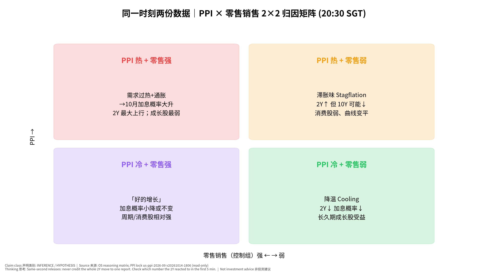
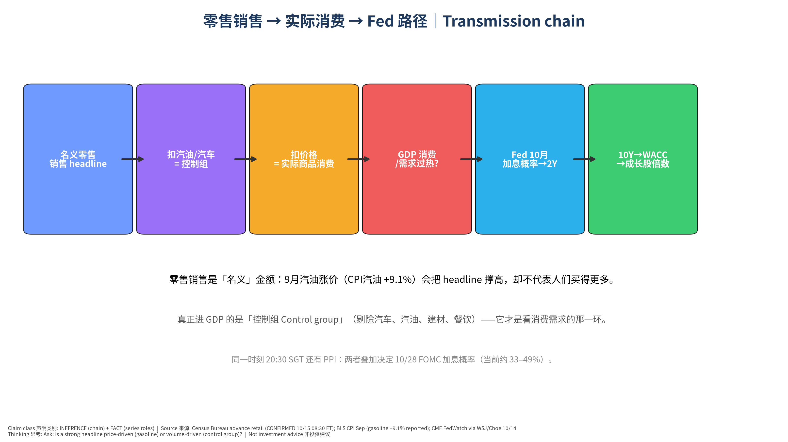
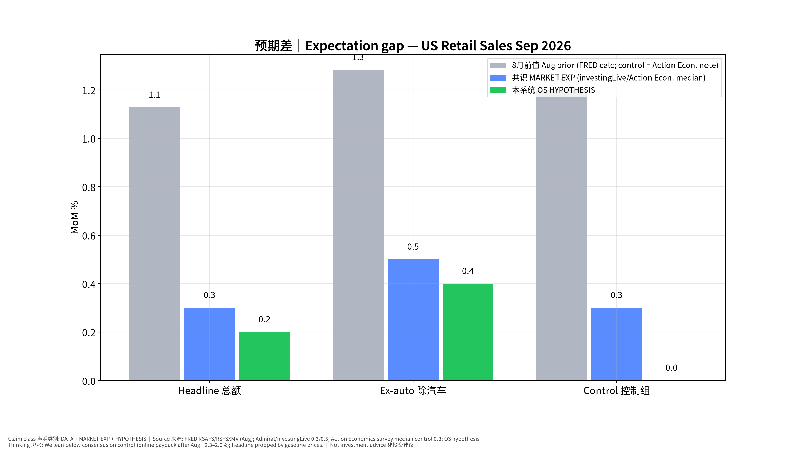
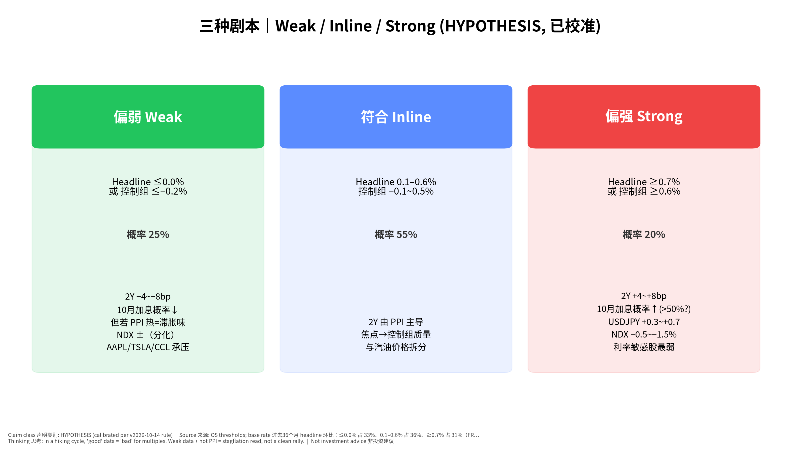
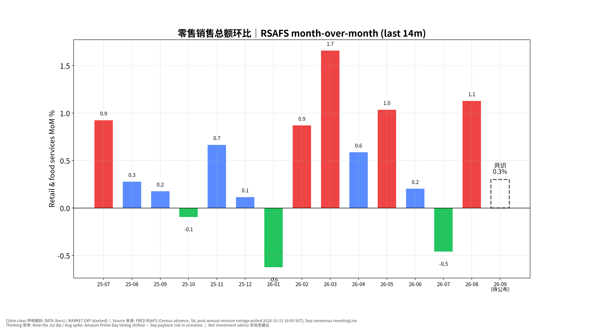

# 美国9月零售销售 发布前事件书｜US Retail Sales (Sep 2026) Pre-Event Book — 专业中文版

> **发布时间：2026-10-15（周四）08:30 美东 = 20:30 新加坡时间 (SGT)**｜状态 **CONFIRMED**（census.gov/retail/release_schedule.html：September 2026 → October 15, 2026, 8:30 am）
> 同一时刻：PPI（已于 v20261014-1806 独立锁定，本书不改写）、初请失业金、费城联储、纽约联储制造业指数。次日：进口价格（周五 20:30 SGT）、工业产出（周五 21:15 SGT）。
> 发布前快照锁定：**2026-10-15 18:05 SGT**（版本 v20261015-1805）。本文件不会在事后改写。非投资建议｜Not investment advice。标签：FACT｜DATA｜MARKET EXP｜HYPOTHESIS｜INFERENCE｜UNCERTAINTY。

**⏱ 30秒看懂**

1. **发生什么：**今晚 20:30 SGT 公布美国9月零售销售（Retail Sales｜美国人在商店、网上、餐厅花了多少钱）——和 PPI 同一秒公布。
2. **和我的股票有什么关系：**美联储9月刚加息到 3.75–4.00%，昨晚 CPI 偏热后市场给 10/28 再加息约 33–49% 概率。消费太强 = 更可能加息 = 利率敏感的成长股（ARM/PLTR/RKLB/CRWV）承压；AAPL、TSLA、CCL 直接看消费。
3. **该看什么/做什么：**只盯一个数：控制组 Control group（共识 +0.3%）。≤−0.2% 偏弱，≥+0.6% 偏强；再问：总额高是不是只因为汽油变贵？

**🗺 阅读地图**

| 你有多少时间 | 读哪里 |
|---|---|
| 2 分钟 | ⏱30秒 + 第4节观察清单。 |
| 10 分钟 | 第1–3节 + 图01/03/05：名义 vs 实际、三种剧本、PPI×零售矩阵。 |
| 30 分钟 | 全文 + 思考过程（第7节）+ 教学版 + 测验 + 事后作业。 |

层级说明：**L1 故事**（人人能懂）→ **L2 关键数字**（带解释）→ **L3 专业细节**（网页可折叠，默认收起）。

## 0. 背景事实 Context (FACT / DATA)
- **政策利率**：FOMC 9/16 加息 25bp 至 **3.75–4.00%**（FRED DFEDTARU=4.00；Warsh 发布会称「移除一剂宽松 a dose of accommodation」，并拒绝预判下一步）。
- **昨晚 CPI（锁定书 us-cpi-2026-09 已出事后复盘）**：整体 **+0.6% 环比 / 3.7% 同比**，核心 **+0.3% / 2.6%**；汽油涨 9.1%（媒体报道）。
- **市场定价（MARKET EXP）**：10/28 加息概率 CPI 前约 22% → 公布后 41.5%（CME FedWatch，10/14 12:20 ET）/ 49%（WSJ 引 CME）/ 收盘约 32.7%（Cboe）——**波动大，以发布前最新为准**。
- **利率**：2Y **4.79%**、10Y **5.21%**（FRED，2026-10-13）。
- **8月零售**（FRED，年度修订后）：总额 **+1.13%**、除汽车 **+1.28%**（首发曾为 +1.2% / +1.4%）；网购 8 月 +2.3~2.6%（Prime Day 时间错位，Action Economics / Continuum）。

## 1. 执行摘要 Executive Summary
1. **共识 (MARKET EXP)**：总额 **+0.3%**、除汽车 **+0.5%**（investingLive 周历，经 Admiral Markets 10/14 转引；Action Economics 调查中位数相同），控制组 **+0.3%**（Action Economics 调查中位数，区间 −0.1~+0.5%）。
2. **我们 (HYPOTHESIS)**：总额 **+0.2%**、除汽车 **+0.4%**、控制组 **0.0%**——**比共识偏软**。理由：①8 月网购 +2.3~2.6% 的 Prime Day 错位在 9 月回吐（网购约占控制组 28%）；②汽油涨价撑高名义总额、却挤压实际购买力；③两家独立预览（Action Economics 控制组 −0.1%、Continuum 除汽车与汽油 −0.1%）均偏软。**UNCERTAINTY：我们没有独立的刷卡数据模型，偏离共识的依据是二手预览，置信度中等偏低。**
3. **情景概率（已按 v2026-10-14 规则校准）**：偏弱 25% / 符合 55% / 偏强 20%。基础概率：过去36个月 headline 环比：≤0.0% 占 33%、0.1–0.6% 占 36%、≥0.7% 占 31%（FRED RSAFS 计算）。校准：未触发（所有情景与基础概率差距 ≤20pp）。
4. **为什么重要**：在加息周期里，「消费强」= 「需求过热」= 更可能 10 月加息（坏消息对估值倍数）；「消费弱 + PPI 热」= 滞胀味——不是干净的利好。
5. **观察名单**：消费直连 AAPL、TSLA（汽车销售）、CCL（可选消费/旅游）；利率敏感 ARM、PLTR、RKLB、CRWV、CRWD；AI 资本开支链（NVDA/AVGO/TSM）主要受今天台积电财报叙事主导，零售数据只通过 2Y/10Y 间接影响。

## 2. 共识 vs 我们 Expectation Gap

| 指标 | 8月前值 (DATA) | 共识 MARKET EXP | 来源/日期 | 我们 HYPOTHESIS | 差（我们−共识） |
|---|---|---|---|---|---|
| 总额 Headline MoM | +1.13%（首发 +1.2%） | **+0.3%** | investingLive via Admiral 10/14；Action Econ. 中位数 | **+0.2%** | −0.1 |
| 除汽车 Ex-auto MoM | +1.28%（首发 +1.4%） | **+0.5%** | 同上 | **+0.4%** | −0.1 |
| 控制组 Control MoM | +1.2%（Action Econ. 引述） | **+0.3%** | Action Econ. 调查中位数（区间 −0.1~+0.5） | **0.0%** | **−0.3** |

**分析师备选（非共识，仅作对照）**

| 机构 | 预测 | 类别 |
|---|---|---|
| Action Economics (Oct 13 survey note) | headline +0.1% / ex_auto +0.3% / control -0.1% | 分析师观点（非共识） |
| Continuum Economics (Oct 14) | headline +0.1% / ex_auto +0.4% / ex_auto_gas -0.1% | 分析师观点（非共识） |
| Wells Fargo (Oct 9 week ahead) | headline +0.4% | 分析师观点（非共识） |

## 3. 情景树 Scenarios (HYPOTHESIS)

| 情景 | 阈值 | 原始概率 | 基础概率 | 校准后 | 2Y | 10Y | USD/JPY | NDX | 受影响最大 |
|---|---|---|---|---|---|---|---|---|---|
| 偏弱 Weak | 总额 ≤0.0% 或 控制组 ≤−0.2% | 25% | 33% | **25%** | −4~−8bp | −2~−6bp | −0.3~−0.6 | 若 PPI 冷：+0.5~+1%；若 PPI 热：分化 | AAPL/TSLA/CCL ↓，长久期成长 ↑ |
| 符合 Inline | 总额 0.1–0.6%；控制组 −0.1~0.5% | 55% | 36% | **55%** | 由 PPI 主导 | 由 PPI 主导 | — | ±0.5% | 看控制组质量 |
| 偏强 Strong | 总额 ≥0.7% 或 控制组 ≥0.6% | 20% | 31% | **20%** | +4~+8bp | +3~+6bp | +0.3~+0.7 | −0.5~−1.5% | ARM/PLTR/RKLB/CRWV ↓ |

反应幅度为数量级示意（HYPOTHESIS），不是交易信号。**关键子情景**：总额 ≥0.7% 但控制组 ≤0.1% = 汽油/价格推动的「假强」，债市可能先涨后回。

## 4. 发布时观察清单 Live-Observation Checklist（20:30 SGT 10/15）

先填实际值，再看标题；先看控制组，再看总额。

| # | 看什么 | 偏弱 | 偏强 | 初学者注释 |
|---|---|---|---|---|
| 1 | **控制组 Control group** 环比 | ≤−0.2% | ≥+0.6% | 进 GDP 的那部分；共识 +0.3%，我们 0.0% |
| 2 | 总额 Headline 环比 | ≤0.0% | ≥0.7% | 共识 +0.3%；汽油贵会「虚高」 |
| 3 | 加油站销售 Gasoline stations | — | 大涨 | 若总额强主要来自这里 → 价格不是数量 |
| 4 | 无店铺/网购 Nonstore | 明显负 | 再涨 | 检验「Prime Day 回吐」假设（我们偏软的核心理由） |
| 5 | 汽车 Motor vehicles | 负 | 正 | 行业数据显示 9 月汽车销售走弱 → TSLA 叙事 |
| 6 | 8 月修正 Revisions | 下修 | 上修 | 下修 0.3pp 以上 = 等于额外一次「偏弱」 |
| 7 | 餐饮 Food services | 负 | 强 | 服务类消费唯一窗口 → CCL 等旅游消费 |
| 8 | 2Y 首 15 分钟 | ≤−4bp | ≥+4bp | 注意：同一秒还有 PPI，见图05矩阵归因 |
| 9 | 初请 Initial claims（共识约 195–200k，前值 197k） | ≥215k | ≤190k | 劳动市场若松动，Fed 更可能等到 12 月 |
| 10 | 费城联储（共识 28.4，前值 37.8）/ 纽约联储（共识 10.3，前值 7.6） | 大幅低于 | 大幅高于 | 共识来自 ITC Daily Calendar 10/15；价格分项更重要 |

**📊 怎么看这张图**

- **坐标/颜色：**横轴=零售（控制组）强弱，纵轴=PPI 冷热；四格=四种组合的市场含义。
- **只记住一件事：**两份数据同时出来，2Y 的反应是「合成」的——先看哪份更出乎意料。
- **什么会改变结论：**若 2Y 在 PPI 偏热时反而下行，说明市场在交易「增长担忧」而不是通胀。

## 5. 受影响观察名单
- **消费直连**：AAPL（高端消费韧性；iPhone 周期）、TSLA（汽车销售 + 利率敏感双重）、CCL（可选消费/旅游；餐饮分项是代理变量）。
- **利率路径**（与 CPI/PPI 书同一敏感度框架）：ARM、PLTR、RKLB、CRWV、CRWD、MRVL——偏强情景下最弱。
- **AI 链**：NVDA、AVGO、TSM、MU 今日主驱动是台积电财报（14:00 SGT 已开完，事后复盘归入下一份 Daily），零售只经由 2Y/10Y 间接影响——**归因时勿混淆**。
- **USD/JPY**：偏强情景 → 美日利差扩大 → 日元走弱；关注 BOJ 10/29–30 前的套息交易拥挤（Carry stress）。

## 6. 证伪条件 Falsifiers
1. 控制组 ≥+0.5%（且网购未回吐）→ 我们「Prime Day 回吐」假设错误 → 记 Fundamental Forecast 误差，上调消费韧性先验。
2. 偏强但 2Y 升幅 <2bp → 市场只认 PPI/Fed 讲话，零售对当前 Fed 反应函数权重低。
3. 偏弱但 AAPL/TSLA/CCL 上涨 → 市场在交易「利率下行」而非「需求转弱」→ 本书的消费股传导失效。
4. 总额强、控制组弱，但 10Y 盈亏平衡通胀大涨 → 市场担心汽油二次传导，「价格虚高可看穿」假设失效。
5. 8 月大幅上修（≥0.3pp）而 9 月符合 → 水平更高，实际是偏强；只看环比会误判。

## 7. 思考过程 Thinking walkthrough（七步法）
1. **先问对问题：谁在乎、为什么在乎**：谁在乎？美联储（10/28 是否连续加息）、债市（2Y）、消费股。为什么？在加息周期里，需求强弱决定 Fed 要不要继续「移除宽松」。
2. **市场已经定价了什么**：共识 +0.3% 已经假设 8 月大涨后放缓；10 月加息约 33–49%——市场把「强消费」部分计入。只有「实际−共识」会动价格。
3. **搭因果链，每环配一个检验数据**：零售名义额 →（扣汽油价格：CPI 汽油 +9.1%）→ 控制组 → 实际商品消费 → GDP → Fed 判断需求是否过热 → 2Y → 10Y → WACC → 成长股倍数。每环检验数据：加油站分项、控制组、BEA 实际消费（10/29）、FedWatch、2Y、10Y、NDX。
4. **找每一环的断点**：断点①汽油虚高（名义≠实际）；断点②PPI 同时公布，2Y 反应混合；断点③Warsh 明早 11:30 SGT 讲话可能盖过数据；断点④8 月修正改变基数。
5. **用工具箱逐一质疑**：见下方工具。
6. **给对立观点最强版本，再用证据裁判**：见「对立观点」。
7. **写下「如果我错了，会先看到什么」**：如果我错了，会先看到「网购 Nonstore 分项仍为正、控制组 ≥+0.4%」。

### 二阶思维 Second-order
- **是什么：**然后呢？谁会因此改变行为？
- **为什么用：**零售数据本身不改变公司利润，它改变的是 Fed 的判断。
- **用在本事件上：**控制组 +0.6% → FedWatch 10 月加息概率可能从约 40% 升至 >55% → 2Y +5bp → 按 CPI 书的敏感度框架，高估值股承压。一阶是「消费好=消费股好」，二阶是「消费好=加息=估值降」。
- **✍ 轮到你：**如果控制组 −0.3%，同时 PPI 0.7%，二阶效果是什么？写下你的答案再看图05。

### 市场已经定价了什么 Priced-in
- **是什么：**只有「实际−预期」推动价格。
- **为什么用：**8 月 +1.1% 很强，共识已经预期放缓到 +0.3%。
- **用在本事件上：**若公布 +0.3%：虽然比 8 月「大幅放缓」，标题会写「零售放缓」，但这是「符合」——不应引发大反应。
- **✍ 轮到你：**如果标题写「零售销售大幅放缓」而实际 = 共识，你会怎么判断市场反应？

### 基础概率 Base rates
- **是什么：**这类结果历史上多常见？
- **为什么用：**防止我们对「偏软」过度自信。
- **用在本事件上：**过去36个月 headline 环比：≤0.0% 占 33%、0.1–0.6% 占 36%、≥0.7% 占 31%（FRED RSAFS 计算）。我们给偏弱 25%，与基础概率比较后：未触发（所有情景与基础概率差距 ≤20pp）。
- **✍ 轮到你：**把阈值改成控制组 ≤0.0%，你觉得基础概率会更高还是更低？为什么？

**我们的观点：**9 月零售偏软（控制组约 0.0%），主要是网购回吐 + 汽油挤压实际购买力。

**对立观点最强版本：**
1. 8 月 BEA 年度修订显示家庭收入更强（Wells Fargo），消费有更多支撑，可能不回吐。
2. 股市财富效应（指数高位）与工资增长仍支撑高收入人群消费。
3. 共识 +0.3% 是许多机构的中位数，我们只依赖两家偏软预览，样本偏差。

| 证据 | 支持我们 | 支持对立 | 权重 |
|---|---|---|---|
| Action Economics 控制组 −0.1% | ✔ |  | 中 |
| Continuum 除汽车与汽油 −0.1% | ✔ |  | 中 |
| Wells Fargo 总额 +0.4%，收入修订上调 |  | ✔ | 中 |
| Redbook 周数据 9 月动能略降（Continuum 引述） | ✔ |  | 低 |
| 8 月网购 +2.3~2.6% 一次性 | ✔ |  | 高 |

**裁判：**证据略偏向我们，但不足以高信心偏离共识——所以我们只把控制组下调 0.3pp，并把「符合」保持为最大概率情景。

## 8. 最终自我质疑 Final Self-Challenge
- 我们偏软的理由几乎都来自二手预览；如果那些机构本身有「偏软」历史偏差，我们是在复制别人的错误。
- 今晚真正主导 2Y 的可能是 PPI，而不是零售——我们是否高估了这份数据的市场意义？
- 加息周期中「强=坏」的映射可能在财报季被盈利叙事打断（TSM 指引）；不要把 NDX 的全部涨跌归因给零售。

## 9. 周五次日：工业产出 & 进口价格（简表，Post only）
- 进口价格 Import prices（9 月）：周五 08:30 ET = **20:30 SGT**，CONFIRMED（bls.gov）。观察：油价推动 vs 非油进口价格（关税/美元）。
- 工业产出与产能利用率 IP & Capacity Utilization（9 月）：周五 09:15 ET = **21:15 SGT**，CONFIRMED（federalreserve.gov G.17 日历）。8 月 IP 指数 103.07（FRED INDPRO，环比约 +0.02%）。共识本书未核实 → 不编造；复盘归入下一份 Daily OS。

## 10. Source Ledger
| 来源 | 日期 | 用途 | 类别 |
|---|---|---|---|
| census.gov/retail/release_schedule.html | 查证 2026-10-15 | 发布时间 CONFIRMED | FACT |
| Admiral Markets preview（引 investingLive 周历） | 2026-10-14 | 共识 0.3% / 0.5% | MARKET EXP |
| Action Economics 调查（Indicator survey PDF） | 2026-10-13 | 中位数 0.3/0.5/0.3、区间；自家预测 0.1/0.3/−0.1 | MARKET EXP + Analyst |
| Continuum Economics preview | 2026-10-14 | 0.1 / 0.4 / ex auto&gas −0.1 | Analyst |
| Wells Fargo Economics Week Ahead | 2026-10-09 | 0.4%；年度修订说明 | Analyst |
| ITC G10 Daily Calendar | 2026-10-15 | 初请/费城/纽约联储共识 | MARKET EXP |
| FRED RSAFS / RSFSXMV / INDPRO / DGS2 / DGS10 / DFEDTARU | 拉取 2026-10-15 18:05 SGT | 前值、历史、利率 | DATA |
| federalreserve.gov 9/16 发布会实录 | 2026-09-16 | 加息至 3.75–4.00%，「a dose of accommodation」 | FACT |
| CME FedWatch via Yahoo/Benzinga, WSJ, Cboe | 2026-10-14 | 10 月加息概率 22%→41.5%/49%/32.7% | MARKET EXP |
| us-cpi-2026-09 post v20261015-0800；us-ppi-2026-09 pre v20261014-1806 | 锁定 | 联动，不改写 | Locked |

## 11. Assumption Register
1. investingLive/Action Economics 中位数可作街共识代理（ASSUMPTION）；若 Bloomberg 调查中位数不同，复盘时注明。
2. 网购回吐幅度足以把控制组拉到约 0.0%（HYPOTHESIS；证伪见 §6-1）。
3. 当前 Fed 反应函数对「需求强」敏感（INFERENCE，依据 Warsh 9/16「金融条件并不紧」表述）。
4. 反应幅度为数量级示意（HYPOTHESIS）。

## 12. Model Provenance
Builder `pipeline/build_1015_pre.py`；版本 v20261015-1805；FRED 实时拉取；校准规则 `calibration.apply_rule`（v2026-10-14）。Excel 含活公式（意外值、情景判定、概率加权期望）。

## 图表 Charts

**📊 怎么看这张图**

- **坐标/颜色：**方框从左到右=因果顺序；箭头=传导。
- **只记住一件事：**名义零售 ≠ 实际消费：汽油涨价会让数字「看起来强」。
- **什么会改变结论：**若控制组强（不仅是汽油），链条后半段（Fed→2Y）才真正被触发。

**📊 怎么看这张图**

- **坐标/颜色：**灰=8月前值，蓝=共识，绿=我们。
- **只记住一件事：**我们最大分歧在控制组（0.0 vs 0.3）。
- **什么会改变结论：**网购分项若仍为正，我们的绿柱就是错的。

**📊 怎么看这张图**

- **坐标/颜色：**每根柱=一个月的零售环比；红≥0.7、绿≤0.0。
- **只记住一件事：**7 月低、8 月高是 Prime Day 时间错位；9 月可能回吐。
- **什么会改变结论：**若 9 月仍 ≥0.7，说明不是错位，而是消费真强。

## 13. 事后作业 Post-event homework（发布后填写，不改本书）
| 环节 | 成立/断开 | 证据 | 学到什么 |
|---|---|---|---|
| ①零售意外→Fed 10月预期 | ____ | ____ | ____ |
| ②→2年期 | ____ | ____ | ____ |
| ③→10年期 | ____ | ____ | ____ |
| ④→折现率 | ____ | ____ | ____ |
| ⑤→AAPL/TSLA/CCL 与成长股 | ____ | ____ | ____ |

