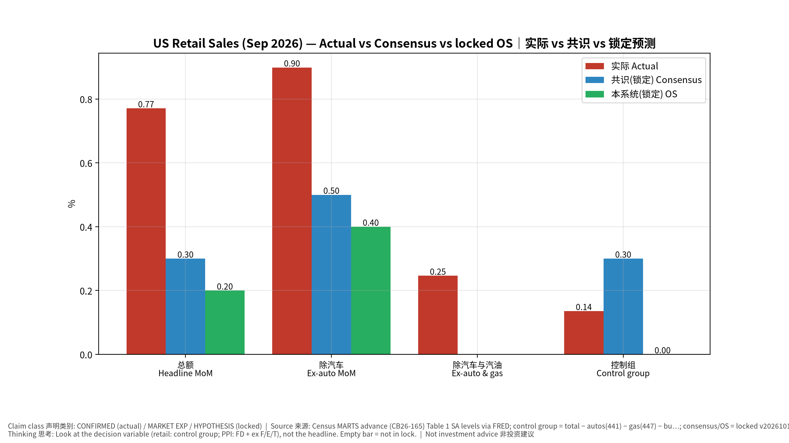
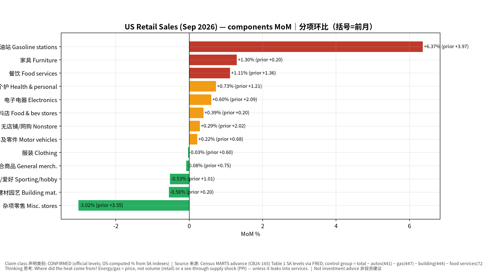
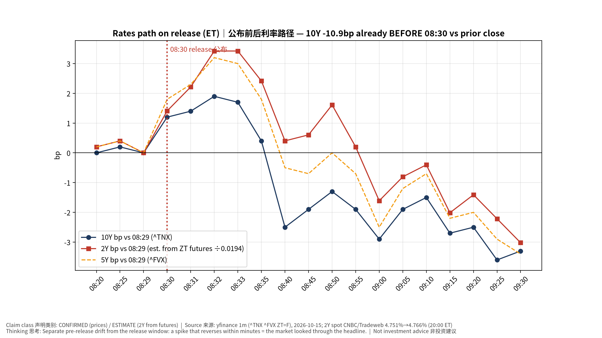
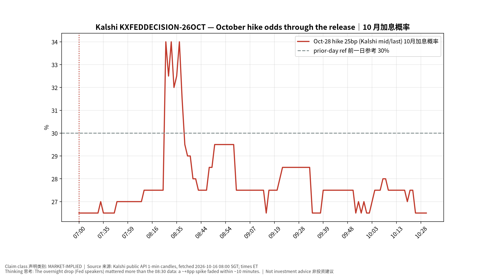
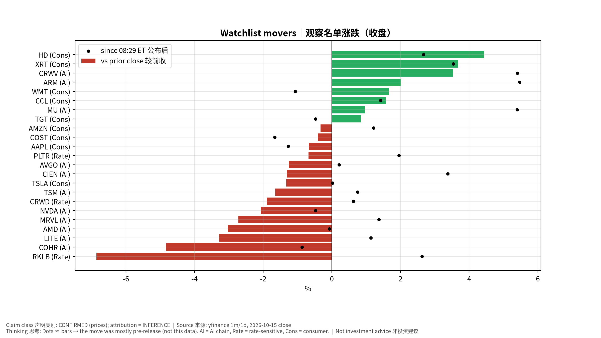
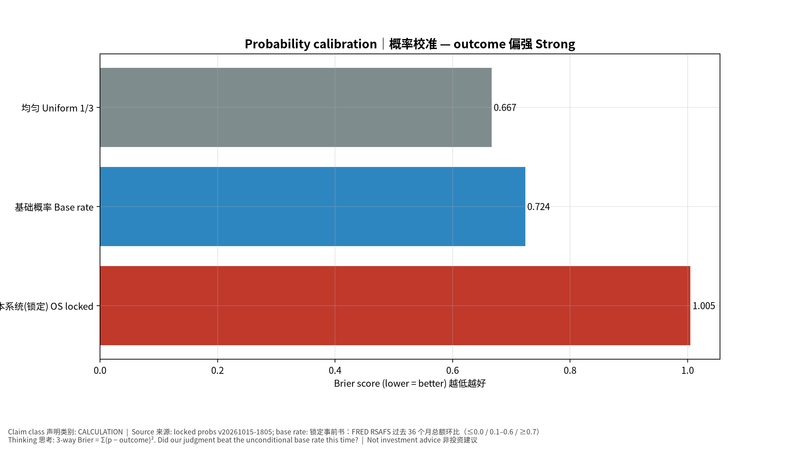
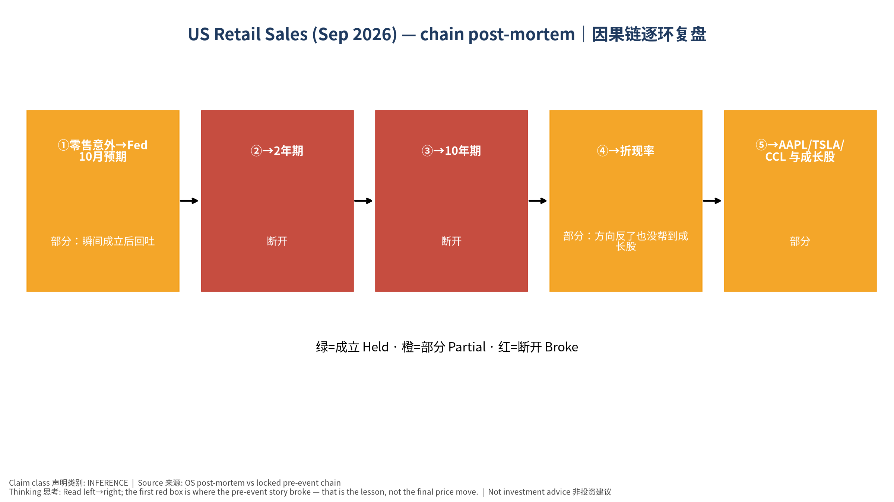
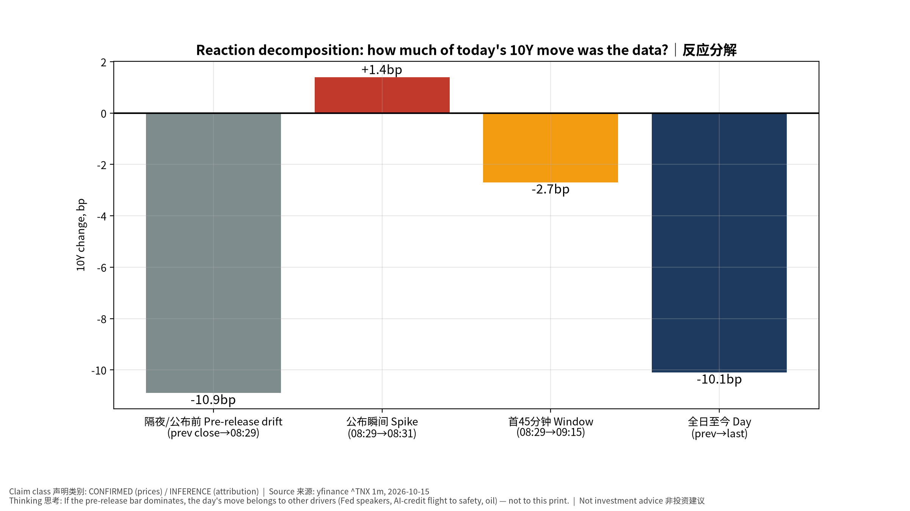

# US Retail Sales (Sep 2026) — Post-Event Review (English) v20261016-0800-post
> Final (close) | Locked pre-event book v20261015-1805 (2026-10-15T18:05), not rewritten | Not investment advice

## 30-second take
1. **What happened:** US Retail Sales (Sep 2026) control = +0.1% vs locked consensus 0.3% / locked OS 0.0%. Locked-rule bucket: **strong** (fake-strong sub-scenario: headline ≥0.7% on gasoline prices, control ≤0.1%); quality bucket: **inline**.
2. **Markets:** 10Y -10.1bp on the day, of which -10.9bp happened BEFORE 08:30; release window (08:29→09:15 ET) -2.7bp, 2Y (futures est.) -2.0bp. Kalshi October hike 28% → peak 36% → 28% at T+45 (prior-day 30%).
3. **Lesson:** split the time windows; a spike that reverses = the market looked through the headline. Tech weakness (NDX -0.05%, SOX -0.88%) was mostly pre-release (AI-credit/positioning), not this print.

## 1. Actual vs consensus vs locked OS
| Metric | Actual (OS calc) | Official rounded | Consensus (locked) | OS (locked) | Surprise | OS error |
|---|---|---|---|---|---|---|
| 总额 Headline MoM | +0.77% | +0.8% | 0.3% | 0.2% | +0.47pp | +0.57pp |
| 除汽车 Ex-auto MoM | +0.90% |  | 0.5% | 0.4% | +0.40pp | +0.50pp |
| 除汽车与汽油 Ex-auto & gas | +0.25% |  | — | — | N/A | N/A |
| 控制组 Control group | +0.14% |  | 0.3% | 0.0% | -0.16pp | +0.14pp |

## 2. Components
| Component | MoM | Prior MoM (revised) |
|---|---|---|
| 加油站 Gasoline stations | +6.37% | +3.97% |
| 餐饮 Food services | +1.11% | +1.36% |
| 家具 Furniture | +1.30% | +0.20% |
| 电子电器 Electronics | +0.60% | +2.09% |
| 健康个护 Health & personal | +0.73% | +1.21% |
| 无店铺/网购 Nonstore | +0.29% | +2.02% |
| 食品饮料店 Food & bev stores | +0.39% | +0.20% |
| 汽车及零件 Motor vehicles | +0.22% | +0.68% |
| 服装 Clothing | -0.03% | +0.60% |
| 综合商品 General merch. | -0.08% | +0.75% |
| 体育/爱好 Sporting/hobby | -0.53% | +1.01% |
| 建材园艺 Building mat. | -0.56% | +0.20% |
| 杂项零售 Misc. stores | -3.02% | +3.55% |

## 3. Market reaction
| 资产 | 前收 | 08:29 ET | 08:31 | 09:15（T+45） | 最新 | 公布瞬间 | 首 45 分钟 | 较前收 |
|---|---|---|---|---|---|---|---|---|
| 10Y 美债 (^TNX) | 5.190% | 5.081% | 5.095% | 5.054% | 5.089% | +1.4bp | -2.7bp | -10.1bp |
| 5Y (^FVX) | 4.992% | 4.890% | 4.913% | 4.868% | 4.899% | +2.3bp | -2.2bp | -9.3bp |
| 2Y（ZT 期货估算 / CNBC 现货） | 4.751% |  |  |  | 4.766%（20:00 ET） | +2.2bp | -2.0bp | +1.5bp |
| USD/JPY | 158.32 | 158.01 | 158.07 | 157.84 | 158.15 | +0.04% | -0.11% | -0.11% |
| DXY 美元指数 | 102.55 | 102.13 | 102.21 | 102.07 | 102.05 | +0.08% | -0.05% | -0.49% |
| NQ 纳指期货 | 30,182.75 | 29,833.00 | 29,754.00 | 29,799.50 | 29,995.75 | -0.26% | -0.11% | -0.62% |
| ES 标普期货 | 7,770.25 | 7,751.50 | 7,737.75 | 7,744.00 | 7,777.25 | -0.18% | -0.10% | +0.09% |
| 黄金 Gold | 4,107.90 | 4,176.00 | 4,164.50 | 4,184.10 | 4,179.30 | -0.28% | +0.19% | +1.74% |
| WTI 原油 | 95.09 | 93.84 | 93.68 | 94.47 | 96.17 | -0.17% | +0.67% | +1.14% |
| VIX | 16.87 | 17.48 | 17.69 | 17.49 | 16.46 | +0.21 | +0.01 | -0.41 |
| NDX 纳指100 | 29,950.82 | （09:30 开盘） |  |  | 29,935.59 |  |  | -0.05% |
| SOX 费城半导体 | 11,684.38 | （09:30 开盘） |  |  | 11,581.22 |  |  | -0.88% |
| S&P 500 | 7,718.94 | （09:30 开盘） |  |  | 7,744.06 |  |  | +0.33% |

| 合约（Kalshi） | 前一日参考价 | 公布前 08:29 ET | 公布后峰值(08:30–09:15) | T+45 09:15 | 最新 |
|---|---|---|---|---|---|
| 10/28 会议 加息 25bp | 30% | 28% | 36% | 28% | 28% |
| 12 月会议 加息 25bp | 79% | 78% |  |  | 77% |

## 4. Watchlist
| 代码 | 类别 | 盘前(08:29) vs 前收 | 公布后(08:29→最新) | 较前收（收盘） |
|---|---|---|---|---|
| NVDA | AI | -1.60% | -0.48% | -2.07% |
| MU | AI | -4.20% | +5.40% | +0.97% |
| TSM | AI | -2.38% | +0.75% | -1.65% |
| AVGO | AI | -1.46% | +0.21% | -1.26% |
| ARM | AI | -3.28% | +5.47% | +2.01% |
| AMD | AI | -2.97% | -0.07% | -3.03% |
| MRVL | AI | -4.04% | +1.37% | -2.72% |
| LITE | AI | -4.36% | +1.14% | -3.27% |
| CIEN | AI | -4.53% | +3.38% | -1.31% |
| COHR | AI | -4.00% | -0.87% | -4.83% |
| CRWV | AI | -1.78% | +5.40% | +3.53% |
| PLTR | Rate | -2.58% | +1.95% | -0.68% |
| RKLB | Rate | -9.24% | +2.63% | -6.86% |
| CRWD | Rate | -2.51% | +0.63% | -1.90% |
| AAPL | Cons | +0.61% | -1.27% | -0.67% |
| TSLA | Cons | -1.35% | +0.02% | -1.33% |
| CCL | Cons | +0.15% | +1.42% | +1.58% |
| AMZN | Cons | -1.53% | +1.22% | -0.33% |
| WMT | Cons | +2.77% | -1.07% | +1.67% |
| COST | Cons | +1.28% | -1.66% | -0.40% |
| HD | Cons | +1.72% | +2.67% | +4.44% |
| TGT | Cons | +1.33% | -0.48% | +0.85% |
| XRT | Cons | +0.14% | +3.54% | +3.68% |

## 5. Calibration (Brier, lower = better)
OS locked 1.005 | base rate 0.724 | uniform 0.667. Base-rate source: 锁定事前书：FRED RSAFS 过去 36 个月总额环比（≤0.0 / 0.1–0.6 / ≥0.7）.
## 6. Chain post-mortem, steelman, what to watch
See the Chinese edition §4–6 (full reasoning). Source ledger and assumption register as in ZH §8–9.
## Charts

