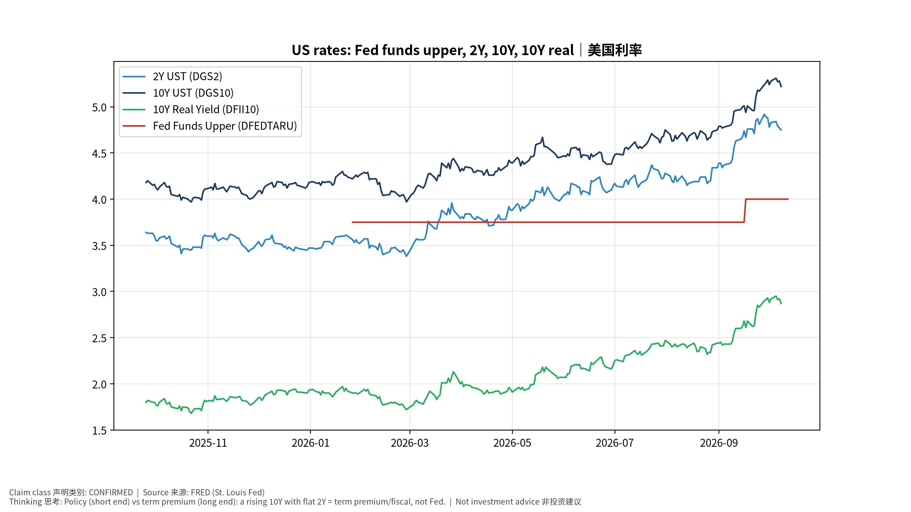
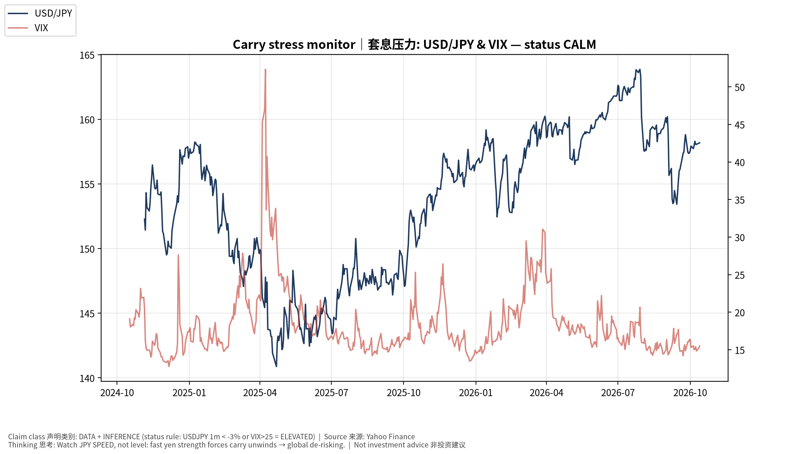
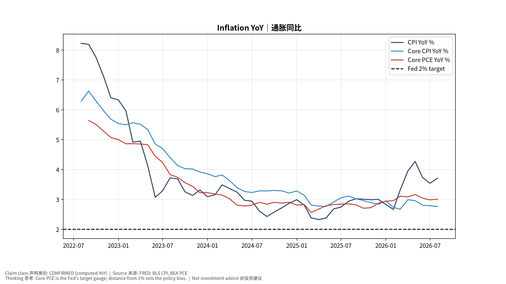
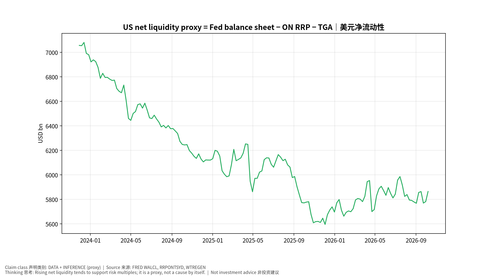
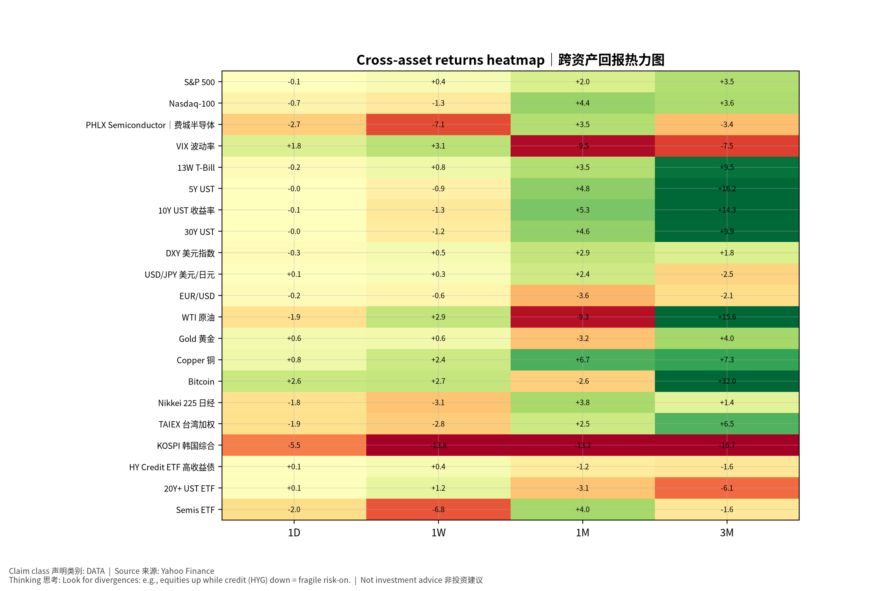

# 宏观与跨资产专题 Macro & Cross-Asset Special v20261013-1622
> 数据快照 20261013-1622 (SGT)。来源: FRED、Yahoo Finance。非投资建议。

## 1. 结论摘要 (INFERENCE)
- 通胀: CPI 同比 +3.7% (2026-08-01)，核心CPI +2.8%，核心PCE +3.0% (2026-08-01)——仍高于2%目标。
- 政策利率上限 4.0% (2026-10-12)；10Y 5.22%；10Y实际利率 2.87%；2s10s 0.44%。
- 美元净流动性代理 ≈ 5,867 bn USD (WALCL−RRP−TGA)。
- 套息压力 Carry Stress: **CALM** (USD/JPY 1个月 +2.4%，VIX 15.5)。
- 高收益利差 HY OAS 3.15%；芝加哥金融条件指数 NFCI -0.494（负=宽松）。

## 2. 传导链 Transmission chain
通胀/就业 → FOMC 反应函数 → 2Y → 10Y(含期限溢价/财政) → 实际利率 → WACC → 成长股估值倍数；BOJ → JGB → USD/JPY 速度 → 套息平仓 → 全球流动性。

## 3. 市场心理与资金 (证据要求)
- 本版可用证据: 跨资产价格(见热力图)、VIX、信用利差。CFTC持仓/基金经理调查/期权偏度 **UNAVAILABLE**（未接入），因此不对"机构定位"作断言。
- 反身性观察: 若AI龙头上涨同时HYG下跌 → 脆弱的风险偏好。

## 4. AI 生产率 → 通胀 → Fed (专题框架)
AI Capex ↑ → 生产率 ↑ → 单位劳动成本 ULC ↓ → 核心通胀 ↓ → Fed 更鸽 (鸽派路径)；或 AI Capex ↑ → 电力/建设/芯片需求过热 → 通胀 ↑ → Fed 更鹰 (过热路径)。证据: 11/5 生产率与成本(BLS, CONFIRMED)、ECI 10/30。

## 5. 跨资产表 (DATA)
| 资产 | 代码 | 最新 | 日期 | 1D | 1W | 1M | 1Y |
|---|---|---|---|---|---|---|---|
| S&P 500 | ^GSPC | 7,807.240 | 2026-10-12 | -0.1% | +0.4% | +2.0% | +15.9% |
| Nasdaq-100 | ^NDX | 30,664.699 | 2026-10-12 | -0.7% | -1.3% | +4.4% | +22.2% |
| PHLX Semiconductor｜费城半导体 | ^SOX | 12,236.790 | 2026-10-12 | -2.7% | -7.1% | +3.5% | +78.9% |
| VIX 波动率 | ^VIX | 15.480 | 2026-10-13 | +1.8% | +3.1% | -9.5% | -25.6% |
| 13W T-Bill | ^IRX | 4.050 | 2026-10-12 | -0.2% | +0.8% | +3.5% | +5.1% |
| 5Y UST | ^FVX | 5.019 | 2026-10-12 | -0.0% | -0.9% | +4.8% | +34.2% |
| 10Y UST 收益率 | ^TNX | 5.240 | 2026-10-12 | -0.1% | -1.3% | +5.3% | +26.3% |
| 30Y UST | ^TYX | 5.598 | 2026-10-12 | -0.0% | -1.2% | +4.6% | +18.3% |
| DXY 美元指数 | DX-Y.NYB | 102.318 | 2026-10-13 | -0.3% | +0.5% | +2.9% | +3.4% |
| USD/JPY 美元/日元 | JPY=X | 158.180 | 2026-10-13 | +0.1% | +0.3% | +2.4% | +4.9% |
| EUR/USD | EURUSD=X | 1.119 | 2026-10-13 | -0.2% | -0.6% | -3.6% | -3.9% |
| WTI 原油 | CL=F | 91.990 | 2026-10-13 | -1.9% | +2.9% | -9.3% | +56.2% |
| Gold 黄金 | GC=F | 4,214.300 | 2026-10-13 | +0.6% | +0.6% | -3.2% | +5.3% |
| Copper 铜 | HG=F | 6.755 | 2026-10-13 | +0.8% | +2.4% | +6.7% | +39.3% |
| Bitcoin | BTC-USD | 83,919.328 | 2026-10-13 | +2.6% | +2.7% | -2.6% | +11.0% |
| Nikkei 225 日经 | ^N225 | 67,777.523 | 2026-10-13 | -1.8% | -3.1% | +3.8% | +49.4% |
| TAIEX 台湾加权 | ^TWII | 48,341.309 | 2026-10-13 | -1.9% | -2.8% | +2.5% | +84.5% |
| KOSPI 韩国综合 | ^KS11 | 6,035.350 | 2026-10-13 | -5.5% | -13.8% | -13.2% | +73.8% |
| HY Credit ETF 高收益债 | HYG | 77.290 | 2026-10-12 | +0.1% | +0.4% | -1.2% | +1.9% |
| 20Y+ UST ETF | TLT | 78.050 | 2026-10-12 | +0.1% | +1.2% | -3.1% | -8.4% |
| Semis ETF | SMH | 590.990 | 2026-10-12 | -2.0% | -6.8% | +4.0% | +71.7% |

## 6. FRED 宏观表 (DATA)
| 指标 | 代码 | 最新 | 日期 |
|---|---|---|---|
| CPI | CPIAUCSL | 334.131 | 2026-08-01 |
| Core CPI | CPILFESL | 337.765 | 2026-08-01 |
| Core PCE | PCEPILFE | 130.455 | 2026-08-01 |
| PPI Final Demand | PPIFIS | 157.411 | 2026-08-01 |
| Unemployment Rate | UNRATE | 4.200 | 2026-09-01 |
| Nonfarm Payrolls | PAYEMS | 159,044.000 | 2026-09-01 |
| AHE | CES0500000003 | 37.810 | 2026-09-01 |
| Initial Claims | ICSA | 197,000.000 | 2026-10-03 |
| Real GDP | GDPC1 | 24,408.011 | 2026-04-01 |
| Fed Funds Upper | DFEDTARU | 4.000 | 2026-10-12 |
| 2Y UST | DGS2 | 4.750 | 2026-10-08 |
| 10Y UST | DGS10 | 5.220 | 2026-10-08 |
| 10Y-2Y | T10Y2Y | 0.440 | 2026-10-09 |
| 10Y Breakeven | T10YIE | 2.330 | 2026-10-09 |
| 10Y Real Yield | DFII10 | 2.870 | 2026-10-08 |
| HY OAS | BAMLH0A0HYM2 | 3.150 | 2026-10-08 |
| Fed Balance Sheet | WALCL | 6,747,560.000 | 2026-10-07 |
| ON RRP | RRPONTSYD | 0.300 | 2026-10-09 |
| TGA | WTREGEN | 880,253.000 | 2026-10-07 |
| Chicago NFCI | NFCI | -0.494 | 2026-10-02 |
| Japan 10Y (monthly) | IRLTLT01JPM156N | 2.940 | 2026-08-01 |

## 7. 风险与证伪
- 若核心PCE连续3个月月率≤0.2% → "高通胀粘性"假设被证伪。
- 若USD/JPY在1个月内下跌>5% → 套息压力升级、科技股倍数受压。
## 8. Source Ledger
FRED series IDs as listed (latest observation dates in table); Yahoo Finance daily closes snapshot 20261013-1622.
## 9. Assumption Register
Carry rule thresholds (ASSUMPTION); net-liquidity proxy definition (METHOD).

## 图片报告 Image Report

---
# Macro & Cross-Asset Special (English) v20261013-1622
- Inflation: CPI YoY +3.7%, core CPI +2.8%, core PCE +3.0% — above 2%.
- Fed funds upper 4.0%; 10Y 5.22%; 10Y real 2.87%; 2s10s 0.44%.
- Net liquidity proxy ≈ 5,867 bn USD. Carry stress: **CALM** (USD/JPY 1M +2.4%, VIX 15.5).
- Positioning claims are withheld: CFTC/fund-manager survey/option skew feeds are UNAVAILABLE in v1.
- AI productivity → inflation → Fed: two competing paths (dovish productivity vs overheating); key evidence Nov 5 Productivity & Costs, Oct 30 ECI.
- Falsifiers: core PCE ≤0.2% m/m for 3 months; USD/JPY −5% in a month.
Tables: see Chinese section (bilingual labels).
