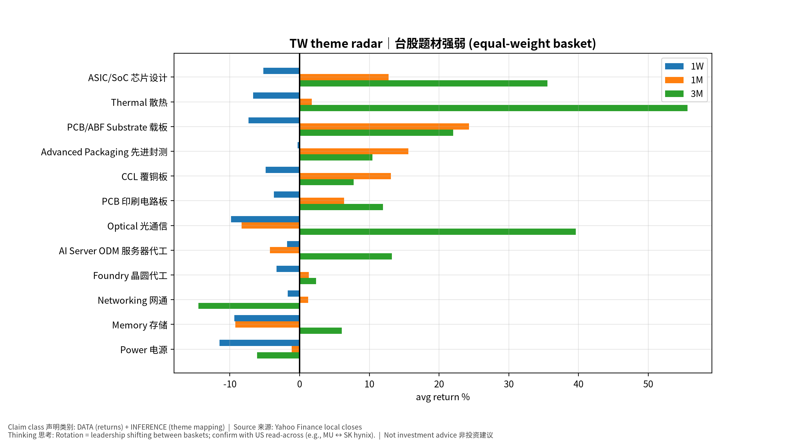
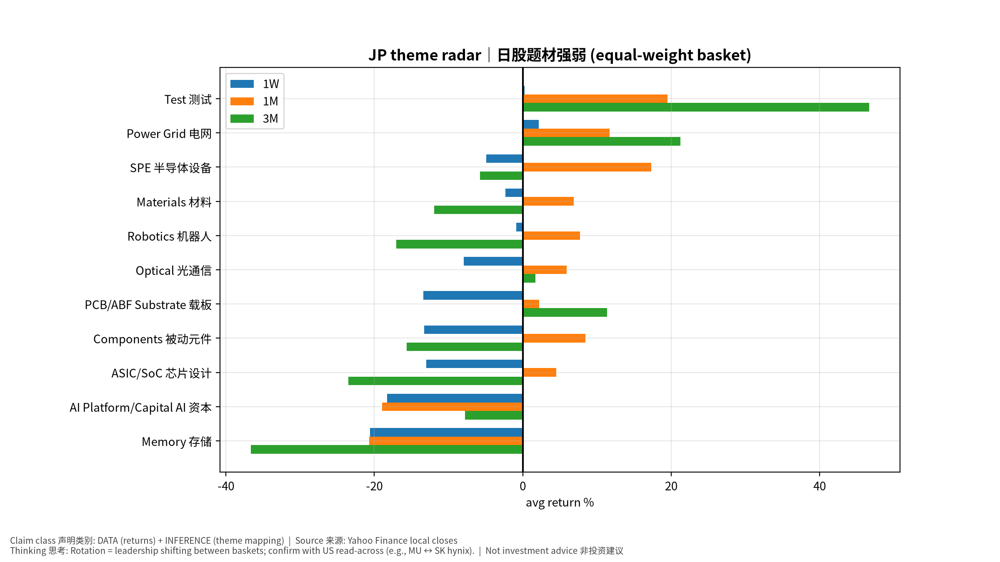
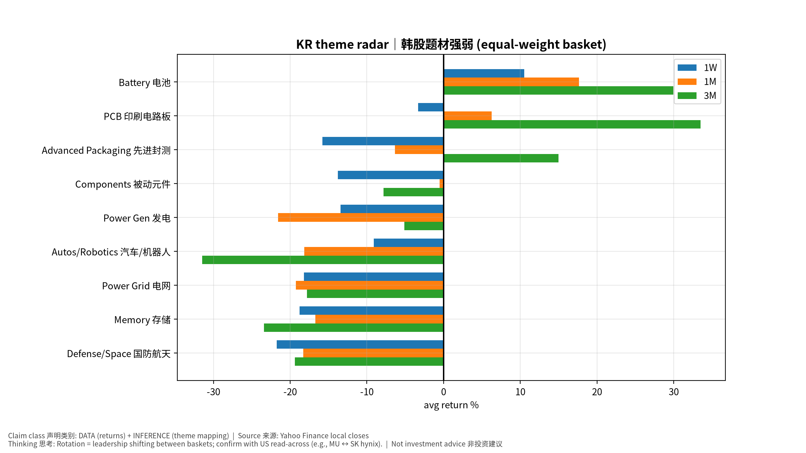

# 台日韩题材雷达 TW/JP/KR Theme Radar v20261014-0758
> 快照 20261014-0758；等权篮子；评分 = 0.5×1W + 0.3×1M + 0.2×3M (ASSUMPTION)。分类到技术/制程/产品层级(L2)。非投资建议。

## 1. 题材排名 Theme ranking
| 市场 | 题材L1 | 成分数 | 1W | 1M | 3M | 评分 | 状态 |
|---|---|---|---|---|---|---|---|
| KR | Battery 电池 | 1 | +10.5% | +17.6% | +30.0% | +16.5 | STRONG 强 |
| JP | Test 测试 | 1 | +0.2% | +19.5% | +46.7% | +15.3 | STRONG 强 |
| JP | Power Grid 电网 | 1 | +2.2% | +11.7% | +21.3% | +8.8 | STRONG 强 |
| TW | ASIC/SoC 芯片设计 | 3 | -5.2% | +12.8% | +35.6% | +8.3 | STRONG 强 |
| TW | Thermal 散热 | 2 | -6.7% | +1.8% | +55.6% | +8.3 | STRONG 强 |
| TW | PCB/ABF Substrate 载板 | 2 | -7.3% | +24.3% | +22.0% | +8.0 | STRONG 强 |
| KR | PCB 印刷电路板 | 1 | -3.3% | +6.3% | +33.5% | +6.9 | STRONG 强 |
| TW | Advanced Packaging 先进封测 | 1 | -0.3% | +15.6% | +10.4% | +6.6 | STRONG 强 |
| TW | CCL 覆铜板 | 2 | -4.9% | +13.1% | +7.7% | +3.0 | NEUTRAL 中性 |
| TW | PCB 印刷电路板 | 1 | -3.7% | +6.4% | +12.0% | +2.4 | NEUTRAL 中性 |
| JP | SPE 半导体设备 | 4 | -4.9% | +17.3% | -5.8% | +1.6 | NEUTRAL 中性 |
| TW | Optical 光通信 | 2 | -9.9% | -8.3% | +39.6% | +0.5 | NEUTRAL 中性 |
| TW | AI Server ODM 服务器代工 | 4 | -1.8% | -4.2% | +13.2% | +0.5 | NEUTRAL 中性 |
| TW | Foundry 晶圆代工 | 1 | -3.3% | +1.3% | +2.3% | -0.8 | NEUTRAL 中性 |
| JP | Materials 材料 | 1 | -2.3% | +6.9% | -12.0% | -1.5 | NEUTRAL 中性 |
| JP | Robotics 机器人 | 2 | -0.9% | +7.7% | -17.1% | -1.5 | NEUTRAL 中性 |
| JP | Optical 光通信 | 2 | -8.0% | +5.9% | +1.7% | -1.9 | NEUTRAL 中性 |
| TW | Networking 网通 | 1 | -1.7% | +1.2% | -14.5% | -3.4 | WEAK 弱 |
| JP | PCB/ABF Substrate 载板 | 1 | -13.4% | +2.2% | +11.4% | -3.8 | WEAK 弱 |
| TW | Memory 存储 | 2 | -9.3% | -9.2% | +6.0% | -6.2 | WEAK 弱 |
| KR | Advanced Packaging 先进封测 | 1 | -15.8% | -6.3% | +15.0% | -6.8 | WEAK 弱 |
| JP | Components 被动元件 | 1 | -13.3% | +8.4% | -15.6% | -7.2 | WEAK 弱 |
| TW | Power 电源 | 1 | -11.5% | -1.1% | -6.1% | -7.3 | WEAK 弱 |
| KR | Components 被动元件 | 1 | -13.8% | -0.5% | -7.8% | -8.6 | WEAK 弱 |
| JP | ASIC/SoC 芯片设计 | 1 | -13.0% | +4.5% | -23.5% | -9.8 | WEAK 弱 |
| KR | Power Gen 发电 | 1 | -13.4% | -21.6% | -5.1% | -14.2 | WEAK 弱 |
| KR | Autos/Robotics 汽车/机器人 | 1 | -9.1% | -18.2% | -31.5% | -16.3 | WEAK 弱 |
| JP | AI Platform/Capital AI 资本 | 1 | -18.3% | -18.9% | -7.8% | -16.4 | WEAK 弱 |
| KR | Power Grid 电网 | 3 | -18.2% | -19.3% | -17.8% | -18.4 | WEAK 弱 |
| KR | Memory 存储 | 2 | -18.8% | -16.7% | -23.4% | -19.1 | WEAK 弱 |
| KR | Defense/Space 国防航天 | 1 | -21.7% | -18.3% | -19.4% | -20.2 | WEAK 弱 |
| JP | Memory 存储 | 1 | -20.6% | -20.7% | -36.6% | -23.8 | WEAK 弱 |

## 2. 个股明细 (技术/制程/产品 L2)
| 市场 | 题材L1 | 细分L2 | 代码 | 1D | 1W | 1M | 3M |
|---|---|---|---|---|---|---|---|
| TW | Foundry 晶圆代工 | N3/N2 先进制程 + CoWoS | 2330.TW | -2.0% | -3.3% | +1.3% | +2.3% |
| TW | ASIC/SoC 芯片设计 | Custom ASIC / 手机SoC | 2454.TW | -2.2% | -12.4% | -2.2% | +18.3% |
| TW | ASIC/SoC 芯片设计 | Custom ASIC 设计服务 | 3661.TW | -7.7% | +2.7% | +3.8% | -1.2% |
| TW | ASIC/SoC 芯片设计 | ASIC 设计服务 | 3443.TW | -0.1% | -5.9% | +36.6% | +89.6% |
| TW | AI Server ODM 服务器代工 | GB/VR rack 整机 | 2317.TW | -1.8% | -5.5% | -4.8% | +1.5% |
| TW | AI Server ODM 服务器代工 | L10-L11 rack | 2382.TW | +0.3% | -2.4% | -5.6% | -10.9% |
| TW | AI Server ODM 服务器代工 | Hyperscaler 白牌 | 6669.TW | -3.5% | +2.1% | -5.6% | +32.0% |
| TW | AI Server ODM 服务器代工 | L6-L10 | 3231.TW | -1.3% | -1.3% | -1.1% | +30.3% |
| TW | Advanced Packaging 先进封测 | OSAT / CoWoS-like | 3711.TW | -2.9% | -0.3% | +15.6% | +10.4% |
| TW | PCB/ABF Substrate 载板 | ABF 载板 | 3037.TW | -6.0% | -10.9% | +18.8% | +30.7% |
| TW | PCB/ABF Substrate 载板 | ABF 载板 | 8046.TW | +0.0% | -3.7% | +29.7% | +13.4% |
| TW | CCL 覆铜板 | 高速 CCL (M8/M9) | 2383.TW | -9.8% | -2.7% | +3.2% | +8.7% |
| TW | CCL 覆铜板 | 高速 CCL | 6274.TWO | -4.6% | -7.0% | +23.0% | +6.8% |
| TW | PCB 印刷电路板 | AI server PCB/HDI | 2368.TW | -5.3% | -3.7% | +6.4% | +12.0% |
| TW | Thermal 散热 | 液冷 cold plate / 3D VC | 3017.TW | -3.1% | -8.5% | -3.0% | +48.3% |
| TW | Thermal 散热 | 液冷 CDU/manifold | 3324.TWO | -4.2% | -4.8% | +6.5% | +63.0% |
| TW | Power 电源 | AI rack PSU / HVDC | 2308.TW | -6.6% | -11.5% | -1.1% | -6.1% |
| TW | Optical 光通信 | InP 磊晶 epi wafer | 3081.TWO | -9.9% | -9.2% | -4.4% | +50.9% |
| TW | Optical 光通信 | 光收发模块/CPO | 4979.TWO | -8.1% | -10.5% | -12.3% | +28.3% |
| TW | Networking 网通 | 800G/1.6T 交换机 | 2345.TW | -4.2% | -1.7% | +1.2% | -14.5% |
| TW | Memory 存储 | DRAM 利基 | 2408.TW | -7.4% | -7.9% | -6.7% | +15.4% |
| TW | Memory 存储 | DRAM/NOR 利基 | 2344.TW | -7.2% | -10.8% | -11.7% | -3.3% |
| JP | SPE 半导体设备 | 刻蚀/涂布显影 | 8035.T | -7.2% | -9.5% | +10.8% | -11.2% |
| JP | Test 测试 | SoC/HBM ATE | 6857.T | -2.9% | +0.2% | +19.5% | +46.7% |
| JP | SPE 半导体设备 | Dicing/Grinding (HBM) | 6146.T | -4.7% | -8.1% | +9.0% | -13.9% |
| JP | SPE 半导体设备 | EUV mask inspection | 6920.T | -5.1% | -0.2% | +32.0% | +9.7% |
| JP | SPE 半导体设备 | 清洗设备 | 7735.T | -6.3% | -1.8% | +17.3% | -7.8% |
| JP | ASIC/SoC 芯片设计 | Socionext ASIC | 6526.T | -6.9% | -13.0% | +4.5% | -23.5% |
| JP | PCB/ABF Substrate 载板 | ABF 载板 (Ibiden) | 4062.T | -7.8% | -13.4% | +2.2% | +11.4% |
| JP | Materials 材料 | 硅晶圆/光刻胶 | 4063.T | -0.2% | -2.3% | +6.9% | -12.0% |
| JP | Optical 光通信 | 光纤/光缆 (Fujikura) | 5803.T | -6.3% | -8.9% | +0.1% | +5.5% |
| JP | Optical 光通信 | 光纤+电线 (Sumitomo Elec) | 5802.T | -2.9% | -7.0% | +11.7% | -2.1% |
| JP | Memory 存储 | NAND (Kioxia) | 285A.T | -13.3% | -20.6% | -20.7% | -36.6% |
| JP | Power Grid 电网 | 变压器/电网 (Hitachi) | 6501.T | +1.7% | +2.2% | +11.7% | +21.3% |
| JP | AI Platform/Capital AI 资本 | SoftBank/ARM/Stargate | 9984.T | -8.5% | -18.3% | -18.9% | -7.8% |
| JP | Components 被动元件 | MLCC | 6981.T | -4.9% | -13.3% | +8.4% | -15.6% |
| JP | Robotics 机器人 | Fanuc 工业机器人 | 6954.T | +1.5% | +0.1% | +6.8% | -7.6% |
| JP | Robotics 机器人 | Yaskawa 伺服/机器人 | 6506.T | +1.2% | -1.8% | +8.6% | -26.5% |
| KR | Memory 存储 | DRAM/HBM/Foundry (Samsung) | 005930.KS | -7.4% | -15.9% | -13.9% | -16.4% |
| KR | Memory 存储 | HBM 领先 (SK hynix) | 000660.KS | -10.1% | -21.6% | -19.5% | -30.5% |
| KR | Advanced Packaging 先进封测 | TC Bonder (Hanmi) | 042700.KS | -7.8% | -15.8% | -6.3% | +15.0% |
| KR | Components 被动元件 | MLCC/FC-BGA (SEMCO) | 009150.KS | -8.3% | -13.8% | -0.5% | -7.8% |
| KR | PCB 印刷电路板 | 高多层 PCB (Isu Petasys) | 007660.KS | -3.1% | -3.3% | +6.3% | +33.5% |
| KR | Power Grid 电网 | 变压器 (HD Hyundai Electric) | 267260.KS | -3.8% | -17.4% | -23.1% | -31.1% |
| KR | Power Grid 电网 | 配电 (LS Electric) | 010120.KS | -2.4% | -14.5% | -10.6% | -2.3% |
| KR | Power Grid 电网 | 变压器 (Hyosung Heavy) | 298040.KS | -4.0% | -22.7% | -24.1% | -20.0% |
| KR | Power Gen 发电 | 燃机/核电 (Doosan Enerbility) | 034020.KS | -1.8% | -13.4% | -21.6% | -5.1% |
| KR | Defense/Space 国防航天 | Hanwha Aerospace | 012450.KS | -2.7% | -21.7% | -18.3% | -19.4% |
| KR | Autos/Robotics 汽车/机器人 | Hyundai Motor/Boston Dynamics | 005380.KS | -1.6% | -9.1% | -18.2% | -31.5% |
| KR | Battery 电池 | LGES ESS | 373220.KS | +3.0% | +10.5% | +17.6% | +30.0% |

## 3. 美股联动 US read-across
- Memory: MU ↔ 000660.KS/005930.KS/285A.T；Foundry: TSM ↔ 2330.TW；Optical: LITE/COHR/GLW ↔ 5803.T/3081.TWO/4979.TWO；Power grid: PWR/EME ↔ 267260.KS/6501.T；ASIC: AVGO/MRVL ↔ 3661.TW/2454.TW；SPE: AMAT/KLAC ↔ 8035.T/6857.T/6146.T。
## 4. 教学 Teaching
题材轮动 (rotation｜轮动) = 资金从一个篮子转向另一个。看"1W强但3M弱"=新启动；"3M强但1W弱"=可能拥挤后降温。证伪: 美股对应龙头财报不及预期而亚洲篮子仍上涨 → 题材脱离基本面。
English: rotation = money moving between baskets; strong 1W/weak 3M = new leadership; strong 3M/weak 1W = possible crowding unwind.
## Source Ledger
Yahoo Finance local-exchange daily closes, snapshot 20261014-0758. Theme mapping = analyst classification (pipeline/universe.py).

