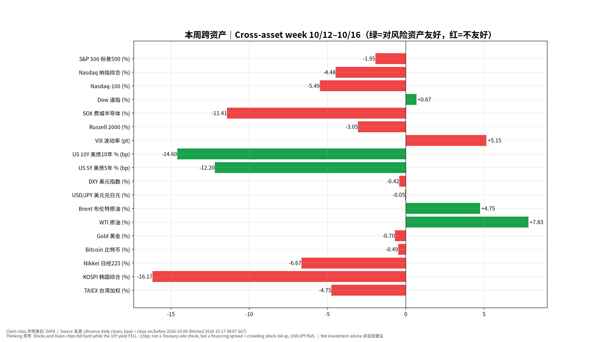
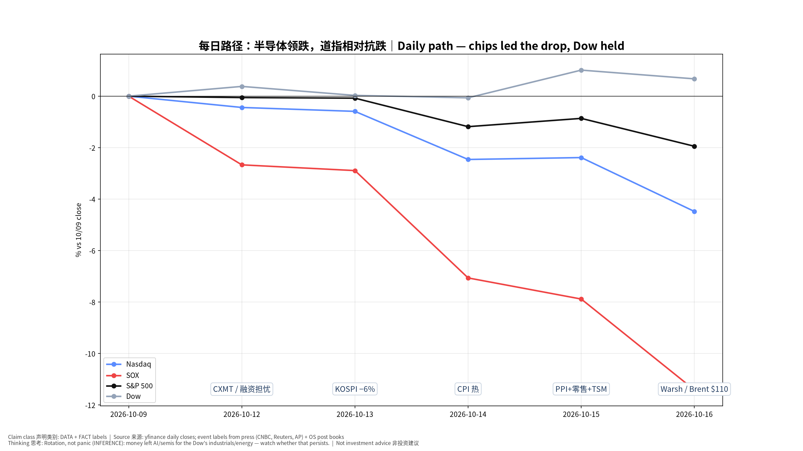
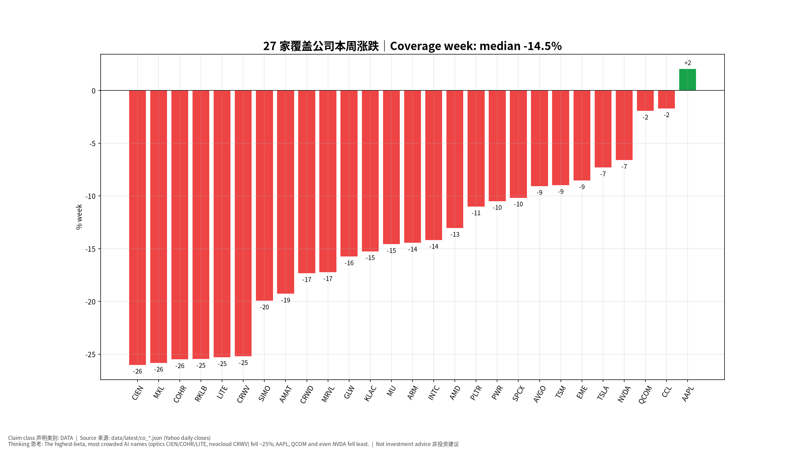
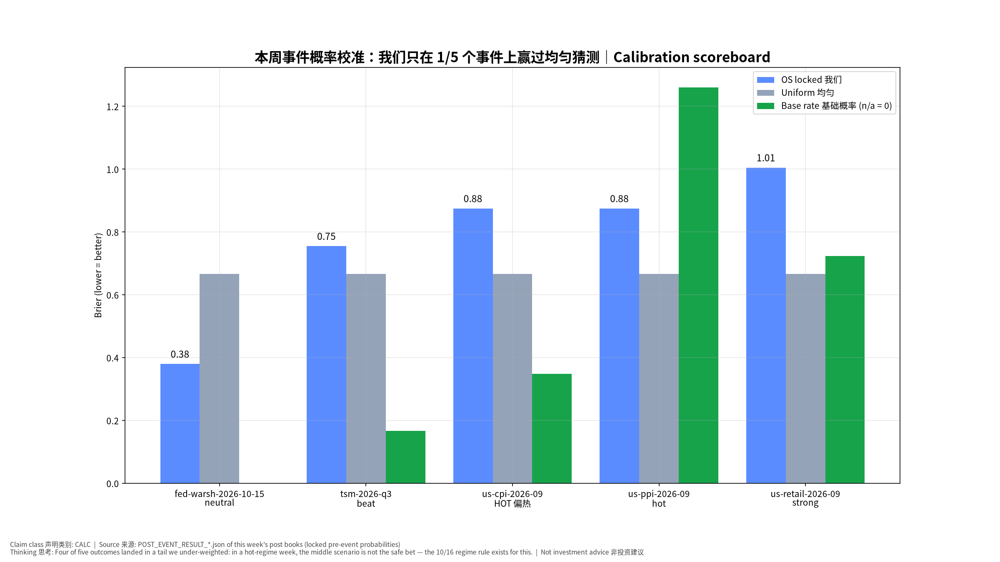
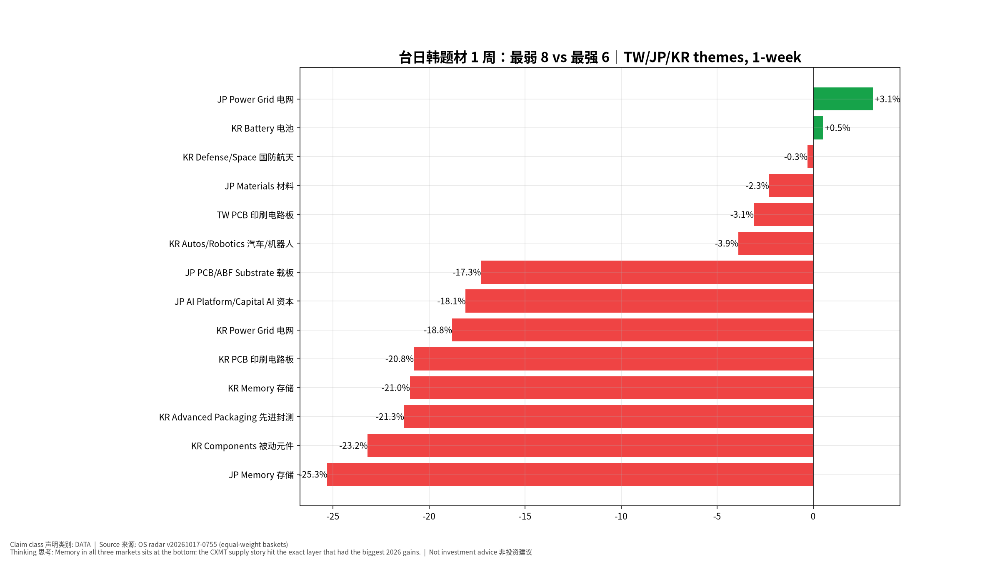
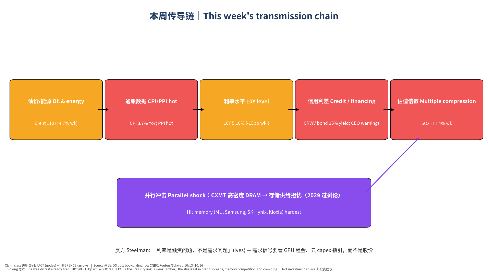

# 周度雷达与复盘｜Weekly Radar & Review — 2026-W42（2026-10-12 – 2026-10-16）

> 版本 v20261017-0807-2026-W42｜生成 2026-10-17 08:07 SGT｜周六例行｜非投资建议 Not investment advice｜数字：yfinance 日收盘（以 2026-10-09 收盘为基准）、本系统事件书、带日期的新闻来源；推断已标注。

**⏱ 30秒看懂**

1. **发生什么：**本周 AI/半导体交易大幅回调：纳指 -4.5%、SOX -11.4%、标普 -1.9%，道指 +0.7%（资金从科技转向工业/能源）。起因是两件事叠加：①长鑫存储 CXMT 的 DRAM 进展引发存储供给担忧；②通胀偏热 + 油价 + 高负债 AI 公司的信用利差扩大（CoreWeave 债券收益率 15%），让市场开始质疑 AI 数据中心「借钱建设」能否持续。注意：10 年期美债本周反而**下降约 15bp**——压力不在国债利率，而在融资利差和拥挤平仓。
2. **和我的股票有什么关系：**我们 27 家覆盖公司中位数 -14.5%；跌最多：CIEN -26%、MXL -26%、COHR -26%（光通信 CIEN/COHR/LITE、新云 CRWV 都约 −25%）；最抗跌：AAPL +2%、CCL -2%、QCOM -2%。台日韩题材里**三地存储全部垫底**。
3. **该看什么/做什么：**下周最重要：SPCX（10/21）、TSLA（10/22）、MXL（10/23）财报（日期待 IR 确认），以及 10/27–28 FOMC 前的数据。本周的方法论教训：**热数据周里，「中间情景」不是安全选项**——5 个事件里 4 个结果落在我们低估的尾部。

**🗺 阅读地图**

| 你有多少时间 | 读哪里 |
|---|---|
| 2 分钟 | ⏱30秒 + 图1 跨资产 + 图4 校准记分牌 |
| 10 分钟 | 加读 §1 发生了什么、§3 覆盖公司、§4 事件复盘汇总 |
| 30 分钟 | 全读，含 §6 传导链与对立观点、§7 模型进化、§9–11 来源/假设/模型来源、自我测验 |

层级说明：**L1 故事**（人人能懂）→ **L2 关键数字**（带解释）→ **L3 专业细节**（网页可折叠，默认收起）。

## 1. 本周发生了什么｜What happened（时间线，事实 FACT）
| 时间 | 事件 | 来源 | 类别 |
|---|---|---|---|
| 10/10–12 周末–周一 | 长鑫存储 CXMT 宣布新架构、更高密度的服务器 DRAM 进展，存储股开始下跌；周一 SOX −2.7%，三星 −10%、SK 海力士 −8%。 | cn13 / reu | FACT |
| 10/12 周一 | 博通 CEO 陈福阳与英特尔 CEO 警告：融资可能成为 AI 扩张的主要阻力（陈称可能比芯片或电力短缺更大）。 | cn15 | FACT |
| 10/13 周二 | KOSPI 盘中跌逾 6%（韩国芯片股连跌第五日），铠侠 −13%；CoreWeave 6 月发行的债券收益率升至 15%（发行时 9.625%）。 | reu | FACT |
| 10/14 周三 | 9 月 CPI 同比 3.7%、环比 0.6%（汽油推动），核心同比 2.6% → 本系统判定「偏热」。 | OS CPI post book | FACT |
| 10/15 周四 | PPI 偏热、零售总额强但控制组弱；台积电营收 \$46.72bn 超指引上沿；截至周四，全球市值最大的 20 只 AI/半导体股本周合计蒸发逾 1 万亿美元（CNBC）。 | OS post books / cn15 | FACT |
| 10/16 周五 SGT | Warsh 在曼谷 IMF 对谈中不预判 10 月 → Kalshi 10 月加息概率约 30%→13–15%，12 月约 76–78% 不变。 | cnw / OS Warsh post book | FACT + MARKET-IMPLIED |
| 10/16 周五 US | 科技股抛售延续：纳指 −2.1%、标普 −1.1%；SOX −3.83%；VIX 升近 21% 至 20 附近；布伦特盘中触及 \$110（5 月来首次，霍尔木兹局势）；CoreWeave 跌近 12%，周跌逾 25%。全周纳指为 6 月下旬以来最差。 | ap / sch / yh | FACT |

来源链接：[Reuters 10/13](https://www.investing.com/news/economy-news/analysisbrutal-session-for-chip-stocks-shows-ai-trade-is-turning-4945597)｜[CNBC 10/13](https://www.cnbc.com/2026/10/13/sk-hynix-softbank-samsung-electronics-shares-tech-stocks-fall.html)｜[CNBC 10/15 AI rout](https://www.cnbc.com/2026/10/15/sk-hynix-samsung-softbank-stocks-asia-tech-rout-ai-funding-worries.html)｜[CNBC 10/15 memory](https://www.cnbc.com/2026/10/15/memory-stocks-micron-sk-hynix-samsung-china.html)｜[Schwab 10/16](https://schwabnetwork.com/articles/closing-bell-ai-selloff-deepens-as-chip-stocks-slide-and-volatility-surges)｜[AP 10/16](https://apnews.com/article/stocks-markets-us-ai-oil-tech-warsh-d2655f64db7ec8ae450525d58f97b628)｜[Yahoo Finance 10/16](https://finance.yahoo.com/markets/live/stock-market-today-dow-sp-500-nasdaq-futures-mixed-amid-volatile-week-112939401.html)｜[CNBC Warsh 10/16](https://www.cnbc.com/2026/10/16/feds-warsh-says-ai-development-path-will-be-very-bumpy-.html)

## 2. 跨资产一周｜Cross-asset week（DATA）
| 资产 | 上周五收盘 | 本周五收盘 | 周变化 |
|---|---|---|---|
| S&P 500 标普500 | 7811.54 | 7659.44 | -1.95% |
| Nasdaq 纳指综合 | 27366.17 | 26140.03 | -4.48% |
| Nasdaq-100 | 30883.15 | 29187.55 | -5.49% |
| Dow 道指 | 51654.95 | 52002.41 | +0.67% |
| SOX 费城半导体 | 12572.42 | 11137.29 | -11.41% |
| Russell 2000 | 2806.98 | 2721.37 | -3.05% |
| VIX 波动率 | 14.84 | 19.99 | +5.15 pt |
| US 10Y 美债10年 % | 5.24 | 5.10 | -14.60 bp |
| US 5Y 美债5年 % | 5.02 | 4.90 | -12.20 bp |
| DXY 美元指数 | 102.21 | 101.78 | -0.42% |
| USD/JPY 美元兑日元 | 158.06 | 157.99 | -0.05% |
| Brent 布伦特原油 | 104.72 | 109.69 | +4.75% |
| WTI 原油 | 91.85 | 99.04 | +7.83% |
| Gold 黄金 | 4216.30 | 4186.70 | -0.70% |
| Bitcoin 比特币 | 82546.32 | 82141.46 | -0.49% |
| Nikkei 日经225 | 69030.92 | 64425.95 | -6.67% |
| KOSPI 韩国综合 | 6625.93 | 5554.22 | -16.17% |
| TAIEX 台湾加权 | 49313.44 | 46969.87 | -4.75% |

**📊 怎么看这张图**

- **坐标/颜色：**每根横条=一个资产的周变化；绿色=对股票等风险资产友好（例如股价涨、波动率/利率降），红色=不友好。
- **只记住一件事：**股票和亚洲芯片大跌，但 10 年期利率反而下降约 15bp（绿）：这不是「国债利率冲击」周，而是「融资利差 + 拥挤平仓」周。
- **什么会改变结论：**如果高收益债/新云债券利差收窄后 AI 股仍继续跌，说明问题在需求或竞争——解释要再改。

**📊 怎么看这张图**

- **坐标/颜色：**横轴=交易日，纵轴=相对上周五收盘的累计涨跌；标注=当天主要事件。
- **只记住一件事：**SOX（红）从周一就领跌，道指（灰）相对抗跌——是板块轮动。
- **什么会改变结论：**若道指也开始大跌，说明从「轮动」升级为「整体去风险」。

## 3. 27 家覆盖公司｜Coverage week（DATA）

**📊 怎么看这张图**

- **坐标/颜色：**每根柱=一家公司本周涨跌，从跌最多到涨最多排列。
- **只记住一件事：**今年涨幅最大、拥挤度最高的 AI 名字（光通信 CIEN/COHR/LITE、新云 CRWV）跌约 25%；AAPL、QCOM 甚至 NVDA 跌得最少。
- **什么会改变结论：**如果下周财报（TSLA 等）带动反弹集中在高负债名字，说明是空头回补而非基本面修复。

L3 专业细节：27 家周度明细表（点击展开）

| Ticker | 上周五 | 本周五 | 周变化 |
|---|---|---|---|
| AAPL | 336.64 | 343.46 | +2.0% |
| CCL | 26.35 | 25.90 | -1.7% |
| QCOM | 175.50 | 172.11 | -1.9% |
| NVDA | 229.28 | 214.13 | -6.6% |
| TSLA | 382.70 | 354.72 | -7.3% |
| EME | 789.03 | 721.66 | -8.5% |
| TSM | 453.31 | 412.61 | -9.0% |
| AVGO | 361.54 | 328.75 | -9.1% |
| SPCX | 162.57 | 146.03 | -10.2% |
| PWR | 705.94 | 631.86 | -10.5% |
| PLTR | 209.05 | 186.03 | -11.0% |
| AMD | 608.10 | 528.75 | -13.0% |
| INTC | 104.70 | 89.85 | -14.2% |
| ARM | 266.28 | 227.80 | -14.5% |
| MU | 1028.84 | 878.84 | -14.6% |
| KLAC | 195.57 | 165.74 | -15.3% |
| GLW | 156.68 | 132.00 | -15.8% |
| MRVL | 275.28 | 227.83 | -17.2% |
| CRWD | 275.04 | 227.39 | -17.3% |
| AMAT | 507.03 | 409.29 | -19.3% |
| SIMO | 263.90 | 211.30 | -19.9% |
| CRWV | 82.08 | 61.39 | -25.2% |
| LITE | 1103.36 | 824.13 | -25.3% |
| RKLB | 68.21 | 50.84 | -25.5% |
| COHR | 312.62 | 232.90 | -25.5% |
| MXL | 96.16 | 71.32 | -25.8% |
| CIEN | 449.77 | 332.73 | -26.0% |

**估值说明：**本周的价格下跌本身不是「重大信息」；公司模型只做机械刷新（价格、市值、隐含增速），**未改动任何公司的情景假设**。唯一有公司层面新信息的是 TSM（财报，见事后书），结论：结构不变。

## 4. 本周事件复盘汇总｜Event post-mortems this week（CALC）
| 事件 | 事后书版本 | 结果（锁定规则） | 我们锁定的概率 | Brier 我们 | Brier 均匀 | Brier 基础概率 |
|---|---|---|---|---|---|---|
| Fed Chair Warsh x IMF Georgieva | v20261017-0801-post | neutral | {"hawkish": 0.3, "neutral": 0.5, "dovish": 0.2} | 0.38 | 0.667 | None |
| TSM Q3 2026 Earnings | v20261016-0802-post | beat | {"beat": 0.3, "inline": 0.45, "miss": 0.25} | 0.755 | 0.667 | 0.167 |
| US CPI Sep 2026 | v20261015-0800-post | HOT 偏热 | 见书内 | 0.875 | 0.667 | 0.349 |
| US PPI Sep 2026 | v20261016-0759-post | hot | {"cool": 0.25, "inline": 0.5, "hot": 0.25} | 0.875 | 0.667 | 1.261 |
| US Retail Sales Sep 2026 | v20261016-0800-post | strong | {"weak": 0.25, "inline": 0.55, "strong": 0.2} | 1.005 | 0.667 | 0.724 |

**📊 怎么看这张图**

- **坐标/颜色：**每组三根柱：蓝=我们事前锁定的概率得分，灰=每个情景平均分配的瞎猜，绿=历史基础概率（没有就为 0/空）。越低越好。
- **只记住一件事：**我们只在 1/5 个事件上赢过瞎猜：在热数据周里，我们总把最多的概率放在「符合预期」的中间情景，而结果频频落在尾部。
- **什么会改变结论：**如果下个月同样的规则（10/16 已上线的「高波动时中间情景封顶 45%」）仍然输给均匀猜测，说明问题不是封顶比例，而是情景边界画得太窄。

**本周共性错误（Error classification）：**
1. **概率校准（Probability Calibration）**：CPI、PPI、零售、TSM 四个事件结果都落在尾部（偏热/偏强/超预期），而我们中间情景给了 45–55%。**已修正**：10/16 上线「状态感知校准」（VIX>20 或 MOVE 高 或最近 3 个宏观事件落在尾部 → 中间情景封顶 45%）。下周起所有事前书生效。
2. **市场反应映射（Market-Reaction）**：TSM「好成绩、股价跌」；Warsh「中性措辞、市场读成偏鸽」。共同点：**价格由板块/路径定价决定，而不是事件本身**。已加入：财报 beat 拆成「顺风 beat / 逆风 beat」两套剧本；央行讲话加「其他官员言论汇总」。
3. **做对的**：Warsh 措辞判断（中性 50% 命中）；TSM 基本面链条（AI 需求、N2 爬坡、指引）全部成立。

## 5. 台日韩题材雷达（1 周）｜Theme radar
| 市场 | 题材 | 1 周 | 1 月 | 状态 |
|---|---|---|---|---|
| JP | Memory 存储 | -25.3% | -25.7% | WEAK 弱 |
| KR | Components 被动元件 | -23.2% | -15.1% | WEAK 弱 |
| KR | Advanced Packaging 先进封测 | -21.3% | -9.1% | WEAK 弱 |
| KR | Memory 存储 | -21.0% | -23.4% | WEAK 弱 |
| KR | PCB 印刷电路板 | -20.8% | -9.6% | WEAK 弱 |
| KR | Power Grid 电网 | -18.8% | -28.6% | WEAK 弱 |
| JP | AI Platform/Capital AI 资本 | -18.1% | -24.3% | WEAK 弱 |
| JP | PCB/ABF Substrate 载板 | -17.3% | -0.0% | WEAK 弱 |
| KR | Autos/Robotics 汽车/机器人 | -3.9% | -18.4% | WEAK 弱 |
| TW | PCB 印刷电路板 | -3.1% | +22.1% | STRONG 强 |
| JP | Materials 材料 | -2.3% | +4.5% | WEAK 弱 |
| KR | Defense/Space 国防航天 | -0.3% | -17.9% | WEAK 弱 |
| KR | Battery 电池 | +0.5% | +11.9% | STRONG 强 |
| JP | Power Grid 电网 | +3.1% | +11.5% | STRONG 强 |

**📊 怎么看这张图**

- **坐标/颜色：**横条=题材篮子（等权）本周涨跌；上方最弱，下方最强。
- **只记住一件事：**三地「存储」都在最弱区——CXMT 消息打在了今年涨幅最大的那一层。
- **什么会改变结论：**如果下周韩国存储反弹而美股 MU 不跟，说明是韩国本地资金流问题，不是全球存储逻辑。

## 6. 本周传导链 + 对立观点｜Transmission chain & steelman

**📊 怎么看这张图**

- **坐标/颜色：**从左到右是因果链，每个方块下有本周的证据数字；紫色是并行冲击（存储供给）。
- **只记住一件事：**本周的证伪检验已经触发：10 年期利率下降（橙色方块）而 SOX 大跌——所以「国债利率」这一环很弱，真正的压力在「信用利差/融资可得性」和存储竞争、拥挤平仓。
- **什么会改变结论：**如果高收益信用利差收窄、而 AI 股仍跌，那么连「融资」这一环也断了，驱动就是需求预期本身。

**ΔPrice 分解（INFERENCE，非精确归因）：**ΔPrice ≈ ΔEPS（本周未见盈利预期下调的证据：TSM 给出全年美元营收增长约 44%）+ ΔMultiple(利率)（10Y 水平仍在 5% 以上，但本周下降约 15bp → 本周贡献小）+ ΔMultiple(AI 叙事 / 信用利差)（新云融资可持续性、存储竞争）+ ΔPositioning（今年 SOX 涨幅大、拥挤）+ ΔLiquidity（日元稳定，套息压力未爆发）。**本周主要是倍数和仓位，不是盈利。**

**我们的观点：**本周是「融资利差 + 拥挤去杠杆 + 存储竞争」驱动的估值回调，AI 需求本身没有出现恶化证据。

**对立观点最强版本：**
1. 这次不一样：融资问题会变成需求问题——如果新云（CRWV 等）借不到钱，它们就买不了 GPU，NVDA/存储的订单会被砍。
2. CXMT 的进展是真实的结构性威胁，存储的超级周期可能提前结束。
3. TSM 超预期股价仍跌，说明市场已经开始「不为好消息买单」——典型的周期顶部特征。

| 证据 | 支持我们 | 支持对立 | 权重 |
|---|---|---|---|
| TSM 营收超指引、全年美元营收增长约 44% | ✔ |  | 高 |
| CRWV 债券收益率 15%、股价周跌逾 25% |  | ✔ | 高 |
| 博通/英特尔 CEO 警告融资阻力 |  | ✔ | 中 |
| Ives：「利率是融资问题，不是需求问题」 | ✔ |  | 低（观点） |
| 道指本周上涨、没有整体恐慌 | ✔ |  | 中 |
| 存储 2029 过剩论仅一篇专栏、未被其他分析师附和（CNBC） | ✔ |  | 中 |

**裁判：**证据仍偏向「估值/仓位回调」，但对立观点第 1 点是本周最该认真对待的：融资→需求的传导一旦出现，我们的结论就会翻转。证伪信号：新云下调 capex、GPU 租金下跌、大型云厂商在财报中放缓 capex 指引。

## 7. 模型进化与观察区｜Model Evolution & Observation Zone（本周）
- 10/14：CPI 同比口径按日期对齐（bug 修复）；Pages 体积治理（ZIP 转 GitHub Release）。
- 10/16：**状态感知校准规则**上线（用户批准）；财报 beat 拆分顺风/逆风。
- 10/17：观察区新增候选「无前瞻指引型主席，会前 ≤2 周、加息概率 20–45% 时的中性措辞 → 概率向暂停衰减」（来自 Warsh 事后书）。
- 待验证候选：「融资成本 → AI capex」传导是否从股价走到订单（看 10 月底云厂商财报）。

## 8. 下周与之后｜Next 2 weeks
| 日期 | 事件 | 状态 |
|---|---|---|
| 2026-10-21 | SPCX earnings + call 财报 | TENTATIVE (Yahoo calendar; confirm on IR) |
| 2026-10-22 | TSLA earnings + call 财报 | TENTATIVE (Yahoo calendar; confirm on IR) |
| 2026-10-23 | MXL earnings + call 财报 | TENTATIVE (Yahoo calendar; confirm on IR) |
| 2026-10-27 | GLW earnings + call 财报 | TENTATIVE (Yahoo calendar; confirm on IR) |
| 2026-10-27/28 | FOMC decision + Chair Warsh press conference｜FOMC 利率决议 | CONFIRMED (federalreserve.gov) |
| 2026-10-29 | EME earnings + call 财报 | TENTATIVE (Yahoo calendar; confirm on IR) |
| 2026-10-29 | KLAC earnings + call 财报 | TENTATIVE (Yahoo calendar; confirm on IR) |
| 2026-10-29 | PWR earnings + call 财报 | TENTATIVE (Yahoo calendar; confirm on IR) |
| 2026-10-29 | SIMO earnings + call 财报 | TENTATIVE (Yahoo calendar; confirm on IR) |
| 2026-10-29 | US GDP Q3 advance + Sep PCE | TENTATIVE (verify bea.gov) |
| 2026-10-29/30 | BOJ MPM + Outlook Report｜日本央行会议 | CONFIRMED (boj.or.jp) |
| 2026-10-30 | INTC earnings + call 财报 | TENTATIVE (Yahoo calendar; confirm on IR) |

每个重要事件都会走完整生命周期：事前书（锁定）→ 即时观察 → 事后复盘 → 模型更新。

## 9. 来源台账｜Source Ledger
| 内容 | 来源 | 类别 | 时间 |
|---|---|---|---|
| 指数/利率/汇率/商品/亚洲指数 | yfinance 日收盘 | DATA | 2026-10-17 08:07 SGT |
| 27 家公司价格 | data/latest/co_*.json（Yahoo） | DATA | 2026-10-17 08:07 SGT |
| 事件结果与 Brier | 本周事后书 POST_EVENT_RESULT_*.json | CALC | 各书生成时间 |
| 题材 1 周 | 雷达 v20261017-0755 | DATA | v20261017-0755 |
| 新闻时间线 | Reuters / CNBC / Schwab / AP / Yahoo（见 §1 链接） | FACT（报道） | 2026-10-13 至 10-16 |
| 下周财报日期 | Yahoo 日历 | TENTATIVE | 2026-10-17 08:07 SGT |

## 10. 假设登记｜Assumption Register
| # | 假设 | 类型 | 如何检验 / 失效 |
|---|---|---|---|
| 1 | 本周下跌主要是倍数/仓位而非盈利 | INFERENCE | 若下周起分析师大幅下调 FY27 EPS 则失效 |
| 2 | 压力主要在信用利差/融资可得性，而非国债利率（本周 10Y −15bp 已否定国债利率链） | INFERENCE | 若高收益信用利差收窄而 AI 股仍跌则失效 |
| 3 | 存储下跌主要因 CXMT 与过剩论 | INFERENCE | 若 DRAM 合约价出现下调报道则升级为基本面 |
| 4 | 题材篮子等权、成分少（1–4 只）代表性有限 | ASSUMPTION | 扩充成分 |
| 5 | 下周财报日期（Yahoo） | TENTATIVE | 以公司 IR 公告为准 |

## 11. 模型来源｜Model Provenance
构建脚本 `pipeline/build_weekly.py`（周六例行）；数据见来源台账；Excel 含实时公式（周变化、Brier 汇总、胜率）；不改写任何事前预测——事件概率直接读取各事后书锁定值。

**✅ 自我测验 Check your understanding**

Q1. TSM 财报超预期，为什么本周还是跌？

**答案：**本周定价的主角是整个 AI 板块的估值倍数（利率、融资、拥挤），单一公司的好成绩抵不过板块的倍数收缩。

Q2. 本周 10 年期利率下降了约 15bp，为什么 AI 股还大跌？

**答案：**说明压估值的不是「无风险利率上升」，而是①借钱最多的 AI 公司信用利差扩大（CRWV 债券收益率 15%）、②CXMT 带来的存储竞争担忧、③今年涨幅巨大后的拥挤平仓。这就是用证伪条件检验因果链：我们事先说「利率降而 AI 仍跌 → 利率链失效」，这周正好发生了。

Q3. 我们本周的概率校准为什么差？

**答案：**我们把最多概率放在中间情景，而高波动、热数据的环境里结果更常落在尾部；所以 10/16 加了中间情景封顶 45% 的规则。

**✍ 本周作业**：打开 Excel「Coverage」表，按周跌幅排序，找出跌幅最大的 5 家，查它们的资产负债率（Company 页）——验证「越依赖融资，跌越多」这个假设是否成立。

## Final Self-Challenge
我们把本周解释为「融资利差 + 拥挤 + 存储竞争」，因为盈利预期没下调。但盈利下调总是滞后于股价——如果 10 月底云厂商财报下调 capex，那本周的下跌就是**提前反映需求**，而我们的「估值回调」解释就错了。下周起把「云厂商 capex 指引」放在观察清单第一位。

- 构建日志：week 2026-10-12→2026-10-16 (base = close on/before 2026-10-09); ^GSPC -1.95, ^IXIC -4.48, ^NDX -5.49, ^DJI +0.67, ^SOX -11.41, ^RUT -3.05, ^VIX +5.15, ^TNX -14.60, ^FVX -12.20, DX-Y.NYB -0.42, JPY=X -0.05, BZ=F +4.75, CL=F +7.83, GC=F -0.70, BTC-USD -0.49, ^N225 -6.67, ^KS11 -16.17, ^TWII -4.75
- 构建日志：27-stock week: median -14.5%, worst ('CIEN', -26.022189118882977), best ('AAPL', 2.0259030418250834)
- 构建日志：calibration events: fed-warsh-2026-10-15 neutral OS 0.38 uni 0.6666666666666667; tsm-2026-q3 beat OS 0.7549999999999999 uni 0.6666666666666667; us-cpi-2026-09 HOT 偏热 OS 0.875 uni 0.667; us-ppi-2026-09 hot OS 0.875 uni 0.6666666666666667; us-retail-2026-09 strong OS 1.0050000000000001 uni 0.6666666666666667
- 构建日志：Excel recalc: coverage median=-14.4509538831305; wins=1; errors=none
